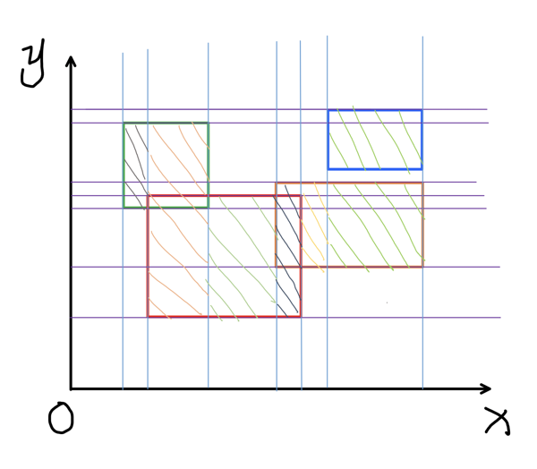

# Scanning Line

The scanline method consists of sorting points on a coordinate line or some abstract "events" by some criterion, followed by a pass through them.

It is often used to solve data structure problems when all queries are known in advance, as well as in geometry for finding union areas of shapes.

### Point Covered by the Maximum Number of Segments

**Task.** Given a set of \\(n\\) segments on a line, defined by the coordinates of their endpoints \\(\[l\_i, r\_i\]\\).
Find any point on the line covered by the maximum number of segments.

Consider the function \\(f(x)\\), equal to the number of segments covering point \\(x\\).
Obviously, we cannot check every point of this function.

Let us call *interesting* those points where the number of covering segments changes.
Since the answer can only change at an interesting point, the maximum is also reached at one of the interesting points.
From this follows an \\(O(n^2)\\) solution: simply enumerate all interesting points (which will be the endpoints of the given segments)
and check the answer for each one.

This solution can be improved. Sort the interesting points by increasing coordinate and walk through them from left to right,
maintaining the count of segments `cnt` that cover the current point.
If a segment starts at the current point, increment `cnt` by one; if it ends, decrement it.
Then try to update the answer with the current value of `cnt`.

To implement this, represent the interesting points as structures with fields "coordinate" and "type" (start / end)
and sort them using a custom comparator.
It is convenient to denote the start of a segment as +1 and the end as -1, so we can simply add this value to `cnt` without branching.

One nuance — if the coordinates of two points coincide, to get the correct answer,
we must consider all segment starts first,
and only then the ends (so that when updating the answer at this coordinate, both right and left boundary segments are counted).

```dotty
final case class Event(x: Int, delta: Int)

def scanline(segments: List[(Int, Int)]): (Int, Int) =
  val events: List[Event] =
    segments.flatMap { (l, r) => List(Event(l, 1), Event(r, -1)) }

  // at equal coordinates, starts (+1) come before ends (-1)
  val sorted = events.sortBy(e => (e.x, -e.delta))

  sorted.foldLeft((0, (0, 0))) { case ((count, (maxPoint, maxCount)), e) =>
    val newCnt = count + e.delta
    (
      newCnt,
      if newCnt > maxCount then (e.x, newCnt) else (maxPoint, maxCount)
    )
  }._2
```

**How it works.** For segments `List((1, 4), (2, 5), (4, 6))`, the events are:

```
(1, +1) (4, -1)  (2, +1) (5, -1)  (4, +1) (6, -1)
```

After sorting by coordinate (and at equal coordinates — `+1` first, then `-1`), we walk through them from left to right,
accumulating the current number of covering segments `cnt`:

| coordinate | event | `cnt` | maximum |
| ---------: | ----- | ----: | ------: |
|          1 |    +1 |     1 |       1 |
|          2 |    +1 |     2 |       2 |
|          4 |    +1 |     3 |       3 |
|          4 |    −1 |     2 |       3 |
|          5 |    −1 |     1 |       3 |
|          6 |    −1 |     0 |       3 |

The maximum `3` is reached at any point within the segment `[4, 4]`.

```dotty
scanline(List((1, 4), (2, 5), (4, 6))) // (4,3)
```

This solution runs in \\(O(n \log n)\\) for sorting. If the coordinates are small,
the logarithm can be avoided by creating an events array for each distinct coordinate
and simply iterating over all integer coordinates and their events.
Additionally, it is always a good idea to [compress coordinates](../geometry.md).

Now let us consider several related problems.

### Union Length of Segments

**Task.** Given a set of \\(n\\) segments on a line, defined by the coordinates of their endpoints \\(\[l\_i, r\_i\]\\).
Find the total length of their union.

As in the previous problem, sort all interesting points and during the pass maintain the number of segments covering the current point.
If this number is greater than 0, the segment we traversed from the last interesting point belongs to the union, and its length should be added to the answer:

```dotty
def unionLength(segments: List[(Int, Int)]): Int =
  val events: List[Event] =
    segments
      .flatMap { (l, r) => List(Event(l, 1), Event(r, -1)) }
      .sortBy(e => (e.x, -e.delta))

  @tailrec
  def loop(cnt: Int, res: Int, prev: Int, events: List[Event]): Int =
    events match
      case Nil                   => res
      case Event(x, delta) :: xs =>
        val newRes =
          if cnt > 0 then res + x - prev else res

        loop(cnt + delta, newRes, x, xs)

  events match
    case Nil                   => 0
    case Event(x, delta) :: xs =>
      loop(delta, 0, x, xs)
```

**How it works.** For segments `List((1, 4), (2, 5), (7, 9))`, the events after sorting are the same.
`prev` stores the coordinate of the previously processed event, and `cnt` — the number of coverages on the band `[prev, e.x]`.
If `cnt > 0`, this band belongs to the union, and its length `e.x - prev` is added to the answer:

| event | `cnt` before | band | added |
| -----: | ----------: | ---: | ----: |
| (1, +1) |           0 |    — |     0 |
| (2, +1) |           1 | {1,2} |     1 |
| (4, −1) |           2 | {2,4} |     2 |
| (5, −1) |           1 | {4,5} |     1 |
| (7, +1) |           0 |    — |     0 |
| (9, −1) |           1 | {7,9} |     2 |

The total `1 + 2 + 1 + 2 = 6` is the total union length of `[1, 5] ∪ [7, 9]`.

```dotty
unionLength(List((1, 4), (2, 5), (7, 9))) // 6
```

Runtime: \\(O(n \log n)\\).

### How Many Segments Cover a Point

Now let us say we need to answer, for \\(q\\) points (not necessarily segment endpoints): how many segments cover each given point?

Use the following technique: collect all queries upfront and store them to answer later.
Add query points as events of a new type `0`, which means "answer a query at this point", along with a separate field for the query index.

Now similarly sort the interesting points and walk through them from left to right, maintaining `cnt` and answering queries as we encounter them.

```dotty
def scanline(segments: List[(Int, Int)], queries: List[Int]): Map[Int, Int] =
  case class Event(x: Int, delta: Int, idx: Int)

  val events =
    segments.flatMap { (l, r) => List(Event(l, 1, -1), Event(r, -1, -1)) } ++
      queries.zipWithIndex.map { (q, i) => Event(q, 0, i) }

  // at equal coordinates: additions (+1) first,
  // then queries (0), then deletions (-1)
  val sorted = events.sortBy(e => (e.x, -e.delta))

  sorted.foldLeft((0, Map.empty[Int, Int])) {
    case ((cnt, res), e) =>
      (
        cnt + e.delta,
        if e.delta == 0 then res.updated(e.x, cnt) else res
      )
  }._2
```

**How it works.** For segments `List((1, 4), (2, 5))` and queries `List(3, 0, 5)`, events have types:
`+1` for segment start, `−1` for segment end, and `0` for a query point.
At equal coordinates, the order is: first `+1`, then `0` (query), then `−1`. Walk through the sorted events:

| coordinate | type | `cnt` | query?             |
| ---------: | ---: | ----: | ------------------ |
|          0 |    0 |     0 | yes → `0 -> 0`     |
|          1 |   +1 |     1 | no                 |
|          2 |   +1 |     2 | no                 |
|          3 |    0 |     2 | yes → `3 -> 2`     |
|          4 |   −1 |     1 | no                 |
|          5 |    0 |     1 | yes → `5 -> 1`     |
|          5 |   −1 |     0 | no                 |

Point `3` is covered by both segments (`2`), point `0` — by none (`0`), point `5` — by segment `[2, 5]` only (`1`, since `[1, 4]` has already ended).

```dotty
scanline(List((1, 4), (2, 5)), List(3, 0, 5)) 
// Map(0 -> 0, 3 -> 2, 5 -> 1)
```

Complexity: \\(O((n+q)\log(n+q))\\).

### Number of Intersecting Segments

**Task.** Given a set of \\(n\\) segments on a line, defined by the coordinates of their endpoints \\(\[l\_i, r\_i\]\\).
For each segment, determine how many other segments it intersects with
(in particular, it may share a single point or be contained within another).

Instead of counting, for each segment, the number of segments it intersects with,
let us count the number of segments with which it *does not* intersect and subtract this from \\((n-1)\\).

A segment \\(\[l\_1, r\_1\]\\) does not intersect another segment \\(\[l\_2, r\_2\]\\)
only if \\(r\_2 < l\_1\\) or \\(r\_1 < l\_2\\).
Count the number of segments for each of these cases.
Without loss of generality, consider the first case, i.e., find for each segment the number of segments lying strictly to its left.
To do this, introduce two types of events:

1. Some segment ends at coordinate \\(r\_i\\).
2. Some segment with a given index starts at coordinate \\(l\_j\\).

Now it is enough to walk through these events from left to right, maintaining a count of events of the first type encountered
and subtracting it from the answer cell for events of the second type.

Similarly, walk from right to left, finding segments lying strictly to the right. The total runtime will be \\(O(n \log n)\\) for sorting.

**Code.** Count, for each segment, the number of segments intersecting it (using the "subtract non-intersecting from \\(n-1\\)" principle).
Decompose "does not intersect" into two mutually exclusive cases: a foreign segment ended strictly before the current one starts (\\(r\_j < l\_i\\)),
or a foreign segment started strictly after the current one ends (\\(l\_j > r\_i\\)).
The first is computed in one left-to-right pass (events "start" and "end"), the second — in a mirrored right-to-left pass:

```dotty
def countIntersections(segments: List[(Int, Int)]): List[Int] =
  val n = segments.length
  // events: (coordinate, type, index); type: 0 = start, 1 = end
  val events: List[(Int, Int, Int)] =
    segments.zipWithIndex.flatMap { case ((l, r), i) =>
      List((l, 0, i), (r, 1, i))
    }
      .sortBy(e => (e._1, e._2, e._3))

  // left to right: how many segments ended strictly before the current start
  val ans = events.foldLeft((0, Map.empty[Int, Int])) {
    case ((finished, ans), (x, t, i)) =>
      if t == 1 then (finished + 1, ans)
      else (finished, ans.updated(i, n - 1 - finished))
  }._2

  // right to left: how many segments started strictly after the current end
  events.foldRight((0, ans)) {
    case ((x, t, i), (started, ans)) =>
      if t == 0 then (started + 1, ans)
      else (started, ans.updated(i, ans.getOrElse(i, n - 1) - started))
  }._2.values.toList
```

Consider the sorting: at the same coordinate, start (type `0`) comes before end (type `1`).
This is important because "does not intersect" is strict — segments whose end coincides with the current start (\\(r\_j = l\_i\\))
are considered intersecting, and their end is processed *after* the current start, so it does not land in `finished`.
The reverse pass is similarly structured.

```dotty
countIntersections(List((1, 4), (4, 6), (2, 3)))
// (1,4) intersects with both; (2,3) intersects only with (1,4);
// (4,6) intersects only with (1,4) (does not intersect with (2,3), since 3 < 4)
// List(2, 1, 1)
```

### Sum on a Rectangle

Let us move to a two-dimensional scanline.

**Task.** Given \\(n\\) points on a plane. Answer \\(m\\) queries about the number of points on a rectangle.

First, compress all coordinates (of points and queries): we will assume they are all on the order of \\(O(n + m)\\).

Now split each query into two prefix-sum queries:
the sum on rectangle \\(\[x\_1, x\_2\] \times \[y\_1, y\_2\]\\) equals the sum
on rectangle \\(\[0, x\_2\] \times \[y\_1, y\_2\]\\) minus the sum on rectangle \\(\[0, x\_1\] \times \[y\_1, y\_2\]\\).

Create a segment tree for sums and an `ans` array for query answers.
Now walk in order of increasing all interesting \\(x\\) — the coordinates of points
and the right boundaries of prefix queries — and handle events of three types:

1. If we encounter a point, add one to the cell \\(y\\) in the segment tree.
2. If we encounter a "left" prefix-sum query, compute via the segment tree the sum on interval \\(\[y\_1, y\_2\]\\) and *subtract* it from the answer cell.
3. If we encounter a "right" query, similarly *add* the sum on \\(\[y\_1, y\_2\]\\) to the answer cell.

Thus, we solve the problem offline in \\(O(n \log n)\\): coordinate compression / sorting plus \\(O(n)\\)
segment tree queries (or any other structure for dynamic sum).

The sum on a rectangle as a subproblem is also often used in problems about inversions in permutations and subtree queries.

### Area of Union of Rectangles

**Task.** Given \\(n\\) rectangles, find the area of their union.

We can create two types of events:

1. A rectangle with \\(y\\)-coordinates from \\(y\_1\\) to \\(y\_2\\) starts at point \\(x\_1\\);
2. A rectangle with \\(y\\)-coordinates from \\(y\_1\\) to \\(y\_2\\) ends at point \\(x\_2\\);

and then walk through these events in order of increasing \\(x\\)
and compute the total area, similar to how we did it with one-dimensional segments.



If we generalize the approach directly, we would create an array of size \\(Y\\) (the maximum \\(y\\)-coordinate)
and maintain for each \\(y\\)-parallel the number of rectangles covering it, and each time the \\(x\\)-coordinate of an event changes,
add to the answer the difference of the \\(x\\)-coordinates of the old and new events,
multiplied by the number of non-zero elements in the array
(points on the vertical scanning line covered by at least one rectangle).

But in the worst case this runs in \\(O(nY)\\), which is too slow.
To achieve a better asymptotic, replace the array with a segment tree
whose nodes store the minimum and the count of elements with that minimum (initially the minimum is `0` and there are \\(Y\\) such elements across the whole array).

To update the answer, multiply the difference of \\(x\\)-coordinates of adjacent events by the number of non-zero elements,
which can be found by subtracting the count of zero-minimums across the whole tree from \\(Y\\).

This algorithm runs in \\(O(n \log n)\\) with careful coordinate compression, and in \\(O(n \log Y)\\) without it.
This method also generalizes to finding areas of other geometric shapes.

---

**Links:**

- [Source code][sample]
- [Algorithmica — Scanning Line](https://ru.algorithmica.org/cs/decomposition/scanline/)

[sample]: https://gitverse.ru/scalabook/algorithms
