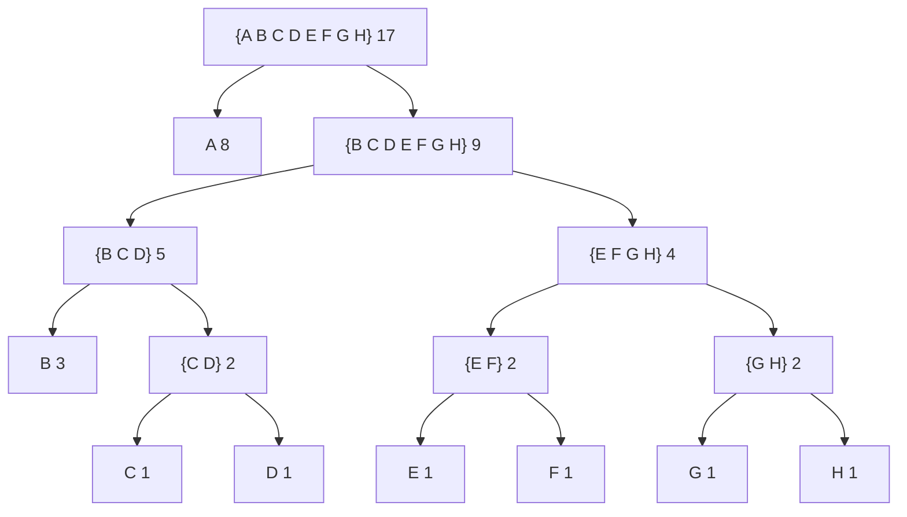

# Huffman Coding Trees

The standard ASCII code, which is used to represent text in computers,
encodes each character as a sequence of seven bits.
Seven bits allow us to represent \\(2^7\\), that is, 128 different characters.
In general, if we need to distinguish n characters, we need \\(log\_{2}(n)\\) bits per character.

Codes like ASCII are known as _fixed-length codes_,
since they represent each character of a message using the same number of bits.
Sometimes it is useful to also use _variable-length_ codes,
in which different characters can be represented by a different number of bits.
For example, Morse code does not use the same number of dots and dashes for all letters of the alphabet.
In particular, E, the most frequent (in English) letter, is represented by a single dot.
In general, if our messages are such that some characters occur very frequently,
and others very rarely, then we can encode our data more efficiently (i.e. with fewer bits per message),
if we assign shorter codes to more frequent characters.

One of the challenges of working with a variable-length code is knowing when,
upon reading a sequence of ones and zeros, we have reached the end of a character.
In Morse code, this problem is solved using a special _separator code_
(after the sequence of dots and dashes for each letter there is a pause).
Another solution is to construct a coding system so that
no complete character code matches the beginning (or _prefix_) of any other character's code.
Such a code is called a _prefix_ code.
For example, if A is encoded as 0, and B as 100, then no other character can have a code that starts with 0 or 100.

In general, substantial savings can be achieved by using variable-length codes
that use the relative frequencies of characters in the messages to be encoded.
One such encoding scheme is called Huffman coding, named after its inventor, David Huffman.
A Huffman code can be represented as a binary tree, with the encodable symbols on the leaves.
Each non-terminal node contains a set of symbols from the leaves under that node.
Additionally, each symbol on a leaf of the tree is assigned a weight (representing the relative frequency),
and each non-terminal node has a weight equal to the sum of the weights of the leaves under it.
Weights are not used in the encoding and decoding process.
Below we will see how they prove useful in building the tree.

The figure depicts a Huffman tree for codes A through H.
The weights at the tree nodes indicate that the tree was built for messages
where A occurs with relative frequency 8, B with relative frequency 3,
and all other letters with relative frequency 1.



With a Huffman tree, we can find the code for any symbol by starting at the root and moving down
until we reach a terminal vertex containing that symbol.
Each time we go down the left branch, we add 0 to the code, and going down the right branch, we add 1.
(We decide which branch to follow by checking whether one of the branches is a terminal vertex,
and whether the set at the vertex contains the symbol we are looking for.)
For example, starting from the root in the figure above, we reach the terminal vertex D by turning right, then left,
then right, and finally right again; therefore, the code for D is 1011.

To decode a bit sequence using a Huffman tree,
we start at the root and read the bits in the sequence one by one,
to decide whether we need to go down the left or right branch.
Each time we reach a leaf vertex, we produce a new message character and
return to the top of the tree to find the next character.
For example, suppose we are given the tree in the figure and the sequence 10001010.
Starting from the root, we go down the right branch (since the first bit in the string is 1),
then the left (since the second bit is 0), then the left again (since the third bit is also 0).
Here we reach a leaf corresponding to B, so the first character of the decoded message is B.
We start again from the root and go left, since the next bit in the string is 0.
Here we reach a leaf representing the character A.
We start again from the root with the remaining string 1010, go right, left, right, left, and arrive at C.
Thus, the entire message was BAC.

## Generating Huffman Trees

If we are given an "alphabet" of characters and their relative frequencies, how can we generate the "best" code?
(In other words, which tree will encode messages using the fewest number of bits?)
Huffman gave an algorithm for solving this problem and showed that the code produced by this algorithm is
indeed the best variable-length code for messages
in which the relative frequency of characters corresponds to the frequencies for which the code was built.

The algorithm for generating a Huffman tree is quite simple.
The idea is to order the tree so that the least frequent characters end up farthest from the root.
We start with the set of terminal vertices containing the characters and their frequencies,
as specified in the source data from which we need to build the tree.
Now we find the two leaves with the smallest weights and merge them, creating a vertex
in which the previous two are the left and right children.
The weight of the new vertex equals the sum of the weights of its branches.
We remove the two leaves from the original set and replace them with the new vertex. We continue this process.
At each step, we merge the two vertices with the lowest weights, removing them from the set
and replacing them with a vertex for which they are the left and right branches.
This process ends when only one vertex remains, which becomes the root of the entire tree.
Here is how the Huffman tree in the figure was generated:

- Initial set of leaves: `{(A 8) (B 3) (C 1) (D 1) (E 1) (F 1) (G 1) (H 1)}`
- Merge: `{(A 8) (B 3) ({C D} 2) (E 1) (F 1) (G 1) (H 1)}`
- Merge: `{(A 8) (B 3) ({C D} 2) ({E F} 2) (G 1) (H 1)}`
- Merge: `{(A 8) (B 3) ({C D} 2) ({E F} 2) ({G H} 2)}`
- Merge: `{(A 8) (B 3) ({C D} 2) ({E F G H} 4)}`
- Merge: `{(A 8) ({B C D} 5) ({E F G H} 4)}`
- Merge: `{(A 8) ({B C D E F G H} 9)}`
- Final merge `{({A B C D E F G H} 17)}`

The algorithm does not always lead to a single possible tree,
since at each step the selection of vertices with the smallest weight may not be unique.
The choice of order in which the two vertices are merged (i.e.,
which one is left and which is the right subtree) is also arbitrary.

## Representing Huffman Trees

The leaves of the tree are represented as a structure consisting of a character contained in the leaf and a weight.
A tree in general will be a list of a left branch, a right branch, a set of symbols, and a weight.
Here is how a Huffman tree can be represented:

```dotty
sealed trait HuffmanTree:
  def symbols: Vector[Char]
  def weight: Int

case class HuffmanLeaf(symbol: Char, weight: Int) extends HuffmanTree:
  val symbols = Vector(symbol)
case class HuffmanBranch(
    symbols: Vector[Char],
    weight: Int,
    left: HuffmanTree,
    right: HuffmanTree
) extends HuffmanTree
```

When we generate a tree by merging two vertices, we obtain the tree's weight as the sum of the weights of those vertices,
and the set of symbols as the union of their symbol sets.

```dotty
object HuffmanTree:
  def makeCodeTree(left: HuffmanTree, right: HuffmanTree) =
    HuffmanBranch(
      symbols = left.symbols ++ right.symbols,
      weight = left.weight + right.weight,
      left = left,
      right = right
    )
```

## Decoding Procedure

The following procedure implements the decoding algorithm.
As arguments it takes a list of ones and zeros, as well as a Huffman tree.

```dotty
object HuffmanTree:
  enum Bit:
    case Zero, One

  def decode(bits: List[Bit], tree: HuffmanBranch): Vector[Char] =
    def decodeLoop(
        bits: List[Bit],
        currentBranch: HuffmanTree,
        message: Vector[Char]
    ): Vector[Char] =
      (bits, currentBranch) match
        case (_, HuffmanLeaf(symbol, _)) =>
          decodeLoop(bits, tree, message :+ symbol)
        case (Nil, _) => message
        case (Bit.Zero :: tail, HuffmanBranch(_, _, left, _)) =>
          decodeLoop(tail, left, message)
        case (Bit.One :: tail, HuffmanBranch(_, _, _, right)) =>
          decodeLoop(tail, right, message)

    decodeLoop(bits, tree, Vector.empty)
  end decode
```

The `decodeLoop` procedure takes two arguments: the list of remaining bits and the current position in the tree.
It moves "down" the tree, choosing the left or right branch depending on whether
the next bit in the list is zero or one.
When the procedure reaches a leaf, it returns the character from it as the next character of the message,
appending it to the result of decoding the remainder of the message, starting from the root of the tree.

Usage example:

```dotty
val tree =
  HuffmanTree.makeCodeTree(
    HuffmanLeaf('A', 4),
    HuffmanTree.makeCodeTree(
      HuffmanLeaf('B', 2),
      HuffmanTree.makeCodeTree(HuffmanLeaf('D', 1), HuffmanLeaf('C', 1))
    )
  )
val bits = List(
  Bit.Zero,
  Bit.One,
  Bit.One,
  Bit.Zero,
  Bit.Zero,
  Bit.One,
  Bit.Zero,
  Bit.One,
  Bit.Zero,
  Bit.One,
  Bit.One,
  Bit.One,
  Bit.Zero
)

val decoded = HuffmanTree.decode(bits, tree)
// Vector('A', 'D', 'A', 'B', 'B', 'C', 'A')
```

## Weighted Element Sets

In our representation of trees, each non-terminal node contains a set of symbols.
However, the tree generation algorithm discussed above requires
that we also work with sets of leaves and trees, sequentially merging the two smallest elements.
Since we will need to find the smallest element of the set over and over again,
it is convenient to use an ordered representation for such a set.

We will represent a set of leaves and trees as a list of elements
ordered by weight in ascending order.
In the following procedure `adjoinSet`, to construct sets, elements are compared by their weights.
It is assumed that the element being added is not already present in the set.

```dotty
def adjoinSet(
    tree: HuffmanTree,
    trees: List[HuffmanTree]
): List[HuffmanTree] =
  trees match
    case Nil =>
      List(tree)
    case head :: tail if tree.weight < head.weight =>
      tree :: head :: tail
    case head :: tail =>
      head :: adjoinSet(tree, tail)
```

The following procedure takes a list of symbol-frequency pairs, e.g. `((A 4) (B 2) (C 1) (D 1))`,
and generates the initial ordered set of leaves, ready for merging by the Huffman algorithm:

```dotty
def makeLeafSet(pairs: List[(Char, Int)]): List[HuffmanTree] =
  pairs match
    case Nil => List.empty
    case (symbol, weigth) :: tail =>
      val leaf = HuffmanLeaf(symbol, weigth)
      adjoinSet(leaf, makeLeafSet(tail))
```

## Encoding a Message

The `encode` procedure takes a message and a tree as arguments,
and produces a list of bits representing the encoded message.
`encodeSymbol` is a procedure that returns the list of bits that encode the given symbol according to the given tree.
It reports an error if the symbol is not present in the tree.

The algorithm of the `encode` method:

1. If the message is empty, an empty list of bits is returned.
2. If the message is not empty, the `encodeSymbol` method is called for the first character of the message and the tree.
3. The result of the `encodeSymbol` call is appended to the result of the `encode` call for the rest of the message.
4. If `encodeSymbol` returns a list of bits, the `encode` method returns the list of bits obtained by combining the lists of bits from `encodeSymbol` and `encode` for the rest of the message.
5. Otherwise, an error is returned.

The algorithm of the `encodeSymbol` method:

1. If the tree is a leaf and the symbol in it matches the sought symbol, an empty list of bits is returned.
2. If the tree is a branch and the sought symbol is in the left part of the tree, `encodeSymbol` is called recursively for the left part of the tree, and a `0` bit is appended to the result.
3. If the tree is a branch and the sought symbol is in the right part of the tree, `encodeSymbol` is called recursively for the right part of the tree, and a `1` bit is appended to the result.
4. If the sought symbol is not found in the tree, the method returns an error.

```dotty
def encode(
    message: List[Char],
    tree: HuffmanTree
): Either[String, List[Bit]] =
  message match
    case Nil => Right(List.empty)
    case head :: tail =>
      for
        encodedHead <- encodeSymbol(head, tree)
        encodedTail <- encode(tail, tree)
      yield encodedHead ++ encodedTail

def encodeSymbol(symbol: Char, tree: HuffmanTree): Either[String, List[Bit]] =
  tree match
    case leaf: HuffmanLeaf if leaf.symbol == symbol => Right(List.empty)
    case HuffmanBranch(_, _, left, _) if left.symbols.contains(symbol) =>
      encodeSymbol(symbol, left).map: bits =>
        Bit.Zero :: bits
    case HuffmanBranch(_, _, _, right) if right.symbols.contains(symbol) =>
      encodeSymbol(symbol, right).map: bits =>
        Bit.One :: bits
    case _ => Left(s"Symbol $symbol not found in tree")
```

Example of an encoded message:

```dotty
val tree =
  HuffmanTree.makeCodeTree(
    HuffmanLeaf('A', 4),
    HuffmanTree.makeCodeTree(
      HuffmanLeaf('B', 2),
      HuffmanTree.makeCodeTree(HuffmanLeaf('D', 1), HuffmanLeaf('C', 1))
    )
  )
val message = List('A', 'D', 'A', 'B', 'B', 'C', 'A')
val encoded = HuffmanTree.encode(message, tree)
// Right(List(Bit.Zero, Bit.One, Bit.One, Bit.Zero, Bit.Zero, Bit.One, Bit.Zero, 
//   Bit.One, Bit.Zero, Bit.One, Bit.One, Bit.One, Bit.Zero))
```

## Building a Huffman Coding Tree

The following procedure takes a list of symbol-frequency pairs
(where no symbol appears in more than one pair) as an argument and generates a Huffman coding tree
according to the Huffman algorithm.

The algorithm of the `successiveMerge` method:

1. Sort the list of trees by weight in ascending order.
2. If the list of trees is empty, return `None`.
3. If the list of trees contains only one tree, return it.
4. If the list of trees contains more than one tree, extract the two trees with the smallest weight,
   merge them into a new tree, and add it to the list of trees.
5. Repeat steps 1–4 until only one tree remains in the list.

```dotty
def generateHuffmanTree(pairs: List[(Char, Int)]): Option[HuffmanTree] =
  successiveMerge(makeLeafSet(pairs))

def successiveMerge(trees: List[HuffmanTree]): Option[HuffmanTree] =
  trees match
    case Nil         => None
    case head :: Nil => Some(head)
    case first :: second :: tail =>
      successiveMerge(adjoinSet(makeCodeTree(first, second), tail))
```

---

**References:**

- [Source code][sample]
- [Abelson Harold, Sussman Gerald Jay, Sussman Julie - Structure and Interpretation of Computer Programs][SICP]

[SICP]: https://web.mit.edu/6.001/6.037/sicp.pdf
[sample]: https://gitverse.ru/scalabook/algorithms
