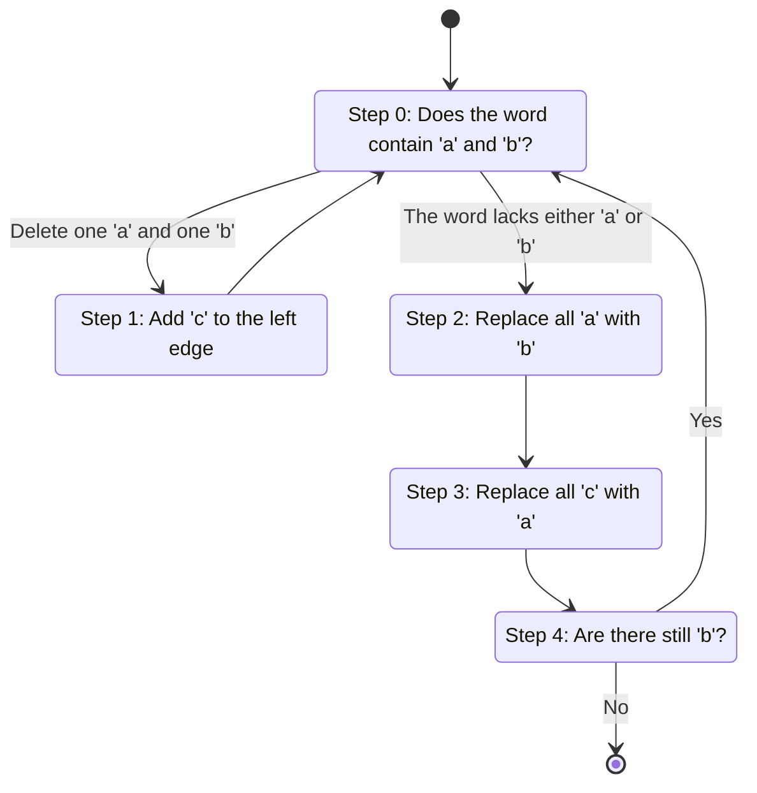

# Algorithms

**An algorithm** is a precisely defined sequence of actions required to solve a given problem.

An algorithm has five important properties.

- **Finiteness**. An algorithm must always terminate after a finite number of steps.
- **Definiteness**. Each step of an algorithm must be precisely defined.
- **Input**. An algorithm has some (possibly zero) number of _inputs_,
  i.e. values that are given before its execution begins or determined dynamically during its execution.
- **Output**. An algorithm has one or more _outputs_,
  i.e. values that have a clearly defined relationship to the inputs.
- **Effectiveness**. An algorithm is generally considered _effective_ if all its operations are simple enough
  to be carried out precisely within a finite amount of time using pencil and paper.

> The name "algorithm" comes from the name of the author of a famous Persian mathematics textbook,
> Abu Abd Allah Muhammad ibn Musa al-Khwarizmı (Abu Abdull Muhammad ibn Musa al-Khwarizmi) (circa 825 AD),
> which literally means "Father Abdullah, Muhammad, son of Musa, born from Khwarizm".
> The Aral Sea in Central Asia was once called Lake Khwarizm,
> and the Khwarizm region is located in the basin of the Amu Darya River south of this sea.
> Al-Khwarizmi wrote the famous book Kitab aljabr wal-muqabala
> (Kitab al-Jabr wal-Muqabala — "The Book of Restoration and Opposition").
> From the title of this book, which was devoted to solving linear and quadratic equations,
> came another word — "algebra".

## A more formal definition

A _method of computation_ is defined as a quadruple **(Q, I, Ω, f)**,
where **Q** is a set containing subsets **I** and **Ω**, and **f** is a function that maps the set **Q** to itself.
In addition, **f** leaves the points of the set **Ω** unchanged,
i.e. **f(q)** equals **q** for all elements **q** of the set **Ω**.
These four elements, **Q**, **I**, **Ω**, **f**, respectively represent
the states of computation, input, output, and the computation rule.
Each input value **x** from the set **I** defines a _computable sequence_
\\(x\_{0}, x\_{1}, x\_{2}, ...\\) in the following way: \\(x\_{0} = x\\) and \\(x\_{k+1} = f(x\_{k})\\) for \\(k \geq 0\\).
A computable sequence is said to _terminate in k steps_,
if \\(k\\) is the smallest integer for which \\(x\_{k}\\) belongs to **Ω**,
and it produces an output value \\(x\_{k}\\) for the given \\(x\\).
(Notice that if \\(x\_{k}\\) belongs to **Ω**, then \\(x\_{k+1}\\) also belongs to **Ω**,
since in that case \\(x\_{k+1} = x\_{k}\\).)
Some computable sequences may never terminate,
but an _algorithm_ is a method of computation that terminates in a finite number of steps for all **x** in **I**.

## An effective formal algorithm

This formulation of the concept "algorithm" does not include a constraint regarding effectiveness.
For example, \\(Q\\) may be the set of infinite sequences
that cannot be computed using pencil and paper, and \\(f\\) may include operations
that are not always feasible for an ordinary person.
If we want to restrict the concept of "algorithm" such that
it can only contain elementary operations,
then we impose constraints on the elements \\(Q\\), \\(I\\), \\(Ω\\) and \\(f\\), for example, as follows.
Let \\(A\\) be a finite set of letters,
and \\(A^{\*}\\) — the set of all strings defined over the set \\(A\\)
(i.e. the set of all ordered sequences \\(x\_{1}x\_{2}...x\_{n}\\),
where \\(n \geq 0\\) and \\(x\_{j}\\) belongs to \\(A\\) for \\(1 \leq j \leq n\\)).
The idea is as follows:
encode computation states so that they are represented as strings from the set \\(A^{\*}\\).
Now let \\(N\\) be a non-negative integer, and \\(Q\\) be the set of all pairs \\((\sigma, j)\\),
where \\(\sigma\\) belongs to \\(A^{\*}\\), and \\(j\\) is an integer, \\(0 \leq j \leq N\\).
Let \\(I\\) be a subset of pairs from \\(Q\\), for which \\(j = 0\\),
and \\(Ω\\) be a subset of pairs from \\(Q\\), for which \\(j = N\\).
If \\(\Theta\\) and \\(\sigma\\) are strings from \\(A^{\*}\\),
then we will say that \\(\Theta\\) is contained in \\(\sigma\\), if \\(\sigma\\) has the form \\(\alpha\Theta\omega\\),
where \\(\alpha\\) and \\(\omega\\) are some strings.
Finally, define the function \\(f\\) using strings \\(\Theta\_{j}\\), \\(\phi\_{j}\\)
and integers \\(a\_{j}\\), \\(b\_{j}\\), \\(0 \leq j < N\\) as follows:

- \\(f(\sigma, j) = (\sigma, a\_{j})\\), if \\(\Theta\_{j}\\) is not contained in \\(\sigma\\)
  (proceed to the next step if the condition is not met);
- \\(f(\sigma, j) = (\alpha\phi\_{j}\omega, b\_{j})\\), if \\(\alpha\\) is the shortest string
  for which \\(\sigma = \alpha\Theta\_{j}\omega\\)
  (proceed to the next step if the condition is met);
- \\(f(\sigma, N) = (\sigma, N)\\)

### Example of a formal effective algorithm description

> taken from Exercise 1.1.8 of [The Art of Computer Programming][TAOCP]

An example of a formal effective algorithm for computing the greatest common divisor of positive integers \\(m\\) and \\(n\\).
Let the input be represented as the string \\(a^{m}b^{n}\\),
i.e. \\(a\\) repeated \\(m\\) times followed by \\(b\\) repeated \\(n\\) times.

A formal effective algorithm might look like this:

Let \\(A = {a, b, c}, N = 5\\).
The algorithm execution finishes when we get the string \\(a^{gcd(m, n)}\\).

| j     | θ\_j            | φ\_j            | b\_j | a\_j | Comment                                                          |
|-------|-----------------|-----------------|------|------|----------------------------------------------------------------------|
| **0** | `ab`            | (Empty string)  | 1    | 2    | Delete one `a` and one `b` and go to **1**, or go to **2**. |
| **1** | (Empty string)  | `c`             | 0    | 0    | Add `c` to the left edge, go to **0**.                         |
| **2** | `a`             | `b`             | 2    | 3    | Replace all `a` with `b`.                                        |
| **3** | `c`             | `a`             | 3    | 4    | Replace all `c` with `a`.                                        |
| **4** | `b`             | `b`             | 0    | 5    | If `b` still remains, repeat.                                    |

### Computation example

Consider computing the GCD for the pair `(6, 3)`:

- Iteration 1
    - **Step 0**: `aaaaaabbb` -> `aaaaabb`
    - **Step 1**: `aaaaabb` -> `caaaaabb`
    - **Step 0**: `caaaaabb` -> `caaaab`
    - **Step 1**: `caaaab` -> `ccaaaab`
    - **Step 0**: `ccaaaab` -> `ccaaa`
    - **Step 1**: `ccaaa` -> `cccaaa`
    - **Step 0**: `cccaaa` => transition to **Step 2**
    - **Step 2**: `cccaaa` -> `cccbbb`
    - **Step 3**: `cccbbb` -> `aaabbb`
    - **Step 4**: `aaabbb` => next iteration
- Iteration 2
    - **Step 0**: `aaabbb` -> `aabb`
    - **Step 1**: `aabb` -> `caabb`
    - **Step 0**: `caabb` -> `cab`
    - **Step 1**: `cab` -> `ccab`
    - **Step 0**: `ccab` -> `cc`
    - **Step 1**: `cc` -> `ccc`
    - **Step 0**: `ccc` => transition to **Step 2**
    - **Step 2**: `ccc` -> `ccc`
    - **Step 3**: `ccc` -> `aaa`
    - **Step 4**: `aaa` => algorithm termination

The final answer `aaa` means that the GCD of 6 and 3 is 3.

---

**References:**

- [Source code][sample]
- [Tests](https://gitverse.ru/scalabook/algorithms/content/master/algorithms/src/test/scala/ru/scalabook/algorithms)
- [The Art of Computer Programming - Donald E. Knuth][TAOCP]
- [Markov A.A., Nagorny N.M. - Theory of Algorithms](https://www.ozon.ru/product/teoriya-algorifmov-markov-andrey-andreevich-nagornyy-nikolay-makarovich-1799472833/)

[TAOCP]: https://www-cs-faculty.stanford.edu/~knuth/taocp.html
[sample]: https://gitverse.ru/scalabook/algorithms
