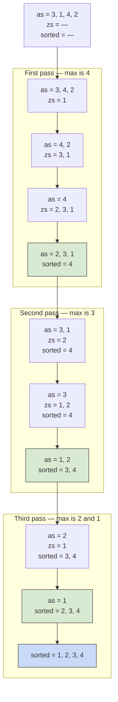

# Bubble Sort

**Algorithm:**

The [bubble sort](https://ru.wikipedia.org/wiki/%D0%A1%D0%BE%D1%80%D1%82%D0%B8%D1%80%D0%BE%D0%B2%D0%BA%D0%B0_%D0%BF%D1%83%D0%B7%D1%8B%D1%80%D1%8C%D0%BA%D0%BE%D0%BC) algorithm
consists of repeated passes through the sortable array.
During each pass, elements are compared pairwise sequentially
and if the order in a pair is wrong, the elements are swapped.
Passes through the array are repeated N-1 times or until it is found on a given pass
that no more swaps are needed, meaning — the array is sorted.
During each pass of the algorithm through the inner loop, the next largest element of the array is placed
in its correct position at the end of the array next to the previous "largest element",
and the smallest element moves one position toward the beginning of the array
("bubbles up" to the needed position, hence the name of the algorithm).

**Estimation:**

- **Time**:
    - Worst - \\(O(n^{2})\\)
    - Best - \\(O(n)\\)
    - Average - \\(O(n^{2})\\)
- **Memory** - \\(O(1)\\)

**Code:**

The bubble sort implementation using functional programming is based on three lists,
`as`, `zs` and `sorted`, whose state at each step is shown in the diagram above.
Execution is done by a recursive `loop` function that performs one pass through the still-unsorted
part of `as` in one call:

- if the unsorted part `as` is empty, all elements are already sorted, and we return `sorted`;
  this situation is only possible if `zs` is also empty, because when `as` shrinks to 1 element, `zs` is moved into it,
  and so on until `zs` is empty.
- if `as` consists of a single element, it is the maximum among the still-unsorted part:
    - we add the maximum to the head of the sorted list `sorted` and continue pairwise comparison among `zs`;
- if `as` consists of multiple elements, we compare the first two elements:
    - if `h1 > h2`, we swap them — the larger element "bubbles up" forward and will be compared with the next,
      while the smaller one is put aside into `zs`;
    - otherwise the larger element `h2` (or equal) goes forward, and `h1` is set aside into `zs`.

Thus, sooner or later the biggest element of each unsorted part will be first in `as`,
end up in `sorted` and "fall out" of further consideration, like a bubble floating upward.

```dotty
import scala.annotation.tailrec
import scala.math.Ordered.orderingToOrdered

def bubbleSort[A: Ordering](list: List[A]): List[A] =
  @tailrec
  def loop(as: List[A], zs: List[A], sorted: List[A]): List[A] =
    as match
      case Nil       => sorted
      case h1 :: Nil => loop(zs, Nil, h1 :: sorted)
      case h1 :: h2 :: t =>
        if h1 > h2 then loop(h1 :: t, h2 :: zs, sorted)
        else loop(h2 :: t, h1 :: zs, sorted)

  loop(list, Nil, Nil)

bubbleSort(List(3, 1, 4, 2))
// List(1, 2, 3, 4)
```

**Visualization:**

Let's see how the algorithm works on the example of the list `3, 1, 4, 2`.
Below is the state of the three lists (`as`, `zs`, `sorted`) at each step of the recursive `loop` function:

| Step | `as` before | Operation | `as` after | `zs` | `sorted` |
|-----|---------|----------|------------|------|----------|
| 1 | 3, 1, 4, 2 | 3 > 1: swap | 3, 4, 2 | 1 | — |
| 2 | 3, 4, 2 | 3 < 4: no swap | 4, 2 | 3, 1 | — |
| 3 | 4, 2 | 4 > 2: swap | 4 | 2, 3, 1 | — |
| 4 | 4 | single element: max is 4 | 2, 3, 1 | — | 4 |
| 5 | 2, 3, 1 | 2 < 3: no swap | 3, 1 | 2 | 4 |
| 6 | 3, 1 | 3 > 1: swap | 3 | 1, 2 | 4 |
| 7 | 3 | single element: max is 3 | 1, 2 | — | 3, 4 |
| 8 | 1, 2 | 1 < 2: no swap | 2 | 1 | 3, 4 |
| 9 | 2 | single element: max is 2 | 1 | — | 2, 3, 4 |
| 10 | 1 | single element: max is 1 | — | — | 1, 2, 3, 4 |
| 11 | — | `as` is empty: done | — | — | 1, 2, 3, 4 |



The yellow color highlights steps where the next maximum bubbles up into the head of the sorted part,
and the final state is marked in blue.

---

**Links:**

- [Source code][sample]
- [Bhim P. Upadhyaya - Data Structures and Algorithms with Scala](https://idp.springer.com/authorize?response_type=cookie&amp;client_id=springerlink&amp;redirect_uri=https%3A%2F%2Flink.springer.com%2Fbook%2F10.1007%2F978-3-030-12561-5)
- [Scalacaster](https://github.com/vkostyukov/scalacaster/tree/master)
- [Algorithmica - Bubble Sort](https://ru.algorithmica.org/cs/sorting/bubble/)
- [Niklaus Wirth - Algorithms + Data Structures = Programs](https://en.wikipedia.org/wiki/Algorithms_%2B_Data_Structures_%3D_Programs)

[sample]: https://gitverse.ru/scalabook/algorithms
