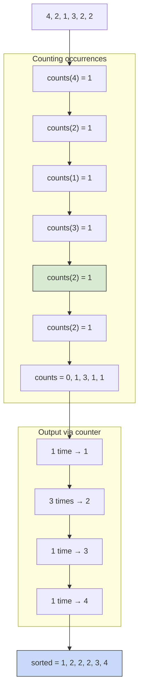

# Counting Sort

**Algorithm:**

[Counting sort](https://ru.wikipedia.org/wiki/%D0%A1%D0%BE%D1%80%D1%82%D0%B8%D1%80%D0%BE%D0%B2%D0%BA%D0%B0_%D0%BF%D0%BE%D0%B4%D1%81%D1%87%D1%91%D1%82%D0%BE%D0%BC) differs from other sorts: it does not compare elements with each other, but instead uses the fact that the range of values is known in advance and is small.

If it is known that all values are integers from `0` to `k`, then:

- create a counter array `counts` of size `k + 1`, which will store how many times each number appears;
- iterate through all elements of the original list and increment the corresponding counter cell by `1`;
- after counting, iterate through the counter from `0` to `k` and write out the number `i` as many times as it appeared (i.e., `counts(i)` times).

The running time is \\(O(k + n)\\), where `k` is the size of the value range and `n` is the number of elements.
If `k` is relatively small, counting sort is one of the most optimal solutions.

The functional implementation uses an immutable vector counter, updated via `foldLeft`,
and the result is collected using `flatMap` over the range of values.

**Estimation:**

- **Time**:
  - Worst - \\(O(k + n)\\)
  - Best - \\(O(k + n)\\)
  - Average - \\(O(k + n)\\)
- **Memory** - \\(O(k)\\)

**Code:**

```dotty
def countingSort(list: List[Int], max: Int): List[Int] =
  val counts =
    list.foldLeft(Vector.fill(max + 1)(0))((v, x) => v.updated(x, v(x) + 1))
  (0 to max).flatMap(n => Vector.fill(counts(n))(n)).toList

countingSort(List(3, 1, 4, 2), 4)
// List(1, 2, 3, 4)

countingSort(List(4, 2, 1, 3, 2), 4)
// List(1, 2, 2, 3, 4)
```

**Visualization:**

Let's see how the algorithm works on the example of the list `4, 2, 1, 3, 2, 2` with `max = 4`.
First, the counter `counts` is built — how many times each number from `0` to `4` appears:

| Step | Element `x` | Increment counter | `counts`          |
| --- | ----------- | ------------------- | ----------------- |
| 1   | 4           | `counts(4)`         | 0, 0, 0, 0, **1** |
| 2   | 2           | `counts(2)`         | 0, 0, **1**, 0, 1 |
| 3   | 1           | `counts(1)`         | 0, **1**, 1, 0, 1 |
| 4   | 3           | `counts(3)`         | 0, 1, 1, **1**, 1 |
| 5   | 2           | `counts(2)`         | 0, 1, **2**, 1, 1 |
| 6   | 2           | `counts(2)`         | 0, 1, **3**, 1, 1 |

Then, from the counter, we write out the result: number `0` — 0 times, `1` — once, `2` — three times, `3` — once, `4` — once.



The green highlights the filled counter, and the final sorted list is marked in blue.

---

**Links:**

- [Source code][sample]
- [Algorithmica - Counting Sort](https://ru.algorithmica.org/cs/sorting/counting/)

[sample]: https://gitverse.ru/scalabook/algorithms
