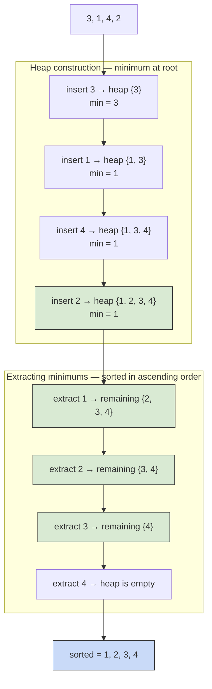

# Heap Sort

**Algorithm:**

[Heap sort](https://en.wikipedia.org/wiki/Heapsort) (also called _heapsort_) consists of two stages:

- build a [heap][heap wiki] from the original set of elements such that the minimum element is always at the root of the heap (min-heap);
- extract one minimum element from the heap at a time and append it to the sorted part of the result.

The key idea is that a heap supports fast minimum extraction in
\\(O(log(n))\\) per operation. After performing \\(n\\) extractions, we get a sorted set in
\\(O(n log(n))\\).

This functional implementation uses a _leftist heap_,
for which merging two heaps also runs in \\(O(log(n))\\):

- heap property: `min` at a node is no greater than `min` of any of its descendants;
- leftist property: the rank of the left subtree (`rank`) is no less than the rank of the right subtree; `rank` is the length of the right path from the root to an empty node.

Thanks to \\(O(log(n))\\) merging, element insertion is simply merging a single-element heap with the current one,
and minimum extraction is merging the left and right subtrees of the root.

**Estimation:**

- **Time**:
  - Worst - \\(O(n log(n))\\)
  - Best - \\(O(n log(n))\\)
  - Average - \\(O(n log(n))\\)
- **Memory** - \\(O(n)\\)

**Code:**

Define [Leftist Heap `LeftistHeap`](../../data-structures/heap.md)
as a binary tree: an empty node `Leaf` and a `Branch` node,
storing rank, minimum element `min`, and left and right subtrees:

```dotty
enum LeftistHeap[+A]:
  import LeftistHeap.*

  case Leaf

  case Branch(
      min: A,
      left: LeftistHeap[A],
      right: LeftistHeap[A],
      override val rank: Int
  )

  val rank: Int = this match
    case neh: Branch[A] => neh.rank
    case _              => 0

  def insert[B >: A: Ordering](x: B): LeftistHeap[B] = this match
    case Branch(min, left, right, _) =>
      if left.rank > right.rank then bubble(min, left, right.insert(x))
      else bubble(min, left.insert(x), right)
    case _ => LeftistHeap(x)
end LeftistHeap

object LeftistHeap:
  def apply[A: Ordering](x: A): LeftistHeap[A] =
    LeftistHeap(x, Leaf, Leaf)

  private def apply[A: Ordering](
      x: A,
      l: LeftistHeap[A],
      r: LeftistHeap[A]
  ): LeftistHeap[A] =
    Branch(x, l, r, r.rank + 1)

  private def bubble[A: Ordering](
      x: A,
      l: LeftistHeap[A],
      r: LeftistHeap[A]
  ): LeftistHeap[A] =
    (l, r) match
      case (Branch(y, lt, rt, _), _) if x > y =>
        LeftistHeap(y, LeftistHeap(x, lt, rt), r)
      case (_, Branch(z, lt, rt, _)) if x > z =>
        LeftistHeap(z, l, LeftistHeap(x, lt, rt))
      case (_, _) => LeftistHeap(x, l, r)

  def merge[A: Ordering](x: LeftistHeap[A], y: LeftistHeap[A]): LeftistHeap[A] =
    (x, y) match
      case (_, Leaf) => x
      case (Leaf, _) => y
      case (
            Branch(xx, xl, xr, _),
            Branch(yy, yl, yr, _)
          ) =>
        if xx < yy then swap(xx, xl, merge(xr, y))
        else swap(yy, yl, merge(yr, x))

  private def swap[A: Ordering](
      x: A,
      l: LeftistHeap[A],
      r: LeftistHeap[A]
  ): LeftistHeap[A] =
    if l.rank < r.rank then LeftistHeap(x, r, l)
    else LeftistHeap(x, l, r)

end LeftistHeap
```

- node rank — length of the right path to an empty node; `Leaf` has rank `0`;
- `insert` builds a node, placing the subtree with the larger rank on the left;
- `merge` merges two heaps, choosing the smaller minimum for the root and recursively merging one of the subtrees;
- insertion — merging a single-element heap with an existing one;
- `extract` removes the root minimum one at a time, each time merging the left and right subtrees.

```dotty
def heapSort[A: Ordering](list: List[A]): List[A] =
  import LeftistHeap.*

  @tailrec
  def extract(h: LeftistHeap[A], acc: List[A]): List[A] = h match
    case Leaf               => acc.reverse
    case Branch(x, l, r, _) => extract(merge(l, r), x :: acc)

  val heap =
    list.foldLeft(Leaf: LeftistHeap[A])((h, x) => h.insert(x))
  extract(heap, Nil)

heapSort(List(3, 1, 4, 2))
// List(1, 2, 3, 4)
```

**Visualization:**

Let's see how the algorithm works on the example of the list `3, 1, 4, 2`.
First, a min-heap is built (inserting each element means merging with the current heap),
then the root minimum is extracted one at a time:

Heap construction:

| Step | Inserting | Heap (minimum at root) | Heap minimum |
|-----|-----------|------------------------|--------------|
| 1 | 3 | 3 | 3 |
| 2 | 1 | 1, then 3 | 1 |
| 3 | 4 | 1, then 3 and 4 | 1 |
| 4 | 2 | 1, then 3, 4 and 2 | 1 |

Minimum extractions:

| Step | Extracting | Heap after | `sorted` (in extraction order) |
|-----|-----------|------------|---------------------------------|
| 5 | 1 | 2 (and 3, 4) | 1 |
| 6 | 2 | 3 (and 4) | 1, 2 |
| 7 | 3 | 4 | 1, 2, 3 |
| 8 | 4 | — | 1, 2, 3, 4 |



Green highlights steps where the next minimum is extracted from the heap,
and the final sorted list is marked in blue.

---

**Links:**

- [Source code][sample]
- [Algorithmica - Heap Sort](https://ru.algorithmica.org/cs/sorting/heapsort/)
- [Heap — data structure][heap wiki]

[sample]: https://gitverse.ru/scalabook/algorithms
[heap wiki]: https://en.wikipedia.org/wiki/Heap_(data_structure)
