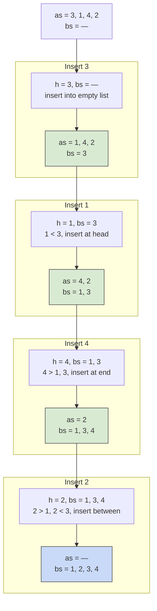

# Insertion Sort

**Algorithm:**

Initially, the sorted sequence is empty.
At each step, the [insertion sort algorithm](https://ru.wikipedia.org/wiki/%D0%A1%D0%BE%D1%80%D1%82%D0%B8%D1%80%D0%BE%D0%B2%D0%BA%D0%B0_%D0%B2%D1%81%D1%82%D0%B0%D0%B2%D0%BA%D0%B0%D0%BC%D0%B8)
selects one of the input elements and inserts it into the correct position in the already sorted sequence until
the input set is exhausted.
At any point in time, the elements in the sorted sequence satisfy the output requirements of the algorithm.

**Estimation:**

- **Time**:
  - Worst - \\(O(n^{2})\\)
  - Best - \\(O(n)\\)
  - Average - \\(O(n^{2})\\)
- **Memory** - \\(O(n)\\)

**Code:**

An insertion sort implementation using functional programming might look like this:

- Initialization: Start with two lists:
    - `as`, which contains elements to be sorted,
    - and `bs`, which is initially empty and will contain the sorted elements.
- Main sorting process:
    - Check if list `as` is empty. If it is, this means all elements have been processed, and we can return the sorted list `bs`.
    - If `as` is not empty, take the first element `h` from `as` and the remaining elements `t`.
    - Inserting the element: Call the `insert` function, passing element `h` and the current sorted list `bs`.
    - The `insert` function inserts element `h` at the correct position in list `bs` to maintain order.
- Inside the `insert` function:
    - If `h` is greater than the first element of `bs`, add the first element to the head of the list that results from inserting `h` into the rest of `bs`.
    - If `h` is less than or equal to the first element of `bs`, add `h` to the head of `bs`.
- Recursion: After inserting element `h`, call `sort` again, passing the remaining elements `t` and the updated list `bs`, which now includes the inserted element.
- Termination: The process continues until all elements from `as` have been processed and added to `bs`.

```dotty
def insertionSort[A: Ordering](list: List[A]): List[A] =
  @tailrec
  def sort(as: List[A], bs: List[A]): List[A] = as match
    case Nil    => bs
    case h :: t => sort(t, insert(h, bs))

  def insert(h: A, bs: List[A]): List[A] = bs match
    case hb :: tb if h > hb => hb :: insert(h, tb)
    case _                  => h :: bs

  sort(list, Nil)

insertionSort(List(3, 1, 4, 2))
// List(1, 2, 3, 4)
```

**Visualization:**

Let's see how the algorithm works on the example of the list `3, 1, 4, 2`.
Below is the state of the two lists (`as`, `bs`) at each step, where `insert` places the next element `h` at the correct position in the sorted part `bs`:

| Step | `h` | Insert into `bs`      | `bs` after | `as`    |
| --- | --- | ------------------- | ---------- | ------- |
| 1   | 3   | into empty list     | 3          | 1, 4, 2 |
| 2   | 1   | 1 < 3, insert at head | 1, 3       | 4, 2    |
| 3   | 4   | 4 > 1, 3, insert at end | 1, 3, 4    | 2       |
| 4   | 2   | 2 > 1, 2 < 3, insert between | 1, 2, 3, 4 | —       |
| 5   | —   | `as` is empty: done | 1, 2, 3, 4 | —       |



Green highlights states where the sorted part `bs` is extended with a new element, and the final state is marked in blue.

---

**Links:**

- [Source code][sample]
- [Bhim P. Upadhyaya - Data Structures and Algorithms with Scala](https://idp.springer.com/authorize?response_type=cookie&amp;client_id=springerlink&amp;redirect_uri=https%3A%2F%2Flink.springer.com%2Fbook%2F10.1007%2F978-3-030-12561-5)
- [Scalacaster](https://github.com/vkostyukov/scalacaster/tree/master)
- [Algorithmica - Insertion Sort](https://ru.algorithmica.org/cs/sorting/insertion/)
- [Niklaus Wirth - Algorithms + Data Structures = Programs](https://en.wikipedia.org/wiki/Algorithms_%2B_Data_Structures_%3D_Programs)

[sample]: https://gitverse.ru/scalabook/algorithms
