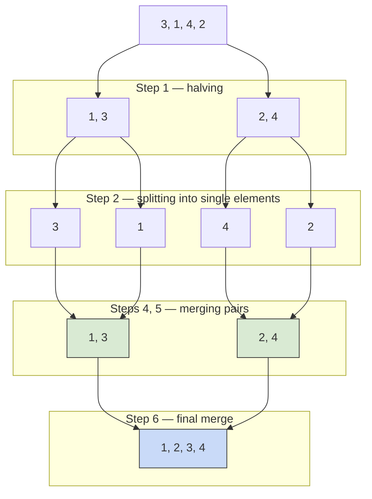

# Merge Sort

**Algorithm:**

[The merge sort algorithm](https://en.wikipedia.org/wiki/Merge_sort) works as follows:

- the sortable array is divided into two parts of roughly equal size
- each of the resulting parts is sorted separately, for example — using the same algorithm
- the two ordered halves of half the size are joined into one

**Estimation:**

- **Time**:
  - Worst - \\(O(n log(n))\\)
  - Best - \\(O(n log(n))\\)
  - Average - \\(O(n log(n))\\)
- **Memory** - \\(O(1)\\) for a list, \\(O(n)\\) for an array

**Code and Explanation:**

The difference from the default imperative implementation is the way of splitting a list into two parts.
Usually this is solved by using the length of the list, whose cost is O(n),
since it requires traversing from beginning to end.
[This implementation](https://github.com/vkostyukov/scalacaster/blob/master/src/sort/MergeSort.scala)
splits the list into two equal parts using the `halve` function.
This function does a simple thing — it takes the first two elements of the list
and adds them to two separate lists that accumulate the result.
In other words, the function adds all even-positioned nodes to the first part,
and odd-positioned nodes to the second. This can be done in O(n).


- Input: The `mergeSort` method takes a list of elements of type A, for which an ordering (comparison) is defined.
- Splitting the list: The inner method `halve` splits the input list into two parts.
  It uses a helper recursive function `loop` that takes three parameters: the current list, a list for the first half and a list for the second half.
  `loop` iterates through the elements of the list, adding them alternately to the first and second halves until all elements are processed.
  As a result, `halve` returns a tuple of two lists: the first and second halves.
- Sorting the halves: The inner method `halveAndSort` calls `halve` to split the list, then recursively calls `sort` to sort each half.
  The `sort` method takes a tuple of two lists and sorts them. If both lists are empty, it returns an empty list.
  If one of the lists contains a single element, it returns that element as a list. If both lists contain elements, they are sorted.
- Merging sorted halves: The `merge` method takes two sorted lists and merges them into one sorted list.
  It uses a recursive `loop` function that compares elements from the two lists.
  `loop` adds the smaller element from the two lists to the resulting list until one of the lists becomes empty.
  After that, the remaining elements of the other list are added to the result.
- Reverse order: The merge result is collected in reverse order,
  so at the end `loop` calls `reverse` to return the elements in the correct order.
- Return result: The `mergeSort` method returns the final sorted list.

```dotty
def mergeSort[A: Ordering](list: List[A]): List[A] =
  def halveAndSort(as: List[A]) = sort(halve(as))

  def sort(p: (List[A], List[A])): List[A] = p match
    case (Nil, Nil)       => Nil
    case (ha :: Nil, Nil) => ha :: Nil
    case (Nil, hb :: Nil) => hb :: Nil
    case (as, bs)         => merge(halveAndSort(as), halveAndSort(bs))

  def halve(as: List[A]): (List[A], List[A]) =
    @tailrec
    def loop(bs: List[A], fs: List[A], ss: List[A]): (List[A], List[A]) =
      bs match
        case f :: s :: r => loop(r, f :: fs, s :: ss)
        case f :: Nil    => (f :: fs, ss)
        case Nil         => (fs, ss)

    loop(as, Nil, Nil)

  def merge(as: List[A], bs: List[A]): List[A] =
    @tailrec
    def loop(cs: List[A], ds: List[A], r: List[A]): List[A] = (cs, ds) match
      case (Nil, Nil) => r.reverse
      case (_, Nil)   => r.reverse ++ cs
      case (Nil, _)   => r.reverse ++ ds
      case (ha :: ta, hb :: tb) =>
        if ha < hb then loop(ta, ds, ha :: r)
        else loop(cs, tb, hb :: r)

    loop(as, bs, Nil)

  halveAndSort(list)
end mergeSort

mergeSort(List(3, 1, 4, 2))
// List(1, 2, 3, 4)
```

**Visualization:**

Let's see how the algorithm works on the example of the list `3, 1, 4, 2`.
First, the list is recursively divided in half by the `halve` function, until each part has one element,
then the sorted parts are joined by the `merge` function:

| Step | Action               | Result                      |
| --- | ---------------------- | ----------------------------- |
| 1   | `halve(3, 1, 4, 2)`    | left: `1, 3`, right: `2, 4` |
| 2   | `halve(1, 3)`          | left: `3`, right: `1`       |
| 3   | `halve(2, 4)`          | left: `4`, right: `2`       |
| 4   | `merge(3, 1)`          | `1, 3`                        |
| 5   | `merge(4, 2)`          | `2, 4`                        |
| 6   | `merge(1, 3` and `2, 4)` | `1, 2, 3, 4`                  |



Green highlights sorted parts obtained by merging pairs, and the final sorted list is marked in blue.

---

**Links:**

- [Source code][sample]
- [Bhim P. Upadhyaya - Data Structures and Algorithms with Scala](https://idp.springer.com/authorize?response_type=cookie&amp;client_id=springerlink&amp;redirect_uri=https%3A%2F%2Flink.springer.com%2Fbook%2F10.1007%2F978-3-030-12561-5)
- [Scalacaster](https://github.com/vkostyukov/scalacaster/tree/master)
- [Niklaus Wirth - Algorithms + Data Structures = Programs](https://en.wikipedia.org/wiki/Algorithms_%2B_Data_Structures_%3D_Programs)

[sample]: https://gitverse.ru/scalabook/algorithms
