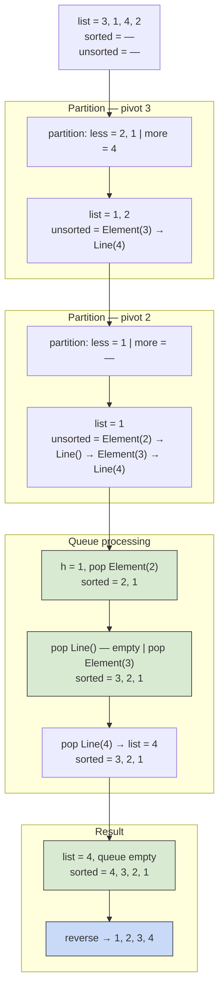

# Quick Sort

**Algorithm:**

The general idea of the [quick sort algorithm](https://en.wikipedia.org/wiki/Quicksort) is as follows:

- select an element from the array, called the pivot. It can be any element of the array.
  The correctness of the algorithm does not depend on the choice of the pivot element, but its efficiency may vary significantly depending on it.
- compare all other elements with the pivot and rearrange them in the array to split the array into three contiguous segments
  that follow one after another: "elements smaller than the pivot", "equal" and "greater than the pivot".
- for the "smaller" and "greater" segments, recursively perform the same sequence of operations if the length of the segment is greater than one

**Estimation:**

- **Time**:
    - Worst - \\(O(n^{2})\\)
    - Best - \\(O(n log(n))\\)
    - Average - \\(O(n log(n))\\)
- **Memory** - \\(O(n)\\)

**Code and Explanation:**

- Function definitions:
    - `quickSort`: The main function that takes a list of elements and starts the sorting process.
    - `partitionAndSort`: A helper recursive function that performs partitioning and sorting of elements.
    - `partition`: A function that splits elements into three parts: less than, equal to, and greater than the pivot.
- Initialization: The `quickSort` function takes a list `list` and calls `partitionAndSort` with an empty list for sorted elements
  and an empty queue for unsorted elements.
- Recursive partitioning:
    - The `partitionAndSort` function takes three parameters:
        - `list` - the current list that needs to be sorted.
        - `sorted` - the already sorted list (in reverse order — from largest to smallest),
          all elements of which are less than any element in `list`.
        - `unsorted` - a collection of "queues" structured such that each "link" contains elements greater than any from `list`,
          yet less than elements of the next link in the chain.
    - Initial state: `list` - the original list, `sorted` - empty list, `unsorted` - empty queue.
    - In the loop: If the list `list` contains more than one element:
        - Call `partition` to split elements into three parts: less (`less`), equal (`p`) and greater (`more`)
        - Recursive call to `partitionAndSort` with new parameters: `list` - `less`, `sorted` - `sorted`, `unsorted` -
          add two links to the queue: first `Line(g)` - a list of elements greater than `p`, then `Element(p)` - a link with the current pivot element.
          It's important to note that the properties (`list`, `sorted`, `unsorted`) don't change: `list` by definition contains elements greater than `sorted` (which is currently empty),
          `sorted` itself doesn't change, and `unsorted` contains links whose elements are greater than any element in `list` and while
          each link contains elements smaller than any element in the next link.
    - In the loop: If the list `list` contains zero or one element, update `sorted`:
      add to the head of `sorted` the element from `list`, if it exists. The `sorted` property doesn't change — elements are sorted from largest to smallest.
      Read the next element from the `unsorted` queue.
    - If the `unsorted` queue is empty, there are no more unsorted elements — return the updated `sorted`.
    - If the `unsorted` queue is not empty, take the first element from the queue:
        - If it is `Element(p)`, add element `p` to the head of `sorted`, since `p` is the next element by "rank"
          (greater than everything in `sorted` and less than everything in `unsorted`).
          Call `partitionAndSort` with an empty `list`, updated `sorted`, and `unsorted` — the remaining elements in the queue.
        - If it is `Line(g)`, recursively call `partitionAndSort` with `list` - `g`, updated `sorted` and `unsorted` — the remaining elements in the queue.
          It's important to note that the properties (`list`, `sorted`, `unsorted`) also don't change: `list` contains elements greater than `sorted` (since it has elements greater than the pivot `p`, which starts `sorted`), `sorted` remains sorted from largest to smallest,
          and `unsorted` contains links whose elements are greater than any element in `list` by their definition, since it is its former first link.
- Partitioning elements: Using the `partition` function, elements of the list are split into three groups:
    - `less`: elements smaller than the pivot.
    - `p`: the pivot element.
    - `more`: elements greater than the pivot.
- After all recursive calls complete, return the list `sorted` in reverse order.

```dotty
def quickSort[A: Ordering](list: List[A]): List[A] =
  sealed trait Queue[A]
  case class Element[A](head: A)    extends Queue[A]
  case class Line[A](list: List[A]) extends Queue[A]

  @tailrec
  def partitionAndSort(
      list: List[A],
      sorted: List[A],
      unsorted: List[Queue[A]]
  ): List[A] =
    (list, unsorted) match
      case (Nil, Nil)      => sorted
      case (h :: Nil, Nil) => h :: sorted
      case (Nil, hq :: tq) =>
        hq match
          case Element(el) =>
            partitionAndSort(Nil, el :: sorted, tq)
          case Line(list) =>
            partitionAndSort(list, sorted, tq)
      case (h :: Nil, hq :: tq) =>
        hq match
          case Element(el) =>
            partitionAndSort(Nil, el :: h :: sorted, tq)
          case Line(list) =>
            partitionAndSort(list, h :: sorted, tq)
      case (h :: t, _) =>
        val (l, p, g) = partition(h, t)
        partitionAndSort(l, sorted, Element(p) :: Line(g) :: unsorted)

  def partition(p: A, rest: List[A]): (List[A], A, List[A]) =
    @tailrec
    def loop(
        p: A,
        rest: List[A],
        less: List[A],
        more: List[A]
    ): (List[A], A, List[A]) =
      rest match
        case Nil             => (less, p, more)
        case h :: t if h < p => loop(p, t, h :: less, more)
        case h :: t          => loop(p, t, less, h :: more)

    loop(p, rest, Nil, Nil)

  partitionAndSort(list, Nil, Nil).reverse
end quickSort

quickSort(List(3, 1, 4, 2))
// List(1, 2, 3, 4)
```

**Visualization:**

Let's see how the algorithm works on the example of the list `3, 1, 4, 2`. Each row of the table is one call
to `partitionAndSort(list, sorted, unsorted)`:

- if `list` contains multiple elements, `partition` is called, which selects the pivot element `p`
  (first in the list) and returns `less` (less than `p`) and `more` (greater than `p`); then `less` is processed recursively,
  and queue `unsorted` adds links `Element(p)` and `Line(more)`;
- if `list` is a single element, it is greedily added to the head of `sorted`, after which the queue is processed,
  since `sorted` stores from largest to smallest, while elements are processed in decreasing order;
- the queue `unsorted` (from head to tail) is processed as follows: `Element(p)` adds `p` to the head of `sorted`,
  and `Line(g)` starts processing list `g`.

| Step | `list`     | Action                                                           | `sorted` after | `unsorted` after (head → tail)            |
| --- | ---------- | ---------------------------------------------------------------- | -------------- | -------------------------------------------- |
| 1   | 3, 1, 4, 2 | `partition`, pivot 3: `less = 2, 1`, `more = 4`; recursion into `less` | —              | `Element(3) → Line(4)`                       |
| 2   | 1, 2       | `partition`, pivot 2: `less = 1`, `more = `; recursion into `less`     | —              | `Element(2) → Line() → Element(3) → Line(4)` |
| 3   | 1          | single element: `h = 1`; pop `Element(2)`                        | 2, 1           | `Line() → Element(3) → Line(4)`              |
| 4   | —          | pop `Line()`, part is empty — nothing added               | 2, 1           | `Element(3) → Line(4)`                       |
| 5   | —          | pop `Element(3)`                                               | 3, 2, 1        | `Line(4)`                                    |
| 6   | —          | pop `Line(4)` → becomes new `list`                        | 3, 2, 1        | —                                            |
| 7   | 4          | single element, queue empty                                        | 4, 3, 2, 1     | —                                            |


After step 7, the queue `unsorted` is empty and the function returns `sorted = 4, 3, 2, 1`.
A final `.reverse` yields `1, 2, 3, 4`.



Green highlights steps where the pivot element transitions into the sorted part,
and the final state is marked in blue.

---

**Links:**

- [Source code][sample]
- [Bhim P. Upadhyaya - Data Structures and Algorithms with Scala](https://idp.springer.com/authorize?response_type=cookie&amp;client_id=springerlink&amp;redirect_uri=https%3A%2F%2Flink.springer.com%2Fbook%2F10.1007%2F978-3-030-12561-5)
- [Scalacaster](https://github.com/vkostyukov/scalacaster/tree/master)
- [Niklaus Wirth - Algorithms + Data Structures = Programs](https://en.wikipedia.org/wiki/Algorithms_%2B_Data_Structures_%3D_Programs)

[sample]: https://gitverse.ru/scalabook/algorithms
