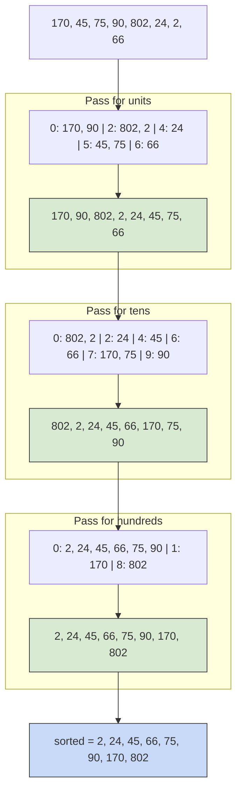

# Radix Sort

**Algorithm:**

[Radix sort](https://en.wikipedia.org/wiki/Radix_sort) applies the idea of [counting sort][counting] to large keys: instead of maintaining a counter for the entire value space, the key is split into digits, and the list is sorted by each digit in turn.

For numbers, sorting is typically done from least significant digit to most significant:

- each pass sorts the list by one digit (e.g., the next decimal digit) using a _stable_ counting sort;
- stability is important: elements with the same digit preserve the order established by previous passes;
- after processing the last (most significant) digit, the list is fully sorted.

The running time is \\(O(d \\cdot (b + n))\\), where `n` is the number of elements, `b` is the base of the number system (the number of possible digit values, e.g. `10`), and `d` is the number of digits.

In the functional implementation, stability is achieved via `groupBy` by digit key: within each group, elements preserve their original order, and the result is assembled by iterating digits from `0` to `9`.

**Estimation:**

- **Time**:
  - Worst - \\(O(d \\cdot (b + n))\\)
  - Best - \\(O(d \\cdot (b + n))\\)
  - Average - \\(O(d \\cdot (b + n))\\)
- **Memory** - \\(O(n + b)\\)

**Code:**

```dotty
import scala.annotation.tailrec

def radixSort(list: List[Int]): List[Int] =
  def countingPass(d: Int, xs: List[Int]): List[Int] =
    val grouped = xs.groupBy(x => (x / d) % 10)
    (0 to 9).flatMap(digit => grouped.getOrElse(digit, Nil)).toList

  list.maxOption match
    case None    => Nil
    case Some(m) =>
      @tailrec
      def loop(d: Int, xs: List[Int]): List[Int] =
        if m / d == 0 then xs
        else loop(d * 10, countingPass(d, xs))
      loop(1, list)

radixSort(List(3, 1, 4, 2))
// List(1, 2, 3, 4)

radixSort(List(170, 45, 75, 90, 802, 24, 2, 66))
// List(2, 24, 45, 66, 75, 90, 170, 802)
```

**Visualization:**

Let's see how the algorithm works on the example `170, 45, 75, 90, 802, 24, 2, 66`, with the maximum number being `802` (three digits).
Each pass sorts the list by the next digit (right to left), stably iterating digits from `0` to `9`:

Pass for units (\\(d = 1\\)):

| Digit | Numbers (in order) |
|-------|------------------------------|
| 0 | 170, 90 |
| 2 | 802, 2 |
| 4 | 24 |
| 5 | 45, 75 |
| 6 | 66 |

After the pass: `170, 90, 802, 2, 24, 45, 75, 66`

Pass for tens (\\(d = 10\\)):

| Digit | Numbers (in order) |
|-------|------------------------------|
| 0 | 802, 2 |
| 2 | 24 |
| 4 | 45 |
| 6 | 66 |
| 7 | 170, 75 |
| 9 | 90 |

After the pass: `802, 2, 24, 45, 66, 170, 75, 90`

Pass for hundreds (\\(d = 100\\)):

| Digit | Numbers (in order) |
|-------|------------------------------|
| 0 | 2, 24, 45, 66, 75, 90 |
| 1 | 170 |
| 8 | 802 |

After the pass: `2, 24, 45, 66, 75, 90, 170, 802`



Green highlights the results of stable passes through each digit, and the final sorted list is marked in blue.

---

**Links:**

- [Source code][sample]
- [Algorithmica - Radix Sort](https://ru.algorithmica.org/cs/sorting/radix/)
- [Counting sort][counting]

[sample]: https://gitverse.ru/scalabook/algorithms
[counting]: https://en.wikipedia.org/wiki/Counting_sort
