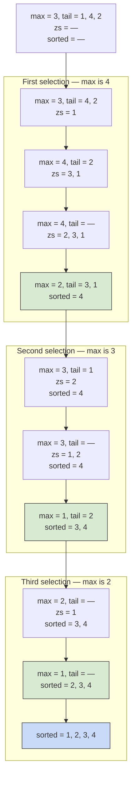

# Selection Sort

**Algorithm:**

Steps of the [selection sort algorithm](https://en.wikipedia.org/wiki/Selection_sort):

- find the position (index) of the minimum (maximum) value in the current list
- swap this value with the value at the first unsorted position (no swap is needed if the minimum (maximum) element is already in the current position)
- now sort the remainder of the list, excluding already sorted elements

**Estimation:**

- **Time**:
  - Worst - \\(O(n^{2})\\)
  - Best - \\(O(n^{2})\\)
  - Average - \\(O(n^{2})\\)
- **Memory** - \\(O(1)\\)

**Code:**

A selection sort implementation using functional programming might look like this:

- the helper method `loop` takes the following arguments:
    - `max` - the current maximum element
    - `tail` - the part of the unsorted list where elements still need to be compared with the maximum
    - `zs` - the part of the unsorted list where each element is no greater than the maximum
    - `sorted` - the sorted part of the list
- if `tail` is empty, then `max` is the maximum element in the unsorted part
    - if `zs` is also empty, there is no unsorted part left, return `max :: sorted`
      (in the sorted part `sorted`, all elements are no less than `max`,
      so `max :: sorted` remains sorted in ascending order)
    - if `zs` is not empty, add `max` to the sorted part
      and continue searching for the next maximum element among `zs`
- if `tail` is not empty, take its head element — `h`:
    - if `max` is greater than `h`, add `h` to the examined list `zs`
    - otherwise, add `max` to the examined list `zs`
    - continue the search with the "new" maximum element through the remaining part of `tail`

```dotty
def selectionSort[A: Ordering](list: List[A]): List[A] =
  @tailrec
  def loop(max: A, tail: List[A], zs: List[A], sorted: List[A]): List[A] =
    (tail, zs) match
      case (Nil, Nil)             => max :: sorted
      case (Nil, h :: t)          => loop(h, t, Nil, max :: sorted)
      case (h :: t, _) if max > h => loop(max, t, h :: zs, sorted)
      case (h :: t, _)            => loop(h, t, max :: zs, sorted)

  list match
    case Nil          => Nil
    case head :: tail => loop(head, tail, Nil, Nil)

selectionSort(List(3, 1, 4, 2))
// List(1, 2, 3, 4)
```

**Visualization:**

Let's see how the algorithm works on the example of the list `3, 1, 4, 2`.
Below is the state of the four values (`max`, `tail`, `zs`, `sorted`) at each step of the recursive `loop` function:

| Step | `max` | `tail`              | Operation                     | `zs`    | `sorted`   |
| --- | ----- | ------------------- | ----------------------------- | ------- | ---------- |
| 1   | 3     | 1, 4, 2             | 3 > 1: keep 1                 | 1       | —          |
| 2   | 3     | 4, 2                | 3 < 4: new `max` = 4          | 3, 1    | —          |
| 3   | 4     | 2                   | 4 > 2: keep 2                 | 2, 3, 1 | —          |
| 4   | 4     | —                   | `tail` empty: `max` = 4       | 2, 3, 1 | —          |
| 5   | 4     | — (take 2 from `zs`) | add 4 to `sorted`             | 3, 1    | 4          |
| 6   | 2     | 3, 1                | 2 < 3: new `max` = 3          | 2       | 4          |
| 7   | 3     | 1                   | 3 > 1: keep 1                 | 1, 2    | 4          |
| 8   | 3     | —                   | `tail` empty: `max` = 3       | 1, 2    | 4          |
| 9   | 3     | — (take 1 from `zs`) | add 3 to `sorted`             | -       | 3, 4       |
| 10  | 1     | 2                   | 1 < 2: new `max` = 2          | 1       | 3, 4       |
| 11  | 2     | —                   | `tail` empty: `max` = 2       | 1       | 3, 4       |
| 12  | 2     | — (take 1 from `zs`) | add 2 to `sorted`             | —       | 2, 3, 4    |
| 13  | 1     | —                   | `tail` and `zs` are empty: done | —       | 1, 2, 3, 4 |



Green highlights steps where the next maximum transitions into the head of the sorted part,
and the final state is marked in blue.

---

**Links:**

- [Source code][sample]
- [Bhim P. Upadhyaya - Data Structures and Algorithms with Scala](https://idp.springer.com/authorize?response_type=cookie&amp;client_id=springerlink&amp;redirect_uri=https%3A%2F%2Flink.springer.com%2Fbook%2F10.1007%2F978-3-030-12561-5)
- [Scalacaster](https://github.com/vkostyukov/scalacaster/tree/master)
- [Algorithmica - Selection Sort](https://ru.algorithmica.org/cs/sorting/selection/)
- [Niklaus Wirth - Algorithms + Data Structures = Programs](https://en.wikipedia.org/wiki/Algorithms_%2B_Data_Structures_%3D_Programs)

[sample]: https://gitverse.ru/scalabook/algorithms
