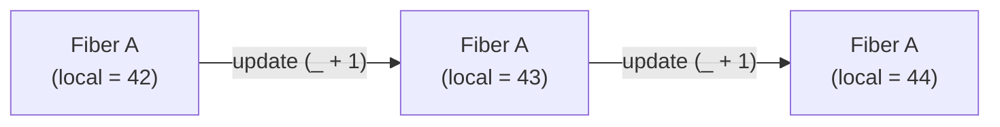
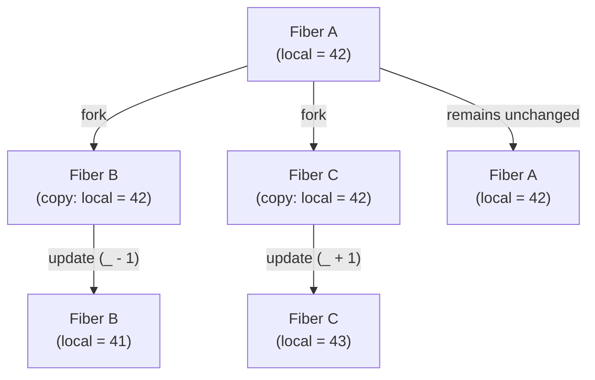
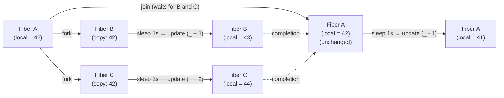

# IOLocal — Fiber-Scoped Contextual Data

`IOLocal` is a powerful Cats Effect mechanism that allows passing contextual data
along the execution of fibers, similar to how `ThreadLocal` works with threads in Java,
but with significant improvements and guarantees for concurrent asynchronous programming.

`IOLocal` provides a convenient way to manage context across different scoping regions.
In some scenarios, `IOLocal` can be considered an alternative to `cats.data.Kleisli`,
but with a more convenient API and concurrency support.

## What `IOLocal` Is Not

`IOLocal` should not be regarded as a `Ref`, as the former adheres to different laws.
**Key difference:** `Ref` is shared state, changes to which are visible to all fibers.
`IOLocal` is **fiber context**, changes to which are visible **only to the current fiber and its child fibers** (at the time of their creation).

## Core Principle: Context Isolation Between Fibers

**The golden rule of `IOLocal`:** After a child fiber is created (e.g., via `Spawn[F].start`),
it receives a **copy** of the parent's context at the moment of its creation.
Subsequent context changes in the parent or in different child fibers **do not affect each other**.
Each fiber works with its own isolated copy.

This is a fundamental difference from `ThreadLocal` in Java, where changes in a child thread may be visible to the parent
(depending on the type of `ThreadLocal`). In `IOLocal`, isolation is complete and predictable.

## Operations on `IOLocal`

`IOLocal[F, A]` provides a standard set of operations for working with context:

- `get: F[A]` — get the current context value.
- `set(a: A): F[Unit]` — set a new context value.
- `update(f: A => A): F[Unit]` — atomically update the context value.
- `getAndSet(a: A): F[A]` — get the current value and set a new one.
- `getAndUpdate(f: A => A): F[A]` — get the current value and update it.

## Scenario 1: Operations Visible Only in the Current Fiber

Within a single fiber, `IOLocal` behaves like ordinary mutable state. Updates are visible sequentially.



```dotty
import cats.effect.{IO, IOLocal}

def increment(idx: Int, local: IOLocal[Int]): IO[Unit] =
  local.update(_ + 1) >>
    local.get.flatMap(current => IO.println(s"update $idx: $current"))

val program =
  for
    local   <- IOLocal[Int](42)
    _       <- increment(1, local)
    _       <- increment(2, local)
    current <- local.get
    _       <- IO.println(s"fiber A: $current")
  yield ()

// Output:
// update 1: 43
// update 2: 44
// fiber A: 44
```

**Result:** Fiber A sequentially changes its value from 42 → 43 → 44.

## Scenario 2: Child Fibers Receive a Copy of the Context

When a fiber creates child fibers (via `.start`),
each child fiber receives a **copy** of the parent's `IOLocal` at the **moment of creation**.
Subsequent changes in the parent or child fibers do not affect each other.



```dotty
import cats.effect.{IO, IOLocal}

def update(name: String, local: IOLocal[Int], f: Int => Int): IO[Unit] =
  local.update(f) >>
    local.get.flatMap(current => IO.println(s"$name: $current"))

val program =
  for
    local   <- IOLocal[Int](42)
    fiberB  <- update("fiber B", local, _ - 1).start
    fiberC  <- update("fiber C", local, _ + 1).start
    _       <- fiberB.joinWithNever
    _       <- fiberC.joinWithNever
    current <- local.get
    _       <- IO.println(s"fiber A: $current")
  yield ()

// Output:
// fiber B: 41
// fiber C: 43
// fiber A: 42
```

**Key observations:**

- Fiber B received a copy of `42` and decreased it to `41`.
- Fiber C received a copy of `42` and increased it to `43`.
- Fiber A remains unchanged (`42`).

## Scenario 3: Parent Changes After Fork Are Not Visible to Child Fibers

Even if the parent changes its `IOLocal` **after** creating child fibers, these changes will not be visible to the child fibers.
The child fibers already received their copy at creation time.



```dotty
import cats.effect.{IO, IOLocal}

import scala.concurrent.duration.DurationInt

def updateDelayed(name: String, local: IOLocal[Int], f: Int => Int): IO[Unit] =
  IO.sleep(1.second) >>
    local.update(f) >>
    local.get.flatMap(current => IO.println(s"$name: $current"))

val program =
  for
    local  <- IOLocal[Int](42)
    fiberB <- updateDelayed("fiber B", local, _ + 1).start
    fiberC <- updateDelayed("fiber C", local, _ + 2).start
    _      <- fiberB.joinWithNever
    _      <- fiberC.joinWithNever
    _      <- updateDelayed("fiber A", local, _ - 1)
  yield ()

// Output:
// fiber B: 43   (42 + 1)
// fiber C: 44   (42 + 2)
// fiber A: 41   (42 - 1)
```

Here, `fiber A` changes its context after `fiberB` and `fiberC` have already been created.
Its changes (`-1`) apply only to itself and do not affect the child fibers.

## Real Example: Propagating TraceId

One of the most common uses of `IOLocal` is propagating trace IDs in distributed systems.
You can create a `TraceIdScope` that automatically propagates the identifier through all calls within a single fiber.

```dotty
import cats.Monad
import cats.effect.{IO, IOLocal, Sync, Resource}
import cats.effect.std.{Console, Random}
import cats.syntax.flatMap.*
import cats.syntax.functor.*

case class TraceId(value: String)

object TraceId:
  def gen[F[_]: Sync]: F[TraceId] =
    Random.scalaUtilRandom[F].flatMap(_.nextString(8)).map(TraceId(_))

trait TraceIdScope[F[_]]:
  def get: F[TraceId]
  def scope(traceId: TraceId): Resource[F, Unit]

object TraceIdScope:
  def apply[F[_]: {TraceIdScope as ev}]: TraceIdScope[F] = ev

  def fromIOLocal: IO[TraceIdScope[IO]] =
    for
      local <- IOLocal[TraceId](TraceId("global"))
    yield new TraceIdScope[IO]:
      def get: IO[TraceId] =
        local.get

      def scope(traceId: TraceId): Resource[IO, Unit] =
        Resource.make(local.getAndSet(traceId))(previous =>
          local.set(previous)
        ).void

def callRemote[F[_]: {Monad, Console, TraceIdScope}]: F[String] =
  for
    traceId <- TraceIdScope[F].get
    _ <- Console[F].println(s"Processing request. TraceId: ${traceId.value}")
  yield "some response"

def service[F[_]: {Sync, Console, TraceIdScope}]: F[String] =
  for
    traceId <- TraceId.gen[F]
    result  <- TraceIdScope[F].scope(traceId).use(_ => callRemote[F])
  yield result

val program =
  TraceIdScope.fromIOLocal.flatMap { implicit scope =>
    service[IO]
  }
```

**How this works:**

1. `TraceIdScope.fromIOLocal` creates an `IOLocal` with a default global value (`TraceId("global")`).
2. `service` generates a unique `TraceId` and calls `scope(traceId).use(...)`.
3. `scope` temporarily replaces the `IOLocal` value with the new `traceId` for the provided code block (`callRemote`).
   After exiting the block, the old value is restored.
4. `callRemote` reads the current `TraceId` via `TraceIdScope[F].get` and prints it.

Thanks to `Resource.make`, it is guaranteed that even on error or cancellation, the context will be restored correctly.

## Advanced Integration: `IOLocal` as `ThreadLocal` for Java Libraries

To support integration with Java libraries that rely on `ThreadLocal`,
Cats Effect provides an **unsafe** bridging mechanism: `IOLocal#unsafeThreadLocal`.
This allows reading and writing an `IOLocal` value in the context of the currently running thread
within a synchronous side effect (`IO.delay` or `IO.blocking`).

**Usage example (JVM-specific):**

```dotty
// Suppose we have a Java library using ThreadLocal
val javaThreadLocal = new ThreadLocal[String]()
javaThreadLocal.set("global-value")

// We want to bridge it with IOLocal to propagate context across fibers
val ioLocal = IOLocal[String].unsafeThreadLocal(javaThreadLocal)

val program =
  for
    _     <- ioLocal.set("fiber-specific-value")
    value <- IO.delay {
      // Within this delay, the ThreadLocal value will already be "fiber-specific-value"
      javaThreadLocal.get() // Returns "fiber-specific-value", not "global-value"
    }
    _ <- IO.println(value)
  yield ()
```

**Warnings and considerations:**

- To use this function, you must set the flag `cats.effect.trackFiberContext=true`
  (via a system property or environment variable).
- **Important:** Enabling context propagation reduces performance by up to 25% in Cats Effect micro-benchmarks.
  However, the impact on real applications may be significantly lower, especially if most time is spent on I/O rather than CPU.
- This is an **unsafe** API in that it breaks `IO` purity (since it interacts with a mutable `ThreadLocal`).
  Use it only as a bridge for legacy libraries when there is no other way.

## Summary and Recommendations

| Feature                            | `Ref[F, A]`                      | `IOLocal[F, A]`                                     |
|:-----------------------------------|:---------------------------------|:----------------------------------------------------|
| **Scope**                          | Global (shared)                  | Fiber-local                                         |
| **Visible to other fibers**        | Yes (everyone sees)              | No (copy only)                                      |
| **Copy on `start`**                | No (same reference)              | Yes (copy of value)                                 |
| **Atomic updates**                 | Yes (CAS)                        | Yes                                                 |
| **Typical use cases**              | Shared state, counters, caches   | Request context, TraceId, user sessions             |

**Best practices:**

1. **Use `IOLocal` for contextual data** that should be "inherited" by child fibers,
   but should not affect the parent or siblings.
2. **Avoid using `IOLocal` as a replacement for `Ref` for frequently mutated data.**
   Frequent context updates can create excessive memory and CPU overhead.
3. **Always restore context after temporary changes** using `Resource` (as in the `scope` example).
   This guarantees that errors and cancellation do not lead to "leaking" incorrect context.
4. **Integration with Java `ThreadLocal` should be used only when necessary**, test the performance impact
   and enable `cats.effect.trackFiberContext` only in environments where it's truly needed.

---

**Links:**

- [Cats effect documentation][doc]
- [Cats effect IOLocal](https://typelevel.org/cats-effect/docs/core/io-local)
- [Flavors of shared state in Cats Effect](https://blog.kubukoz.com/flavors-of-shared-state/)

[doc]: https://typelevel.org/cats-effect/docs/concepts
