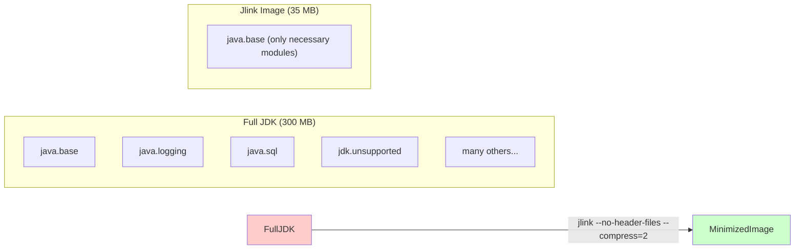

# Jlink Image

**`jlink`** is a tool included in the [Java Platform Module System (JPMS)](https://openjdk.org/projects/jigsaw/spec/), first introduced in Java 9.
It allows creating **custom, minimal JDK images** (runtimes) that contain exactly the Java modules
your application needs, and nothing more.

**Key advantages of `jlink`:**

| Feature                 | Full JDK                   | Custom Image (jlink)                          |
|:------------------------|:---------------------------|:----------------------------------------------|
| **Disk size**           | 200-300 MB                 | 20 to 70 MB (depending on the application)    |
| **Number of modules**   | All Java modules (dozens)  | Only the necessary ones (often 5-10)          |
| **Startup time**        | Standard                   | Slightly faster (fewer classes loaded)        |
| **Memory consumption**  | High                       | Lower (fewer classes in metaspace)             |
| **Compatibility**       | Full (everything included) | Limited to included modules                   |

**Typical use cases for jlink:**

- **Docker images:** You can package your app with a minimal JDK, significantly reducing the image size.
- **Serverless / FaaS:** Smaller image size → faster cold starts.
- **Embedded systems:** Every megabyte counts.
- **Desktop applications:** You distribute the program with your "own" Java, without requiring the user to install a JDK.



## Cats Effect Compatibility with jlink Images

Cats Effect applications depend **only on the `java.base` module**.
This is the most basic JDK module, containing `java.lang`, `java.io`, `java.util`, `java.nio`, `java.net`, and other fundamental packages.

A JDK build created with `jlink` **always** contains `java.base`.
Therefore, Cats Effect projects will work "out of the box" on any jlink image, without any additional flags or configuration.

```dotty
// A minimal jlink image can be created roughly like this:
// jlink --add-modules java.base --output minimal-jdk

// Your Cats Effect application will work on this image:
./minimal-jdk/bin/java -jar my-app.jar   // Everything works!
```

## The Only Limitation: Fiber Dumps

The fiber dump functionality (sending `SIGUSR1` / `SIGINFO` signal to print a dump to stderr)
depends on the `sun.misc.Signal` API. This class resides in the **`jdk.unsupported`** module.

Since a standard jlink image containing only `java.base` **does not include** `jdk.unsupported`,
the POSIX signal-based mechanism for triggering fiber dumps **will not work**.

**What exactly doesn't work:**

- Sending `kill -USR1 <pid>` on Linux.
- Pressing `Ctrl + T` on macOS (SIGINFO).
- Any other code calling `sun.misc.Signal`.

**What continues to work:**

- Everything else in the Cats Effect application.
- Programmatic fiber dump retrieval via [MBean](fiber-dumps.md) (since JMX works through a different mechanism that doesn't require `sun.misc.Signal`).

## Restoring Signal Support: The `jdk.unsupported` Module

If fiber dumps via signals are critical to you (e.g., for debugging production deadlocks),
you can include the `jdk.unsupported` module in your custom JDK image.

**The `jdk.unsupported` module provides:**

- `sun.misc.Unsafe` (low-level operations).
- `sun.misc.Signal` (POSIX signal handling).
- Other internal APIs not in the standard Java specification.

### Adding the Module Manually (via `jlink`)

```bash
# Create a JDK image with both java.base AND jdk.unsupported modules
jlink --add-modules java.base,jdk.unsupported --output jdk-with-signals

# Verify the module is included
./jdk-with-signals/bin/java --list-modules | grep jdk.unsupported
# Output: jdk.unsupported@<version>
```

### Configuration in sbt-native-packager

If you use the [`sbt-native-packager`](https://www.scala-sbt.org/sbt-native-packager/) plugin
to build Docker images or installers, you can configure `jlink` to include `jdk.unsupported`:

```dotty
// build.sbt
enablePlugins(JavaAppPackaging, JlinkPlugin)

// Add the jdk.unsupported module to the image
jlinkModules += "jdk.unsupported"

// (Optional) Specify additional modules if needed
jlinkModules ++= Seq("java.logging", "java.sql") // as needed
```

After this, the plugin will automatically pass `--add-modules java.base,jdk.unsupported` (and others) to `jlink` during the build.

## Complete Example: Building a Docker Image with a Minimal JDK

### 1. `build.sbt` Configuration

```dotty
enablePlugins(JavaAppPackaging, JlinkPlugin)

name := "cats-effect-jlink-demo"
version := "1.0.0"
scalaVersion := "3.8.3"
libraryDependencies += "org.typelevel" %% "cats-effect" % "3.7.0"

// jlink configuration
jlinkModules += "java.base"        // always included by default
jlinkModules += "jdk.unsupported"  // for signal support

Compile / mainClass := Some("com.example.Main")
```

### 2. Application Code (as usual)

```dotty
package com.example

import cats.effect.{IO, IOApp}

object Main extends IOApp.Simple:
  def run: IO[Unit] = IO.println("Hello from minimal JDK!")
```

### 3. Building the Docker Image

```bash
sbt docker:publishLocal
```

### 4. Checking the Size

```bash
docker images | grep cats-effect-jlink-demo
# cats-effect-jlink-demo   1.0.0   85 MB   (vs. ~300 MB for a full JDK)
```

## Conclusion and Recommendations

| Scenario                                                                         | Include `jdk.unsupported`? | Reason                                                       |
|:---------------------------------------------------------------------------------|:---------------------------|:-------------------------------------------------------------|
| Production app where fiber dumps are critical for debugging                      | ✅ **Yes**                  | You'll be able to trigger dumps via signals.                 |
| You use another JVM library requiring `sun.misc.Unsafe`                          | ✅ **Yes**                  | E.g., some libraries for off-heap memory operations.         |
| Minimal Docker image size is more important than debugging                       | ❌ **No**                   | The image will be slightly smaller (by ~5-10 MB).            |
| You don't use fiber dumps and don't call `sun.misc.Unsafe` directly              | ❌ **No**                   | Leave just `java.base`.                                      |
| You want the fastest possible startup time in Serverless                         | ❌ **No**                   | Fewer classes → faster loading.                              |

**Summary:** Cats Effect works great on jlink images.
The only thing that might be missing is signal support for fiber dumps.
If you need it, add the `jdk.unsupported` module.
In all other cases, an image with just `java.base` will work perfectly.

---

**Links:**

- [Cats effect documentation][doc]
- [Cats effect Jlink Image](https://typelevel.org/cats-effect/docs/core/jlink)

[doc]: https://typelevel.org/cats-effect/docs/concepts
