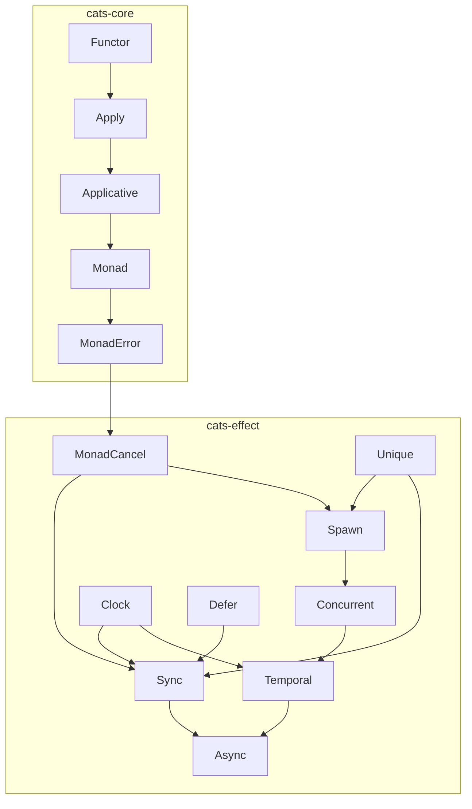

# Type Classes

## What Does It Mean to Be an Effect?

The type class hierarchy in Cats Effect defines **formal rules** that describe
what it means to be a functional effect.
This is analogous to how mathematics has axioms for numbers (e.g., commutativity of addition).

When you work with `IO`, `Resource`, `Kleisli`, or any other effectful structure,
you can rely on it satisfying certain laws. This enables:

- **Formal reasoning about code** — knowing that refactoring won't break logic
- **Writing polymorphic code** — functions that work with any effect `F[_]` supporting the required capabilities
- **Composing abstractions** — building complex programs from simple parts

## Categories of Effect Capabilities

Cats Effect organizes effect capabilities into **six main categories**,
ordered by increasing power (each subsequent category assumes the previous ones):

### 1. Resource Safety & Cancellation

**Foundational level** for all other capabilities. Enables:

- Safely releasing resources (files, database connections) on errors or cancellation
- Cancelling running effects (e.g., on timeout or explicit user cancellation)
- Protecting critical sections from interruption

**Key type classes:** `MonadCancel`, `Spawn`

### 2. Parallel Computation

Enables running multiple effects concurrently and coordinating their execution:

- Spawning fibers — lightweight logical threads
- Racing effects
- Time-slicing between fibers (cooperative multitasking)

**Key type classes:** `Spawn`, `Concurrent`

### 3. Shared State

Synchronization primitives for safe data exchange between concurrent processes:

- Atomic references (`Ref`)
- Single-use variables (`Deferred`)
- Semaphores (`Semaphore`)
- Queues (`Queue`)

**Key type classes:** `Concurrent`

### 4. Time

Working with temporal dimensions:

- Getting the current time (wall-clock and monotonic time)
- Suspending execution (`sleep`)
- Setting timeouts

**Key type classes:** `Clock`, `Temporal`

### 5. Safe Interfacing with Synchronous Side Effects — Sync Effects

Transforming ordinary synchronous code with side effects into a pure functional description:

- `delay` — wrapping side effects (`var`, `println`, `Random.nextInt`)
- `blocking` — isolating blocking operations (`Thread.sleep`, disk reads)
- `suspend` — lazy evaluation of effects

**Key type classes:** `Sync`, `Defer`

### 6. Safe Interfacing with Asynchronous Side Effects — Async Effects

Integration with callback-based async APIs:

- Transforming `(Either[Throwable, A] => Unit) => Unit` into `F[A]`
- Supporting cancellation of async operations
- Switching the execution thread pool (`evalOn`)

**Key type classes:** `Async`

## Why This Order?

The hierarchy is built so that **it is impossible to express a more powerful concept through a less powerful one** without "cheating":

- **Parallelism requires cancellation** — without the ability to cancel fibers, implementing races or timeouts safely is impossible
- **Time requires parallelism** — to observe the passage of time, you need the ability to suspend one fiber while others run
- **Async is the most powerful** — with `async`, you can create a new thread under the hood (`new Thread`)
  and emulate any other capability, but this would violate laws and safety

**Key insight:** The higher the level, the more guarantees you get, but fewer effect types can support it.
For example, `StateT` can be a `Monad`, but it cannot be `Async`,
because it cannot work with real time and side effects.

## Capabilities from Cats Core

Before discussing effects, Cats Effect relies on **basic abstractions from the Cats library**:

| Type class     | What it provides                                                 | Usage example                        |
|----------------|------------------------------------------------------------------|--------------------------------------|
| `Functor`      | `map` — value transformation                                     | `fa.map(_ + 1)`                      |
| `Apply`        | `ap` — function application in context, `product` — combining effects | `(fa, fb).mapN(_ + _)`          |
| `Applicative`  | `pure` — lifting a value into a context                          | `Applicative[IO].pure(42)`           |
| `Monad`        | `flatMap` — sequential composition with dependencies             | `fa.flatMap(a => fb.map(b => a + b))`|
| `MonadError`   | `raiseError` / `handleError` — error handling                    | `fa.handleErrorWith(e => IO.pure(0))`|

These capabilities form the **foundation** upon which the entire ecosystem is built.
Without them, effects would just be "sealed computations" without combinability.

## Functional Effect Hierarchy



Key capabilities added at each level:

| Type class         | Key operation                              | What it provides                                                                     |
|--------------------|--------------------------------------------|--------------------------------------------------------------------------------------|
| `Clock`            | `realTime`, `monotonic`                    | Working with time (wall-clock and monotonic time)                                    |
| `Sync`             | `delay`, `blocking`, `suspend`             | Lazy synchronous evaluation, isolating side effects, blocking code                   |
| `Unique`           | `unique`                                   | Generating unique tokens (e.g., for identification)                                  |
| `Defer`            | `defer`                                    | Lazy effect creation, deferring computation until execution                          |
| `MonadCancel`      | `cancelable`, `uncancelable`, `onCancel`   | Effect cancellation, protecting critical sections, registering finalizers            |
| `Spawn`            | `start`, `racePair`, `never`, `cede`       | Spawning fibers, races, cooperative multitasking                                     |
| `Concurrent`       | `ref`, `deferred`, `semaphore`, `cancelable` | Synchronization primitives (`Ref`, `Deferred`, `Semaphore`) and cancellable async calls |
| `Temporal`         | `sleep`, `timeout`, `timeoutTo`            | Delays, timeouts, working with time                                                  |
| `Async`            | `async`, `evalOn`, `executionContext`      | Async FFI (`callback → F[A]`), thread pool switching, `Future` integration           |

## Practical Significance of the Hierarchy

### For Effect Users

You can **precisely express requirements** for code:

```dotty
// Require cancellation — cannot pass a plain monad
def withTimeout[F[_]: Temporal](fa: F[String]): F[String] =
  fa.timeout(1.second)

// Require everything — only IO or similar
def runServer[F[_]: Async](port: Int): F[Unit] = ...
```

### For Library Authors

You can **write maximally generic code**:

- A Redis library may require only `Sync` (if the client is synchronous)
- An HTTP client library may require `Async` (async requests)
- A rate limiting library — `Concurrent` (needs `Ref` and `Deferred`)

### For Understanding Code

Looking at a method signature, you immediately understand **what it can do**:

- `F[_]: Monad` — sequential computations only, no errors or side effects
- `F[_]: Sync` — can perform side effects, but cannot run concurrent processes
- `F[_]: Async` — can do everything: side effects, concurrency, and asynchrony

## Summary: Laws as the Foundation of Reliability

When you write `(1 + 2) + 3`, you don't think about whether it will use an Intel or ARM processor.
The laws of arithmetic guarantee the same result.

**Similarly**, when you use `MonadCancel`, you know, for example, that:

- `uncancelable(uncancelable(fa)) == uncancelable(fa)`
- `onCancel(onCancel(fa, fin1), fin2) == onCancel(fa, fin1 *> fin2)`

This enables:

- **Refactoring with confidence** — laws guarantee that changes won't break logic
- **Property-based testing** — verifying not specific values, but law compliance
- **Composing effects** — like Lego, knowing the pieces are compatible

**Cats Effect is not just an IO library. It is a language for describing effects with formal semantics.**

---

**Links:**

- [Cats effect documentation][doc]
- [Cats effect TypeClasses](https://typelevel.org/cats-effect/docs/typeclasses)
- [Error Handling in Cats Effect Part-9](https://yadukrishnan.live/error-handling-in-cats-effect-part-9)

[doc]: https://typelevel.org/cats-effect/docs/concepts
