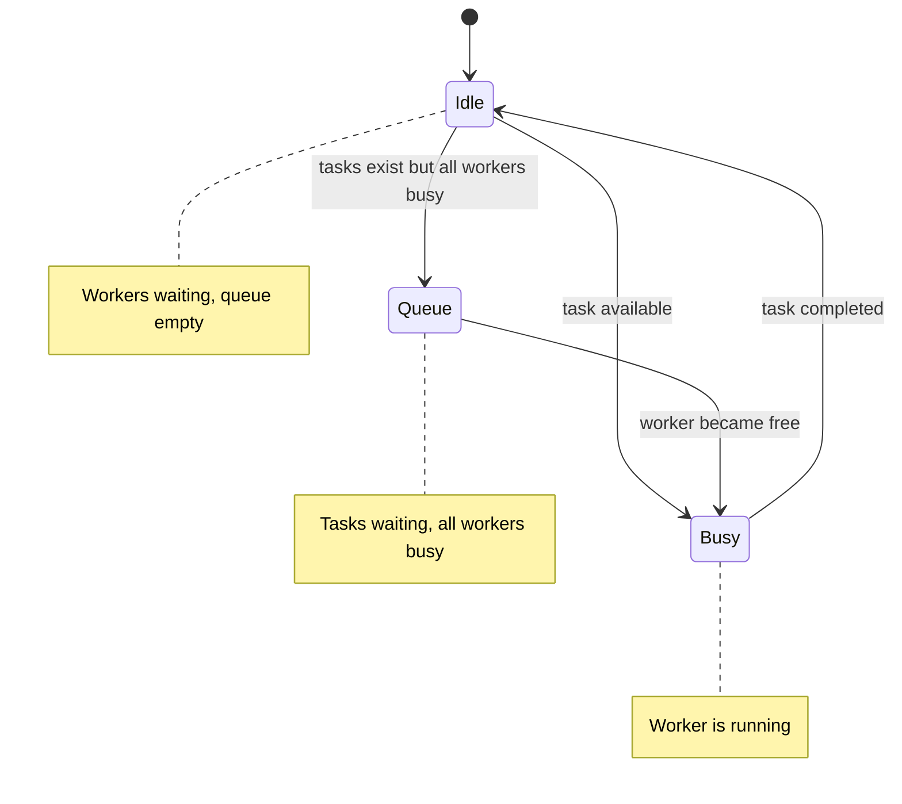

# WorkerPool

Now, using all the knowledge, we'll build a **worker pool** based on `Ref` and `Deferred`:

## General Purpose

`WorkerPool` is a **concurrent queue with a worker pool** (analogous to a thread pool, but on lightweight fibers).
It allows you to submit tasks to a queue, where they are processed by a fixed number of parallel workers.

**Key feature:** If workers are idle, tasks are passed to them **immediately** without being placed in the queue (optimization for low load).

## Implementation of a Concurrent Task Processing Pool

```dotty
import cats.*
import cats.effect.*
import cats.effect.implicits.*
import cats.implicits.*
import cats.syntax.all.*

import scala.collection.immutable.Queue
import scala.concurrent.duration.*

object WorkerPoolDemo extends IOApp.Simple:
  case class State[F[_], A](
      queue: Queue[A],
      waiting: Queue[Deferred[F, A]] // ← queue of waiting workers
  )

  class WorkerPool[F[_]: Concurrent, A](
      state: Ref[F, State[F, A]],
      workers: Int
  ):
    // Submit a task to the queue
    def submit(a: A): F[Unit] =
      state.modify {
        // There are waiting workers — give to the first one
        case State(queue, waiting) if waiting.nonEmpty =>
          val (waitingDeferred, newWaiting) = waiting.dequeue
          (State(queue, newWaiting), waitingDeferred.complete(a).void)

        // No waiting workers — put in the queue
        case State(queue, waiting) =>
          (State(queue.enqueue(a), waiting), Concurrent[F].unit)
      }.flatten

    // Start workers
    def start(workerTask: A => F[Unit]): Resource[F, Unit] =
      (1 to workers).toList.traverse { _ =>
        Resource.make(
          take.flatMap(workerTask).foreverM.start // launch
        )(_.cancel)                               // and cancel on release
      }.map(_ => ()) // combine all Resources into one

    // Retrieve a task (called by a worker)
    private def take: F[A] =
      Concurrent[F].deferred[A].flatMap { waitingDeferred =>
        state.modify {
          // There's a task in the queue — deliver immediately
          case State(queue, waiting) if queue.nonEmpty =>
            val (a, newQueue) = queue.dequeue
            (State(newQueue, waiting), a.pure[F])

          // No tasks — register the wait
          case State(queue, waiting) =>
            (
              State(queue, waiting.enqueue(waitingDeferred)),
              waitingDeferred.get
            )
        }.flatten
      }
  end WorkerPool

  object WorkerPool:
    def make[F[_]: Concurrent, A](workers: Int): Resource[F, WorkerPool[F, A]] =
      Resource.eval(
        // Empty task queue and empty waiting queue
        Concurrent[F].ref(State[F, A](Queue.empty, Queue.empty)).map { state =>
          new WorkerPool[F, A](state, workers)
        }
      )

  // Demonstration of parallel work
  def run: IO[Unit] =
    val resource: Resource[IO, WorkerPool[IO, String]] =
      for
        pool <- WorkerPool.make[IO, String](3)
        _    <- pool.start { task =>
          // Each task runs for 1 second
          IO.sleep(1.second) *>
            IO.println(
              s"✅ ${Thread.currentThread().getName} processed: $task [${java.time.LocalTime.now()}]"
            )
        }
      yield pool

    resource.use { pool =>
      for
        _ <- IO.println("🚀 Sending 10 tasks...")
        _ <- (1 to 10).toList.traverse(i => pool.submit(s"Task $i"))
        _ <- IO.sleep(5.seconds) // Give time for processing
        _ <- IO.println("🏁 Finishing work")
      yield ()
    }
  end run
end WorkerPoolDemo
```

## Imports and Dependencies

```dotty
import cats.*
import cats.effect.*
import cats.effect.implicits.*
import cats.implicits.*
import cats.syntax.all.*

import scala.collection.immutable.Queue
import scala.concurrent.duration.*
```

Main Cats Effect libraries are included (`IO`, `Concurrent`, `Resource`, `Deferred`, `Ref`),
syntax extensions for convenient work with effects (`flatMap`, `traverse`, `foreverM`),
immutable `Queue` from the standard library, and utilities for working with durations (`Duration`, `seconds`).

## State Model

```dotty
case class State[F[_], A](
    queue: Queue[A],
    waiting: Queue[Deferred[F, A]]
)
```

The pool's state at any given time consists of two components:

- `queue` — an immutable queue of pending tasks (of type `Queue[A]`). If workers are busy, tasks go here.
- `waiting` — an immutable queue of `Deferred[F, A]` instances, representing **worker fibers waiting for a task**.
  If a worker is idle but the queue is empty, it registers itself via this `Deferred` and sleeps.
  When a task appears, it "wakes" the waiting worker via `complete`.

## The WorkerPool Class

```dotty
class WorkerPool[F[_]: Concurrent, A](
    state: Ref[F, State[F, A]],
    workers: Int
):
```

- `F[_]` — the effect type (e.g., `IO`), bounded by the `Concurrent` typeclass. This gives access to `Ref`, `Deferred`, `start`, `cancel`, and other concurrent primitives.
- `A` — the type of tasks the pool processes (e.g., `String`, `Request`, `Job`, etc.).
- `state` — an atomic reference (`Ref`) to the current state. All changes happen through atomic `modify`, ensuring thread safety.
- `workers` — the number of concurrently running workers.

### submit Method — Add a Task to the Pool

```dotty
def submit(a: A): F[Unit] =
  state.modify {
    case State(queue, waiting) if waiting.nonEmpty =>
      val (waitingDeferred, newWaiting) = waiting.dequeue
      (State(queue, newWaiting), waitingDeferred.complete(a).void)

    // No waiting workers — put in the queue
    case State(queue, waiting) =>
      (State(queue.enqueue(a), waiting), Concurrent[F].unit)
  }.flatten
```

`submit` is an atomic operation that decides where to route the task:

**Case 1: There is a waiting worker** (the `waiting` queue is not empty)

- We take the waiting worker `waitingDeferred` from the queue
- The worker is already registered and waiting for a task
- We don't put the task in the queue; we **pass it directly** via `waitingDeferred.complete(a).void`
- State is updated: `waiting` becomes `newWaiting` (queue without `waitingDeferred`)
- The task starts processing immediately

**Case 2: No waiting workers** (`waiting` is empty)

- All workers are busy or not yet started
- The task is placed at the end of the queue: `queue.enqueue(a)`
- The `waiting` queue remains unchanged (empty)
- Returns `Concurrent[F].unit` (nothing to do, the task just waits in the queue)

**Important:** `.flatten` at the end unfolds the result of `modify` (which returns `F[F[Unit]]`) into `F[Unit]`.
The first layer is the state change effect, the second is the effect from the chosen branch (`waiting.complete(...)` or `unit`).

### Private Method take — Retrieve a Task

```dotty
private def take: F[A] =
  Concurrent[F].deferred[A].flatMap { waitingDeferred =>
    state.modify {
      case State(queue, waiting) if queue.nonEmpty =>
        val (a, newQueue) = queue.dequeue
        (State(newQueue, waiting), a.pure[F])
      case State(queue, waiting) =>
        (
          State(queue, waiting.enqueue(waitingDeferred)),
          waitingDeferred.get
        )
    }.flatten
  }
```

This method is called by **each worker** in an infinite loop. It either gets a task immediately or sleeps until one appears.

**Step 1:** A new `Deferred[A]` named `waitingDeferred` is created. This is the communication channel between the task sender and the sleeping worker.

**Step 2:** Atomically (`modify`) we analyze the current state:

**Case A: There are tasks in the queue, and no one is waiting**

- We extract the first task from the queue: `queue.dequeue` returns `(task, queue_without_first_element)`
- State is updated: the queue becomes shorter, `waiting` stays unchanged
- We return the task as an effect: `a.pure[F]`
- The worker gets the task immediately

**Case B: The queue is empty, no one is waiting**

- State is updated: `waiting` now contains our `Deferred` (the worker registers as waiting)
- We return `waitingDeferred.get` — this is an effect that **blocks the worker** until someone (in `submit`) calls `waitingDeferred.complete(...)`
- The worker sleeps without consuming CPU resources

**Step 3:** `.flatten` — similar to `submit`, unfolds the nested effect.

### start Method — Launch Workers

```dotty
def start(workerTask: A => F[Unit]): Resource[F, Unit] =
  (1 to workers).toList.traverse { _ =>
    Resource.make(
      take.flatMap(workerTask).foreverM.start
    )(_.cancel)
  }.map(_ => ())
```

This method creates and launches `workers` independent workers, each running in an infinite loop.

**Step 1:** For each worker (from 1 to `workers`), a [`Resource` is created](../../std/resource.md):

**On resource creation (`Resource.make`):**
- `take` is executed — the worker tries to get a task (if no tasks, it sleeps)
- `flatMap(workerTask)` — the retrieved task is passed to the user's processing function
- `.foreverM` — after processing, the worker repeats the loop (calls `take` again, etc.)
- `.start` — starts this infinite worker in a separate fiber and returns a `Fiber`

**On resource release (`Resource.make` second parameter):** `_.cancel` is called — a cancellation signal is sent to the worker fiber

**Step 2:** `.traverse` collects all `Resource[F, Fiber[F]]` into a single `Resource[F, List[Fiber[F]]]`

**Step 3:** `.map(_ => ())` — the result is not important; we return `Unit`, as we care only about lifecycle management
(canceling workers on resource release)

**Why `Resource`?** Because workers must live exactly as long as the pool is used.
On exiting `resource.use`, all workers are automatically cancelled, preventing resource leaks.

## WorkerPool Companion Object

```dotty
object WorkerPool:
  def make[F[_]: Concurrent, A](workers: Int): Resource[F, WorkerPool[F, A]] =
    Resource.eval(
      Concurrent[F].ref(State[F, A](Queue.empty, Queue.empty)).map { state =>
        new WorkerPool[F, A](state, workers)
      }
    )
```

- Factory method for creating a `WorkerPool` instance
- Initializes initial state: empty task queue, empty waiting workers queue
- Wraps creation in `Resource.eval`, because creating `Ref` is an effect
- Returns `Resource[F, WorkerPool]`, allowing easy composition with `start` in for-comprehensions

## Usage Demonstration

```dotty
def run: IO[Unit] =
  val resource: Resource[IO, WorkerPool[IO, String]] =
    for
      pool <- WorkerPool.make[IO, String](3)
      _    <- pool.start { task =>
        IO.sleep(1.second) *>
          IO.println(
            s"✅ ${Thread.currentThread().getName} processed: $task [${java.time.LocalTime.now()}]"
          )
      }
    yield pool

  resource.use { pool =>
    for
      _ <- IO.println("🚀 Sending 10 tasks...")
      _ <- (1 to 10).toList.traverse(i => pool.submit(s"Task $i"))
      _ <- IO.sleep(5.seconds) // Give time for processing
      _ <- IO.println("🏁 Finishing work")
    yield ()
  }
end run
```

**1. Creating the resource:**

- A pool with 3 workers is created
- 3 workers are started, each processing tasks with a 1-second delay
- The processing function simply prints a message about the completed task

**2. Using the pool:**

- `use` guarantees that after the block, workers are correctly stopped
- 10 tasks are sent, each via `pool.submit`
- Then the program waits 5 seconds for all tasks to be processed (they'll be processed in about 4 seconds: 3 seconds for 9 tasks in 3 threads and the remaining 10th task)

**Expected output:**

```
🚀 Sending 10 tasks...
✅ io-compute-3 processed: Task 2 [13:28:17.827536]
✅ io-compute-11 processed: Task 3 [13:28:17.827536]
✅ io-compute-2 processed: Task 1 [13:28:17.827552]
✅ io-compute-blocker-3 processed: Task 4 [13:28:18.830851]
✅ io-compute-blocker-11 processed: Task 5 [13:28:18.830850]
✅ io-compute-blocker-2 processed: Task 6 [13:28:18.831298]
✅ io-compute-blocker-16 processed: Task 7 [13:28:19.832875]
✅ io-compute-blocker-15 processed: Task 9 [13:28:19.832876]
✅ io-compute-blocker-8 processed: Task 8 [13:28:19.832876]
✅ io-compute-blocker-5 processed: Task 10 [13:28:20.834842]
🏁 Finishing work
```

**As you can see:** despite there being 10 tasks and only 3 workers, all tasks are successfully processed thanks to the queue.

## Pool Operation Diagram



## Summary

This code demonstrates an **elegant implementation of a worker pool** using Cats Effect's functional concurrent primitives:

- **Non-blocking** — workers sleep via `Deferred.get`, not consuming OS threads
- **Atomic** — all state changes happen via `Ref.modify`
- **Resource-safe** — `Resource` guarantees cancellation of all workers
- **Optimized** — tasks are passed to waiting workers without entering the queue
- **Scalable** — thousands of workers can be created, since each fiber is lightweight

---

**Links:**

- [Source code](https://gitverse.ru/artemkorsakov/scalabook/content/master/examples/src/main/scala/ru/scalabook/libs/cats/effect/WorkerPoolDemo.scala)
- [Cats effect documentation][doc]
- [Cats effect Concurrent](https://typelevel.org/cats-effect/docs/typeclasses/concurrent)

[doc]: https://typelevel.org/cats-effect/docs/concepts
