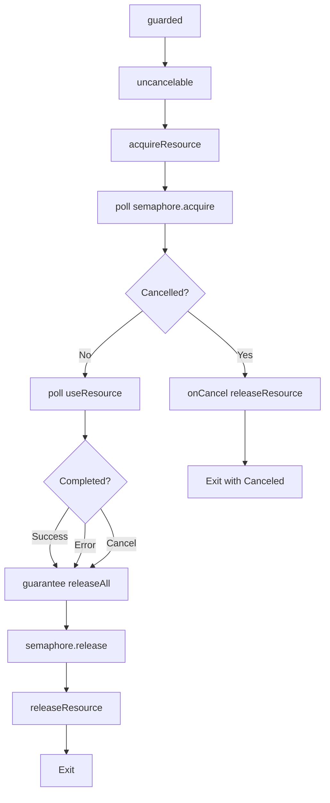

# MonadCancel — Managing Cancellations and Resources

## Introduction: The Lifecycle of a Fiber

In Cats Effect, every fiber can complete in **three different states**,
reflecting a fundamental reality of concurrent programming:

```dotty
sealed trait Outcome[F[_], E, A]

// Successful completion with a result
final case class Succeeded[F[_], E, A](fa: F[A]) extends Outcome[F, E, A]

// Completion with an error
final case class Errored[F[_], E, A](e: E) extends Outcome[F, E, A]

// Cancellation (the fiber was interrupted before completing)
final case class Canceled[F[_], E, A]() extends Outcome[F, E, A]
```

**Key difference from ordinary `MonadError`:** In traditional monads, there are only two outcomes — success or error.
Cats Effect adds a third — **cancellation**.
This means that when writing resource-safe code, we must consider not only exceptions,
but also the possibility that our fiber will be interrupted by another fiber or a timeout.

`MonadCancel[F[_], E]` is a typeclass that extends `MonadError[F, E]` from Cats,
adding the ability to **guarantee finalizer execution even on cancellation**.

## Problem: Why Isn't MonadError Enough?

Consider a typical scenario — working with a file:

```dotty
import cats.effect.IO
import cats.effect.syntax.all.*
import java.io.*

// ❌ PROBLEM: What happens on cancellation?
def readFileUnsafe(path: String): IO[String] =
  for
    fis  <- IO(new FileInputStream(path)) // Opened resource
    data <- readFromStream(fis)           // Read data
    _    <- IO(fis.close())               // Close
  yield data
```

**What can go wrong:**

1. **Error in `readFromStream`** — `close()` won't execute → resource leak
2. **Fiber cancellation during `readFromStream`** — `close()` won't execute → resource leak
3. **Cancellation right before `close()`** — resource will remain open

`MonadError` lets you handle errors via `handleError`, but it **doesn't know about cancellations**. `MonadCancel` solves this problem.

## Bracket — Guaranteed Resource Release

**`bracket`** is a fundamental combinator that works as a functional analog of `try`/`finally`, but with cancellation support:

```dotty
def bracket[A, B](acquire: F[A])(use: A => F[B])(release: A => F[Unit]): F[B]
```

**`bracket` guarantees:**

1. If `acquire` completed successfully, then `release` **will definitely be executed**
2. `release` will be executed even if:
    - `use` threw an error
    - The fiber was **cancelled** during `use`
3. `acquire` runs **atomically** and cannot be cancelled — either in full or not at all

### File Example:

```dotty
def copyFile[F[_]: Sync](src: String, dest: String): F[Unit] =
  // bracket guarantees resource closure
  val acquireSrc = Sync[F].delay(new FileInputStream(src))
  val acquireDst = Sync[F].delay(new FileOutputStream(dest))

  acquireSrc.bracket { srcStream =>
    acquireDst.bracket { dstStream =>
      // use: copy data
      transferData(srcStream, dstStream)
    } { dstStream =>
      // release for dest
      Sync[F].delay(dstStream.close())
    }
  } { srcStream =>
    // release for src
    Sync[F].delay(srcStream.close())
  }
```

**What is guaranteed:**

- Both files will be closed even on cancellation in the middle of copying
- If cancellation occurred before opening the second file, the first one will still close
- No resource leaks

### Bracket with Explicit Error Type

```dotty
import cats.effect.MonadCancel
import cats.effect.syntax.all.*

def withResource[F[_], R, A](
    acquire: F[R],
    use: R => F[A],
    release: R => F[Unit]
)(using F: MonadCancel[F, Throwable]): F[A] =
  F.bracket(acquire)(use)(release)

// Usage
withResource(
  acquire = openDatabaseConnection,
  use = conn => executeQuery(conn),
  release = conn => closeConnection(conn)
)
```

## Uncancelable — Protecting Critical Sections

**`uncancelable`** is a mechanism that **temporarily disables cancellation** within its block.

```dotty
def uncancelable[A](body: (F ~> F) => F[A]): F[A]
```

The parameter `poll` (of type `F ~> F`) is a function that allows **selectively enabling cancellation** inside the protected block.

### Simple Example:

```dotty
import cats.effect.IO
import cats.effect.syntax.all.*

val protectedBlock: IO[Int] =
  IO.uncancelable: poll =>
    for
      // This part CANNOT be cancelled
      a <- IO(42)
      b <- poll(IO(computeSomething())) // Cancellation is ALLOWED here!
      c <- IO(a + b)                    // Protected again
    yield c
```

### Why Is `poll` Needed?

Without `poll`, we couldn't create **cancellable** operations inside an uncancelable block.
This would make implementing many concurrent primitives impossible.

## Real Example: A Semaphore with Guaranteed Release

Consider a classic example — protecting critical sections with a semaphore:

```dotty
import cats.effect.{MonadCancel, Sync}
import cats.effect.std.Semaphore
import cats.effect.syntax.all.*
import cats.syntax.all.*

def guarded[F[_], R, A](
    semaphore: Semaphore[F],
    acquireResource: F[R],
    useResource: R => F[A],
    releaseResource: R => F[Unit]
)(using F: MonadCancel[F, Throwable]): F[A] =
  F.uncancelable: poll =>
    for
      // 1. Atomically acquire resource (uncancellable)
      resource <- acquireResource

      // 2. Try to acquire semaphore (CANCELLABLE!)
      //    If cancellation happens, release the resource
      _ <- poll(semaphore.acquire).onCancel(releaseResource(resource))

      // 3. Release both the resource and the semaphore
      // 4. Use the resource (CANCELLABLE!)
      releaseAll = semaphore.release >> releaseResource(resource)
      result <- poll(useResource(resource)).guarantee(releaseAll)
    yield result
```

This example shows how to correctly combine:

- **`uncancelable`** — protecting critical sections
- **`poll`** — selectively enabling cancellation
- **`onCancel`** — handling cancellation with resource cleanup
- **`guarantee`** — guaranteed execution of finalizers

Imagine you have:

1. An **expensive resource** (`R`) that must be acquired and released (e.g., a database connection, file descriptor)
2. A **semaphore** for limiting concurrent access to this resource
3. A **user operation** (`useResource`) that works with the resource

**Safety requirements:**

- The resource must be **released guaranteed** (even on errors and cancellations)
- The semaphore must be **released guaranteed** (even on errors and cancellations)
- Acquiring the resource must be **atomic** (can't cancel in the middle)
- Waiting for the semaphore must be **cancellable** (so it doesn't hang forever)
- Using the resource must be **cancellable** (so you can cancel a long-running operation)

### Function Signature

```dotty
def guarded[F[_], R, A](
    semaphore: Semaphore[F],
    acquireResource: F[R],
    useResource: R => F[A],
    releaseResource: R => F[Unit]
)(using F: MonadCancel[F, Throwable]): F[A] =
```

**Parameters:**

| Parameter         | Type          | Purpose                                              |
|-------------------|---------------|------------------------------------------------------|
| `semaphore`       | `Semaphore[F]`| Concurrent access limiter                            |
| `acquireResource` | `F[R]`        | How to acquire the resource (e.g., open a connection)|
| `useResource`     | `R => F[A]`   | What to do with the resource                         |
| `releaseResource` | `R => F[Unit]`| How to release the resource                          |

**Returns:** `F[A]` — the result of using the resource

### Step 0: Entering `uncancelable`

```dotty
F.uncancelable: poll =>
```

**What happens:** We enter a **critical section** where cancellation is **temporarily disabled**.

**Why:** We need to execute several atomic operations that should not be interrupted mid-flight.
If a cancellation occurs inside `uncancelable`, it will be "deferred" until we exit the block.

**Important:** We have the `poll` parameter — a function that allows **selectively enabling cancellation** inside the block.

### Step 1: Atomic Resource Acquisition

```dotty
resource <- acquireResource
```

**Cancellable?** ❌ **NO**

**Why:** Imagine that `acquireResource` is a complex operation that:

- Opens a database connection
- Sets up parameters
- Begins a transaction

If we allow cancelling this operation mid-flight, we could end up with a **half-initialized resource** in an undefined state.
For example, the connection is open, but the transaction wasn't started — what then to release?

**Guarantee:** Thanks to `uncancelable`, this operation will run **in full or not at all**.

### Step 2: Acquiring the Semaphore With Cancellation Handling

```dotty
_ <- poll(semaphore.acquire).onCancel(releaseResource(resource))
```

**Cancellable?** ✅ **YES** (thanks to `poll`)

**Why this is complex:**

`semaphore.acquire` can **block** the fiber if the semaphore is already taken.
We **want** other fibers to be able to interrupt this wait.
For example, if the user pressed Ctrl+C or a timeout fired.

**What `poll` does:** It "enables" cancellation for the inner operation.
Without `poll`, the call to `semaphore.acquire` would be uncancelable inside `uncancelable`.

**What `onCancel` does:** If cancellation **does occur** while waiting for the semaphore,
we must release the `resource` that we already acquired in Step 1.

**Execution scenario:**

- Normal scenario:
    - `resource` acquired
    - `semaphore.acquire()` — waits 1 second, gets access
    - `onCancel` doesn't trigger (no cancellation occurred)
- Cancellation scenario:
    - `resource` acquired
    - `semaphore.acquire()` — started waiting
    - External fiber calls `fiber.cancel()`
    - `poll(semaphore.acquire)` receives the cancellation signal
    - `onCancel(releaseResource(resource))` — resource is released
    - Fiber completes with `Canceled()`

**Why this is safe:** If we can't acquire the semaphore (because we were cancelled), we don't need the resource — we release it.

### Step 3: Creating a Combined Release

```dotty
releaseAll = semaphore.release >> releaseResource(resource)
```

**Cancellable?** ❌ **NO** (this is just a definition, not execution)

**What it is:** We create an **effect** that:

1. Releases the semaphore (`semaphore.release`)
2. Releases the resource (`releaseResource(resource)`)

**Important:** Order matters! First release the semaphore (so other fibers can proceed), then the resource.

### Step 4: Using the Resource with `guarantee`

```dotty
result <- poll(useResource(resource)).guarantee(releaseAll)
```

**Cancellable?** ✅ **YES** (thanks to `poll`)

**What's happening here:**

1. **`poll(useResource(resource))`** — execute the user operation with **cancellation enabled**.
    This is important because `useResource` can be long-running (file processing, network request), and we must be able to interrupt it.

2. **`.guarantee(releaseAll)`** — guarantee that `releaseAll` will be executed **in all cases**:
    - If `useResource` completed successfully → execute `releaseAll`
    - If `useResource` failed with an error → execute `releaseAll`
    - If `useResource` was cancelled → execute `releaseAll`

**Comparison of `guarantee` and `bracket`:**

```dotty
// guarantee — simplified version of bracket
fa.guarantee(finalizer)
// Equivalent to:
fa.bracket(_ => finalizer)(_ => F.unit)

// bracket — more flexible, allows using the result
acquire.bracket(use)(release)
```

### Complete Picture: Execution Flows

#### Scenario 1: Successful Execution

```
1. Enter uncancelable
2. resource = acquireResource() ─────────────────► Resource acquired
3. poll(semaphore.acquire) ─────────────────────► Semaphore acquired
4. poll(useResource(resource)) ─────────────────► Result obtained
5. releaseAll = semaphore.release + releaseResource(resource)
6. Exit uncancelable
```

#### Scenario 2: Error in `useResource`

```
1. Enter uncancelable
2. resource = acquireResource() ─────────────────► Resource acquired
3. poll(semaphore.acquire) ─────────────────────► Semaphore acquired
4. poll(useResource(resource)) ──► ERROR!
5. guarantee catches the error
6. releaseAll() ────────────────────────────────► Release semaphore and resource
7. Error is propagated further
```

#### Scenario 3: Cancellation During Semaphore Wait

```
1. Enter uncancelable
2. resource = acquireResource() ─────────────────► Resource acquired
3. poll(semaphore.acquire) ──► START WAITING
4. External cancellation!
5. poll receives cancellation signal
6. onCancel(releaseResource(resource)) ─────────► Release resource
7. Fiber completes with Canceled()
8. Semaphore was never acquired, so not released
```

#### Scenario 4: Cancellation During `useResource`

```
1. Enter uncancelable
2. resource = acquireResource() ─────────────────► Resource acquired
3. poll(semaphore.acquire) ─────────────────────► Semaphore acquired
4. poll(useResource(resource)) ──► SUDDEN CANCELLATION
5. guarantee catches the cancellation
6. releaseAll() ────────────────────────────────► Release semaphore and resource
7. Fiber completes with Canceled()
```

### Visualization: Call Stack



This pattern is so important that it is extracted into the standard library as `Semaphore.permit.use` and `Resource`.

## Deep Dive into the Semantics of `poll`

### The Problem `poll` Solves

`poll` is perhaps the **most difficult to understand** element of Cats Effect.
Many developers use the library for years but don't fully grasp why `poll` works the way it does, and not otherwise.

In this section, we'll break down the **deep root cause** of this design decision
and why alternatives (for example, a hypothetical `cancelable` function) would lead to catastrophic consequences.

### Why `poll`, Not `cancelable`?

#### Hypothetical Alternative: A `cancelable` Function

Imagine that instead of `poll`, we had a `cancelable` function that simply "enables" cancellation inside `uncancelable`:

```dotty
// ❌ HYPOTHETICAL DESIGN
F.uncancelable: cancelable =>
  // cancelable simply enables cancellation for inner operations
  for
    r      <- acquireResource
    _      <- cancelable(semaphore.acquire).onCancel(releaseResource(r))
    result <- cancelable(useResource(r))
  yield result
```

At first glance, this looks simpler and more understandable.

### The Impossible Question: What Is `uncancelable` If You Have `cancelable`?

If we have `cancelable`, which can **enable cancellation** anywhere, a fundamental contradiction arises:

**What does `uncancelable` mean if someone can always use `cancelable`?**

Consider an example:

```dotty
// Assume we have cancelable
def badProgram[F[_]: MonadCancel]: F[Unit] =
  F.uncancelable: cancelable =>
    // We're inside an uncancelable block
    F.delay(println("Starting"))

    // But we can enable cancellation anywhere!
    cancelable(F.canceled) // Self-cancellation!

    F.delay(println("End")) // Will this execute or not?
```

**Question:** Will `println("End")` execute?

If `cancelable` really enables cancellation, then `F.canceled` must interrupt execution.
But then `uncancelable` loses its meaning — it no longer guarantees atomicity!

If `cancelable` does **not** enable cancellation for `canceled`, how should it work with other operations?

### The Arms Race Between `uncancelable` and `cancelable`

If `cancelable` existed, developers could write code like this:

```dotty
// Absurd scenario with cancelable
F.uncancelable: cancelable1 =>
  F.uncancelable: cancelable2 =>
    cancelable1(     // Enable cancellation via outer cancelable
      cancelable2(   // Enable cancellation via inner cancelable
        F.uncancelable( // And so on forever
          // ... what's happening here?
        )
      )
    )
```

This leads to **non-deterministic behavior**:

- Which `cancelable` has priority?
- If the inner `cancelable` enables cancellation and the outer one disables it — who wins?
- Can you "override" cancellation multiple times?

```dotty
// Example of a paradox
F.uncancelable: cancelable =>
  // cancelable enables cancellation
  cancelable(
    F.uncancelable: _ =>
      // But cancellation is disabled again here!
      // But cancelable from the outer scope still exists
      // What to do?!
  )
```

**No system with such contradictory requirements can be deterministic.**

### The Solution: `poll` as an "Annihilator", Not a "Switch"

Instead of creating `cancelable`, which **enables** cancellation,
the authors of Cats Effect created `poll`, which **annihilates** the effect of `uncancelable`.

#### Mathematical Analogy

```dotty
// poll "cancels" its enclosing uncancelable
uncancelable(poll => poll(fa)) === fa

// This is akin to a mathematical identity:
// f(f^(-1)(x)) === x
// where f = uncancelable, f^(-1) = poll
```

### Nested `uncancelable`: Composition Rules

#### Scenario 1: Inner `poll`

```dotty
MonadCancel[F].uncancelable: outer =>
  MonadCancel[F].uncancelable: inner =>
    inner(fa)  // poll of the inner uncancelable
```

**Breakdown:**

1. The inner `poll` (via `inner`) **annihilates** the inner `uncancelable`
2. The outer `uncancelable` remains active
3. Result:
    `MonadCancel[F].uncancelable(o => MonadCancel[F].uncancelable(i => i(fa)))`
    equals `MonadCancel[F].uncancelable(o => fa)`

**Why:** The inner shield is canceled, but the outer one continues protecting.

#### Scenario 2: Outer `poll` Inside the Inner Block

```dotty
MonadCancel[F].uncancelable: outer =>
  MonadCancel[F].uncancelable: inner =>
    outer(fa)  // poll of the outer uncancelable
```

**Breakdown:**

1. `outer(fa)` tries to annihilate the **outer** `uncancelable`
2. But we are **inside** the inner `uncancelable`
3. `outer` doesn't act because we haven't exited the inner block yet
4. Result:
    `MonadCancel[F].uncancelable(o => MonadCancel[F].uncancelable(i => o(fa)))`
    equals `MonadCancel[F].uncancelable(o => MonadCancel[F].uncancelable(i => fa))`

**Important rule:** `poll` acts **only** on the `uncancelable` that created it, and **only** at the stack level where it was called.

#### Scenario 3: Composing `poll`s

```dotty
MonadCancel[F].uncancelable: outer =>
  MonadCancel[F].uncancelable: inner =>
    inner(outer(fa))  // inner.poll first, then outer.poll
```

**Breakdown:**

1. `inner(outer(fa))` — `inner.poll` is applied first
2. The inner `uncancelable` is annihilated
3. Now `outer(fa)` is applied to the result
4. The outer `uncancelable` is also annihilated
5. Result: `fa` (fully unprotected)

**Order matters:** `poll`s are applied **from inner to outer**, like peeling an onion.

### Why This Design? Preserving Local Reasoning

#### Key Principle: Locality

A developer reading code should understand its behavior **without looking into** the implementation of called functions.

Consider an example that would **break** if `poll` worked like `cancelable`:

```dotty
// A function that relies on the uncancelability of its argument
def foo[F[_]: MonadCancel, A](inner: F[A]): F[A] =
  F.uncancelable: _ =>
    // We assume that inner CANNOT be cancelled
    // because we need to clean up the resource after it
    inner <* cleanupImportantResource

// A bar that uses poll
def bar[F[_]: MonadCancel]: F[String] =
  F.uncancelable: poll =>
    poll(F.pure("bar"))  // Enable cancellation for a trivial operation

// Composition
val x = foo(bar)
```

#### If `poll` Enabled Cancellation (WRONG):

```dotty
// Unrolling foo(bar):
F.uncancelable: _ =>
  // Substitute bar:
  F.uncancelable{ cancelable =>
    cancelable(F.pure("bar"))
  } <* cleanupImportantResource
```

**Problem:** The inner `cancelable` makes the inner `uncancelable` block cancellable.
Cancellation can now occur **inside** this block, right before `cleanupImportantResource`!
The resource won't be cleaned up, violating `foo`'s contract.

#### With Real `poll` (Annihilation):

```dotty
// Real poll simply removes the inner uncancelable:
F.uncancelable: _ =>
  // bar becomes F.pure("bar") (poll annihilated the inner uncancelable)
  F.pure("bar") <* cleanupImportantResource
```

**Result:** Everything is predictable. `cleanupImportantResource` will definitely execute,
because there are no internal `uncancelable` blocks that could be "pierced".

## Self-Cancellation

**Self-cancellation** is the unique ability of a fiber to cancel **itself**.

```dotty
// Cancel the current fiber
val canceled: F[Unit] = MonadCancel[F].canceled
```

### Self-Cancellation Example:

```dotty
import cats.effect.IO
import cats.effect.unsafe.implicits.global

val program: IO[Unit] =
  for
    fiber <- (
      IO.println("Starting work...") >>
        IO.canceled >> // Self-cancellation
        IO.println("This WILL NOT execute")
    ).start
    result <- fiber.join
    _      <- IO.println(s"Result: $result")
  yield ()

program.unsafeRunSync()
// Output:
// Starting work...
// Result: Canceled()
```

### Self-Cancellation vs `raiseError`

| Characteristic      | `canceled`  | `raiseError`             |
|---------------------|-------------|--------------------------|
| Result type         | `F[Unit]`   | `F[Nothing]`             |
| Can be handled?     | `onCancel`  | `handleError`/`attempt`  |
| Suppressed by `uncancelable`? | ✅ Yes    | ❌ No                    |
| Can be "recovered"? | ❌ No        | ✅ Yes (via `attempt`)   |

**Important:** Inside `uncancelable` blocks, `canceled` becomes `F[Unit]` (no cancellation occurs):

```dotty
IO.uncancelable: poll =>
  for
    _ <- IO.println("This will execute")
    _ <- IO.canceled // Here canceled DOES NOTHING!
    _ <- IO.println("This will also execute, cancellation suppressed")
  yield ()
// Cancellation will happen AFTER exiting uncancelable!
```

### Deferred Self-Cancellation:

```dotty
import cats.effect.unsafe.implicits.global
import cats.effect.IO

val run =
  for
    fib <- (
      IO.uncancelable { _ =>
        IO.canceled >>
          IO.println("This will be printed, as cancellation is suppressed")
      } >>
        IO.println(
          "This will never be printed, cancellation occurred after uncancelable"
        )
    ).start
    res <- fib.join
  yield res

run.unsafeRunSync()
// Output:
// This will be printed, as cancellation is suppressed
// (second println didn't execute)
```

Self-cancellation is intended for use scenarios such as [supervisor networks](https://erlang.org/doc/man/supervisor.html)
and other complex constructs that require the ability to manipulate one's own execution in such ways.
In application code, it's not commonly seen.

## Summary: Key Concepts of MonadCancel

| Concept             | Purpose                                             | Example Use Case                       |
|---------------------|-----------------------------------------------------|----------------------------------------|
| **`bracket`**       | Guaranteed resource release                         | Working with files, connections        |
| **`uncancelable`**  | Protecting critical sections from cancellation      | Atomic operations, resource allocation |
| **`poll`**          | Selectively enabling cancellation inside `uncancelable` | Waiting for semaphore in a protected block |
| **`canceled`**      | Fiber self-cancellation                             | Supervisors, complex concurrent structures |
| **`onCancel`**      | Registering a cancellation handler                  | Cleaning up resources on cancellation  |

**Golden rule:** Use `bracket` for resources, `uncancelable` for atomic operations,
and remember that `poll` is your only way to yield the floor inside a protected section.

---

**Links:**

- [Cats effect documentation][doc]
- [Cats effect MonadCancel](https://typelevel.org/cats-effect/docs/typeclasses/monadcancel)
- [Baeldung: Cancellation in Cats Effect](https://www.baeldung.com/scala/cats-effect-cancellation)
- [Cancellation of IO/Fiber in Cats Effect 3 Part 6](https://yadukrishnan.live/cancellation-of-iofiber-in-cats-effect-3-part-6)

[doc]: https://typelevel.org/cats-effect/docs/concepts
