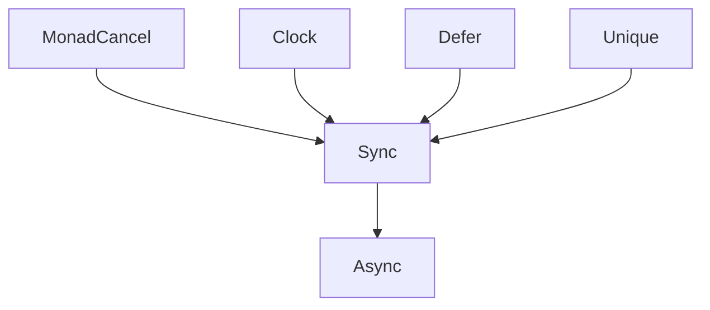

# Sync — Synchronous FFI in Cats Effect

## Introduction: What Is a Synchronous FFI?

**FFI (Foreign Function Interface)** is a mechanism [for calling code in other languages](https://ru.wikipedia.org/wiki/%D0%98%D0%BD%D1%82%D0%B5%D1%80%D1%84%D0%B5%D0%B9%D1%81_%D0%B2%D0%BD%D0%B5%D1%88%D0%BD%D0%B8%D1%85_%D1%84%D1%83%D0%BD%D0%BA%D1%86%D0%B8%D0%B9)
or, in the context of Cats Effect, **interacting with the "impure" world of side effects** from pure functional code.

`Sync[F[_]]` provides a safe way to suspend (suspend) synchronous side effects in the effect context `F[_]`.
It is a bridge between the imperative world (Java/Scala with side effects) and the functional world (Cats Effect).

```dotty
trait Sync[F[_]] extends MonadCancel[F, Throwable] with Clock[F] with Defer[F]
    with Unique[F]:
  def delay[A](thunk: => A): F[A]
  def blocking[A](thunk: => A): F[A]
  def interruptible[A](thunk: => A): F[A]
  def interruptibleMany[A](thunk: => A): F[A]
```

## The Problem `Sync` Solves

In pure functional programming, we don't have direct access to side effects. You can't just write:

```dotty
// ❌ Can't do this — side effect executes immediately 
// and isn't referentially transparent
val inc: Long = counter.incrementAndGet()
```

Instead, we **describe** the computation as a value `F[A]`, which will be executed later by the Cats Effect runtime.
`Sync` provides primitives for such description.

## Key Distinction: Blocking vs Non-Blocking Operations

Before using `Sync` methods, it's important to understand the difference:

| Characteristic      | Non-blocking operations                                                    | Blocking operations                                                    |
|---------------------|----------------------------------------------------------------------------|------------------------------------------------------------------------|
| **What they do**     | Fast computations, memory work, atomic operations                         | I/O waiting, synchronization, `Thread.sleep`                           |
| **Examples**         | `AtomicLong.incrementAndGet()`, computations `x + y`, collection work     | File reading, network requests, `Future.get()`, `CountDownLatch.await()` |
| **Execution time**   | Nanoseconds / microseconds                                                | Milliseconds, seconds, more                                            |
| **Impact on thread** | Doesn't block the thread                                                  | Blocks the thread for the entire duration                              |

**Why this matters for Cats Effect:**

- Cats Effect uses a limited pool of compute threads (typically = number of CPU cores)
- Blocking such a thread can stop the entire system
- Blocking operations must be isolated in special pools

## Detailed Breakdown of Sync Methods

### `delay` — For Non-Blocking Side Effects

```dotty
def delay[A](thunk: => A): F[A]
```

**Purpose:** Suspending fast, non-blocking side effects.

**When to use:**

- Working with `AtomicXXX`
- Simple array/collection operations
- Random number generation (`Random.nextInt`)
- Calling methods that don't block

**Examples:**

```dotty
import cats.effect.Sync
import java.util.concurrent.atomic.AtomicLong
import scala.util.Random

def incrementCounter[F[_]: Sync](counter: AtomicLong): F[Long] =
  Sync[F].delay(counter.incrementAndGet())

def getRandomNumber[F[_]: Sync]: F[Int] =
  Sync[F].delay(Random.nextInt(100))

def currentTimeMillis[F[_]: Sync]: F[Long] =
  Sync[F].delay(System.currentTimeMillis())
```

**Important:** `delay` should NOT be used for blocking operations!

```dotty
// ❌ BAD: blocking operation via delay
val badFileRead: IO[String] = IO.delay:
  Source.fromFile("huge-file.txt").mkString // Blocks the compute thread!

// ✅ CORRECT: use blocking
val goodFileRead: IO[String] = IO.blocking:
  Source.fromFile("huge-file.txt").mkString
```

### `blocking` — For Blocking Operations

```dotty
def blocking[A](thunk: => A): F[A]
```

**Purpose:** Executing blocking operations in a special thread pool.

**How it works:**

1. Cats Effect has a **separate thread pool for blocking operations** (usually unlimited or with a large number of threads)
2. `blocking` moves the execution to this pool
3. The compute pool (compute pool) remains free for other fibers
4. After the operation completes, control returns to the compute pool

**When to use:**

- Reading/writing files
- Network requests via synchronous clients (JDBC, HttpURLConnection)
- `Thread.sleep`
- Waiting on locks (`CountDownLatch`, `Semaphore` from Java)
- Working with `java.io` (not `java.nio`)

**Examples:**

```dotty
import cats.effect.Sync

import scala.io.Source
import java.io.*
import java.net.*

def readFile[F[_]: Sync](path: String): F[String] =
  Sync[F].blocking:
    val source = Source.fromFile(path)
    try source.mkString
    finally source.close()

def jdbcQuery[F[_]: Sync](conn: Connection, sql: String): F[ResultSet] =
  Sync[F].blocking:
    conn.createStatement().executeQuery(sql) // JDBC is blocking!

def sleepSeconds[F[_]: Sync](seconds: Int): F[Unit] =
  Sync[F].blocking(Thread.sleep(seconds * 1000L))
```

### `interruptible` — Blocking Operations With Cancellation Support

```dotty
def interruptible[A](thunk: => A): F[A]
```

**Purpose:** Executing a blocking operation that can be interrupted on fiber cancellation.

**Problem it solves:** Ordinary blocking operations (via `blocking`) **cannot be cancelled** until they naturally complete.
For example, if `Thread.sleep(10000)` was called and the fiber was cancelled after 1 second, it will still wait all 10 seconds.

**How it works:**

1. When `interruptible` is launched, Cats Effect remembers the thread on which the operation runs
2. On fiber cancellation, the thread receives an interrupt signal (`Thread.interrupt()`)
3. The blocking operation should react to the interrupt (usually by throwing `InterruptedException`)

**When to use:**

- Long blocking operations (tens of seconds or more)
- Operations that can react to interruption
- When the ability to cancel quickly is important

**Examples:**

```dotty
import cats.effect.{IO, IOApp, Sync}
import scala.concurrent.duration.*

def longRunningBlocking[F[_]: Sync]: F[String] =
  Sync[F].interruptible:
    // Simulate a long operation that responds to interruption
    (1 to 100).foldLeft("") { case (result, i) =>
      // Check for interruption at each step
      if Thread.currentThread().isInterrupted then
        throw new InterruptedException()
      else
        Thread.sleep(100) // simulate work
        s"Step $i\n"
    }

// Usage with timeout
val program: IO[Unit] =
  for
    fiber <- longRunningBlocking[IO].start
    _     <- IO.sleep(500.millis) // let it run a bit
    _ <- fiber.cancel // Cancel — interruptible will allow interrupting the operation!
    _ <- fiber.join
  yield ()
```

### `interruptibleMany` — Multiple Interruption Attempts

```dotty
def interruptibleMany[A](thunk: => A): F[A]
```

**Purpose:** A more aggressive version of `interruptible` that keeps sending interrupt signals until the operation completes.

**Difference between `interruptible` and `interruptibleMany`:**

| Characteristic                | `interruptible`                                     | `interruptibleMany`                                   |
|-------------------------------|-----------------------------------------------------|-------------------------------------------------------|
| **Number of interrupt attempts** | One                                              | Multiple, until the operation completes               |
| **When to use**                | Operations that quickly respond to interruption     | Operations that ignore the first signal               |
| **Example**                    | `Thread.sleep`, `Object.wait`                       | Loops with their own interrupt handling               |

**When you need `interuptibleMany`:**

Some blocking operations don't respond to the first interrupt signal:

- Certain socket implementations
- Custom loops that catch `InterruptedException`
- Operations that restore the interrupt status

```dotty
def stubbornBlockingOperation: Unit =
  try
    // Some long operation
    Thread.sleep(10000)
  catch
    case _: InterruptedException =>
      // Ignoring the interrupt! Bad practice, but it happens
      Thread.currentThread().interrupt() // restored the flag
      // continuing work...
      Thread.sleep(10000)

// interruptible may not work with such code
val bad: IO[Unit] = Sync[IO].interruptible(stubbornBlockingOperation)

// interruptibleMany will repeatedly send interrupts
val good: IO[Unit] = Sync[IO].interruptibleMany(stubbornBlockingOperation)
```

## Hierarchy and Relationship with Other Types



`Sync` is a **central typeclass** that:

- Inherits `MonadCancel` (cancellation support)
- Inherits `Clock` (working with time)
- Inherits `Defer` (lazy evaluation)
- Inherits `Unique` (unique tokens)
- Is the parent of `Async` (asynchronous operations)

## Peculiarities and Pitfalls

### 1. Never Use `delay` for Blocking Operations

```dotty
// ❌ BAD — will block the compute thread
val bad: IO[Unit] = IO.delay(Thread.sleep(10000))

// ✅ GOOD — uses the blocking pool
val good: IO[Unit] = IO.blocking(Thread.sleep(10000))
```

### 2. Not All Blocking Operations Can Be Interrupted

```dotty
// Some operations don't react to interrupt()
val socketRead: IO[Array[Byte]] = IO.interruptible:
  val socket = new Socket("example.com", 80)
  val buffer = new Array[Byte](1024)
  socket.getInputStream.read(buffer) // Can ignore interrupts!

// Solution: use async alternatives (NIO, fs2.io)
```

### 3. `interruptible` Doesn't Guarantee Instant Cancellation

```dotty
val op: IO[Unit] = IO.interruptible:
  // If the operation doesn't check the interrupt status,
  // cancellation may be delayed
  var i = 0L
  while i < Long.MaxValue do i += 1 // CPU-bound, doesn't react to interrupt()
```

### 4. Proper Handling of `InterruptedException`

```dotty
def properInterruptibleOp[F[_]: Sync]: F[Unit] =
  Sync[F].interruptible:
    try
      Thread.sleep(10000)
    catch
      case _: InterruptedException =>
        // IMPORTANT: restore the interrupt status
        Thread.currentThread().interrupt()
        throw new InterruptedException()
```

## Summary: Choosing the Right Method

| Situation                                             | Method              | Example                                          |
|-------------------------------------------------------|---------------------|--------------------------------------------------|
| Fast computation (nanoseconds/microseconds)           | `delay`             | `counter.incrementAndGet()`                      |
| File reading, JDBC query                              | `blocking`          | `Source.fromFile().mkString`                     |
| Long blocking call with cancellation option           | `interruptible`     | `Thread.sleep(10000)`                            |
| "Stubborn" blocking call                              | `interruptibleMany` | Custom loops ignoring interrupts                 |

**Golden rule:** Always ask yourself — "Does this operation block the thread?"
If yes, use `blocking`, `interruptible`, or `interruptibleMany`. If no — use `delay`.
The correct choice ensures that your Cats Effect program is responsive, scalable, and correctly handles cancellations.

---

**Links:**

- [Cats effect documentation][doc]
- [Cats effect Sync](https://typelevel.org/cats-effect/docs/typeclasses/sync)

[doc]: https://typelevel.org/cats-effect/docs/concepts
