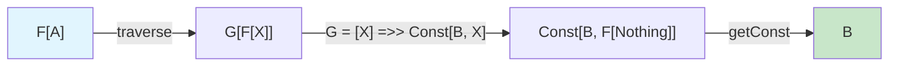

# Const: Constant Type

## A Strange Data Type

```dotty
final case class Const[A, B](getConst: A)
```

At first glance, `Const` seems like a strange data structure — it has two type parameters, but stores only a value of the first type.
What's the point? It turns out it has many uses,
being an excellent example of consistency and elegance in functional programming.

## Const Concept

The `Const` type can be viewed as a typed analog of the `const` function:

```dotty
def const[A, B](a: A)(b: => B): A = a
```

The `const` function takes two arguments and simply returns the first, ignoring the second.
The `Const` type takes two type parameters, but stores only a value of the first type.
The second type parameter is never used in the data — it is called a **phantom type**.

### Comparison with other types

| Data type        | Parameters | Stored value     | Use of second parameter   |
|------------------|------------|------------------|---------------------------|
| `Const[A, B]`    | `A`, `B`   | Only `A`         | Phantom (unused)          |
| `Either[E, A]`   | `E`, `A`   | `E` or `A`       | Used for error            |
| `Tuple2[A, B]`   | `A`, `B`   | `A` and `B`      | Both are used             |
| `Id[A]`          | `A`        | `A`              | Only one parameter        |

## Why is this useful?

It might seem that `Const` offers no advantages over a type without a second parameter.
However, the existence of the second parameter proves useful in certain contexts.

## Implementing Lenses via Const

Lenses are a powerful abstraction for working with nested data structures.
They allow getting, setting, and modifying values within composite types.

```dotty
trait Lens[S, A]:
  def get(s: S): A
  def set(s: S, a: A): S
  def modify(s: S)(f: A => A): S = set(s, f(get(s)))
```

Where `S` is the "source" and `A` is the "target".

### Effectful Modifications

Sometimes we need effectful modifications — for example, a modification that may fail (`Option`)
or return multiple values (`List`):

```dotty
trait Lens[S, A]:
  def get(s: S): A
  def set(s: S, a: A): S

  def modify(s: S)(f: A => A): S = set(s, f(get(s)))

  def modifyOption(s: S)(f: A => Option[A]): Option[S] =
    f(get(s)).map(a => set(s, a))

  def modifyList(s: S)(f: A => List[A]): List[S] =
    f(get(s)).map(a => set(s, a))
```

Note that `modifyOption` and `modifyList` have the same implementation.
The only thing they need is a `map` operation over the data type.
Being good functional programmers, we abstract this:

```dotty
import cats.Functor
import cats.syntax.all.*

trait Lens[S, A]:
  def get(s: S): A
  def set(s: S, a: A): S

  def modify(s: S)(f: A => A): S = set(s, f(get(s)))

  def modifyF[F[_]: Functor](s: S)(f: A => F[A]): F[S] =
    f(get(s)).map(a => set(s, a))
```

Now we can redefine `modify` via `modifyF`, using [`Id`](id.md).
Also, `set` can be viewed as a modification that ignores the current value.

```dotty
trait Lens[S, A]:
  def modifyF[F[_]: Functor](s: S)(f: A => F[A]): F[S]

  def set(s: S, a: A): S         = modify(s)(_ => a)
  def modify(s: S)(f: A => A): S = modifyF[Id](s)(f)
  def get(s: S): A
```

### Problem: how to implement `get` via `modifyF`?

`get` cannot be defined via modification — modifications change an existing value, while `get` extracts it.
But let's try.

In `modifyF`, we pass `S` and a function `A => F[A]`. The difficulty is obtaining `A` from `F[S]`.
If we think of `F` as a constant function at the type level, which accepts any type
and returns some constant type (e.g. `A`), then this resembles `Const`.

`Const` takes two parameters, so one needs to be fixed.
The function returns `F[S]`, but we need `A`.
This means the first parameter of `Const` must be `A`, while the second remains free:

```
Const[A, _] instead of F[_]
```

Now the function requires `A => Const[A, A]` and returns `Const[A, S]`.
From the definition of `Const`, we know that the value of `Const[X, Y]` is equivalent to `X` (with some wrapping).
So we need a function `A => A`. The only thing we can do is take `A` and return it (wrapped in `Const`).

### Implementing Functor for Const

Before using, notice that `modifyF` requires a `Functor` for `F[_]`.
We need to define a [`Functor`] instance for `Const` with the first parameter fixed:

```dotty
given constFunctor[X]: Functor[[A] =>> Const[X, A]] =
  new Functor[[A] =>> Const[X, A]]:
    // Const[X, A] ~= X, so the function f is not needed
    extension [A](fa: Const[X, A])
      def map[B](f: A => B): Const[X, B] = Const(fa.getConst)
```

### Implementing `get` via `modifyF`

Now let's put it all together:

```dotty
trait Lens[S, A]:
  def modifyF[F[_]: Functor](s: S)(f: A => F[A]): F[S]

  def set(s: S, a: A): S         = modify(s)(_ => a)
  def modify(s: S)(f: A => A): S = modifyF[Id](s)(f)

  def get(s: S): A =
    val storedValue = modifyF[[B] =>> Const[A, B]](s)(a => Const(a))
    storedValue.getConst
```

This works! We obtain a `Const[A, S]` and simply extract the stored value `A`.

**What's happening here?**

We treat the effectful "modification" as a storage operation — we take `A` and store it in `Const`.
Knowing only that `F[_]` has a `Functor` instance, it can only apply `map` to `Const`, which won't change the stored value.
After `modifyF` returns a new `S`, we extract the stored `A` and we are done!

## Traverse and Foldable

In the well-known article ["The Essence of the Iterator Pattern"](https://www.cs.ox.ac.uk/jeremy.gibbons/publications/iterator.pdf)
by Jeremy Gibbons and Bruno Oliveira, a functional approach to iterating over data collections is described.
Among the abstractions presented — [`Foldable`]
and [`Traverse`]:

```dotty
import cats.{Applicative, Monoid}

trait Foldable[F[_]]:
  // Folding a collection F[A] using a monoid B
  def foldMap[A, B: Monoid](fa: F[A])(f: A => B): B

trait Traverse[F[_]]:
  // Traversing a collection with an effectful function
  def traverse[G[_]: Applicative, A, B](fa: F[A])(f: A => G[B]): G[F[B]]
```

These two type classes seem unrelated — the first reduces a collection to a single value,
the other traverses a collection with an effectful function, collecting results.
Surprisingly, `Traverse` includes `Foldable`.

### Implementing Foldable via Traverse

```dotty
trait Traverse[F[_]] extends Foldable[F]:
  def traverse[G[_]: Applicative, A, X](fa: F[A])(f: A => G[X]): G[F[X]]

  def foldMap[A, B: Monoid](fa: F[A])(f: A => B): B
```

To implement `foldMap` via `traverse`, we need to obtain `B`. But `traverse` returns `G[F[X]]`.
It seems there's no way to combine them. However, if we think of `G[_]` as a constant function at the type level,
where `F[X]` is ignored, we can do it.

`traverse` requires that `G[_]` has an [`Applicative`] instance.
Let's define it for `Const`:

```dotty
given constApplicative[Z: Monoid]: Applicative[[X] =>> Const[Z, X]] with
  /** Lifts a value into the applicative functor context. */
  def unit[A](a: => A): Const[Z, A] =
    Const(Monoid[Z].empty)

  /** Applies a function in context to a value in context. */
  def apply[A, B](fab: Const[Z, A => B])(fa: Const[Z, A]): Const[Z, B] =
    Const(Monoid[Z].combine(fa.getConst, fab.getConst))
```

`Const[Z, A]` means we have a value `Z`, and we ignore `A`. We need:

1. `unit` — we have `A`, but need to return `Z`. We ignore `A` and use `Monoid[Z].empty`
2. `apply` — we have two `Z` values, we combine them via `Monoid[Z].combine`

### Implementing `foldMap`

Now we can implement `foldMap`:

```dotty
trait Traverse[F[_]] extends Foldable[F]:
  def traverse[G[_]: Applicative, A, X](fa: F[A])(f: A => G[X]): G[F[X]]

  def foldMap[A, B: Monoid](fa: F[A])(f: A => B): B =
    val const: Const[B, F[Nothing]] =
      traverse[[X] =>> Const[B, X], A, Nothing](fa)(a => Const(f(a)))
    const.getConst
```

**What's happening here?**

1. We use `traverse` with `[X] =>> Const[B, X]` as the effect
2. Each element `A` is transformed into `Const[B, Nothing]` with value `f(a)`
3. `traverse` combines all `Const` values via `Applicative` for `Const`
4. The result is `Const[B, F[Nothing]]`, from which we extract `B`

### Why does this work?



The magic is that `traverse`:

1. **Traverses** each element of the collection
2. **Applies** the function `f: A => B` to each element
3. **Combines** results via `Applicative` (which uses `Monoid` for `B`)
4. **Ignores** the structure of `F[X]` via the phantom type `Nothing`

## Comparing Approaches

| Approach                   | Advantages                        | Disadvantages                        |
|----------------------------|-----------------------------------|--------------------------------------|
| Direct Foldable impl.      | Simplicity, clarity               | Code duplication                     |
| Implementing via Traverse  | Uniformity, reuse                 | Complexity of understanding          |
| Using Const                | Elegance, abstraction             | Requires understanding phantom types |

## Summary

`Const` is an elegant example of how phantom types and functional programming abstractions enable:

1. **Implementing `get` via `modifyF`** in lenses, using `Const` as a storage
2. **Expressing `Foldable` via `Traverse`**, using `Const` and `Monoid`
3. **Abstracting effects** in polymorphic code

Key concepts:

- **Phantom type** — a type parameter not used in the data
- **Const** — a constant type that ignores the second parameter
- **Applicative for Const** — requires `Monoid` for accumulating values
- **Traverse + Const = FoldMap** — traversing a collection with accumulation via a monoid

---

**Links:**

- [Link to exercises repository][sample]
- [A Proper Constant Function in Scala](https://apocalisp.wordpress.com/2010/04/21/a-proper-constant-function-in-scala/)
- [Cats](https://typelevel.org/cats/datatypes/const.html)
- [Julien Truffaut - Lens implementation - Part 1](https://functional-wizardry.blogspot.com/2014/02/lens-implementation-part-1.html)

[sample]: https://gitverse.ru/scalabook/typeclasses
