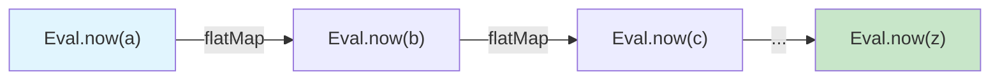

# Eval: Managing Synchronous Computations

## The Problem of Managing Computations

In functional programming, it is important to control when and how expressions are computed.
In Scala, there are several ways to manage computations:

| Approach     | Laziness | Memoization | Example                     |
|--------------|----------|-------------|-----------------------------|
| `val`        | No       | Yes         | `val x = expensive()`       |
| `lazy val`   | Yes      | Yes         | `lazy val x = expensive()`  |
| `def`        | Yes      | No          | `def x = expensive()`       |
| `Function0`  | Yes      | No          | `() => expensive()`         |

However, these approaches have drawbacks:

- **`lazy val`** uses locks for thread safety, which can lead to performance issues
- **Recursive computations** can lead to stack overflow
- **Composing computations** is difficult without a monadic interface

`Eval` is a data type that solves these problems and provides a uniform interface for managing computations.

## The Eval Type: Concept and Definition

`Eval` is a data type for managing **synchronous computations**.
It provides **stack-safety** at all times using a technique
called [**trampolining**](../../fp/external-effects/stack_overflow_error.md).

### Trampolining

[Trampolining](../../fp/external-effects/stack_overflow_error.md) is a technique where recursive calls do not accumulate on the stack,
but are executed in a loop, preventing stack overflow:

```dotty
import cats.Eval

// Ordinary recursion — can cause StackOverflowError
def factorial(n: Int): Int =
  if n == 0 then 1 else n * factorial(n - 1)

// Trampolining — safe for large n
def factorialEval(n: Int): Eval[Int] =
  if n == 0 then Eval.now(1)
  else Eval.defer(factorialEval(n - 1).map(_ * n))
```

## Computation Strategies

`Eval` supports three computation strategies, differing along two parameters:

1. **Memoization** — remembering the result after the first computation
2. **Laziness** — deferring computation until use

### 1. Eval.now — Eager Evaluation

`Eval.now` creates a computation that is executed **immediately** and **memoizes** the result:

```dotty
import cats.Eval
import cats.syntax.all.*

val eager = Eval.now {
  println("Executing expensive computation...")
  1 + 2 * 3
}
// Executing expensive computation...  // <- printed immediately
// eager: Eval[Int] = Now(7)

eager.value // 7 (result already computed, nothing is printed)
```

**Characteristics of `Eval.now`:**

| Characteristic           | Value                                       |
|--------------------------|---------------------------------------------|
| Time of computation      | Immediately upon creation                   |
| Memoization              | ✅ Yes                                       |
| Repeated `.value` call   | Instant return of result                    |
| Use case                 | Constants, already computed values          |

### 2. Eval.later — Lazy Computation with Memoization

`Eval.later` creates a computation that is executed **lazily** (on first `.value` call)
and **memoizes** the result, similar to `lazy val`:

```dotty
val lazyEval = Eval.later {
  println("Executing expensive computation...")
  1 + 2 * 3
}
// lazyEval: Eval[Int] = Later(<function0>)

lazyEval.value // Executing expensive computation... (printed)
// 7

lazyEval.value // 7 (instantly, memoized)
```

**Comparison with `lazy val`:**

| Characteristic   | `lazy val`              | `Eval.later`                         |
|------------------|-------------------------|--------------------------------------|
| Memoization      | ✅                      | ✅                                    |
| Laziness         | ✅                      | ✅                                    |
| Thread safety    | Locks the whole class   | Locks only itself                    |
| Garbage collection | Doesn't free thunk     | Frees thunk after computation        |
| Flexibility      | Limited                 | Can be combined with other `Eval`s   |

**Advantages over `lazy val`:**

1. **Memory release** — after evaluation, `Eval.later` frees the thunk (closure function),
   allowing the garbage collector to free memory earlier
2. **Less locking** — `lazy val` locks the entire class for thread safety, while `Eval.later` locks only itself

### 3. Eval.always — Lazy Non-Memoized Computation

`Eval.always` creates a computation that is executed **lazily** (on every `.value` call) **without memoization**, similar to `def`:

```dotty
val always = Eval.always {
  println("Executing expensive computation...")
  1 + 2 * 3
}
// always: Eval[Int] = Always(<function0>)

always.value // Executing expensive computation... (printed)
// 7

always.value // Executing expensive computation... (printed again!)
// 7
```

**Comparison with other approaches:**

| Characteristic  | `def` | `() => A`    | `Eval.always` |
|-----------------|-------|--------------|---------------|
| Memoization     | No    | No           | No            |
| Laziness        | Yes   | Yes          | Yes           |
| Composition     | No    | Limited      | Yes (Monad)   |
| Stack safety    | No    | No           | Yes           |

## Comparing Eval Strategies

| Strategy                   | Method          | Memoization | Laziness | Computation Time     | Scala Equivalent   |
|----------------------------|-----------------|-------------|----------|----------------------|--------------------|
| Immediate                  | `Eval.now`      | ✅           | ❌        | Upon creation        | `val`              |
| Lazy with memoization      | `Eval.later`    | ✅           | ✅        | On first `.value`    | `lazy val`         |
| Lazy without memoization   | `Eval.always`   | ❌           | ✅        | On every `.value`    | `def`, `() => A`   |

## Composing Computations

### Stack Safety with flatMap

One of the most important uses of `Eval` is stack-safe composition of computations through `flatMap`.
This allows deep recursive computations without the risk of stack overflow.

**Example: Mutual recursion**

```dotty
object MutualRecursion:
  def even(n: Int): Eval[Boolean] =
    Eval.always(n == 0).flatMap {
      case true  => Eval.True
      case false => odd(n - 1)
    }

  def odd(n: Int): Eval[Boolean] =
    Eval.always(n == 0).flatMap {
      case true  => Eval.False
      case false => even(n - 1)
    }

// Safe for large numbers!
MutualRecursion.even(199999).value // false
MutualRecursion.odd(199999).value  // true
MutualRecursion.even(200000).value // true
MutualRecursion.odd(200000).value  // false
```

**Why does this work?**



Ordinary recursion accumulates calls on the JVM stack, which is limited by stack size (typically ~10,000 calls).
`Eval` uses trampolining, turning recursive calls into a sequence of heap operations,
which is limited only by available memory.

### Eval.defer — Deferred Execution

`Eval.defer` allows deferring the execution of a computation that returns `Eval[A]`.
This is useful when a nested `.value` call inside creation methods could be unsafe:

```dotty
// Unsafe approach (can cause problems)
def unsafeFactorial(n: Int): Eval[Int] =
  Eval.always {
    if n == 0 then 1
    else n * unsafeFactorial(n - 1).value // DON'T DO THIS!
  }

// Safe approach with defer
def safeFactorial(n: Int): Eval[Int] =
  if n <= 1 then Eval.now(1)
  else Eval.defer(safeFactorial(n - 1).map(_ * n))

safeFactorial(50000).value // Safe!
```

## Usage Recommendations

| Scenario                                      | Recommended Strategy   | Reason                              |
|-----------------------------------------------|------------------------|--------------------------------------|
| Constants and already computed values         | `Eval.now`             | No point in deferring                |
| Expensive computations performed once         | `Eval.later`           | Resource savings with memoization    |
| Computations that must stay current           | `Eval.always`          | No memoization, always fresh data    |
| Deep recursion                                | `Eval.defer` with `flatMap` | Stack safety                   |
| Composition of computations                   | for-comprehension with Eval | Clean functional style        |

---

**Links:**

- [Link to exercises repository][sample]
- [Cats](https://typelevel.org/cats/datatypes/eval.html)

[sample]: https://gitverse.ru/scalabook/typeclasses
