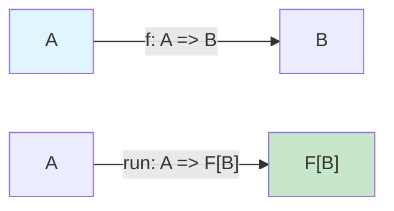
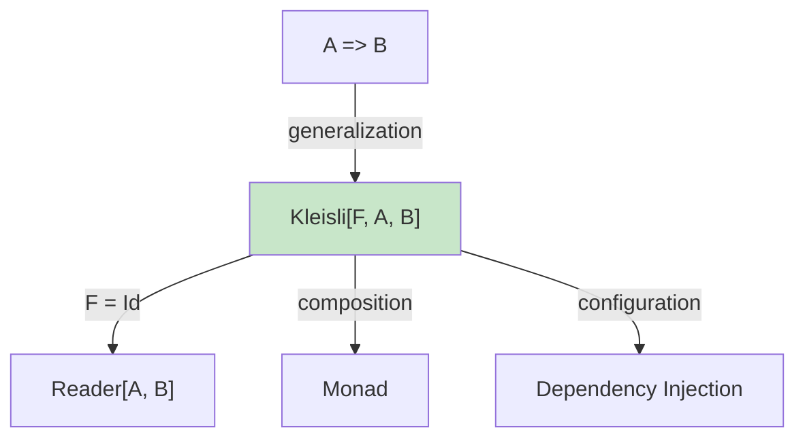

# Kleisli: Composing Functions with Monadic Context

## The Problem of Composition

One of the most useful properties of functions is **composition**.
Given a function `A => B` and a function `B => C`, we can combine them into a new function `A => C`.
It is precisely through this property of composition that we can write many small functions and combine them into larger ones that solve our problems.

```dotty
val twice: Int => Int        = x => x * 2
val countCats: Int => String = x => if x == 1 then "1 cat" else s"$x cats"

val twiceAsManyCats: Int => String = twice andThen countCats
// Or: countCats compose twice

twiceAsManyCats(1) // "2 cats"
```

But what if our functions return **monadic values**? For example:

```dotty
val parse: String => Option[Int] =
  s => if s.matches("-?[0-9]+") then Some(s.toInt) else None

val reciprocal: Int => Option[Double] =
  i => if i != 0 then Some(1.0 / i) else None
```

We cannot use ordinary composition, because the output type of `parse` is `Option[Int]`, and the input type of `reciprocal` is `Int`.

## Kleisli Concept

`Kleisli[F[_], A, B]` is simply a wrapper around a function `A => F[B]`.
Depending on the properties of `F[_]`, you can do different things with `Kleisli`.
For example, if `F[_]` has a `FlatMap` instance (you can call `flatMap` on values of `F[A]`),
you can compose two `Kleisli` values in the same way as ordinary functions.

### Definition

```dotty
import cats.FlatMap
import cats.syntax.all.*

final case class Kleisli[F[_], A, B](run: A => F[B]):
  // Composition: Z => F[B] via Z => F[A] and A => F[B]
  def compose[Z](k: Kleisli[F, Z, A])(using
      F: FlatMap[F]
  ): Kleisli[F, Z, B] =
    Kleisli[F, Z, B](z => k.run(z).flatMap(run))

  // andThen — composition in the opposite direction
  def andThen[Z](k: Kleisli[F, B, Z])(using
      F: FlatMap[F]
  ): Kleisli[F, A, Z] =
    Kleisli(a => run(a).flatMap(k.run))
```

### Returning to the example

```dotty
import cats.syntax.all.*

val parse: Kleisli[Option, String, Int] =
  Kleisli((s: String) => if s.matches("-?[0-9]+") then Some(s.toInt) else None)

val reciprocal: Kleisli[Option, Int, Double] =
  Kleisli((i: Int) => if i != 0 then Some(1.0 / i) else None)

val parseAndReciprocal: Kleisli[Option, String, Double] =
  reciprocal.compose(parse)
// or parse.andThen(reciprocal)

parseAndReciprocal.run("10")  // Some(0.1)
parseAndReciprocal.run("0")   // None (division by zero)
parseAndReciprocal.run("abc") // None (not a number)
```

## Comparison: Ordinary Function vs Kleisli

| Characteristic | `A => B`            | `Kleisli[F, A, B]`             |
|----------------|---------------------|--------------------------------|
| Represents     | Function without effect | Function with effect `F` |
| Composition    | `andThen`/`compose` | Requires `FlatMap[F]`          |
| Application    | `f(a)`              | `k.run(a)`                     |
| Example        | `Int => String`     | `Kleisli[Option, Int, String]` |



## Kleisli Methods

### map — Transforming the result

Requires only `Functor[F]`:

```dotty
import cats.Functor

final case class Kleisli[F[_], A, B](run: A => F[B]):
  def map[C](f: B => C)(using F: Functor[F]): Kleisli[F, A, C] =
    Kleisli(a => F.map(run(a))(f))

val parse: Kleisli[Option, String, Int]            = ???
val parseToString: Kleisli[Option, String, String] =
  parse.map(_.toString) // transforms Option[Int] to Option[String]
```

### flatMap — Sequential composition

Requires `FlatMap[F]`:

```dotty
import cats.FlatMap

final case class Kleisli[F[_], A, B](run: A => F[B]):
  def flatMap[C](f: B => Kleisli[F, A, C])(using
      F: FlatMap[F]
  ): Kleisli[F, A, C] =
    Kleisli(a => F.flatMap(run(a))(b => f(b).run(a)))
```

### Methods table

| Method     | Requirement on `F[_]` | Description                   |
|------------|-----------------------|-------------------------------|
| `map`      | `Functor`             | Transform the result          |
| `flatMap`  | `FlatMap`             | Sequential composition        |
| `compose`  | `FlatMap`             | Reverse-order composition     |
| `andThen`  | `FlatMap`             | Forward-order composition     |
| `lift`     | `Applicative`         | Lift to another context       |
| `traverse` | `Applicative`         | Traverse data structures      |
| `lower`    | `Monad`               | Extract function              |

## Type Instances

`Kleisli` has many type class instances depending on instances of `F[_]`:

| Type class    | Requirement on `F[_]`            |
|---------------|----------------------------------|
| `Functor`     | `Functor`                        |
| `Apply`       | `Apply`                          |
| `Applicative` | `Applicative`                    |
| `FlatMap`     | `FlatMap`                        |
| `Monad`       | `Monad`                          |
| `Arrow`       | `Monad`                          |
| `Strong`      | `Functor`                        |
| `SemigroupK`  | `FlatMap` (for `Kleisli[F, A, A]`) |
| `MonoidK`     | `Monad` (for `Kleisli[F, A, A]`)   |

### Example: Monad for Kleisli

```dotty
import cats.Monad
import cats.data.Kleisli
import cats.syntax.all.*

given kleisliMonad[F[_]: Monad as F, Z]: Monad[[A] =>> Kleisli[F, Z, A]] =
  new Monad[[A] =>> Kleisli[F, Z, A]]:
    def pure[A](a: A): Kleisli[F, Z, A] =
      Kleisli(_ => F.pure(a))

    def flatMap[A, B](fa: Kleisli[F, Z, A])(f: A => Kleisli[F, Z, B])
        : Kleisli[F, Z, B] =
      Kleisli(z => F.flatMap(fa.run(z))(a => f(a).run(z)))

    def tailRecM[A, B](a: A)(f: A => Kleisli[F, Z, Either[A, B]])
        : Kleisli[F, Z, B] =
      Kleisli(z => F.tailRecM(a)(f(_).run(z)))
```

### Monoid instance for Kleisli

If `F[B]` has a `Monoid`, then `Kleisli[F, A, B]` also has a `Monoid`:

```dotty
import cats.Monoid

given kleisliMonoid[F[_], A, B](using
    M: Monoid[F[B]]
): Monoid[Kleisli[F, A, B]] =
  new Monoid[Kleisli[F, A, B]]:
    def empty: Kleisli[F, A, B] =
      Kleisli(_ => M.empty)

    def combine(x: Kleisli[F, A, B], y: Kleisli[F, A, B]): Kleisli[F, A, B] =
      Kleisli(a => M.combine(x.run(a), y.run(a)))
```

## Practical Applications

Imagine we have several modules, each with its own configuration:

```dotty
import cats.Monad
import cats.data.Kleisli
import cats.effect.IOApp
import cats.syntax.all.*

case class DbConfig(url: String, user: String, pass: String)
trait Db
object Db:
  val fromDbConfig: Kleisli[Option, DbConfig, Db] = ???

case class ServiceConfig(addr: String, port: Int)
trait Service
object Service:
  val fromServiceConfig: Kleisli[Option, ServiceConfig, Service] = ???
  
case class AppConfig(dbConfig: DbConfig, serviceConfig: ServiceConfig)

class App(db: Db, service: Service)  
```

Using the `local` method, we can "extend" the input type:

```dotty
final case class Kleisli[F[_], A, B](run: A => F[B]):
  def local[AA](f: AA => A): Kleisli[F, AA, B] = Kleisli(f.andThen(run))

def appFromAppConfig: Kleisli[Option, AppConfig, App] =
  for
    db <- Db.fromDbConfig.local[AppConfig](_.dbConfig)
    sv <- Service.fromServiceConfig.local[AppConfig](_.serviceConfig)
  yield new App(db, sv)
```

## Connection with Other Abstractions



## Summary

`Kleisli` is a powerful abstraction for working with functions that return monadic values. Key aspects:

1. **Composition of monadic functions** — allows composing functions with effects
2. **Wrapper over `A => F[B]`** — adds a monadic interface
3. **Flexibility** — supports various type classes depending on `F[_]`
4. **Reader monad** — is the basis for Dependency Injection
5. **Monad transformers** — combines function effects with other effects

---

**Links:**

- [Link to exercises repository][sample]
- [Cats](https://typelevel.org/cats/datatypes/kleisli.html)

[sample]: https://gitverse.ru/scalabook/typeclasses
