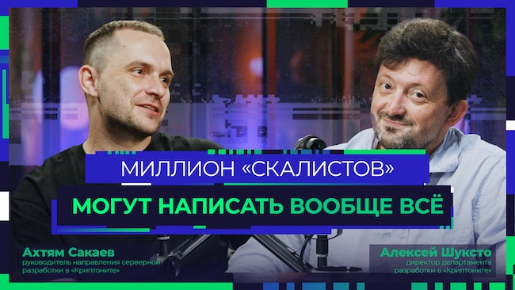

# Podcasts

For those who prefer the audio format, here's a list of podcasts about programming.
These podcasts let you learn something new: interviews with leading industry experts,
discussions of relevant topics, and reviews of new tools and technologies.

## Kryptonite Talks Podcast

[Kryptonite Talks on Scala. Why are there so few Scala developers, and will this language replace Java?](https://t.me/kryptonite_channel/1328)

## Other Podcasts

The podcast list is organized in **alphabetical order**.

| Name                                                                                                       |      🌐 Language      | 📅 Period               | 🔊 Episodes | 🔍 More                                                                                                                                                                                                                                                                                                                                                                                                                                                                                                                                                                                                 |
|------------------------------------------------------------------------------------------------------------|-----------------------|-------------------------|-------------|--------------------------------------------------------------------------------------------------------------------------------------------------------------------------------------------------------------------------------------------------------------------------------------------------------------------------------------------------------------------------------------------------------------------------------------------------------------------------------------------------------------------------------------------------------------------------------------------------------------|
| [**Philosophy of Programming**](https://podcasts.apple.com/ru/podcast/философия-программирования/id787957888) | 🇷🇺 RU | 2013-12-22 → 2014-02-11 |           8 | @:note(🔍 More) The podcast **"Philosophy of Programming"** is a deep and thoughtful conversation about how code, technology, and developer thinking intersect with philosophical concepts. Hosts and guests discuss not only technical aspects, but also ethical, social, and even metaphysical questions behind programming. Episodes make you think about the nature of the digital world, the role of the developer, and how technology changes humanity. An excellent choice for those wanting to go beyond syntax and algorithms. @:@                                                        |
| [**Corecursive**](https://corecursive.com)                                                                   | 🇬🇧 EN | 2018-01-01 → 🟢 present |        110+ | @:note(🔍 More) The podcast **"Corecursive"** is an fascinating journey into the world of development through stories and experiences of outstanding programmers, engineers, and researchers. Host Adam Gordon Bell discusses not only technical details of the guests' work, but also inspiring moments, challenges, and unexpected discoveries on their professional journey. Episodes cover a wide range of topics — from functional programming and open-source to career growth and engineering philosophy. An ideal podcast for those wanting to peek behind the curtain of IT and learn how interesting technologies are built. @:@ |
| [**CTOcast**](https://podcasts.apple.com/us/podcast/ctocast/id945496997)                                    | 🇬🇧 EN + 🇷🇺 RU | 2013-11-01 → 2022-05-27 |          33 | @:note(🔍 More) **CTOcast** is a useful podcast for technical leaders and CTOs, discussing key aspects of managing IT teams, architecture, and products. Guests (experienced CTOs and engineers) share practical cases, dissect scaling challenges, and give valuable advice for growing technology companies. An excellent choice for those wanting to improve skills in tech leadership. @:@                                                                                                                                                                                            |
| [**DevZen**](https://devzen.ru)                                                                            | 🇷🇺 RU | 2014-07-26 → 🟢 present |        520+ | @:note(🔍 More) The podcast **"DevZen"** is a rich and casual conversation about programming, the IT industry, and professional development, where hosts and guests humorously and without pretension discuss relevant technologies, trends, and personal development experience. Discussions range from deep technical topics to career advice and philosophical reflections on the role of the developer in the modern world. The lively language, irony, and practical insights make this podcast a great choice for those who want to combine useful knowledge with lightness and self-deprecation. @:@                                           |
| [**Flatmappers**](https://flatmappers.com)                                                                   | 🇷🇺 RU | 2023-05-07 → 🟢 present |          43+ | @:note(🔍 More) A podcast on topics of interest to the hosts about various aspects of developing complex software products (back-end/web/tooling...), about functional programming and related languages (Scala, Rust, Haskell, Ocaml...), OpenSource, as well as discussions of technical news. @:@                                                                                                                                                                                                                                                                                                         |
| **Scala Love**                                                                                              | 🇬🇧 EN | 2019-01-27 → 2020-10-09 |          24 | @:note(🔍 More) **Scala Love** is a podcast for developers passionate about the Scala ecosystem and functional programming. Hosts and guests discuss language news, best practices, production experience with Scala, and tools and frameworks such as Akka, Cats, and ZIO. Episodes contain expert interviews, case breakdowns, and useful tips, making the podcast a valuable resource for both beginners and experienced Scala developers. Available on major platforms including Apple Podcasts. @:@                                                                      |
| [**Scalalaz**](https://russiancast.club/scalalaz/)                                                         | 🇷🇺 RU | 2016-08-07 → 2022-10-15 |         110 | @:note(🔍 More) **Scalalaz** is a Russian-language podcast about Scala and functional programming. It discusses language subtleties, advanced FP concepts (e.g., monads, typeclasses), and breaks down conference talks and Scala experience in real projects. The podcast will be especially useful for developers who want to dive deeper into the functional paradigm, but do so in a casual format with jokes. Available on **Russiancast.club** and other podcast streaming platforms. @:@                                                                    |
