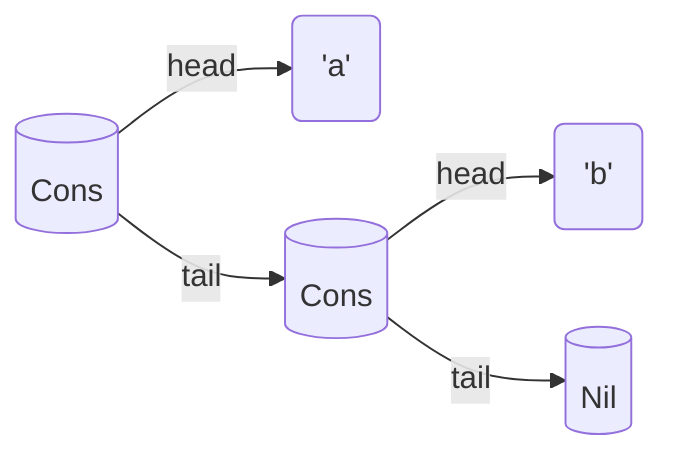
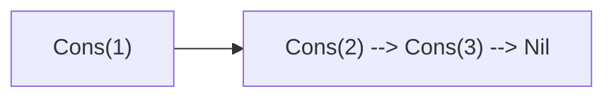
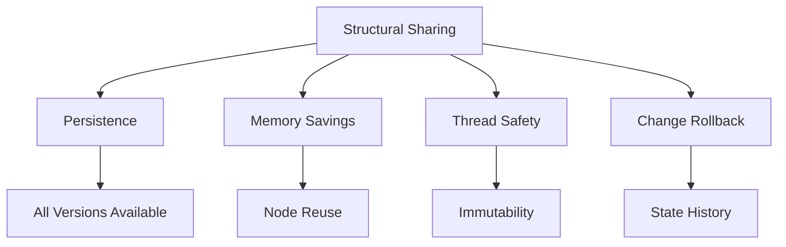
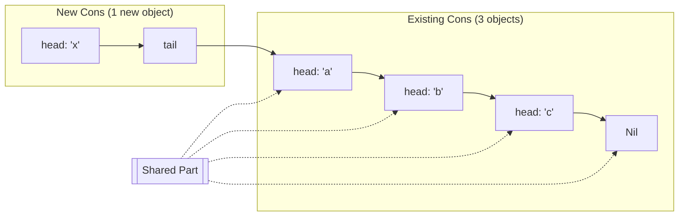
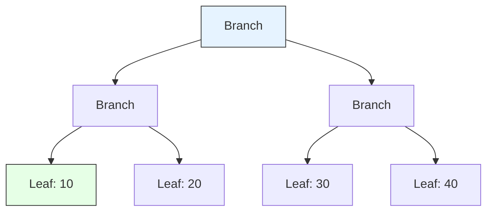

# Functional Data Structures

Functional data structures are a fundamental concept in functional programming,
possessing the following key characteristics:

1. **Immutability (_immutability_)**:
    - Foundational property: once created, an instance of a data structure cannot be modified
    - All operations that simulate changes actually create new versions of the structure
    - Guarantees data safety and absence of side effects

2. **Recursive nature**:
    - Most functional structures are built on recursive principles
    - Recursive definitions allow building complex structures from simple components
    - Examples: lists defined via head and tail (recursively), trees via subtrees

3. **Operation optimization**:
    - Structural sharing is used to minimize overhead
    - New versions of structures reuse immutable parts of original structures
    - Provides memory efficiency and performance

## Main Types of Functional Data Structures

### Linked Lists (List)

- The classic functional structure
- Implementation: recursive composition of nodes (head + tail)
- Operations: O(1) for adding to the head, O(n) for indexed access
- Ideal for sequential processing and recursive algorithms

### Trees (Tree)

- Hierarchical structures with a recursive nature
- Variants: binary trees, search trees, red-black trees
- Each node contains a value and references to child nodes
- Optimal for searching and ordered data storage

### Associative Arrays (Map/Dictionary)

- Immutable stores of key-value pairs
- Implementations: via balanced trees or hash trees
- Guarantee predictable operation performance

### Sets (Set)

- Functional analogs of mathematical sets
- Often implemented via trees or hash structures
- Support set-theoretic operations

## Advantages of the Functional Approach

**1. Safety and Reliability**

- **Immutability:** Data is not modified; new versions are created. Accidental corruption is prevented.
- **Pure functions:** The result depends only on input data. No hidden dependencies.
- **Easy testing:** Functions can be tested in isolation, without complex runtime environments.

**2. Concurrency**

- **Thread safety:** Immutable data can be safely used in multi-threaded environments without locks.
- **Simplified distributed processing:** Data is easy to pass between nodes (e.g., for MapReduce).

**3. State Management**

- **Change history:** Automatic saving of all data versions (convenient for undo/redo, auditing).
- **Easy reproducibility:** Easy to debug, as any state can be recreated.

**4. Efficiency**

- **Sharing:** New data structures can reuse immutable parts of old ones.
- **Optimizations:** Lazy evaluation, memoization, and aggressive compiler optimization are possible due to function purity.

**5. Compositionality**

- **Modularity:** Programs are assembled from small, independent functions, like building blocks.
- **Reusability:** Common patterns (map, filter, reduce) work with different data types.

## Singly Linked List

A singly linked list is a basic but important functional data structure, with the following properties:

- Linear organization of elements
- Each node contains:
    - Data
    - A reference to the next node (or end-of-list marker)
- Recursive definition: a list is either an empty element (`Nil`), or a head plus a tail (`Cons`)

### Formal Definition

```dotty
enum LinkedList[+A]:
  case Nil
  case Cons(head: A, tail: LinkedList[A])

object LinkedList:
  def apply[A](as: A*): LinkedList[A] =
    if as.isEmpty then Nil
    else Cons(as.head, apply(as.tail *))
```

Explanation of the definition:

- `LinkedList` - a parameterized type with a covariant parameter `A`
- `Nil` represents an empty list
- `Cons` (short for "constructor") creates a new list element
- The `apply` method in the companion object provides convenient list construction

### List Visualization

An example of the list `Cons("a", Cons("b", Nil))`:



### Practical Usage

Examples of list construction:

```dotty
val empty: LinkedList[Double] = Nil  // Empty list
val single: LinkedList[Int] = Cons(1, Nil)  // Single-element list
val multi: LinkedList[String] = Cons("a", Cons("b", Nil))  // Multi-element list
val convenient: LinkedList[String] = LinkedList("a", "b")  // Alternative syntax
```

### Basic Operations

Examples of recursive operations:

```dotty
def sum(ints: LinkedList[Int]): Int = ints match
  case Nil => 0
  case Cons(x, xs) => x + sum(xs)

def product(ds: LinkedList[Double]): Double = ds match
  case Nil => 1.0
  case Cons(0.0, _) => 0.0  // Optimization for zero
  case Cons(x, xs) => x * product(xs) 
```

Characteristics:

- Use of pattern matching for list decomposition
- Recursive processing of the list tail
- Base case (`Nil`) terminates recursion

### Exercise 2.1.1: Manual List Construction

> [Repository with exercises and instructions][sample]

```dotty
// Create the following lists manually:
val empty: LinkedList[Int] = ??? // Empty list
val single: LinkedList[String] = ??? // List with one element "Hello"
val threeNumbers: LinkedList[Int] = ??? // List 1, 2, 3
```

@:note(T🔍 Show Solution)

```dotty
val empty: LinkedList[Int] = Nil
val single: LinkedList[String] = Cons("Hello", Nil)
val threeNumbers: LinkedList[Int] = Cons(1, Cons(2, Cons(3, Nil)))  
```

@:@

### Exercise 2.1.2: Basics of Pattern Matching

Implement a function `describe` that analyzes the structure of a list and returns its textual description:

```dotty
def describe[A](list: LinkedList[A]): String =
  list match
    case Nil => ???
    case Cons(_, _) => ???
```

Return values:

- `"empty"` for an empty list (`Nil`)
- `"singleton"` for a list with one element
- `"at least two"` for a list with two or more elements

**Exercise Goal**

Practice skills:

- Pattern matching on algebraic data types
- Analyzing the recursive structure of linked lists
- Working with base cases for lists

**Usage Examples**

```dotty
describe(Nil)                      // "empty"
describe(Cons(1, Nil))             // "singleton"
describe(Cons(1, Cons(2, Nil)))    // "at least two"
describe(Cons("a", Cons("b", Cons("c", Nil))))  // "at least two"
```

@:note(T🔍 Show Solution)

The `describe` function analyzes the structure of a linked list and returns a string describing its size: 
`"empty"` for an empty list (`Nil`), `"singleton"` for a list with one element (`Cons(_, Nil)`), 
and `"at least two"` for lists with two or more elements (any other case). 
The solution uses pattern matching to check the three possible list structure variants, 
ensuring simplicity, readability, and complete coverage of all possible cases.

```dotty
def describe[A](list: LinkedList[A]): String =
  list match
    case Nil => "empty"
    case Cons(_, Nil) => "singleton"
    case _ => "at least two"
```

@:@

### Exercise 2.1.3: Implementing the `length` Function for a List

Implement the `length` function that computes the length of a linked list:

```dotty
def length[A](list: LinkedList[A]): Int = ???
```

**Exercise Goal**

Learn to:

- Work with recursive data structures
- Apply pattern matching to process lists
- Write clean functional implementations of basic operations

**Usage Examples**

```dotty
length(Nil) == 0
length(Cons(1, Nil)) == 1
length(Cons("a", Cons("b", Cons("c", Nil)))) == 3
```

@:note(T🔍 Show Solution)

This implementation computes the length of a linked list via **tail recursion**, 
which avoids stack overflow for large lists. 
The inner `loop` function sequentially traverses each element of the list (ignoring values via `_`), 
incrementing the accumulator `acc` by `1` at each step, until it reaches the end of the list (`Nil`), 
at which point it returns the accumulated value. 

```dotty
def length[A](list: LinkedList[A]): Int =
  @annotation.tailrec
  def loop(remaining: LinkedList[A], acc: Int): Int = 
    remaining match
      case Nil => acc
      case Cons(_, tail) => loop(tail, acc + 1)

  loop(list, 0)
```

@:@

### Exercise 2.1.4: Appending Lists

Implement the `append` function that concatenates two linked lists:

```dotty
def append[A](xs: LinkedList[A], ys: LinkedList[A]): LinkedList[A] = ???
```

**Exercise Goal**

Learn to:

- Work with recursive operations on linked lists
- Implement basic operations of functional data structures
- Apply the principle of structural sharing

**Usage Examples**

```dotty
append(Nil, Nil) == Nil
append(Cons(1, Nil), Cons(2, Nil)) == Cons(1, Cons(2, Nil))
append(Cons("a", Cons("b", Nil)), Cons("c", Nil)) == Cons("a", Cons("b", Cons("c", Nil)))
```

**Hints**

- Use pattern matching on the first list
- For the recursive case, create new Cons nodes
- The second list is appended only in the base case

@:note(T🔍 Show Solution)

The `append` function recursively concatenates two linked lists, creating a new list 
where elements of the first list (`xs`) precede elements of the second (`ys`). 
When pattern matching reveals that `xs` is empty (`Nil`), the function returns `ys`; 
otherwise, it sequentially creates new `Cons` nodes, preserving the head (`h`) of the current list 
and recursively processing the tail (`t`) until the end of the first list is reached. 
This is a classic functional approach that preserves immutability -- 
the original lists are not modified; instead, a new structure is created that shares nodes of the second list for efficiency. 
The complexity is O(n), where `n` is the length of the first list.

```dotty
def append[A](xs: LinkedList[A], ys: LinkedList[A]): LinkedList[A] = 
  xs match
    case Nil => ys
    case Cons(h, t) => Cons(h, append(t, ys))
```

@:@

### Exercise 2.1.5: Reversing a List

Implement the `reverse` function that returns a new list with elements in reverse order:

```dotty
def reverse[A](list: LinkedList[A]): LinkedList[A] = ???
```

**Exercise Goal**

Learn to:

- Work with recursive list transformations
- Apply tail recursion for efficient reversal
- Use accumulators to accumulate the result

**Usage Examples**

```dotty
reverse(Nil) == Nil
reverse(Cons(1, Nil)) == Cons(1, Nil)
reverse(Cons(1, Cons(2, Cons(3, Nil)))) == Cons(3, Cons(2, Cons(1, Nil)))
```

**Hints**

1. Use a helper function with an accumulator
2. Pattern match on the input list
3. On each step, take the head and add it to the accumulator

@:note(T🔍 Show Solution)

The `reverse` function reverses a linked list using **tail recursion** for optimal performance. 
The inner `loop` function sequentially destructures the original list (`remaining`), 
moving each element into the accumulator (`acc`), which accumulates the result in reverse order. 
When the original list becomes empty (`Nil`), the accumulator contains the ready-to-use reversed list. 
The `@tailrec` annotation guarantees optimization into a loop, providing **O(n) complexity** and preventing stack overflow. 
The solution preserves **immutability** -- the original list is not modified; a new structure is created.

```dotty
def reverse[A](list: LinkedList[A]): LinkedList[A] =
  @annotation.tailrec
  def loop(remaining: LinkedList[A], acc: LinkedList[A]): LinkedList[A] =
    remaining match
      case Nil => acc
      case Cons(head, tail) => loop(tail, Cons(head, acc))
  
  loop(list, Nil)
```

@:@

### Exercise 2.1.6: Searching for an Element in a List

Implement the `contains` function that checks whether an element exists in a linked list:

```dotty
def contains[A](list: LinkedList[A], elem: A): Boolean = ???
```

**Exercise Goal**

Learn to:

- Search for elements in functional data structures
- Apply recursive approaches with conditions
- Work with generic types

**Usage Examples**

```dotty
contains(Nil, 1) == false
contains(Cons(1, Nil), 1) == true
contains(Cons("a", Cons("b", Nil)), "c") == false
```

@:note(T🔍 Show Solution)

The `contains` function checks for the presence of an element in a linked list using **recursive pattern matching**: 
for an empty list (`Nil`), it returns `false`, and for a non-empty one (`Cons`) 
it compares the head of the list with the target element and, on mismatch, recursively checks the tail. 
The `||` operator provides **lazy evaluation** -- the function finishes as soon as the first match is found. 
The solution demonstrates a canonical functional approach with **linear O(n) complexity** and preservation of immutability, 
but requires optimization via tail recursion for very long lists.

```dotty
@annotation.tailrec
def contains[A](list: LinkedList[A], elem: A): Boolean = 
  list match
    case Nil => false
    case Cons(head, tail) => 
      head == elem || contains(tail, elem)
```

@:@

## Principle of Structural Sharing

A fundamental property of functional data structures is **immutability** 
and **efficient memory reuse**, achieved through the following mechanisms:

### 1. Adding Elements (Cons Operation)

**How it works:**

- When adding a new element to the front of a list (the `Cons` operation), **only one new node** is created
- The new node contains:
    - The added element (in the `head` field)
    - **A reference to the original list** (in the `tail` field)

```dotty
val original = Cons(2, Cons(3, Nil))  // [2, 3]
val extended = Cons(1, original)      // [1, 2, 3] 
```

**Advantages:**

- Execution time: **O(1)** (independent of list size)
- Memory: **+1 node** (not a full copy of the list)
- **The original list remains fully accessible**



### 2. Removing Elements (Tail Operation)

**How it works:**

- When "removing" the head of a list (the `tail` operation), a reference to the existing tail is simply returned
- **No modifications** to the original structure

```dotty
val list = Cons(1, Cons(2, Cons(3, Nil)))  // [1, 2, 3]
val shortened = list.tail                  // [2, 3] 
```

**Characteristics:**

- Actual "removal" is **just a reference change**
- All previous versions of the list remain **fully functional**
- Execution time: **O(1)**

### Key Advantages of the Approach

**Data Persistence:**

- All versions of data structures **are preserved** after modifications
- Ability to roll back to previous states

Usage example:

```dotty
val v1 = Cons(1, Cons(2, Nil))  // Version 1
val v2 = Cons(0, v1)            // Version 2
// v1 and v2 are fully independent and immutable
```

**Memory Efficiency:**

- Average case: **O(k)** memory for k operations (instead of O(k*n))

Example of savings:

```dotty
// Create 1000 variants of a list
val base = (1 to 1000000).foldRight(Nil)(Cons(_, _))
val variants = (1 to 1000).map(i => Cons(i, base)) 
// Memory: O(n + k) instead of O(k*n)
```

**Thread Safety:**

- No locks needed
- **Conflict-free** reading from multiple threads is possible

Example:

```dotty
val sharedList = Cons("data", baseList)
// sharedList can be safely passed between threads
```

### Limitations and Nuances

1. **Performance**:
    - Indexed access: **O(n)** (requires full traversal)
    - Appending to the end: **O(n)** (requires full copying)

2. **Usage patterns**:
    - Optimal for **LIFO** operations (last in, first out)
    - Not suitable for frequent **random mutations**



### Visualization of Structural Sharing



## Functional Binary Trees

Binary trees are a recursive functional data structure,
where each node can be either a terminal node (leaf) or contain references to two subtrees.
Unlike imperative implementations, functional trees are immutable -- 
any modification creates a new tree, preserving the original.

### Basic Structure

```dotty
enum Tree[+A]:
  // Terminal node with a value
  case Leaf(value: A) 
  
  // Internal node with left and right subtrees
  case Branch(left: Tree[A], right: Tree[A])
```

Key features:

- **Recursiveness**: the type definition refers to itself
- **Generics**: the type parameter `A` allows storing values of any type
- **Algebraic**: two independent node variants (sum type)

### Structure Visualization

Example tree:



### Optimizations and Features

1. **Persistence**:
    - All versions of the tree remain available after modification
    - Example:
      ```dotty
      val v1 = Branch(Leaf(1), Leaf(2))
      val v2 = Branch(v1, Leaf(3)) // v1 remains available
      ```

2. **Lazy Evaluation**:
    - Lazy computation in branches can be implemented:
      ```dotty
      case class LazyBranch(left: () => Tree[A], right: () => Tree[A])
      ```

### Performance Comparison

| Operation | Functional | Imperative |
|-----------|------------|------------|
| Search | O(log n) | O(log n) |
| Insertion | O(log n)\* | O(1) |      
| Deletion | O(log n)\* | O(1) |     
| Memory | O(n) | O(n) |   

\* -- accounting for persistence and structural sharing

Functional trees are especially useful in:

- Systems requiring immutability (blockchain, undo/redo)
- Distributed computing
- Multi-threaded environments

### Exercise 2.2.1: Manual Tree Construction

```dotty
// Create the following trees manually:
val empty: Tree[Int] = ???        // Empty tree
val single: Tree[String] = ???    // Tree with one leaf "Hello"
val sampleTree: Tree[Int] = ???   // Tree Branch(Branch(Leaf(1), Leaf(2)), Leaf(3))
```

@:note(T🔍 Show Solution)

```dotty
val empty: Tree[Int] = Leaf(0)    
val single: Tree[String] = Leaf("Hello")
val sampleTree: Tree[Int] = 
  Branch(
    Branch(Leaf(1), Leaf(2)),
    Leaf(3)
  )
```

@:@

### Exercise 2.2.2: Implementing the `size` Function for a Tree

Implement the `size` function that computes the number of nodes in a tree:

```dotty
def size[A](tree: Tree[A]): Int = ???
```

**Usage Examples**

```dotty
size(Leaf(1)) == 1
size(Branch(Leaf(1), Branch(Leaf(2), Leaf(3)))) == 5
```

@:note(T🔍 Show Solution)

The `size` function recursively computes the total number of nodes in the tree: for a leaf (`Leaf`), it returns `1` (counting the leaf itself), 
and for a branch (`Branch`), it sums `1` (the current node) plus the size of the left subtree (`size(l)`) and the right subtree (`size(r)`). 
The solution demonstrates a classic functional approach with pattern matching, 
traversing all nodes of the tree with linear **O(n)** complexity, where n is the number of nodes, 
and preserving immutability -- the original tree is not modified during computation.

```dotty
def size[A](tree: Tree[A]): Int = tree match
  case Leaf(_) => 1
  case Branch(l, r) => 1 + size(l) + size(r)
```

@:@

### Exercise 2.2.3: Transforming a Tree

Implement the `map` function (transformation of container contents) for trees:

```dotty
def map[A, B](tree: Tree[A])(f: A => B): Tree[B] = ???
```

**Usage Examples**

```dotty
map(Leaf(1))(_ * 2) == Leaf(2)
map(Branch(Leaf(1), Leaf(2)))(_.toString) == Branch(Leaf("1"), Leaf("2"))
```

@:note(T🔍 Show Solution)

The `map` function recursively transforms the tree, applying function `f` to each value in leaves (`Leaf`), 
while preserving the original branch structure (`Branch`). 
The solution uses pattern matching: for leaves it calls the transformation function `f(v)`, 
and for branches it recursively processes both subtrees. 
This approach guarantees **immutability** -- a completely new tree with transformed values is created, 
but with identical branching structure. The operation complexity is **O(n)**, where n is the number of nodes. 
A typical use case is transforming all values in a tree (e.g., numbers to strings) without changing its shape.

```dotty
def map[A, B](tree: Tree[A])(f: A => B): Tree[B] = tree match
  case Leaf(v) => Leaf(f(v))
  case Branch(l, r) => Branch(map(l)(f), map(r)(f))
```

@:@

### Exercise 2.2.4: Removing an Element from a Tree

Implement the `remove` function that removes terminal nodes with a given value from the tree:

> Exercise requires knowledge of `Option` from the ["Error Handling"](handling-errors.md) section

```dotty
def remove[A](tree: Branch[A], value: A): Option[Tree[A]] = ???
```

**Requirements:**

1. Remove only terminal nodes (`Leaf`) matching the given value
2. Preserve the original tree structure for immutable parts
3. `None` is returned if all elements of the tree are removed

**Examples:**

```dotty
val tree1 = Branch(Leaf(1), Branch(Leaf(2), Leaf(3)))
remove(tree1, 2) == Branch(Leaf(1), Leaf(3))

val tree2 = Branch(Leaf("a"), Leaf("b"))
remove(tree2, "c") == tree2

val tree3 = Branch(
  Branch(Leaf(1), Leaf(1)),
  Branch(Leaf(1), Leaf(2))
)
remove(tree3, 1) == Leaf(2)
```

@:note(T🔍 Show Solution)

The `remove` function recursively processes the tree, removing terminal nodes (`Leaf`) with a given value: 
if the value in a leaf matches the target, the node is removed (returns `None`), otherwise the leaf is preserved; 
for branches (`Branch`), the function checks the results of processing both subtrees 
and either combines them into a new branch (if both subtrees remain), 
or returns the remaining subtree (if one was removed), or `None` (if both subtrees were removed). 

```dotty
def remove[A](tree: Tree[A], value: A): Option[Tree[A]] =
  tree match
    case Leaf(v) if v == value => None
    case Leaf(v) => Some(Leaf(v))
    case Branch(left, right) =>
      (remove(left, value), remove(right, value)) match
        case (None, None) => None
        case (Some(l), None) => Some(l)
        case (None, Some(r)) => Some(r)
        case (Some(l), Some(r)) => Some(Branch(l, r))
```

@:@

---

**Links:**

- [Repository with exercises][sample]
- [Functional Programming in Scala, Second Edition, Chapter 3](https://www.manning.com/books/functional-programming-in-scala-second-edition?query=Functional%20Programming%20in%20Scala,%20Second%20Edition)
- [Introduction to Functional Programming - Bird, Wadler, Chapter 3](https://archive.org/details/introductiontofu0000bird/mode/2up)
- [Learning Scalaz](http://eed3si9n.com/learning-scalaz/Validation.html#NonEmptyList)
- [Scalaz API](https://javadoc.io/doc/org.scalaz/scalaz-core_3/7.3.6/scalaz/NonEmptyList.html)

[sample]: https://gitverse.ru/scalabook/fp
