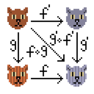
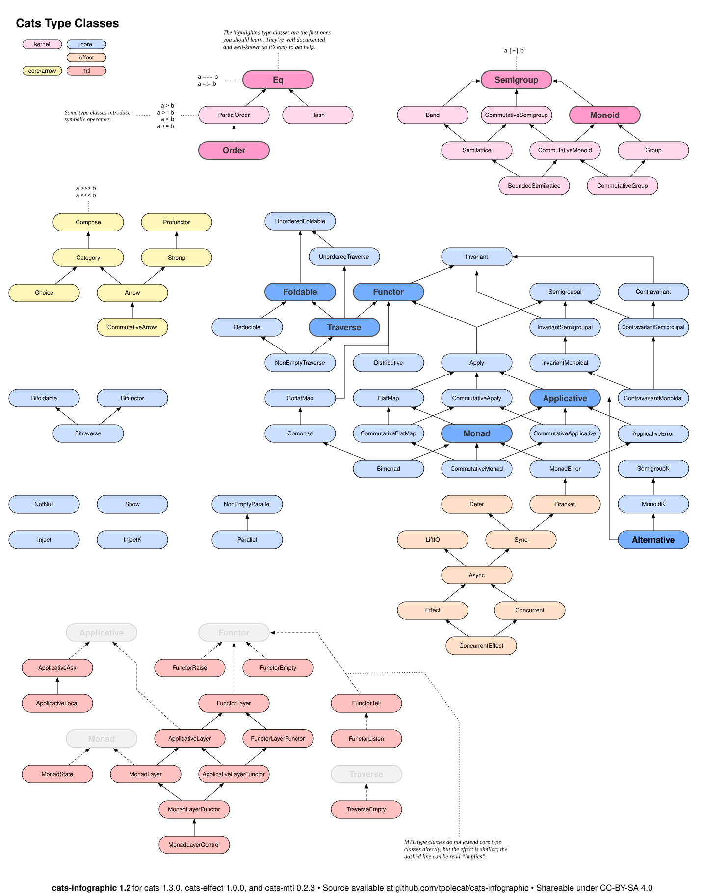

# Cats



## Overview

**Cats** is a library that provides abstractions for functional programming in [Scala](https://scala-lang.org).

Scala supports both object-oriented and functional paradigms,
and this is reflected in the hybrid approach of the standard library.
Cats aims to provide foundational, binary-compatible, modular, accessible, and
efficient abstractions for functional programming.

Cats' broader goal is to create a foundation for [an ecosystem of pure, type-safe libraries](https://typelevel.org/cats/typelevelEcosystem.html),
designed to support functional programming in Scala applications.

**Key features of Cats:**

- **Binary compatibility:** different versions of the library can be used in the same project without conflicts.
- **Modularity:** you only include the modules you actually need.
- **Accessibility:** working with Cats does not require deep knowledge of category theory.
- **Efficiency:** Cats abstractions generally do not create significant runtime overhead.

### Why "Cats"?

The name is a playful shortening of the English word _category_,
which refers to the mathematical **[Theory of Categories](https://en.wikipedia.org/wiki/Category_theory)**.

However, to use Cats, you **do not need to know anything** about category theory.
The name merely reflects the mathematical roots of the library,
and its API is designed to solve practical everyday development tasks.

### Getting Started

Cats is available not only on the standard **JVM** (Java Virtual Machine),
but also for compilation to JavaScript via **[Scala.js](http://www.scala-js.org/)**
and to native code via **[Scala Native](https://www.scala-native.org/)**.
This allows Cats to be used in backend services, frontend applications (e.g., on React),
and even in high-performance native code systems.

#### Adding the dependency

To start using Cats, add the following line to your `build.sbt` file:

```dotty
libraryDependencies += "org.typelevel" %% "cats-core" % "@VERSION@"
```

> Note: replace `@VERSION@` with the [current version of the library](https://mvnrepository.com/artifact/org.typelevel/cats-core).

#### Cats modules

The line above includes **cats-core** — the main module.
However, you can include other modules selectively to reduce the final application size.
Here are the main modules (specify the name of the needed module instead of `"cats-core"`):

- **`cats-kernel`** — minimal set of basic type classes (e.g., `Eq`, `Semigroup`, `Monoid`).
  Required by all other modules.
- **`cats-core`** — the library core, including most major type classes and functionality.
  Required for full functionality.
- **`cats-laws`** — contains laws (formal rules) that type class instances must obey.
  Used for testing.
- **`cats-free`** — provides "free" structures such as the [Free monad](../typeclass/monad/free-monads.md),
  and related type classes.
  Used for building domain-specific languages (DSLs).
- **`cats-testkit`** — helper library for writing tests that verify type class instances obey laws.
- **`algebra`** — type classes representing algebraic structures (e.g., groups, rings). This is the foundation for `cats-kernel`.
- **`alleycats-core`** — experimental Cats instances and classes that may not obey all formal laws.
  Use with caution when laws are sacrificed for practicality.

## Type Classes

[**Type classes**](../typeclass/index.md) are a powerful functional programming tool
that provides **ad-hoc polymorphism** (also known as **overloading**).

While many object-oriented languages use inheritance for polymorphism,
functional programming tends toward a combination of:

1. **Parametric polymorphism** (as in Java generics): one function works with any type, knowing nothing about it.
2. **Ad-hoc polymorphism** (type classes): the same function may behave differently with different types,
   but this behavior is predefined and independent of inheritance hierarchies.

**In simple terms:** a type class defines an _interface_ (a set of operations),
and for specific types _instances_ — implementations of that interface — are provided.
This allows "adding" new behavior to existing types without modifying their source code.

### Type classes in Cats (infographic)

Below is an infographic that visualizes the hierarchy of Cats' main type classes
from the most general (`Functor`) to the most specialized (`Monad`, `Comonad`, etc.).



> Author: [@tpolecat](https://github.com/tpolecat/cats-infographic).
> The graph shows how type classes extend each other (arrows mean "extends" or "depends on").

**Brief explanation of the hierarchy (top to bottom):**

- [Functor](../typeclass/monad/functor.md) — can apply a function to a value inside a container (`map` method).
- [Apply](../typeclass/monad/apply.md) — extends `Functor` with `ap`, allowing application of a function also inside a container.
- [Applicative](../typeclass/monad/applicative.md) — adds the ability to lift an ordinary value into a container (`pure`).
- [FlatMap](../typeclass/monad/bind.md) — provides computation binding via `flatMap` (foundation of for-comprehensions).
- [Monad](../typeclass/monad/monad.md) — combines `Applicative` and `FlatMap`. This is the best-known type class for sequential computations.
- [MonadError](../typeclass/monad/monad-error.md) — adds error handling to a monad.
- [CoflatMap / Comonad](../typeclass/monad/co-monads.md) — "reversed" versions of `FlatMap` and `Monad` (focus on extracting a value from context rather than wrapping).

### Partial type class instances table in Cats

**Important note:** Cats provides _standard_ instances (implementations) for many types.
However, not every type supports _all_ operations (e.g., you cannot make `flatMap` for `Validated`,
since its semantics are designed for error accumulation, not for sequential action).

The following table (originally provided by [@hobwekiva](https://typelevel.org/cats/typeclasses.html))
shows which type classes are implemented for which built-in types.

**Legend:**

- **✔** — full support. A lawful instance exists for this type.
- **✗** — no support. Impossible to implement or makes no sense.
- **Conditions** — e.g., `K:Monoid` means the instance exists _only if_ an instance of `Monoid` is also defined for type `K`.

| Data Type (container)                  | Functor |         Apply          |      Applicative       |        Monad        | MonoidK |    ApplicativeError    | MonadError | CoflatMap | Comonad | Bimonad |
|:---------------------------------------|:-------:|:----------------------:|:----------------------:|:-------------------:|:-------:|:----------------------:|:----------:|:---------:|:-------:|:-------:|
| **`Id[A]`** (identity)                 |    ✔    |           ✔            |           ✔            |          ✔          |    ✗    |           ✗            |     ✗      |     ✔     |    ✔    |    ✔    |
| **`Eval[A]`** (lazy evaluation)        |    ✔    |           ✔            |           ✔            |          ✔          |    ✗    |           ✗            |     ✗      |     ✔     |    ✔    |    ✔    |
| **`Option[A]`** (maybe absent)         |    ✔    |           ✔            |           ✔            |          ✔          |    ✔    |           ✔            |     ✔      |     ✔     |    ✗    |    ✗    |
| **`Const[K, A]`** (constant)           |    ✔    |  ✔ (if `K:Monoid`)     |  ✔ (if `K:Monoid`)     |          ✗          |    ✗    |           ✗            |     ✗      |     ✗     |    ✗    |    ✗    |
| **`Either[E, A]`** (error or value)    |    ✔    |           ✔            |           ✔            |          ✔          |    ✔    |           ✔            |     ✔      |     ✗     |    ✗    |    ✗    |
| **`List[A]`** (list)                   |    ✔    |           ✔            |           ✔            |          ✔          |    ✔    |           ✗            |     ✗      |     ✔     |    ✗    |    ✗    |
| **`NonEmptyList[A]`** (non-empty list) |    ✔    |           ✔            |           ✔            |          ✔          |    ✗    |           ✗            |     ✗      |     ✔     |    ✔    |    ✔    |
| **`Stream[A]`** (lazy list)            |    ✔    |           ✔            |           ✔            |          ✔          |    ✔    |           ✗            |     ✗      |     ✔     |    ✗    |    ✗    |
| **`Map[K, A]`** (map)                  |    ✔    |           ✔            |           ✗            |          ✗          |    ✔    |           ✗            |     ✗      |     ✗     |    ✗    |    ✗    |
| **`Validated[E, A]`** (error-accumulating) | ✔ | ✔ (if `E:Semigroup`) | ✔ (if `E:Semigroup`) |          ✗          |    ✗    | ✔ (if `E:Semigroup`) |     ✗      |     ✗     |    ✗    |    ✗    |
| **`Reader[E, A]`** (environment reader) | ✔     |           ✔            |           ✔            |          ✔          |    ✗    |           ✗            |     ✗      |     ✗     |    ✗    |    ✗    |
| **`Writer[E, A]`** (logging writer)    |    ✔    |  ✔ (if `E:Monoid`)     |  ✔ (if `E:Monoid`)     | ✔ (if `E:Monoid`)   |    ✗    |           ✗            |     ✗      |     ✔     |    ✗    |    ✗    |

#### Practical meaning of the table

Looking at the table, you can quickly understand a type's capabilities:

- **`Validated`** cannot be used in for-comprehensions (no `Monad`),
  but it is excellent for _form validation_ with error accumulation (`Applicative`).
- **`NonEmptyList`** is a full monad and even a comonad (can extract the first element, for example),
  but has no `MonoidK` (cannot represent an empty element).
- **`Map`** is not a monad (no `flatMap`), but can be `MonoidK`
  (map merging with a "neutral" element — an empty map).
- **`Id`** supports almost everything, including `Comonad` and `Bimonad`, because it is a "wrapper" over an ordinary value.

This table is a cheat sheet that helps you choose the right abstraction for your task.

## Cats Ecosystem

Besides the main modules, there are several important projects released separately:

- **[cats-effect](https://github.com/typelevel/cats-effect)** — standard `IO` type
  for describing asynchronous and effectful computations, plus `Sync`, `Async`, and `Effect` type classes.
  Foundation for functional concurrent programming.
- **[cats-mtl](https://github.com/typelevel/cats-mtl)** — provides [type class transformers](../typeclass/monad/monad-transformer.md)
  for convenient work with effects in a monad stack.
- **[mouse](https://github.com/typelevel/mouse)** — a small Cats extension
  adding convenient syntax (extension methods) for standard types,
  making code even more concise (e.g., `2.some` instead of `Some(2)`).
- **[kittens](https://github.com/typelevel/kittens)** — automatic derivation of type class instances
  for case classes and algebraic data types (ADTs), plus utilities for generic programming.
- **[cats-tagless](https://github.com/typelevel/cats-tagless)** — utilities for working with final tagless encoded algebras:
  automatic interpreter creation, function transformation, etc.
- **[cats-collections](https://github.com/typelevel/cats-collections)** — data structures
  facilitating clean functional programming (e.g., `Diet`, `AVLTree`, `Map` with mutable memory for focus).
- **[cats-testkit-scalatest](https://github.com/typelevel/cats-testkit-scalatest)** — integration of Cats testkit
  with the popular Scalatest testing framework.
- [**cats-parse**](https://github.com/typelevel/cats-parse) — Parser library in the Cats ecosystem.
- [**cats-retry**](https://cb372.github.io/cats-retry/) — Composable retry logic for Cats and Cats Effect.

---

**References:**

- [Cats home page][home]

[home]: https://typelevel.org/cats/
