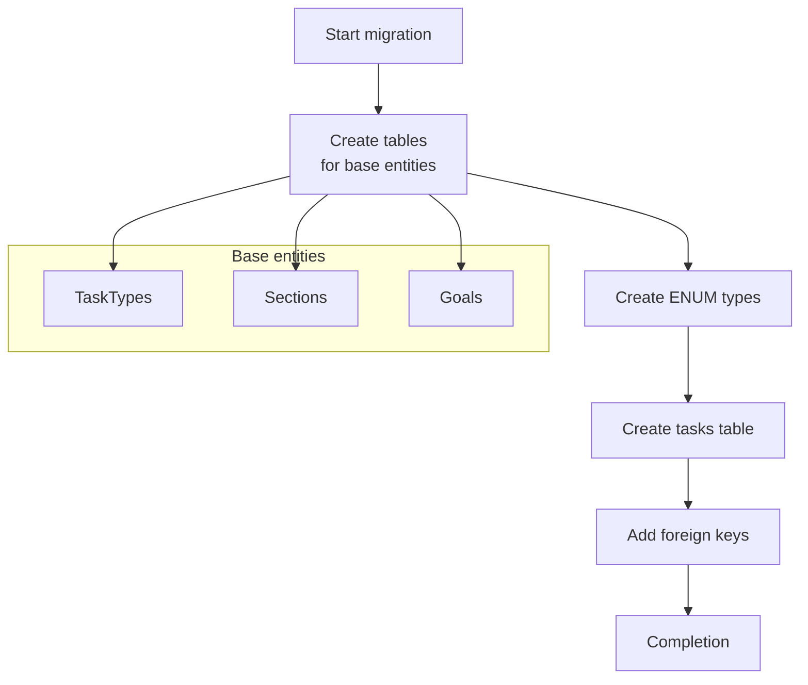

# Creating and Maintaining Database Structure

## Working with PostgreSQL via the Doobie Library

After designing the algebras and creating mock implementations, the next stage is developing production implementations
that will interact with a real data storage system.
We will use **PostgreSQL** — a mature,
reliable, and fully-featured relational database management system (RDBMS).

> 💡 **Note on portability**: The architectural principles and data access approaches described below
> are universal and applicable to most relational databases (MySQL, Oracle, SQL Server, etc.).
> Technical differences will primarily lie in SQL dialect syntax,
> driver specifics, and connection settings for a particular RDBMS.

### Choosing a data access library: Doobie

To implement interaction with PostgreSQL, we will use the [Doobie](https://typelevel.org/doobie/index.html) library.

Doobie is a purely functional JDBC layer library for working with relational databases.
Its key advantages:

- **Strictly functional approach**: Full integration with the Cats Effect ecosystem, using `IO`
  and other abstract effects to describe all operations with side effects (I/O, network operations).
  This ensures predictability, testability, and composability of code.
- **Type safety at compile time**: Many common errors
  (type mismatches between Scala and SQL, typos in column names, incorrect number of parameters)
  are detected at compile time, not at runtime, significantly improving application reliability.
- **High composability**: Doobie queries are built on primitives
  that can be combined using monadic operations (`map`, `flatMap`) and applicative functors.
  This allows constructing complex, dynamic SQL queries from simple, reusable components.
- **Transparency and controllability**: The library provides convenient tools for logging queries and their execution.

To start working with Doobie, you need to add the appropriate dependencies to the project build configuration (`project/Dependencies.scala` file).

Dependency structure for a module working with a database:

```dotty
// File: project/Dependencies.scala
object Dependencies {
  object doobie {
    // Use the current stable version.
    private val version = "1.0.0-RC13"
    val core            = "org.typelevel" %% "doobie-core"     % version
    val free            = "org.typelevel" %% "doobie-free"     % version
    val hikari          = "org.typelevel" %% "doobie-hikari"   % version
    val postgres        = "org.typelevel" %% "doobie-postgres" % version
  }

  object iron {
    ...
    val doobie          = "io.github.iltotore" %% "iron-doobie"     % version
  }

  object log4cats {
    private val version = "2.8.0"
    val core            = "org.typelevel" %% "log4cats-core"   % version
    val slf4j           = "org.typelevel" %% "log4cats-slf4j"  % version
    val logback         = "ch.qos.logback" % "logback-classic" % "1.6.3"
  }

  // ... other dependency blocks ...

  // Root list of libraries for the main application module (pdp)
  val pdpLibs: Seq[ModuleID] =
    Seq(
      ...
      doobie.core,
      doobie.free,
      doobie.hikari,
      doobie.postgres,
      iron.cats,
      iron.circe,
      iron.core,
      iron.doobie,
      iron.pureconfig,
      log4cats.core,
      log4cats.logback,
      log4cats.slf4j,
    )
}
```

### Next Steps After Dependency Configuration

After successfully connecting the necessary libraries, we can proceed to implementing the following key tasks:

1. **Creating algebra interpreters for PostgreSQL**: Implementing the traits `TaskTypeService[F[_]]`, `TaskService[F[_]]`
   and others using Doobie's `ConnectionIO` or `Transactor[F]`.
2. **Configuring database connection**: Configuring a connection pool (`HikariCP` or equivalents),
   creating a `Transactor` — an object that transforms Doobie programs (`ConnectionIO`) into the target effect `F[_]` (e.g., `IO`).
3. **Implementing CRUD operations**: Writing or generating SQL queries
   for `insert`, `select`, `update`, `delete` operations for each of our entities,
   using Doobie's query compilers (`Update`, `Query`).

## Creating and Maintaining Database Structure

When working with relational databases, it is not enough to simply perform data read and write operations (DML).
We also need to manage the structure of the storage itself:
create and modify tables, define data types,
establish relationships between entities, and set integrity constraints.
To solve this task, we create a specialized **migration service**.

#### Key functions of the migration service:

- **Table creation (CREATE TABLE)**: Initializing structured containers for storing different types of data,
  with column types, primary keys, and other attributes defined.
- **Custom data type creation (CREATE TYPE)**: Defining domain-specific types such as ENUM in PostgreSQL,
  which provide semantic precision and restrict permissible values at the database level.
- **Establishing table relationships (FOREIGN KEY)**: Formally defining "one-to-many"
  or "many-to-many" relationships between entities, which is the foundation of the relational model.
- **Setting integrity constraints (CONSTRAINTS)**: Implementing business rules directly
  in the data schema through CHECK constraints, UNIQUE constraints, and NOT NULL, preventing invalid data from entering the system.
- **Ensuring idempotency**: Using `CREATE TABLE IF NOT EXISTS` constructs guarantees that
  migration scripts can be safely run multiple times without errors.

### Designing and Implementing the PostgreSQL Migration Service

We create a `PostgreSQLMigrationService` class that encapsulates all database schema initialization logic.
The class is declared as `private[pdp]`, which restricts its use to the `pdp` package only,
making it available only for internal use and preventing accidental calls from outside.

```dotty
// pdp/src/main/scala/ru/scalabook/pdp/services/postgresql/PostgreSQLMigrationService.scala
/** Service for managing the PostgreSQL database structure. Responsible for
  * creating tables, types, establishing relationships, and constraints.
  *
  * @param xa
  *   {{{Transactor[F]}}} - Doobie abstraction for executing queries in
  *   the F context.
  */
private[pdp] class PostgreSQLMigrationService[F[_]: {MonadCancelThrow, Logger}](
    xa: Transactor[F]
):
  import PostgreSQLMigrationService.*

  def migrate(): F[Boolean] =
    checkExistFK
      .query[Boolean]
      .option
      .transact(xa)
      .flatMap:
        case Some(v) if v =>
          Logger[F].info("No migration required").as(true)
        case _ =>
          Logger[F].info("Database initialization") *>
            initialize()

  /** Main database initialization method. Executes a sequence of
    * DDL queries to create the entire required structure. All operations
    * are executed in a single transaction for atomicity.
    *
    * @return
    *   {{{F[Boolean]}}} - an effect representing the initialization operation.
    */
  def initialize(): F[Boolean] =
    val program =
      for
        _ <- createUsersTable.update.run
        _ <- createTaskTypesTable.update.run
        _ <- addUsersFKToTable("task_types").update.run
        _ <- createSectionsTable.update.run
        _ <- addUsersFKToTable("sections").update.run
        _ <- createGoalsTable.update.run
        _ <- addUsersFKToTable("goals").update.run
        _ <- createStatusEnum.update.run
        _ <- createTasksTable.update.run
        _ <- addSectionFKToTable("tasks").update.run
        _ <- addGoalFKToTable("tasks").update.run
        _ <- addUsersFKToTable("tasks").update.run
        _ <- taskTypeFK.update.run
        _ <- createCompletedTasksTable.update.run
        _ <- addSectionFKToTable("completed_tasks").update.run
        _ <- addGoalFKToTable("completed_tasks").update.run
        _ <- addUsersFKToTable("completed_tasks").update.run
      yield true
    program.transact(xa)
  end initialize

end PostgreSQLMigrationService

private[pdp] object PostgreSQLMigrationService:
  /** Query to check if migration has already been performed */
  private val checkExistFK: Fragment =
    sql"""SELECT EXISTS (
           SELECT 1
           FROM information_schema.tables
           WHERE table_schema = 'public'
           AND table_name = 'users'
       );"""

  private val createUsersTable: Fragment =
    sql"""CREATE TABLE IF NOT EXISTS users (
         id UUID DEFAULT gen_random_uuid() PRIMARY KEY, 
         name VARCHAR(255) NOT NULL, 
         password VARCHAR(255) NOT NULL
         );"""

  private val createTaskTypesTable: Fragment =
    sql"""CREATE TABLE IF NOT EXISTS task_types (
         id SERIAL PRIMARY KEY, 
         name VARCHAR(255) NOT NULL, 
         user_id UUID NOT NULL, 
         displayed BOOLEAN NOT NULL DEFAULT TRUE, 
         ordinal INT NOT NULL DEFAULT 1000
         );"""

  private val createSectionsTable: Fragment =
    sql"""CREATE TABLE IF NOT EXISTS sections (
         id SERIAL PRIMARY KEY, 
         name VARCHAR(255) NOT NULL, 
         user_id UUID NOT NULL, 
         displayed BOOLEAN NOT NULL DEFAULT TRUE, 
         ordinal INT NOT NULL DEFAULT 1000
         );"""

  private val createGoalsTable: Fragment =
    sql"""CREATE TABLE IF NOT EXISTS goals (
         id SERIAL PRIMARY KEY, 
         name VARCHAR(255) NOT NULL, 
         user_id UUID NOT NULL, 
         displayed BOOLEAN NOT NULL DEFAULT TRUE, 
         ordinal INT NOT NULL DEFAULT 1000
         );"""

  private val createStatusEnum: Fragment =
    sql"""CREATE TYPE StatusEnum AS ENUM
         ('InProgress', 'Planned', 'KnowledgeBase', 'Completed');"""

  private val createTasksTable: Fragment =
    sql"""CREATE TABLE IF NOT EXISTS tasks (
         id UUID DEFAULT gen_random_uuid() PRIMARY KEY, 
         name VARCHAR(255) NOT NULL, 
         user_id UUID NOT NULL, 
         task_type_id INT NOT NULL, 
         status StatusEnum NOT NULL, 
         section_id INT NOT NULL, 
         goal_id INT NOT NULL, 
         ordinal INT NOT NULL, 
         start_date DATE, 
         end_date DATE, 
         information TEXT, 
         plan VARCHAR[], 
         duration BIGINT NOT NULL, 
         time_spent BIGINT);"""

  private val createCompletedTasksTable: Fragment =
    sql"""CREATE TABLE IF NOT EXISTS completed_tasks (
         id SERIAL PRIMARY KEY, 
         task_id UUID NOT NULL, 
         task_type_id INT NOT NULL, 
         name VARCHAR(255) NOT NULL, 
         user_id UUID NOT NULL, 
         section_id INT NOT NULL, 
         goal_id INT NOT NULL, 
         duration BIGINT NOT NULL, 
         rating INT NOT NULL, 
         review TEXT, 
         start_date DATE, 
         end_date DATE);"""

  private val taskTypeFK =
    sql"""ALTER TABLE tasks
           ADD CONSTRAINT fk_task_types
           FOREIGN KEY (task_type_id) REFERENCES task_types(id);"""

  private def addSectionFKToTable(tableName: String): Fragment =
    Fragment.const(
      s"""ALTER TABLE "$tableName"
           ADD CONSTRAINT fk_section
           FOREIGN KEY (section_id) REFERENCES sections(id);"""
    )

  private def addGoalFKToTable(tableName: String): Fragment =
    Fragment.const(
      s"""ALTER TABLE "$tableName"
           ADD CONSTRAINT fk_goal
           FOREIGN KEY (goal_id) REFERENCES goals(id);"""
    )

  private def addUsersFKToTable(tableName: String): Fragment =
    Fragment.const(
      s"""ALTER TABLE "$tableName"
           ADD CONSTRAINT fk_users
           FOREIGN KEY (user_id) REFERENCES users(id);"""
    )
end PostgreSQLMigrationService
```

### Importance of Operation Order

The sequence of DDL query execution is strictly regulated:



**Order logic:**

1. **Base tables first**: `task_types`, `sections`, `goals` are created first, as other tables reference them.
2. **Then custom types**: The `StatusEnum` ENUM must exist before the tasks table that uses it is created.
3. **Tasks tables**: Created after all types and base tables are ready.
4. **Foreign keys last**: Established after all referenced tables are created.

---

**References:**

- [Source repository][repo]

[repo]: https://gitverse.ru/scalabook/pdp
