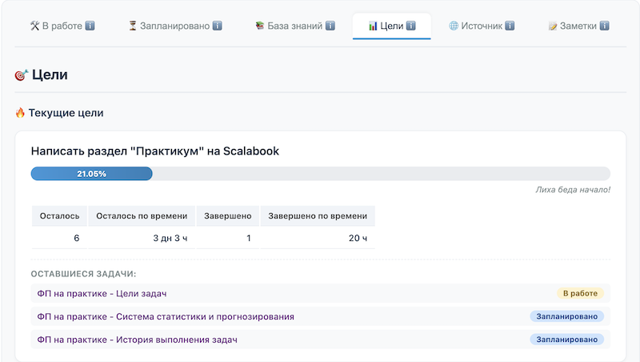

# Statistics

Statistics is a tool that transforms scattered tasks into **a meaningful picture of progress**. 
The user doesn't just see a to-do list, but an answer to the question: "How far have I progressed toward my goals?" 
This is a key motivational element: without it, working on long-term goals turns into endless routine without a sense of movement.

## Statistics by Goals

Let's start by looking at statistics **by goals**.

### Data Models

#### `Statistics` — aggregator of all statistics

```dotty
final case class Statistics(
    goalsStats: Vector[GoalsStats]
)

object Statistics:
  def calculate(
      tasks: Vector[TaskResult],
      goals: Map[GoalId, GoalName]
  ): Statistics =
    Statistics(
      goalsStats = GoalsStats.calculate(tasks, goals)
    )
```

**Breakdown:**

- **`goalsStats: Vector[GoalsStats]`** — a vector of statistics for each user goal. One goal = one vector element.
- **`Statistics.calculate`** — a factory method that takes all tasks and a map of "goal ID → goal name" 
  and delegates computation to `GoalsStats.calculate`.

**Why `Map[GoalId, GoalName]` instead of `Vector[Goal]`?**

Because for statistics we need **only goal names**. 
Passing full `Goal` objects (with `userId`, `displayed`, `ordinal`, etc.) is excessive. 
A map provides fast access by ID — O(1) instead of O(n) when searching in a vector.

#### `GoalsStats` — statistics for a single goal

```dotty
final case class GoalsStats(
    name: GoalName,
    all: Int,
    allDuration: FiniteDuration,
    completed: Int,
    completedDuration: FiniteDuration,
    remainingTasks: Vector[GoalTaskStats]
):
  lazy val remaining: Int                    = all - completed
  lazy val remainingDuration: FiniteDuration = allDuration - completedDuration
  lazy val progress: Double                  =
    calculateProgress(current = completedDuration, all = allDuration)

  lazy val status: GoalStatus =
    if completed == 0 &&
      remainingTasks.headOption.forall(_.status != InProgress)
    then Planned
    else if remaining > 0 then Current
    else Achieved
```

**Stored fields:**

| Field               | Type                    | Purpose                                      |
| ------------------- | ----------------------- | -------------------------------------------- |
| `name`              | `GoalName`              | Goal name for display                        |
| `all`               | `Int`                   | Total number of tasks linked to the goal     |
| `allDuration`       | `FiniteDuration`        | Total effort of all tasks                    |
| `completed`         | `Int`                   | Number of completed tasks                    |
| `completedDuration` | `FiniteDuration`        | Total effort of completed tasks              |
| `remainingTasks`    | `Vector[GoalTaskStats]` | Top 3 uncompleted tasks for display          |

**Computed fields (`lazy val`):**

- **`remaining = all - completed`** — how many tasks are left. We don't store it separately because it's a derived value. 
  Storing duplicate data is a source of desynchronization.
- **`remainingDuration = allDuration - completedDuration`** — how much time is left.
- **`progress`** — percentage of completion, calculated **by time**, not by number of tasks.

**Why progress by time instead of by count?**

Consider an example: a goal has 2 tasks — one taking 1 hour and one taking 10 hours. If the 1-hour task is completed:

- **By count:** 1/2 = 50%.
- **By time:** 1/11 ≈ 9%.

By time is **more honest**. One large task can weigh more than ten small ones. 
The user gets a realistic assessment of progress.

**`progress` formula:**

Progress is calculated through the common function `calculateProgress`:

```dotty
def calculateProgress(
    current: FiniteDuration,
    all: FiniteDuration
): Double =
  if all.toMinutes == 0 then 0.0
  else (current.toMinutes * 10000 / all.toMinutes) / 100.00
```

It is also used by `SectionStats`, `TaskTypeStats`, and other statistics aggregators — a single source of calculation logic.

**Example:** `completedDuration = 30 min`, `allDuration = 90 min`:

- `30 * 10000 / 90 = 3333` (integer division)
- `3333 / 100.00 = 33.33` — 33.33% progress.

**Computing `status`:**

```dotty
lazy val status: GoalStatus =
  if completed == 0 &&
    remainingTasks.headOption.forall(_.status != InProgress)
  then Planned
  else if remaining > 0 then Current
  else Achieved
```

Three goal statuses:

- **`Planned`** — no tasks completed, no tasks in progress. The goal is waiting for its turn.
- **`Current`** — there are uncompleted tasks. The goal is in progress.
- **`Achieved`** — all tasks completed. The goal is achieved.

### `GoalsStats.calculate` — building statistics

```dotty
def calculate(
    tasks: Vector[TaskResult],
    goals: Map[GoalId, GoalName]
): Vector[GoalsStats] =
  tasks.groupBy(_.goalId).flatMap {
    case (goalId, tasks) =>
      val (completedTasks, remainingTasks) =
        tasks.partition(_.status == Completed)
      val topRemainingTasks =
        remainingTasks
          .sortBy(t => (t.status.ordinal, t.ordinal))
          .take(3)
          .map(task => GoalTaskStats(task.id, task.name, task.status))

      goals.get(goalId).map: name =>
        GoalsStats(
          name = name,
          all = tasks.length,
          allDuration = calculateDuration(tasks),
          completed = completedTasks.length,
          completedDuration = calculateDuration(completedTasks),
          remainingTasks = topRemainingTasks
        )
  }.toVector
```

**Step-by-step breakdown:**

**1. Grouping tasks by goal:**

```dotty
tasks.groupBy(_.goalId)
```

All tasks with the same `goalId` are collected into a `Map[GoalId, Vector[TaskResult]]`.

**2. Splitting into completed and remaining:**

```dotty
val (completedTasks, remainingTasks) = tasks.partition(_.status == Completed)
```

- **`completedTasks`** — tasks with status `Completed`.
- **`remainingTasks`** — all others (in progress, planned, in knowledge base).

**3. Sorting remaining tasks:**

```dotty
val topRemainingTasks =
  remainingTasks
    .sortBy(t => (t.status.ordinal, t.ordinal))
    .take(3)
    .map(task => GoalTaskStats(task.id, task.name, task.status))
```

- **`sortBy(t => (t.status.ordinal, t.ordinal))`** — sorting by two keys:
    - **`status.ordinal`** — tasks with a more "active" status go first. 
      The order is defined in `enum Status`: `InProgress` → `Planned` → `KnowledgeBase` → `Completed`.
      `Completed` status won't be in `remainingTasks`, so tasks will be sorted by statuses `InProgress` → `Planned` → `KnowledgeBase`.
    - **`ordinal`** — at equal statuses — by the task's ordinal number.
- **`.take(3)`** — we keep only three tasks. More is not needed: the user sees "what's next", not the entire list.
- **`.map(task => GoalTaskStats(...))`** — converts to a lightweight DTO containing only `id`, `name`, `status`.

**Why `take(3)`?**

The user only needs to see 2–3 next tasks to understand where to move forward. Displaying the entire list — clutters the UI. 
If more are needed — there's the status page with task lists.

**4. Aggregating durations:**

```dotty
allDuration = calculateDuration(tasks)
```

`calculateDuration` sums durations of all tasks via `foldLeft`, starting from zero. Result — `FiniteDuration`.

**5. Using `flatMap`:**

```dotty
tasks.groupBy(_.goalId).flatMap {
  case (goalId, tasks) =>
    goals.get(goalId).map: name =>
      GoalsStats(...)
}.toVector
```

- **`goals.get(goalId)`** returns `Option[GoalName]`.
- **`.map(name => GoalsStats(...))`** — if the name is found, create `GoalsStats`.
- **`.flatMap`** "flattens" the `Option` — if the name is not found, the goal is **ignored**.

### `GoalTaskStats` — lightweight task model

```dotty
final case class GoalTaskStats(
    id: TaskId,
    name: TaskName,
    status: Status
)
```

A minimal model for displaying a task in the remaining list. Contains only:

- **`id`** — for a link to the task page.
- **`name`** — for display.
- **`status`** — for the status badge.

Does not contain `duration`, `progress`, `plan` — these are excessive for a list.

## UI: "🎯 Goals" Tab

### Tab Button

```dotty
tabButton(
  activeIf("goals"),
  "goals",
  "🎯 Goals",
  "Statistics by goals"
),
```

- **`🎯 Goals`** — tab name. Concise, immediately says what it contains.
- **`data-tab="goals"`** — identifier for the JS function `switchTab`.
- **`title`** — tooltip on hover.



### Tab Content

```dotty
tabContent("tab-goals", activeIf("goals"), goals)
```

The tab's HTML fragment is rendered by the `Views.goalsStats` method on the server and inserted into `<div id="tab-goals">`. 
The `active` class is added via the `activeIf(tab)` helper if the tab is open by default. 
This allows separating goal grouping logic by status in Scala code, rather than in the template.

### Rendering ```Views.goalsStats```

`Views.goalsStats(currentGoals, plannedGoals, achievedGoals)` — a rendering method that takes **three ready-made vectors** — already filtered by status goals. The method returns a `String` (ready HTML).

```dotty
def goalsStats(
    currentGoals: Vector[GoalsStats],
    plannedGoals: Vector[GoalsStats],
    achievedGoals: Vector[GoalsStats]
): String
```

**Why three vectors instead of one with filtering in the method?**

Because filtering is **logic**, not rendering. It should be on the server. The method receives ready data and just renders them into three blocks.

Internal helpers: `goalCard(goal, achieved)` — a single goal card; `subsection(title, goals)` — a section block; `achievedSubsection(goals)` — achieved block; `goalsStatsTable(goal)` — metrics table inside the card.

#### "Current Goals" Block

```dotty
div(cls := "statistics-section")(
  h2(cls := "statistics-title")("🎯 Goals"),
  subsection("🔥 Current Goals", currentGoals),
  ...
)

def subsection(title: String, goals: Vector[GoalsStats]): Modifier =
  if goals.nonEmpty then
    div(cls := "goals-subsection")(
      h3(cls := "goals-subsection-title")(title),
      div(cls := "goals-list")(
        goals.map { goal =>
          goalCard(goal, false)
        }*
      )
    )
  else frag()
```

```dotty
def goalCard(goal: GoalsStats, achieved: Boolean): Tag =
  div(cls := s"goal-card ${if achieved then "achieved" else ""}")(
    div(cls := "goal-name")(goal.name.value),
    if !achieved then
      frag(
        div(cls := "goal-progress-container")(
          div(cls := "goal-progress-bar")(
            div(
              cls   := "goal-progress-fill",
              style := s"width: ${goal.progress}%"
            )(
              span(cls := "goal-progress-text")(s"${goal.progress}%")
            )
          ),
          div(cls := "goal-motivation")(raw(motivation(goal.progress)))
        ),
        goalsStatsTable(goal),
        if goal.remainingTasks.nonEmpty then
          div(cls := "goal-remaining-tasks")(
            div(cls := "goal-remaining-title")("Remaining tasks:"),
            ul(cls := "goal-remaining-list")(
              goal.remainingTasks.map { task =>
                li(cls := "goal-remaining-item")(
                  a(
                    href           := s"/task/${task.id.value}",
                    cls            := "goal-task-link",
                    attr("target") := "_blank"
                  )(task.name.value),
                  span(
                    cls := s"goal-task-status status-${task.status.toString.toLowerCase}"
                  )(task.status.show)
                )
              }*
            )
          )
        else frag()
      )
    else frag()
  )
```

**Key details:**

**1. Progress bar with motivation:**

- **Width** — the progress percentage, passed via inline style through `style := s"width: ${goal.progress}%"`.
- **Text inside** — the same value for accuracy.
- **Motivation** — the `motivation` function, returning a phrase depending on the percentage.

**2. Metrics table:**

Four columns: remaining (tasks), remaining (time), completed (tasks), completed (time). Compact and informative.

The `goalsStatsTable(goal)` method generates a `<table class="stats-table goal-stats-table">` with `remaining`, `toDurationDescription(goal.remainingDuration)`, `completed`, `toDurationDescription(goal.completedDuration)`. `toDurationDescription` formats `FiniteDuration` into a human-readable form: `"2 h 30 min"`, `"5 days"`, etc.

**3. Remaining tasks list:**

- **Task link** — `href := s"/task/${task.id.value}"`, opens in a new tab (`attr("target") := "_blank"`). The user can quickly navigate to the task without losing the statistics page.
- **Status badge** — classes `status-inprogress`, `status-planned`, `status-knowledgebase` for color coding.

#### "Planned Goals" Block

The structure is the same as for current goals, but:

- **No progress bar** — because progress is always 0%.
- **No motivation** — nothing to motivate if nothing has started.

#### "Achieved Goals" Block

```dotty
def achievedSubsection(goals: Vector[GoalsStats]): Modifier =
  if goals.nonEmpty then
    div(cls := "goals-subsection")(
      h3(cls := "goals-subsection-title")("🏆 Achieved Goals"),
      div(cls := "goals-list")(
        goals.map { g => goalCard(g, true) }*
      )
    )
  else frag()
```

- **`achieved` class** — green border, light background. A visual reward. Passed through `goalCard(g, true)`, which adds `"achieved"` to className.
- **No progress bar and no task list** — everything is done, nothing to show.

**Why no task list?** All tasks are completed. Displaying them would be excessive. The user sees: "goal achieved, everything done."

### Helper Functions

#### `motivation` Function

```dotty
def motivation(progress: Double): String =
  if progress >= 75 then "Just a bit more and the goal will be achieved"
  else if progress >= 50 then "Half the job is done! Great job!"
  else if progress >= 25 then "Excellent work! Keep it up!"
  else "Every journey begins with the first step!"
```

**Level breakdown:**

| Progress | Phrase                                            | Meaning                                      |
| -------- | ------------------------------------------------- | -------------------------------------------- |
| ≥ 75%    | "Just a bit more and the goal will be achieved"   | Finish is near, don't slow down               |
| ≥ 50%    | "Half the job is done! Great job!"                | Midpoint passed, you can be proud             |
| ≥ 25%    | "Excellent work! Keep it up!"                     | A good start, there is movement               |
| < 25%    | "Every journey begins with the first step!"       | The first step is the hardest                 |

**Why these phrases?**

They **support** the user, not just state a fact. "Half the job is done" — this is an acknowledgment of effort. "Just a bit more" — this is hope for the finish. "Every journey begins with the first step" — this is support in the most difficult moment, when progress is still small.

#### `toDurationDescription` Function

```dotty
def toDurationDescription(duration: FiniteDuration): String =
  val minutes = duration.toMinutes
  val hours   = duration.toHours
  val days    = duration.toDays

  if days >= 365 then
    val years         = days / 365
    val remainingDays = days % 365
    if remainingDays > 0 then s"$years y $remainingDays d"
    else s"$years y"
  else if days >= 30 then
    val months        = days / 30
    val remainingDays = days % 30
    if remainingDays > 0 then s"$months mo $remainingDays d"
    else s"$months mo"
  else if days >= 7 then
    val weeks         = days / 7
    val remainingDays = days % 7
    if remainingDays > 0 then s"$weeks w $remainingDays d"
    else s"$weeks w"
  else if days >= 1 then
    val remHours = hours - days * 24
    if remHours > 0 then s"$days d $remHours h" else s"$days d"
  else if hours >= 1 then
    val remMinutes = minutes - hours * 60
    if remMinutes > 0 then s"$hours h $remMinutes min" else s"$hours h"
  else if minutes >= 1 then s"$minutes min"
  else
    val seconds = duration.toSeconds
    if seconds >= 1 then s"$seconds sec" else "less than 1 sec"
  end if
```

**Logic (7 levels of detail):**

| Condition            | Result                     | Example                        |
| -------------------- | -------------------------- | ------------------------------ |
| `days >= 365`        | `"X y"` / `"X y Y d"`      | `"2 y 30 d"`, `"1 y"`          |
| `days >= 30`         | `"X mo Y d"` / `"X mo"`    | `"5 mo 12 d"`, `"3 mo"`        |
| `days >= 7`          | `"X w Y d"` / `"X w"`      | `"2 w 3 d"`, `"1 w"`           |
| `days >= 1`          | `"X d Y h"` / `"X d"`      | `"5 d 4 h"`, `"2 d"`           |
| `hours >= 1`         | `"X h Y min"` / `"X h"`    | `"2 h 30 min"`, `"3 h"`        |
| `minutes >= 1`       | `"X min"`                  | `"45 min"`                     |
| otherwise            | `"X sec"` / `"less than 1 sec"` | `"30 sec"`, `"less than 1 sec"` |

If the higher level has a remainder, it is added to the next one ("2 y 30 d", "5 mo 12 d"). 
If there is no remainder — only the higher unit is returned ("1 y", "3 h").

## Summary for Goals

**What the user sees:**

- **Current goals** with progress bars and motivation.
- **Planned goals** with volumes of upcoming work.
- **Achieved goals** — a visual reward.
- **Metrics for each goal**: how many tasks are left and how much time that is.
- **List of upcoming tasks** with direct links.

**The key idea:** statistics are not just numbers, but a **motivational tool**. 
Progress bar, motivational phrase, top-3 tasks, and visual separation by status — everything works toward making 
the user see their path and continue moving forward.

---

**Links:**

- [Repository with source code][repo]

[repo]: https://gitverse.ru/scalabook/pdp
