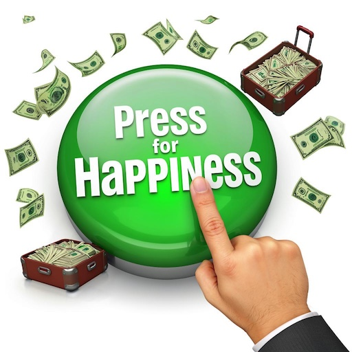

# Functional Programming in Practice

A typical situation: you study for years, read books, watch courses, go through interviews,
successfully join a large company, receive a high salary, feel confident...  
Then comes the first real project. And that's when the real fun begins.

Real deadlines, sprints, Scrum sessions, and business requirements — all this quickly knocks theoretical knowledge out of your head.  
A technical specification might sound like this:

> "Make me a big green button, and when clicked, happiness would descend.
> The deadline was yesterday, because we already sold this solution to the client,
> gave a brilliant demo of mockups in Figma and received a suitcase full of money from them.
> And the client is already practicing their finger, getting ready to press this button."

Of course, this is a little ironic, but not far from the truth. Such situations are one of the main reasons why:

- Most projects last only a few years.
- Developers, on average, change jobs every year and a half.
- Constant pressure for results leads to burnout.
- People leave, hoping to find a company where they can "write proper code".

But business operates by its own rules: if you don't quickly whip up a prototype,
someone else will, and the money will go to them: instead of a suitcase — a wagon.

## Another Way

> Spoiler: There is no other way!

Let's try to "eat the whole elephant"! 

In the modern world, there is a great temptation to vibe-code a project together, but vibe-coding has a significant drawback:
you very quickly reach a point where you stop understanding the project and burn out very fast.

So you need to try very hard from the very beginning to **yourself** develop in a way that:

- The code is **clean** and **readable**.
- It **does not contain critical bugs**.
- It is easy to **maintain**, extend, and test.
- It **does not cause repulsion** in other developers even years later.

As a bonus, we'll kill two birds with one stone: we'll create a full-fledged service together with a UI for "Personal Development Plan" —
a task tracker for automating self-learning and self-improvement.
It will be an analog of [Trello](https://trello.com/), [Weeek](https://weeek.net/) or [Kaiten](https://kaiten.ru/),
but with a focus on **knowledge sharing** in development plans and a **knowledge base**.

Goal: to create a platform where users can:

- Create their own development plans
- Automate routine operations
- Track personal development statistics
- Predict task completion from the plan
- Share plans with others
- Follow ready-made plans from the community

## How Will We Do This?

We will use **Scala** in combination with **functional programming** to:

- Simplify working with state.
- Ensure data safety.
- Write more predictable and testable code.
- Make the architecture elastic and scalable.

The foundation is **clean architecture** with layer separation.
Each level will be independent, allowing easy replacement of system parts,
testing them separately, and not fearing refactoring.

Let's see what it looks like in practice, not just in theory!

---

**Links:**

- [Source code repository][repo]

[repo]: https://gitverse.ru/scalabook/pdp
