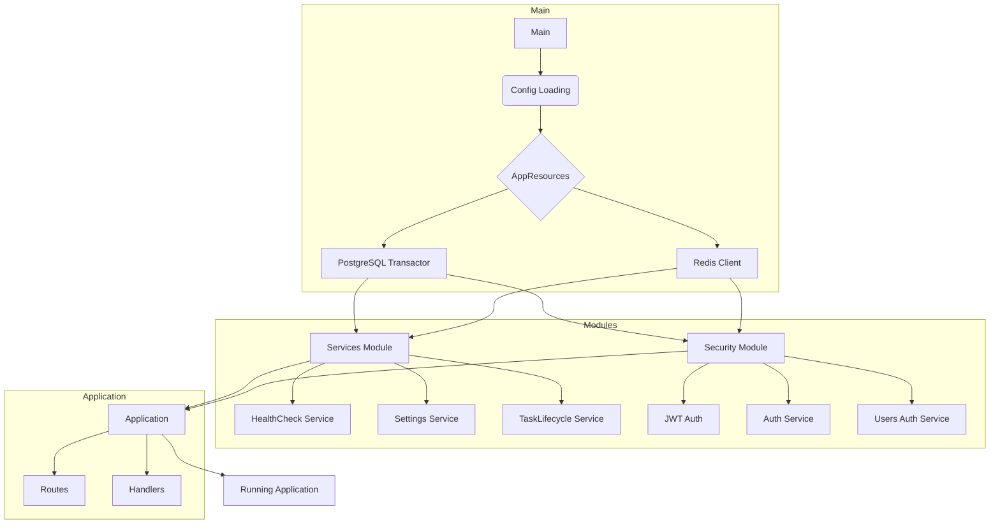

# Server Startup

In this section we will complete the application assembly, combining all previously created components into a single working whole. 
We will configure settings, create service modules and HTTP API, define resource management, and finally, start the server.

## Application Configuration

Any serious application requires flexible configuration of environment parameters: 
server addresses, database connection parameters, secret keys, and so on. 
For this, we use the **PureConfig** library in conjunction with **Iron** to ensure type safety at compile time.

### Configuration Models

Let's create a set of `case class`es that describe the structure of our configuration file. 
Using refined types allows us to impose constraints on values directly in the type definition, 
guaranteeing that an invalid configuration simply won't compile or will cause an error on startup.

```dotty
// Model for HTTP server configuration
final case class HttpServerConfig(
    host: Host,
    port: Port
) derives ConfigReader

object HttpServerConfig:
  // Reader for the Host type: checks that the string is a valid IP address or hostname
  given ConfigReader[Host] =
    ConfigReader[String].emap: host =>
      Host.fromString(host).toRight(UserValidationFailed(s"Invalid host: $host"))

  // Reader for the Port type: checks that the number falls within the valid port range
  given ConfigReader[Port] =
    ConfigReader[Int].emap: port =>
      Port.fromInt(port).toRight(UserValidationFailed(s"Invalid port: $port"))

// Type for a non-empty string with no leading/trailing spaces.
type NonEmptyString = NonEmptyString.T
object NonEmptyString extends RefinedType[String, Not[Empty] & Trimmed]

// Refined type for a user port number.
type UserPortNumber = Int :| Interval.Closed[1024, 49151]

// Model for PostgreSQL configuration
final case class PostgreSQLConfig(
    host: NonEmptyString,
    port: UserPortNumber, // Using a refined type
    user: NonEmptyString,
    password: Secret[NonEmptyString], // Using Secret for sensitive data
    database: NonEmptyString,
    max: Int :| Positive
)

// Model for Redis configuration
final case class RedisConfig(uri: NonEmptyString)

// Type for a JWT key.
type JwtAccessTokenKeyConfig = JwtAccessTokenKeyConfig.T
object JwtAccessTokenKeyConfig extends RefinedType[String, Not[Empty] & Trimmed]

// Model for JWT token configuration
final case class TokenConfig(
    jwtAccessTokenKey: Secret[JwtAccessTokenKeyConfig],
    expiration: FiniteDuration
) derives ConfigReader

// Reader for Secret[A]. We can read A, for which a ConfigReader is defined,
// and then wrap it in Secret.
given secretReader[A: {ConfigReader, Show}]: ConfigReader[Secret[A]] =
  ConfigReader[A].map(Secret.apply)

/** `Config` — root configuration object. */
final case class Config(
    httpServerConfig: HttpServerConfig,
    postgresql: PostgreSQLConfig,
    redis: RedisConfig,
    token: TokenConfig
) derives ConfigReader
```

### Configuration File (`application.conf`)

All the models described above will be populated from the `application.conf` file, 
which should be located in the `src/main/resources` directory. 
Here we set specific values for all parameters.

```conf
# HTTP server configuration
http-server-config = {
  host = "0.0.0.0"
  port = 8080
}

# PostgreSQL connection configuration
postgresql = {
  host = "postgres"
  port = 5432
  user = "postgres"
  password = "my-password"
  database = "pdp"
  max = 10  
}

# Redis connection configuration
redis = {
  uri = "redis://redis"
}

# JWT token configuration
token {
  jwt-access-token-key = "my-secret-key-for-jwt"
  expiration = 1 day
}
```

This approach allows centralized management of all settings, 
and the use of refined types and `Secret` adds a layer of security, 
preventing the accidental use of incorrect or unprotected data.

## Modular Service Architecture

To maintain architectural purity and follow the single responsibility principle, 
we group related functionality into separate modules. 
Our application will consist of main modules: `Security` and `Services`.

### `Security` Module

This module encapsulates all logic related to security and authentication. 
It is responsible for creating JWT authentication, the authentication service, and the service for finding users.

```dotty
sealed trait Security[F[_]] private (
    // JWT signature verifier
    val userJwtAuth: JwtVerification[F],
    // Service for login/logout operations
    val auth: AuthService[F],         
    // Service for finding users by token 
    val usersAuth: UsersAuthService[F, UserInfo] 
)

object Security:
  def make[F[_]: {Sync, MonadCancelThrow}](
      cfg: Config,
      transactor: Transactor[F],              // Doobie transactor for working with DB
      redis: RedisCommands[F, String, String] // Redis client
  ): F[Security[F]] =
    for
      crypto <- Crypto.make[F] // Service for password hashing
      secretKeyValue = cfg.token.jwtAccessTokenKey.value.value
      secretKey      <- SecretKey(secretKeyValue).liftTo[F]

      // JWT signing setup (for Tokens.create)
      userJwtSigning <- JwtSigningBuilder
        .default[F]
        .hmac(HS256, secretKey)
        .build

      // JWT verification setup (for middleware)
      userJwtVerification <- JwtVerificationBuilder
        .default[F]
        .hmac(HS256, secretKey)
        .build
    yield
      // Creating the service for working with tokens
      val tokens = Tokens.make[F](userJwtSigning, cfg.token.expiration)

      // Creating the service for working with users in PostgreSQL
      val usersService = new PostgreSQLUsersService[F](transactor)

      // Creating the authentication service that combines everything above
      val auth = AuthService.make[F](
        tokenExpiration = cfg.token.expiration,
        tokens = tokens,
        usersService = usersService,
        redis = redis,
        crypto = crypto
      )

      // Creating the service for user authentication based on Redis
      val usersAuth = UsersAuthService.make[F](redis)

      new Security[F](userJwtVerification, auth, usersAuth) {}
end Security
```

### `Services` Module

This module combines all business services of the application that work with data. 
It creates instances of services for working with task types, sections, goals, and tasks, 
as well as a health check service.

```dotty
sealed trait Services[F[_]] private (
    healthCheck: HealthCheck[F],
    settingsService: SettingsService[F],
    taskLifecycleService: TaskLifecycleService[F]
)

object Services:
  def make[F[_]: {Sync, MonadCancelThrow, Temporal}](
      transactor: Transactor[F],
      redis: RedisCommands[F, String, String]
  ): Services[F] =
    // 1. Health check service for PostgreSQL and Redis
    val healthCheck =
      HealthCheck.make[F](PostgreSQLHealthCheck.make[F](transactor), redis)

    // 2. Creating low-level services for working with DB
    val typeService    = new PostgreSQLTaskTypeService[F](transactor)
    val sectionService = new PostgreSQLSectionService[F](transactor)
    val goalService    = new PostgreSQLGoalService[F](transactor)
    val taskService    = new PostgreSQLTaskService[F](transactor)
    val historyService = new PostgreSQLHistoryService[F](transactor)

    // 3. Service for settings operations (CRUD for types, sections, goals, tasks)
    val settingsService = SettingsService[F](
      typeService,
      sectionService,
      goalService,
      taskService
    )

    // 4. Service for managing task lifecycle (execution, postponement, etc.)
    val taskLifecycleService = TaskLifecycleService[F](
      typeService,
      sectionService,
      goalService,
      taskService,
      historyService
    )

    new Services[F](
      healthCheck,
      settingsService,
      taskLifecycleService
    ) {}
```

Note that all concrete service implementations (e.g., `PostgreSQLTaskTypeService`) 
are created and used inside the module. 
The outside world interacts only with high-level interfaces (`SettingsService`, `TaskLifecycleService`), 
which already contain business logic.

## Resource Management

Some components of our application, such as database connections or the Redis client, are _resources_. 
They must be created, used, and properly closed. For this, Cats Effect [uses the `Resource` type](../cats-effect/std/resource.md). 
We will create a single `AppResources` module that will be responsible for initializing and managing the lifecycle of all such resources.

```dotty
sealed trait AppResources[F[_]](
    val transactor: Transactor[F],              // Doobie transactor
    val redis: RedisCommands[F, String, String] // Redis client
)

object AppResources:
  def make[F[_]: {Async, Logger, MkRedis}](
      config: Config
  ): Resource[F, AppResources[F]] =
    // Function for creating a PostgreSQL connection resource
    def makePGResource(pgcfg: PostgreSQLConfig): Resource[F, Transactor[F]] = {
      val url =
        s"jdbc:postgresql://${pgcfg.host.value}:${pgcfg.port}/${pgcfg.database.value}"
      for
        hikariConfig <- Resource.pure {
          val config = new HikariConfig()
          config.setDriverClassName("org.postgresql.Driver")
          config.setJdbcUrl(url)
          config.setUsername(pgcfg.user.value)
          config.setPassword(pgcfg.password.value.value)
          config.setMaximumPoolSize(pgcfg.max)
          config
        }
        // Create transactor from JDBC URL
        xa <- HikariTransactor.fromHikariConfig[F](hikariConfig)
        _  <- Resource.eval(checkPostgresConnection(xa))
        _  <- Resource.eval(migration(xa))
      yield xa
    }

    // Helper function for checking the PostgreSQL connection
    def checkPostgresConnection(xa: Transactor[F]): F[Boolean] =
      sql"select version();"
        .query[String]
        .option
        .transact(xa)
        .flatMap {
          case Some(v) => 
            Logger[F].info(s"Connected to Postgres $v").as(true)
          case None    =>
            new RuntimeException("Invalid Postgres connection")
              .raiseError[F, Boolean]
        }

    // Function for running database migrations
    def migration(xa: Transactor[F]): F[Boolean] =
      new PostgreSQLMigrationService(xa).migrate()

    // Function for creating a Redis connection resource
    def makeRedisResource(c: RedisConfig)
        : Resource[F, RedisCommands[F, String, String]] =
      Redis[F].utf8(c.uri.value).evalTap(checkRedisConnection)

    // Helper function for checking the Redis connection
    def checkRedisConnection(
        redis: RedisCommands[F, String, String]
    ): F[Boolean] =
      redis.info.flatMap:
        _.get("redis_version").traverse_ { v =>
          Logger[F].info(s"Connected to Redis $v")
        }.as(true)

    // Combining both resources into one using parMapN.
    // This means they will be initialized in parallel.
    (
      makePGResource(config.postgresql),
      makeRedisResource(config.redis)
    ).parMapN(new AppResources[F](_, _) {})
  end make
```

## Entry Point (Main)

Now that we have all the building blocks, we can assemble them together in the main application object.

```dotty
// pdp/src/main/scala/ru/scalabook/pdp/Main.scala
object Main extends IOApp.Simple:
  given Logger[IO] = Slf4jLogger.getLogger[IO]

  override def run: IO[Unit] =
    readConfig().flatMap: config =>
      AppResources.make[IO](config)
        .evalMap { resources =>
          val services: Services[IO] =
            Services.make[IO](resources.transactor, resources.redis)

          Security.make[IO](
            config,
            resources.transactor,
            resources.redis
          ).map: security =>
            makeApplication(services, security)
        }
        .flatMap: application =>
          ServerBuilder(
            config.httpServerConfig.port,
            config.httpServerConfig.host,
            application
          )
            .build
            .server
        .useForever

  private def readConfig(): IO[Config] =
    IO.fromEither(
      ConfigSource.default.load[Config].left.map(errors =>
        new IllegalArgumentException(s"Invalid config: ${errors.prettyPrint()}")
      )
    )

  private def makeApplication(
      services: Services[IO],
      security: Security[IO]
  ): Application =
    val healthHandler =
      HealthHandler(services.healthCheck)

    healthHandler.handler
      .orElse(assets)
      .orElse(Application.notFound)
```

### Breakdown of `Main` Operation

1. **Configuration loading:** `ConfigSource.default.load[Config]` reads `application.conf` and attempts to create a `Config` object. 
    If the configuration is invalid (e.g., refined type constraints are violated), 
    we throw an exception with a detailed description of errors.
2. **Resource creation:** `AppResources.make[IO](config)` creates a `Resource[IO, AppResources[IO]]`. 
    This resource includes the transactor for PostgreSQL and the client for Redis. 
    At this stage, database connection checks and migrations also occur.
3. **Module assembly:** The `evalMap` method on `Resource` allows us to access the created resources 
    and, using them, build our `Services` and `Security` modules. 
    `evalMap` guarantees that this happens after resources are successfully created, but before they are released.
4. **Server launch:** `flatMap` creates the application service using `Application`.
5. **Waiting:** `useForever` is a convenient method that is equivalent to `.use(_ => IO.never)`. 
    It starts the server and puts the main program into an infinite wait, preventing it from terminating. 
    The server will run until the process is stopped externally.

## Overall Architecture

The following diagram presents an overall overview of our application components and their relationships.



## Summary

We have completed the creation of our application:

- **Type-safe configuration** using PureConfig and Iron helps prevent errors at early stages.
- **Modular architecture** (`Security`, `Services`) allows clear separation of responsibilities and simplifies testing and maintenance.
- **Resource management** via `Resource` from Cats Effect guarantees that all connections to external systems will be properly created and released.
- **Composition** of all parts in `Main` demonstrates how simple, isolated components assemble into a complex yet reliable system.

We now have a fully functional application ready for deployment.

## Running and Verification

You can start the application in the sbt console: `pdp/run`.

And open the address `http://localhost:8080/health_check` in a browser:

You will receive a JSON response with the current state of dependencies:

```json
{
  "redis": "Okay",
  "postgres": "Okay"
}
```

### What's Next

We have set up a minimal working HTTP server with one endpoint `/health_check`.
Next, step by step, we will add new endpoints: registration, login, working with tasks,
user settings. Each new endpoint will be formatted as a separate `Handler`,
registered in `Main` through `orElse` and covered with tests.

---

**Links:**

- [Repository with source code][repo]
- [Gabriel Volpe - Practical FP in Scala][pfp]

[repo]: https://gitverse.ru/scalabook/pdp
[pfp]: https://leanpub.com/pfp-scala
