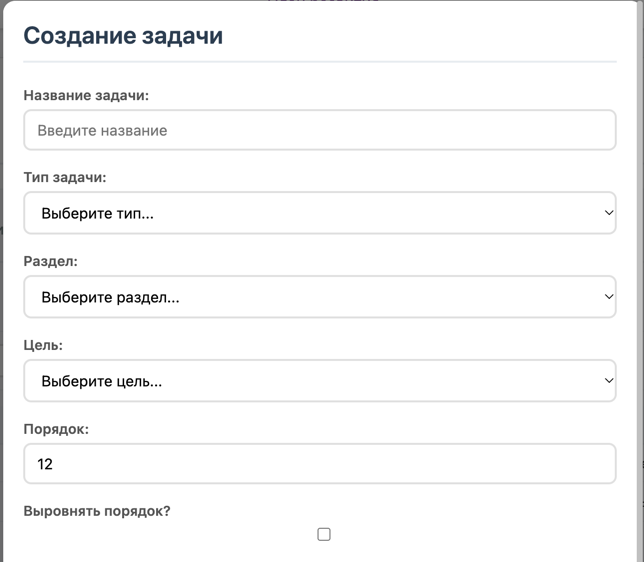

# Ordinal Alignment

On the **"Planned"** tab, tasks are displayed in a strict execution order — the user sets the sequence
in which they plan to execute the plan. However, this order can be disrupted in four situations:

- **Creating a new task** — the user specifies an order that may match an existing one.
- **Editing a task** — changing the ordinal number of an existing task.
- **Queueing a task** — transitioning from `KnowledgeBase` to `Planned` with a specified order.
- **Postponing a task** — returning from `InProgress` back to `Planned`.

Each of these operations can lead to **duplicate ordinal numbers**. 
For example, if the plan has tasks with ordinals `1, 2, 3, 5, 6, 7`, and the user inserts a new task with ordinal `2`, 
two tasks will get the number `2`. This breaks sorting and makes the list ambiguous.

To avoid this, an **"Ordinal Alignment"** mechanism is introduced — when activated with a flag, all tasks of the same status
whose ordinal is **greater than or equal to** the specified one are shifted by one, and the new task takes the freed slot.

## How Alignment Works

### Example

Let's say the plan has tasks with ordinals `1, 2, 3, 5, 6, 7`. The user adds a task with ordinal `2`.

**Without alignment:** you get `1, 2, 2, 3, 5, 6, 7` — two ordinal numbers `2`.

**With alignment:** you get `1, 2, 3, 4, 5, 6, 7`:

- Tasks with ordinal `< 2` remain unchanged: `1`.
- The new task gets ordinal `2`.
- Tasks with ordinal `>= 2` are shifted: `2 → 3`, `3 → 4`, `5 → 5` (since a new task appeared, 
  but the shift goes **strictly by arithmetic progression** from the specified one).

### Algorithm

1. **Filter** tasks of the same status whose `ordinal >= ordinal_of_new_task`.
2. **Sort** them by ascending original `ordinal`.
3. **Assign** them new ordinals, starting with `ordinal_of_new_task` and incrementing by 1 for each.
4. **Save** changes in a single transaction.

Tasks with `ordinal < ordinal_of_new_task` remain unchanged.

## `updateOrdinal` Operation in `TaskService`

First step: add a new operation to the `TaskService` trait that allows bulk updating task ordinals:

```dotty
def updateOrdinal(ordinals: NonEmptyVector[(TaskId, Ordinal)]): F[Boolean]
```

**Signature breakdown:**

- **`NonEmptyVector[(TaskId, Ordinal)]`** — a non-empty vector of pairs "task ID → new ordinal". 
  Using `NonEmptyVector` instead of `Vector` is a type-safe guarantee that the list is not empty. 
  No need to check `isEmpty` — the compiler won't allow it.
- **`F[Boolean]`** — an effect that returns `true` if all updates succeeded.

### Implementation in `PostgreSQLTaskService`

```dotty
def updateOrdinal(ordinals: NonEmptyVector[(TaskId, Ordinal)]): F[Boolean] =
  val (taskId, ordinal) = ordinals.head
  ordinals.tail.foldLeft(
    sql"""UPDATE tasks SET ordinal = $ordinal WHERE id = $taskId""".update.run
  ) {
    case (acc, (taskId, ordinal)) =>
      acc *>
        sql"""UPDATE tasks SET ordinal = $ordinal WHERE id = $taskId""".update.run
  }
    .transact(xa)
    .map(_ > 0)
```

**Step-by-step breakdown:**

1. **`val (taskId, ordinal) = ordinals.head`** — extracts the first pair. It is used as the initial value for `foldLeft`.

2. **`foldLeft(...)`** — iterates over remaining pairs (`ordinals.tail`), accumulating `ConnectionIO`. At each step:
    - **`acc *>`** — effect composition: first the previous update runs, then the current one. 
      The `*>` operator (asterisk-greater) means "left first, then right".
    - **`sql"""UPDATE tasks SET ordinal = $ordinal WHERE id = $taskId""".update.run`** — an `UPDATE` for a single task.

3. **`.transact(xa)`** — wraps the entire sequence of `UPDATE`s in a single transaction. If any `UPDATE` fails — all changes are rolled back.

4. **`.map(_ > 0)`** — converts the number of affected rows to `Boolean`. If at least one was updated — `true`.

**Why `foldLeft` instead of `traverse` or `sequence`?**

`foldLeft` gives explicit control over execution order: all `UPDATE`s execute **sequentially**, not in parallel. 
This is important for `UPDATE` operations because parallel updates can lead to database deadlocks.

### Implementation in `MockTaskService`

```dotty
def updateOrdinal(ordinals: NonEmptyVector[(TaskId, Ordinal)]): F[Boolean] =
  tasksSrc.update: source =>
    ordinals.foldLeft(source) {
      case (source, (taskId, ordinal)) =>
        source.get(taskId) match
          case None       => source
          case Some(task) =>
            source + (taskId -> task.copy(ordinal = ordinal))
    }.as(true)
```

**Breakdown:**

- **`tasksSrc.update`** — atomically updates the mock's internal state (usually `Ref[F, Map[TaskId, Task]]`).
- **`foldLeft(source)`** — we iterate over all pairs, updating the task map.
- **`source.get(taskId)`** — if the task is not found, skip it.
- **`task.copy(ordinal = ordinal)`** — creates a copy of the task with a new ordinal.
- **`.as(true)`** — always returns `true` because a mock cannot "break".

## Alignment Logic in `TaskLifecycleService`

The `reorderTasks` method implements the shift algorithm itself:

```dotty
def reorderTasks(
    userId: UserId,
    ordinal: Ordinal,
    status: Status
): F[Boolean] =
  taskService.getAll(
    userId = userId,
    maybeStatus = status.some,
    maybeTaskType = none,
    maybeSectionId = none
  ).flatMap: tasks =>
    val reorderedTasks: Vector[(TaskId, Ordinal)] =
      tasks.collect {
        case task if task.ordinal.value >= ordinal.value =>
          task.id -> task.ordinal
      }
        .sortBy(_._2)
        .foldLeft((Vector.empty[(TaskId, Ordinal)], ordinal.next)) {
          case ((acc, ordinal), (taskId, _)) =>
            (
              acc :+ (taskId -> ordinal),
              ordinal.next
            )
        }._1

    NonEmptyVector
      .fromVector(reorderedTasks)
      .map(taskService.updateOrdinal)
      .getOrElse(true.pure[F])
```

**Step-by-step breakdown:**

1. **`taskService.getAll(...)`** — loads all user tasks with the specified status.
2. **`tasks.collect { case task if task.ordinal.value >= ordinal.value => ... }`** — selects only tasks 
    whose ordinal is **not less than** the specified one. Tasks with a smaller ordinal are not affected.
3. **`.sortBy(_._2)`** — sorts by ascending original `ordinal`. This is important: the shift must go from a smaller ordinal to a larger one.
4. **`.foldLeft((Vector.empty, ordinal.next))`** — iterates over tasks, starting from `ordinal.next` (the one after the specified one). At each step:
    - Add the task with a new ordinal to the accumulator.
    - Increment the counter for the next task.

   **Why `ordinal.next` instead of `ordinal`?** Because the ordinal `ordinal` is **reserved** for the new or updated task. 
   All others shift starting from the next number.

5. **`._1`** — extracts only the vector of pairs, ignoring the final counter.
6. **`NonEmptyVector.fromVector(reorderedTasks)`** — converts to `NonEmptyVector`. 
    If the list is empty (no tasks with ordinal >= specified), returns `true` — nothing to align.
7. **`.map(taskService.updateOrdinal)`** — if the list is not empty, calls batch-update.
8. **`.getOrElse(true.pure[F])`** — if the list is empty, returns `true` in the `F` effect.

### Example of Operation

Let there be tasks `1, 2, 6, 7, 3, 5` and the user adds a task with ordinal `2`.

**Selection:** tasks with `ordinal >= 2` are `[2, 6, 7, 3, 5]`.

**Sorting:** `[2, 3, 5, 6, 7]`.

**FoldLeft with initial `ordinal.next = 3`:**

- Task with ordinal `2` → gets `3`
- Task with ordinal `3` → gets `4`
- Task with ordinal `5` → gets `5`
- Task with ordinal `6` → gets `6`
- Task with ordinal `7` → gets `7`

**Result:** `[3, 4, 5, 6, 7]` for shifted tasks.

**Final plan:** `1, 2 (new), 3, 4, 5, 6, 7`.

Note: tasks `5, 6, 7` got the same ordinals they had before (5 → 5, 6 → 6, 7 → 7), 
because after shifting `2 → 3, 3 → 4` the next in queue is `5`, and it already matches its number. 
This corresponds to an **arithmetic progression** from the specified ordinal: `2, 3, 4, 5, 6, 7`.

## Updating Request Models

The `ordinalShift` field is added to all request models that participate in ordinal operations:

```dotty
final case class QueueTaskRequest(
    token: String,
    ordinal: Int,
    ordinalShift: Option[String]
) derives FormCodec
```

**Why `Option[String]` instead of `Boolean`?**

Because an HTML checkbox sends the value `"on"` if checked, and **doesn't send the field at all** if unchecked. 
`Option[String]` correctly models both cases:

- `Some("on")` — checkbox is checked.
- otherwise — checkbox is unchecked.

Check in code: `request.ordinalShift.contains("on")`.

**Analogously**, the field is added to `CreateTaskRequest` and `EditTaskRequest`.

## Updating `createHandler` (`TaskHandlers`)

Now task creation happens in two steps: alignment first, then creation itself.

```dotty
val runReorderTasks: IO[Boolean] =
  if request.ordinalShift.contains("on") then
    taskLifecycleService.reorderTasks(
      userId = user.id,
      ordinal = task.ordinal,
      status = task.status
    )
  else IO(true)

val run: IO[String] =
  for
    _    <- runReorderTasks
    _    <- taskLifecycleService.create(task)
    view <-
      TaskViews.getViewAfterCreateTask(
        settingsService = settingsService,
        userId = user.id,
        token = jwtToken,
        tab = request.tab
      )
  yield view
```

**The order of actions is critical:**

1. **`runReorderTasks`** — shift existing tasks to make room for the new one.
2. **`taskLifecycleService.create(task)`** — create the new task with the specified ordinal.

If you swap them — the new task will be created before the shift, and you'll get a duplicate. So first align, then create.

**What if alignment is not needed?**

`IO(true)` — no-op. The effect does nothing but returns `true`. This allows writing a single for-comprehension regardless of the flag.

## Updating `editHandler` (`TaskHandlers`)

Analogously for editing:

```dotty
val runReorderTasks: IO[Boolean] =
  if request.ordinalShift.contains("on") then
    taskLifecycleService.reorderTasks(
      userId = user.id,
      ordinal = task.ordinal,
      status = task.status
    )
  else IO(true)

val run: IO[Option[String]] =
  for
    _    <- runReorderTasks
    _    <- taskLifecycleService.update(task)
    view <- getViewTask(
      taskLifecycleService = taskLifecycleService,
      userId = user.id,
      taskId = task.id,
      jwtToken = jwtToken,
      errorMessage = none
    )
  yield view
```

Here **a nuance is important**: if the old ordinal was `5` and the new one is `2`, then with `reorderTasks(ordinal = 2)` 
tasks with `ordinal >= 2` will be selected, including the task with `ordinal = 5` itself. 
It will also shift — but then `update` will overwrite its ordinal to `2`. 
The final result is correct, although the intermediate state contains an "extra" update.

## Updating `queueHandler` (`TaskHandlers`)

For queueing — the same logic, but with a fixed `Planned` status:

```dotty
case Right(ordinal) =>
  val runReorderTasks: IO[Boolean] =
    if request.ordinalShift.contains("on") then
      taskLifecycleService.reorderTasks(
        userId = user.id,
        ordinal = ordinal,
        status = Status.Planned
      )
    else IO(true)

  for
    _ <- runReorderTasks
    _ <- taskLifecycleService.enqueue(
      id = taskId,
      userId = user.id,
      ordinal = ordinal
    )
    maybeView <- getViewTask(...)
  yield maybeView
```

The task is transitioned from `KnowledgeBase` to `Planned` with the specified ordinal. Before that, all tasks of status `Planned` are aligned.

## Updating Templates

In all forms that have an ordinal input field, a checkbox is added:

### `Views.createTask`

Calls `CreateTaskRequest.render`, which renders the task creation form. The ordinal section:

```dotty
group("ordinal", "Ordinal:")(input(
  attr("id")    := "ordinal",
  attr("name")  := "ordinal",
  attr("type")  := "number",
  attr("min")   := "1",
  attr("value") := request.ordinal,
  required
)),
group("ordinalShift", "Align ordinals?")(
  input(
    attr("id")   := "ordinalShift",
    attr("name") := "ordinalShift",
    attr("type") := "checkbox"
  )
),
```

### `Views.editTask`

Calls `EditTaskRequest.render`, which renders the task editing form. The ordinal section:

```dotty
group("ordinal", "Ordinal:")(
  input(
    attr("id")    := "ordinal",
    attr("name")  := "ordinal",
    attr("type")  := "number",
    attr("min")   := "1",
    attr("value") := request.ordinal,
    cls           := "form-input",
    required
  )
),
group("ordinalShift", "Align ordinals?")(
  input(
    attr("id")   := "ordinalShift",
    attr("name") := "ordinalShift",
    attr("type") := "checkbox"
  )
)
```

### `Views.task` (ordinal selection modal window)

Calls `QueueTaskRequest.render`, which renders the form in the modal window `ordinalModal`. Contains `ordinal` and `ordinalShift` fields:

```dotty
form(
  attr("id")     := "ordinalForm",
  attr("hx-put") := s"/task/${id.value}/queue",
  Htmx.appTarget,
  Htmx.appSwap,
  Htmx.hiddenToken(token.show),
  div(
    cls := "form-group",
    label(`for` := "ordinalSelect")("Ordinal:"),
    div(
      cls := "ordinal-info-block compact",
      div(cls := "ordinal-info-title")(
        s"""Available ordinals for task type "$taskType":"""
      ),
      div(cls := "ordinal-info-list")(ordinalListChildren*)
    ),
    input(
      attr("id")    := "ordinalSelect",
      attr("name")  := "ordinal",
      attr("type")  := "number",
      cls           := "form-input",
      placeholder   := "Enter ordinal",
      attr("value") := ordinal
    ),
    div(
      cls := "form-group",
      label(`for` := "ordinalShift")("Align ordinals?"),
      input(
        attr("id")   := "ordinalShift",
        attr("name") := "ordinalShift",
        attr("type") := "checkbox"
      )
    )
  ),
  div(
    cls := "modal-actions",
    button(
      `type`  := "submit",
      cls     := "save-btn",
      onclick := "closeModal('ordinalModal')"
    )("Confirm"),
    button(
      `type`  := "button",
      cls     := "cancel-btn",
      onclick := "closeModal('ordinalModal')"
    )("Cancel")
  )
)
```

The checkbox is **unchecked by default**. 
If the user checks it, upon form submission the `ordinalShift` field will contain `"on"`, and the server will perform alignment.

## Pre-calculated Ordinal

A separate task is to **offer the user a correct default ordinal**. 
When the user opens the task creation form, the "Ordinal" field should already be filled — with the next free number.

For **"In Progress"** and **"Planned"** statuses, the ordinal is calculated as follows:

```dotty
val createModalHandler: Handler =
  createModalRoute.handleIO: (tab: String, authorization: Authorization) =>
    withUserFromHeader(authorization): (user, token) =>
      val ordinalIO: IO[Ordinal] =
        TaskStatus.find(tab) match
          case Some(status)
              if status == TaskStatus.InProgress ||
                status == TaskStatus.Planned =>
            taskLifecycleService.taskService
              .getAll(
                userId = user.id,
                maybeStatus = status.some,
                maybeTaskType = none,
                maybeSectionId = none
              )
              .map(_.map(_.ordinal.next).maxOption.getOrElse(Ordinal.Min))
          case _ => Ordinal.Max.pure[IO]

      ordinalIO.flatMap: ordinal =>
        val request = CreateTaskRequest.empty(
          token = token.show,
          tab = tab,
          ordinal = ordinal.value
        )

        TaskViews.getViewEmptyCreateTaskModal(
          settingsService = settingsService,
          userId = user.id,
          request = request
        )
```

`createModalHandler` is declared inside `TaskHandlers`; the route it uses
`createModalRoute` is private.

**Step-by-step breakdown:**

1. **`withUserFromHeader(authorization)(...)`** — standard token check from the header.
    `authorization` — first argument, the lambda `(user, token)` — second.
2. **`TaskStatus.find(tab)`** — determine status by tab name.
    Tabs `"in-progress"`, `"planned"`, `"knowledge-base"` map to corresponding `Status`.

3. **Case for `InProgress` and `Planned`:**
    - Load all tasks with this status.
    - For each, compute `ordinal.next` — the next ordinal number.
    - Take the **maximum** of them: `_.ordinal.next`.
    - If the list is empty — return `Ordinal.Min` (usually 1).

   **Why `max` of `next`?** Because we want to place the new task **at the end** of the queue. 
   If the last task has ordinal `10`, the new one should get `11`. 
   `max` guarantees this, even if the list has gaps or tasks with large ordinals.

4. **Case for `KnowledgeBase` and others:**
    - Return `Ordinal.Max` — a large number that the user will replace when queueing.
    - For status `KnowledgeBase`, the ordinal doesn't matter: tasks from the knowledge base are not yet in the queue.

5. **`ordinalIO.flatMap`** — having received the ordinal, create `CreateTaskRequest.empty` with this ordinal and render the modal window.

**What the user sees in the form:**

- Opening the form on the "In Progress" tab, the "Ordinal" field already contains the next free number.
- If there are 5 tasks with ordinals `1, 2, 3, 4, 5`, the field will show `6`.
- If the list has `1, 3, 5, 7` (with gaps), the field will show `8` (max of `7.next = 8`).



The user can accept this value or change it. 
If they change it to a smaller one, they should check the "Align ordinals" checkbox to avoid creating a duplicate.

## Summary

The **"Align Ordinals"** mechanism solves the problem of inserting a task into the middle of the queue:

1. **`updateOrdinal`** in `TaskService` — an operation for updating ordinals.
2. **`reorderTasks`** in `TaskLifecycleService` — the algorithm for shifting tasks into an arithmetic progression.
3. **`ordinalShift`** in request models — a flag that enables alignment.
4. **Handler updates** — calling `reorderTasks` before create/update/queueing.
5. **Checkbox in forms** — UI for managing the flag.
6. **Pre-calculated ordinal** — filling the "Ordinal" field with the next free number.

This mechanism makes working with task ordinals **predictable**: the user can insert a task anywhere in the queue, 
and all other tasks will automatically shift, maintaining continuous numbering.

---

**Links:**

- [Repository with source code][repo]

[repo]: https://gitverse.ru/scalabook/pdp
