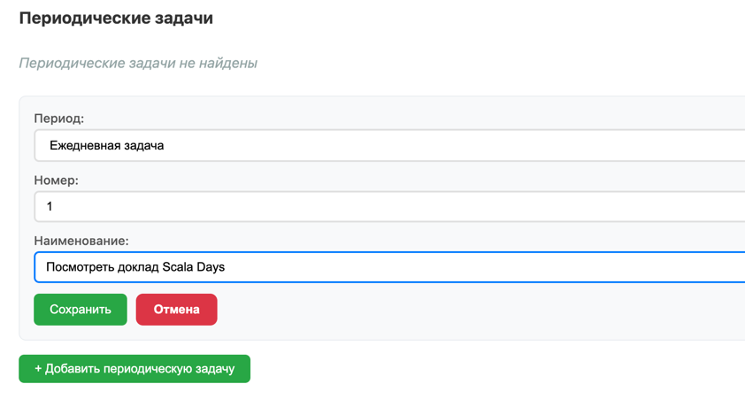
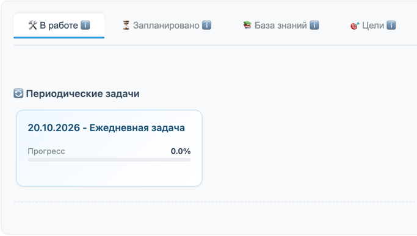
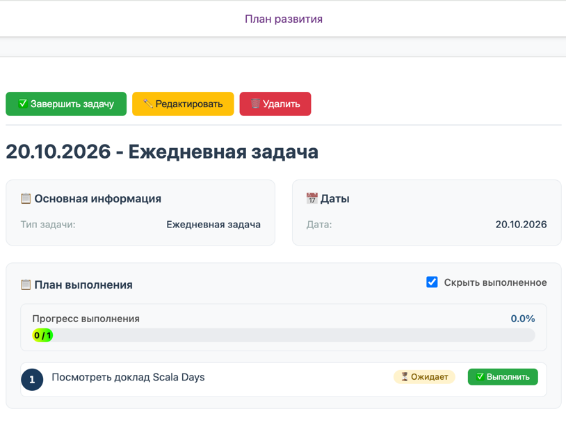

# Periodic Tasks

## Main Concept

Periodic tasks are an automated system for managing **recurring actions** in your personal development plan. 
Unlike one-time tasks that are created and completed manually, periodic tasks are **generated automatically on a given schedule**.

Imagine: you decided to watch [Scala Days](https://www.youtube.com/playlist?list=PLSwkkO70hN24) presentations daily and 
update your development plan monthly. 
Instead of creating tasks manually every day, you set up **templates** — 
and the system itself creates the needed tasks on the needed dates. 
This turns routine into an **automatic process** that doesn't require your attention.

## Why is This Needed?

### Automating Routine

It eliminates the need to manually create the same tasks over and over. 
The user sets up "Daily task: watch a Scala Days presentation" once — and the system creates a new task for today every day. 
No need to remember, no need to copy, no need to re-enter.



### Controlling Regularity

Helps not to miss important recurring actions. 
If today's task "Watch a Scala Days presentation" is not completed — it is visible in the "In Progress" list. 



This is a visual reminder: "you haven't done this yet today." Without periodic tasks, such actions are easily forgotten.



### Reducing Cognitive Load

No need to keep a list of recurring things in your head. 
The user frees mental space for creative tasks because routine is automated. 
This is a key advantage: the brain doesn't waste energy on "what should I do today?" — the system has already prepared the list.

## Setting Up the System

In the settings section, the user creates **periodic task steps** — templates from which tasks will be generated. 
Each step contains three fields:

- **Name** — what exactly needs to be done ("Exercise", "Reading", "Meditation").
- **Ordinal** — the step number in the plan (`1`, `1.2`, `1.2.3`). Determines the execution sequence.
- **Periodicity** — how often to repeat (`Daily`, `Weekly`, `Monthly`, `Quarterly`, `Yearly`).

For each step, **"Edit"** and **"Delete"** buttons are available. 
Editing allows changing the name, number, period, and — optionally — **aligning the ordinal** of neighboring steps.

### `PeriodicType` Model

Periodicity is set via an enumeration with five values:

```dotty
enum PeriodicType:
  case Daily, Weekly, Monthly, Quarterly, Yearly
```

**Breakdown of values:**

| Value         | Meaning        | Example usage                                |
| ------------- | -------------- | -------------------------------------------- |
| **`Daily`**   | Every day      | Watch a presentation, read an article        |
| **`Weekly`**  | Once a week    | Weekly review, planning with yourself        |
| **`Monthly`** | Once a month   | Summary, goals review                        |
| **`Quarterly`** | Once a quarter | Quarter retrospective, plan adjustment     |
| **`Yearly`**  | Once a year    | Annual review, goal setting for the year     |

**Why these five?** They cover **typical planning horizons** in personal development. 
Daily — for habits. Weekly — for tactical review. Monthly — for strategic. 
Quarterly and yearly — for long-term reflection. 
The user doesn't need to create arbitrary intervals (e.g., "every 3 days") — that would complicate the system and confuse the user.

### Serializing `PeriodicType`

```dotty
object PeriodicType:
  given Meta[PeriodicType] =
    Meta[String].timap(PeriodicType.valueOf)(_.toString)
```

**What `Meta` does:** Doobie uses `Meta` to convert between Scala types and PostgreSQL column types. 
`Meta[String].timap(...)` creates a `Meta[PeriodicType]` from `Meta[String]`:

> `Meta` is used at the Doobie level, but the DB stores **not a string, but an enum** (`PeriodicTypeEnum`). 
> Therefore, an explicit cast is used in queries: `${periodicType}::PeriodicTypeEnum`.

**Display:**

```dotty
given Show[PeriodicType] =
  Show.show {
    case Daily     => "Daily task"
    case Weekly    => "Weekly task"
    case Monthly   => "Monthly task"
    case Quarterly => "Quarterly task"
    case Yearly    => "Yearly task"
  }
```

`Show` provides a **human-readable** representation for UI. Unlike `toString` (which gives `"Daily"`), 
`show` gives "Daily task" — understandable to the user.

**String search:**

```dotty
def find(source: String): Option[PeriodicType] =
  values.find(_.toString.equalsIgnoreCase(source.replaceAll("\\W", "")))
```

**Breakdown:**

- **`source.replaceAll("\\W", "")`** — removes all non-word characters. `"daily-task"` → `"dailytask"`, `"Daily!"` → `"Daily"`.
- **`equalsIgnoreCase`** — case-insensitive comparison. `"daily"`, `"DAILY"`, `"Daily"` — all find `Daily`.
- **`values.find`** — returns the first matching enum or `None`.

**Why `find` when there's a `Decoder`?** `find` is used for **parsing from HTML forms**. 
The user sends `"daily"` (from `value` in `<option>`), and the server converts it to `PeriodicType.Daily`. 
`Decoder` — for JSON, `find` — for forms. Different contexts — different utilities.

### `PeriodicStep` Model

```dotty
final case class PeriodicStep(
    id: PeriodicStepId,
    number: StepNumber,
    name: StepName,
    userId: UserId,
    periodicType: PeriodicType
)

object PeriodicStep:
  type PeriodicStepId = PeriodicStepId.T
  object PeriodicStepId extends RefinedType[Int, GreaterEqual[0]]
```

**Field breakdown:**

| Field             | Type             | Purpose                                |
| ----------------- | ---------------- | -------------------------------------- |
| **`id`**          | `PeriodicStepId` | Unique step ID                         |
| **`number`**      | `StepNumber`     | Step number (`1`, `1.2`, `1.2.3`)      |
| **`name`**        | `StepName`       | Step name                              |
| **`userId`**      | `UserId`         | Step owner                             |
| **`periodicType`** | `PeriodicType`  | Periodicity                            |

**`PeriodicStepId`** — a refined type over `Int` with a `GreaterEqual[0]` constraint. 
Negative IDs are prohibited at the type level. This is error protection: `PeriodicStepId(-1)` won't compile.

**`StepNumber` and `StepName`** — the same types as in regular tasks. 
This provides **uniformity**: step numbers and their names follow the same rules 
(number — `^\d+(?:\.\d+)*$`, name — 2 to 300 characters with `Trimmed`).

### DTO `CreatePeriodicStep`

```dotty
final case class CreatePeriodicStep(
    number: StepNumber,
    name: StepName,
    userId: UserId,
    periodicType: PeriodicType
)
```

DTO for creating a step. Differs from `PeriodicStep` by the absence of `id` — the ID is generated by the DB on `INSERT`.

**Why a separate DTO instead of `PeriodicStep` without `id`?** Because `PeriodicStep` requires an `id`, which doesn't exist yet at creation. 
Using `PeriodicStep` with a temporary ID (e.g., `-1`) is an anti-pattern: 
it's easy to forget to replace the ID and get incorrect data. 
A separate DTO makes the intent **explicit**: "these are data for creation, they don't have an ID yet".

## `PeriodicStepService` Service

```dotty
private[services] trait PeriodicStepService[F[_]]:
  def create(newItem: CreatePeriodicStep): F[PeriodicStepId]
  def get(id: PeriodicStepId, userId: UserId): F[Option[PeriodicStep]]
  def getByUser(userId: UserId): F[Vector[PeriodicStep]]
  def update(item: PeriodicStep): F[Boolean]
  def updateAll(items: NonEmptyVector[PeriodicStep]): F[Boolean]
  def delete(id: PeriodicStepId): F[Boolean]
```

**Method breakdown:**

- **`create`** — creates a step and returns the generated ID.
- **`get`** — gets a step by ID **with owner verification** (`userId`). Returns `Option`,
  because the step may not exist (or may belong to another user).
- **`getByUser`** — gets all steps of the user.
- **`update`** — updates a single step. Returns `Boolean` — whether the step was found and updated.
- **`updateAll`** — updates multiple steps in a single transaction. A key method for **reordering**.
- **`delete`** — deletes a step by ID.

**Why `updateAll` instead of `update` in a loop?** `updateAll` uses a **transaction**: 
if one `UPDATE` fails, all changes are rolled back. 
This is critical for reordering: you can't leave steps in a "half-updated" state with duplicate numbers.

## Database Migration

```dotty
private val createPeriodicTypeEnum: Fragment =
  sql"""CREATE TYPE PeriodicTypeEnum AS ENUM
       ('Daily', 'Weekly', 'Monthly', 'Quarterly', 'Yearly');"""

private val createPeriodicStepTable: Fragment =
  sql"""CREATE TABLE IF NOT EXISTS periodic_steps (
       id SERIAL PRIMARY KEY,
       number VARCHAR(255) NOT NULL,
       name VARCHAR(255) NOT NULL,
       user_id UUID NOT NULL,
       periodic_type PeriodicTypeEnum NOT NULL
       );"""
```

**Breakdown:**

- **`CREATE TYPE PeriodicTypeEnum AS ENUM (...)`** — creates a **PostgreSQL user type**. 
  Unlike `VARCHAR`, the enum guarantees that the `periodic_type` column can contain **only** these five values. 
  Trying to insert `'Unknown'` will cause a database-level error — this is additional protection.

- **`periodic_type PeriodicTypeEnum NOT NULL`** — the column has an enum type. An explicit cast is needed on insert: `${periodicType}::PeriodicTypeEnum`.

**Why an enum instead of `VARCHAR`?** The enum provides:

- **Type safety** at the database level.
- **Compact storage** (enum is stored as an integer, not a string).
- **Validation** on insert.

**Enum downside:** adding a new value requires `ALTER TYPE ... ADD VALUE`. 
If `BiWeekly` appears in the future — the type needs migration. For a stable set of five values, this is acceptable.

## `PostgreSQLPeriodicStepService` Implementation

### `create`

```dotty
def create(newItem: CreatePeriodicStep): F[PeriodicStepId] =
  sql"""INSERT INTO periodic_steps (number, name, user_id, periodic_type)
        VALUES (${newItem.number}, ${newItem.name}, ${newItem.userId}, ${newItem.periodicType}::PeriodicTypeEnum)
        RETURNING id"""
    .query[PeriodicStepId]
    .unique
    .transact(xa)
```

**Breakdown:**

- **`INSERT`** — inserts a new step.
- **`${newItem.periodicType}::PeriodicTypeEnum`** — explicit cast to enum. 
  Without it, PostgreSQL won't understand that the string `"Daily"` should become an enum value.
- **`RETURNING id`** — returns the generated ID in one query.
- **`.query[PeriodicStepId].unique`** — expects exactly one row, reads it as `PeriodicStepId`.

### `get`

```dotty
def get(id: PeriodicStepId, userId: UserId): F[Option[PeriodicStep]] =
  sql"""SELECT id, number, name, user_id, periodic_type FROM periodic_steps WHERE id = $id AND user_id = $userId"""
    .query[PeriodicStep].option.transact(xa)
```

Returns `Option[PeriodicStep]`. `.option` converts "no rows" to `None`, "has rows" — to `Some`.
The query filters by both `id` and `user_id` — the service itself guarantees that the user won't get another user's step.

### `getByUser`

```dotty
def getByUser(userId: UserId): F[Vector[PeriodicStep]] =
  sql"""SELECT id, number, name, user_id, periodic_type FROM periodic_steps WHERE user_id = $userId"""
    .query[PeriodicStep]
    .to[Vector]
    .transact(xa)
```

Returns **all** steps of the user. `.to[Vector]` collects rows into a vector.

> **Why not sort in the query?** 
> Sorting is performed **in the settings service** before passing to UI — by `(periodicType.ordinal, number)`. 
> This provides flexibility: if a different sorting is needed, it can be changed in one place — in `getViewSettings`, not in SQL.

### `update`

```dotty
def update(item: PeriodicStep): F[Boolean] =
  getUpdateFragment(item)
    .update.run.transact(xa).map(_ > 0)

private def getUpdateFragment(step: PeriodicStep): Fragment =
  sql"""UPDATE periodic_steps
       SET number = ${step.number}, name = ${step.name}, user_id = ${step.userId}, periodic_type = ${step.periodicType}::PeriodicTypeEnum
       WHERE id = ${step.id}"""
```

**Breakdown:**

- **`getUpdateFragment`** — extracted to a separate method for reuse in `update` and `updateAll`. This eliminates SQL duplication.
- **`.update.run`** — executes `UPDATE`, returns the number of affected rows.
- **`.map(_ > 0)`** — `true` if a row was updated.

### `updateAll`

```dotty
def updateAll(items: NonEmptyVector[PeriodicStep]): F[Boolean] =
  items.tail.foldLeft(getUpdateFragment(items.head).update.run) {
    case (acc, step) =>
      acc *> getUpdateFragment(step).update.run
  }
    .transact(xa)
    .map(_ > 0)
```

**Step-by-step breakdown:**

1. **`items.head`** — the first element is used as the initial value for `foldLeft`.
2. **`items.tail.foldLeft(...)`** — we iterate over the remaining elements.
3. **`acc *> getUpdateFragment(step).update.run`** — effect composition: first the previous `UPDATE`, then the current one.
4. **`.transact(xa)`** — all in a single transaction.
5. **`.map(_ > 0)`** — `true` if at least one `UPDATE` affected a row.

**Why `*>` instead of `flatMap`?** `*>` is `productR`: it executes the left effect, ignores its result, executes the right. 
For `UPDATE` the result doesn't matter — the important thing is that both executed. `*>` is shorter and more expressive than `flatMap(_ => ...)`.

### `delete`

```dotty
def delete(id: PeriodicStepId): F[Boolean] =
  sql"""DELETE FROM periodic_steps WHERE id = $id"""
    .update.run.transact(xa).map(_ > 0)
```

A simple `DELETE` with a check that the row was deleted.

## `SettingsService` — Integration

`SettingsService` is an aggregator that manages all reference data. For periodic tasks, it provides five methods.

### `createStep`

```dotty
def createStep(newItem: CreatePeriodicStep): F[PeriodicStepId] =
  periodicStepService.create(newItem)
```

Simple delegation. `SettingsService` adds no logic — it just proxies the call to `PeriodicStepService`.

### `updateStep`

```dotty
def updateStep(item: PeriodicStep): F[Boolean] =
  periodicStepService.update(item)
```

Also delegation. Validation (e.g., owner check) is performed in the handler or in `reorderSteps`.

### `getSteps`

```dotty
def getSteps(userId: UserId): F[Vector[PeriodicStep]] =
  periodicStepService.getByUser(userId)
```

Loads all steps of the user. Sorting — at the `getViewSettings` level.

### `deleteStep`

```dotty
def deleteStep(id: PeriodicStepId, userId: UserId): F[Boolean] =
  periodicStepService.get(id, userId).flatMap:
    case Some(_) => periodicStepService.delete(id)
    case None    => false.pure[F]
```

**Breakdown:**

1. **`periodicStepService.get(id, userId)`** — loads the step **with owner verification**: the method
    takes `userId` and filters by it. If the step belongs to another user — it will return `None`.
2. **`case Some(_) => periodicStepService.delete(id)`** — the step exists **and** belongs to the user — delete it.
3. **`case None => false.pure[F]`** — if the step doesn't exist or belongs to someone else — return `false`.

**Why did owner verification move out of `SettingsService`?** In `cb36973` owner verification moved
to the low-level `PeriodicStepService`: `get(id, userId)` already filters by `user_id`.
Previously, `SettingsService` itself compared `item.userId == userId`, now the service does it. 
This is separation of concerns: the low-level service does "what is said", the high-level — "what is allowed".

> Owner verification lived in `SettingsService` and protected against **deleting another user's step**. 
> Without it, a user could send `DELETE /settings/periodic_steps/42` and delete another user's step if they guessed the ID. 
> This is a critical vulnerability. Now the same protection is built into `PeriodicStepService.get(id, userId)`: a foreign record simply won't be found.

### `reorderSteps`

```dotty
def reorderSteps(
    ids: NonEmptyVector[PeriodicStepId],
    periodicType: PeriodicType,
    userId: UserId
): F[Boolean] =
  periodicStepService.getByUser(userId).flatMap: items =>
    NonEmptyVector.fromVector(items.filter(_.periodicType == periodicType)) match
      case None =>
        MonadThrow[F].raiseError(
          new IllegalArgumentException("Items list is empty")
        )
      case Some(neItems) =>
        val notFoundIds = ids.filterNot(id => neItems.exists(_.id == id))
        if notFoundIds.nonEmpty then
          MonadThrow[F].raiseError(
            new IllegalArgumentException(
              s"Some ids are not found: ${notFoundIds.mkString(", ")}"
            )
          )
        else
          val sortedItems = neItems.sortBy { step =>
            ids.toVector.indexOf(step.id)
          }

          val initialNumber = PlanStep.FirstStepNumber
          val initialAcc    = NonEmptyVector.one(
            sortedItems.head.copy(number = initialNumber)
          )
          val updated =
            sortedItems.tail
              .foldLeft((initialAcc, initialNumber)) {
                case ((acc, number), step) =>
                  val level      = step.number.level
                  val nextNumber = number.next(level)
                  (
                    acc :+ step.copy(number = nextNumber),
                    nextNumber
                  )
              }._1

          periodicStepService.updateAll(updated)
        end if
```

**Step-by-step breakdown:**

**1. Loading user steps:**

```dotty
periodicStepService.getByUser(userId).flatMap: items =>
```

Load all steps of the user.

**2. Filtering by type:**

```dotty
items.filter(_.periodicType == periodicType)
```

Keep only steps of the **same type** as the one being reordered. 
This is important: steps of different types should not be mixed. Daily steps are numbered separately from weekly ones.

**3. Checking for empty:**

```dotty
case None =>
  MonadThrow[F].raiseError(
    new IllegalArgumentException("Items list is empty")
  )
```

If the user has no steps of this type — an error. This protects against calling `reorderSteps` in an incorrect context.

**4. Checking that all IDs are found:**

```dotty
val notFoundIds = ids.filterNot(id => neItems.exists(_.id == id))
if notFoundIds.nonEmpty then
  MonadThrow[F].raiseError(
    new IllegalArgumentException(
      s"Some ids are not found: ${notFoundIds.mkString(", ")}"
    )
  )
```

If at least one ID from the request is not found among the user's steps — an error. This protects against:

- **Typos** (the user sent `999` instead of `99`).
- **Foreign IDs** (the user tries to reorder another user's steps).
- **Stale data** (the step was deleted between loading and reordering).

**5. Sorting by order from the request:**

```dotty
val sortedItems = neItems.sortBy { step =>
  ids.toVector.indexOf(step.id)
}
```

- **`ids.indexOf(step.id)`** — the step's position in the new order. For example, if `ids = [3, 1, 4, 2]`, then the step with `id = 3` has index `0`.
- **`sortBy`** — sorts by index. Steps go in the order specified in `ids`.

**6. Re-numbering:**

```dotty
val initialNumber = PlanStep.FirstStepNumber
val initialAcc    = NonEmptyVector.one(
  sortedItems.head.copy(number = initialNumber)
)
```

- **`PlanStep.FirstStepNumber`** — the initial number (`StepNumber("1")`).
- **`sortedItems.head.copy(number = initialNumber)`** — the first step is assigned number `1`.
- **`initialAcc`** — accumulator with the first step.

```dotty
val updated =
  sortedItems.tail
    .foldLeft((initialAcc, initialNumber)) {
      case ((acc, number), step) =>
        val level      = step.number.level
        val nextNumber = number.next(level)
        (
          acc :+ step.copy(number = nextNumber),
          nextNumber
        )
    }._1
```

- **`sortedItems.tail`** — remaining steps (without the first).
- **`foldLeft((initialAcc, initialNumber))`** — accumulator: `(vector of steps, current number)`.
- **`step.number.level`** — the nesting level of the step (number of dots in the number).
- **`number.next(level)`** — the next number at this level.
- **`step.copy(number = nextNumber)`** — updates the step number.
- **`._1`** — extracts the vector of steps.

**How renumbering works:**

1. The first step gets number `1`.
2. The next step gets `next(level)` from the current number.
3. If the step is at the top level (`level = 0`), `next(0)` gives the next number: `1 → 2`, `2 → 3`.
4. If the step is nested (`level = 1`), `next(1)` gives `1.1` from `1`, `2.1` from `2`, `2.2` from `2.1`, etc.

**7. Saving:**

```dotty
periodicStepService.updateAll(updated)
```

All updates in a single transaction. If anything fails — rollback.

## Templates

### `Views.settings` — General View

The render method for the settings page:

```dotty
def settings(
    token: SignedJwt,
    taskTypes: Vector[TaskType],
    sections: Vector[Section],
    goals: Vector[Goal],
    periodicSteps: Vector[PeriodicStep],
    errorTaskTypeMessage: Option[String],
    errorSectionMessage: Option[String],
    errorGoalMessage: Option[String],
    errorPeriodicStepMessage: Option[String]
): Frag
```

The "Periodic Tasks" section in settings groups steps **by period type**. For each type — its own table:

```dotty
div(cls := "periodic-type-section")(
  h4(cls := "periodic-type-title")(pt.show),
  table(cls := "periodic-steps-table")(
    thead(tr(th("Number"), th("Name"), th(""))),
    tbody(
      attr("hx-target") := "closest tr",
      attr("hx-swap")   := "outerHTML"
    )(
      stepsForType.map { step =>
        tr(
          cls                           := "periodic-step-row",
          attr("data-periodic-step-id") := step.id.value.toString
        )(
          td(step.number.value),
          td(
            cls                   := "markdown-content",
            attr("data-markdown") := step.name.value.toString
          )(
            button(
              cls            := "edit-btn",
              attr("hx-get") :=
                s"/settings/periodic_steps/${step.id.value}/edit",
              attr("hx-trigger") := "edit",
              attr("onclick")    := "handleEditClick(this)"
            )("✏️ Edit"),
            button(
              cls               := "delete-btn",
              attr("hx-delete") :=
                s"/settings/periodic_steps/${step.id.value}",
              Htmx.appTarget,
              Htmx.appSwap,
              attr("hx-confirm") :=
                s"""Are you sure you want to delete periodic task «${step.name.value}»?"""
            )("🗑️ Delete")
          )
        )
      }*
    )
  )
)
```

**Data breakdown:**

- **`periodicSteps`** — input parameter: `Vector[PeriodicStep]`, already sorted by `(periodicType.ordinal, number)`.
- The method groups steps by `periodicType` via `PeriodicType.values`.
- **`periodicType.show`** — displays a human-readable type name in the section header
  `<h4>` ("Daily task", "Weekly task", etc.).
- **No "Period" column in the table** — the type is in the header.

**Advantages of grouping:**

1. **Visual structure:** the user immediately sees which tasks are daily, which are weekly.
2. **Quick search:** to find daily tasks, you don't need to read the "Period" column in each row.
3. **Stable order:** types go in `enum` order, regardless of data.

### `Views.getPeriodicStepRow` — Row for HTMX Response

The render method for a regular periodic step row (not editable):

```dotty
def getPeriodicStepRow(step: PeriodicStep): String =
  tr(
    cls                           := "periodic-step-row",
    attr("data-periodic-step-id") := step.id.value.toString
  )(
    td(
      button(
        cls             := "refresh-btn",
        attr("onclick") := "htmx.process(this); this.click();",
        attr("hx-get")  := "/settings",
        Htmx.appTarget,
        Htmx.appSwap
      )("🔄 Refresh"),
      step.periodicType.show
    ),
    td(step.number.value),
    td(
      cls                   := "markdown-content",
      attr("data-markdown") := step.name.value.toString
    ),
    td(
      button(
        cls            := "edit-btn",
        attr("hx-get") := s"/settings/periodic_steps/${step.id.value}/edit",
        attr("hx-trigger") := "edit",
        attr("onclick")    := "handleEditClick(this)"
      )("✏️ Edit"),
      button(
        cls               := "delete-btn",
        attr("hx-delete") := s"/settings/periodic_steps/${step.id.value}",
        Htmx.appTarget,
        Htmx.appSwap,
        attr("hx-confirm") :=
          s"""Are you sure you want to delete periodic task «${step.name.value}»?"""
      )("🗑️ Delete")
    )
  ).render
```

**Breakdown:**

- **`step: PeriodicStep`** — the only input parameter. The token is not needed here — the row doesn't contain a form.
- **`hx-get="/settings"`** — the "Refresh" button reloads the entire settings page.
- **`<td class="markdown-content" data-markdown="...">`** — the step name is stored in the `data-markdown` attribute for client-side rendering.

### `EditPeriodicStepRequest.render` — Editable Row

The render method for an editable periodic step row:

```dotty
def render(
    step: PeriodicStep,
    token: SignedJwt,
    maybeError: Option[String]
): Tag =
  val path = s"/settings/periodic_steps/${step.id.value}"

  tr(
    cls                := "periodic-step-row editing",
    attr("hx-trigger") := "cancel",
    attr("hx-get")     := path,
    td(
      select(
        name := "periodicType",
        cls  := "edit-input",
        required,
        PeriodicType.values.map { pt =>
          option(
            (value := pt.toString.toLowerCase) ::
              (if pt == step.periodicType then List[Modifier](selected)
               else List.empty[Modifier])
          )(pt.show)
        }
      )
    ),
    td(
      input(
        cls           := "edit-input",
        name          := "number",
        value         := step.number.toString,
        pattern       := "^\\d+(?:\\.\\d+)*$",
        attr("title") := "Digits and dots only (e.g., 1.2.3)",
        autofocus
      )
    ),
    td(
      input(
        cls   := "edit-input",
        name  := "name",
        value := step.name.toString
      ),
      div(
        cls := "periodic-step-ordinal-shift",
        label(
          input(
            name   := "ordinalShift",
            cls    := "edit-checkbox",
            `type` := "checkbox"
          ),
          "Align ordinals"
        )
      )
    ),
    td(
      Htmx.hiddenToken(token.show),
      button(cls := "cancel-btn", attr("hx-get") := path)("❌ Cancel"),
      button(
        cls                := "save-btn",
        attr("hx-put")     := path,
        attr("hx-include") := "closest tr"
      )("💾 Save"),
      maybeError.map(msg => div(cls := "error")(msg)).getOrElse(frag())
    )
  )
```

**Breakdown:**

- **`step: PeriodicStep`** — the step being edited.
- **`token: SignedJwt`** — the JWT token for authentication (sent in a hidden field).
- **`maybeError: Option[String]`** — an error message if validation failed.
- **`class="periodic-step-row editing"`** — an additional `editing` class for "editing only one row at a time".
- **`hx-trigger="cancel"`** — the row responds to the `cancel` event (when the user opens another row).
- **`hx-get="/settings/periodic_steps/1"`** — on `cancel`, returns a regular row (not editable).
- **`select` for type** — allows changing the period.
- **`input` for number** — with `pattern` and `title`.
- **`input` for name** — a regular text field.
- **Checkbox "Align ordinals"** — on save, triggers `reorderSteps`.
- **`hx-include="closest tr"`** — on save, includes all fields from the row (`periodicType`, `number`, `name`, `ordinalShift`, `token`).

**Why `hx-include="closest tr"`?** Because `<tr>` is not a `<form>`. 
`hx-include` collects the values of all fields inside `<tr>` and sends them in the PUT request. 
This is a standard pattern for editing rows in a table.

## Routes

```dotty
final case class CreatePeriodicStepRequest(
    token: String,
    periodicType: String,
    number: String,
    name: String
) derives FormCodec

final case class EditPeriodicStepRequest(
    token: String,
    periodicType: String,
    number: String,
    name: String,
    ordinalShift: Option[String]
) derives FormCodec
```

**DTO breakdown:**

- **`CreatePeriodicStepRequest`** — for POST creation. Without `ordinalShift` (alignment is not needed on creation — the new step is simply added at the end).
- **`EditPeriodicStepRequest`** — for PUT editing. With `ordinalShift: Option[String]` (the checkbox may or may not be checked).

**Why `periodicType: String` instead of `PeriodicType`?** 
Because the form sends `"daily"` (from `value` in `<option>`), not an enum. 
Parsing in `PeriodicType.find` happens in the handler — this allows returning a **clear error** if the type is not recognized.

**Why `number: String` instead of `StepNumber`?** Analogously: the form sends `"1.2.3"`, and parsing in `StepNumber.either` — in the handler.

**Why `ordinalShift: Option[String]`?** The checkbox sends `"on"` if checked, and **doesn't send the field** if unchecked. 
`Option[String]` models both cases: `Some("on")` and `None`.

### Routes

All step routes are declared as private values inside the `PeriodicStepHandlers` class.
The common path with parameter `periodicStepIdParam` is extracted into a separate value `path`,
and other routes are built on top of it:

```dotty
private val path = Path.root / "settings" / "periodic_steps" / periodicStepIdParam

private val createRoute = Route(
  Request.post(Path.root / "settings" / "periodic_steps")
    .withEntity(Entity.formOf[CreatePeriodicStepRequest]),
  Response.ok(Entity.html).orNotFound
)

private val editRoute = Route(
  Request.put(path).withEntity(Entity.formOf[EditPeriodicStepRequest]),
  Response.ok(Entity.html).orNotFound
)

private val editRowRoute = Route(
  Request.get(path / "edit").extractHeader[Authorization],
  Response.ok(Entity.html).orNotFound
)

private val getRowRoute = Route(
  Request.get(path).extractHeader[Authorization],
  Response.ok(Entity.html).orNotFound
)

private val deleteRoute = Route(
  Request.delete(path).extractHeader[Authorization],
  Response.ok(Entity.html).orNotFound
)
```

`periodicStepIdParam` is a type-safe path parameter (`Param[PeriodicStepId]`),
so the step ID arrives in handlers already as `PeriodicStepId`.

**Route breakdown:**

| Route                                   | Method | Purpose                        |
| --------------------------------------- | ------ | ------------------------------ |
| **`/settings/periodic_steps`**          | POST   | Creating a step                |
| **`/settings/periodic_steps/{id}`**     | PUT    | Editing a step                 |
| **`/settings/periodic_steps/{id}/edit`**| GET    | Edit form                      |
| **`/settings/periodic_steps/{id}`**     | GET    | Regular row (for cancel)       |
| **`/settings/periodic_steps/{id}`**     | DELETE | Deleting a step                |

## Handlers

### `CreatePeriodicStep.parse`

```dotty
object CreatePeriodicStep:
  def parse(
      request: CreatePeriodicStepRequest,
      userId: UserId
  ): ValidatedNec[String, CreatePeriodicStep] =
    (
      StepNumber.either(request.number).toValidatedNec,
      StepName.either(request.name).toValidatedNec,
      PeriodicType.find(
        request.periodicType
      ).toValidNec(s"Periodic type not found: ${request.periodicType}")
    ).mapN {
      case (number, name, periodicType) =>
        CreatePeriodicStep(
          number = number,
          name = name,
          userId = userId,
          periodicType = periodicType
        )
    }
```

**Step-by-step breakdown:**

1. **`StepNumber.either(request.number)`** — number validation. Returns `Either[String, StepNumber]`.
2. **`StepName.either(request.name)`** — name validation.
3. **`PeriodicType.find(request.periodicType)`** — search for period by string. Returns `Option[PeriodicType]`.
4. **`.toValidatedNec`** — converts `Either`/`Option` to `ValidatedNec`.
5. **`.mapN`** — combines three results. If all are valid — creates `CreatePeriodicStep`. If there are errors — accumulates them.

**Why `ValidatedNec` instead of `Either`?** `ValidatedNec` **accumulates** all errors, not stopping at the first one. 
The user sees all problems at once ("the number is invalid", "the name is too short", "the type not found"), not fixing them one by one.

### `PeriodicStepHandlers` Class

All five operations over steps are collected in one `PeriodicStepHandlers` class. Each operation is a
public `val` handler, declaratively connected to its route:

```dotty
final case class PeriodicStepHandlers(
    middleware: JwtAuthMiddleware[IO, UserInfo],
    settingsService: SettingsService[IO]
)(using Logger[IO]) extends AuthorizationHandler(middleware):
  val createHandler: Handler =
    createRoute.handleIO: (request: CreatePeriodicStepRequest) =>
      val create: ((UserInfo, SignedJwt)) => IO[String] =
        (user, jwtToken) =>
          CreatePeriodicStep.parse(request, user.id) match
            case Validated.Valid(newItem) =>
              settingsService
                .createStep(newItem)
                .flatMap: _ =>
                  getViewSettings(
                    settingsService = settingsService,
                    userId = user.id,
                    jwtToken = jwtToken
                  )
                .recoverWith:
                  case ex: IllegalArgumentException =>
                    getViewSettings(
                      settingsService = settingsService,
                      userId = user.id,
                      jwtToken = jwtToken,
                      errorPeriodicStepMessage = ex.getMessage.some
                    )
            case Validated.Invalid(errors) =>
              getViewSettings(
                settingsService = settingsService,
                userId = user.id,
                jwtToken = jwtToken,
                errorPeriodicStepMessage = errors.toChain.toVector.mkString("; ").some
              )
      // ToDo: https://github.com/creativescala/krop/pull/57
      val authorization: Authorization =
        Authorization(Token(AuthScheme.Bearer, request.token))
      withUserFromHeader(authorization)(create)

  val editHandler: Handler = ...
  val editRowHandler: Handler = ...
  val getRowHandler: Handler = ...
  val deleteHandler: Handler = ...
end PeriodicStepHandlers
```

**Step-by-step breakdown of `createHandler`:**

1. **`createRoute.handleIO: (request: CreatePeriodicStepRequest) => ...`** — registers a handler on the `createRoute` route.
2. **`val create: ((UserInfo, SignedJwt)) => IO[String]`** — a curried lambda. First we get the request, then — the user.
3. **`CreatePeriodicStep.parse(request, user.id)`** — request validation.
4. **`Valid(newItem)`** — if valid, create the step via `settingsService.createStep`.
5. **`.flatMap: _ => getViewSettings(...)`** — after creation, load the updated settings page.
6. **`.recoverWith`** — on error (e.g., duplicate step), show the page with a message.
7. **`Invalid(errors)`** — on validation error, show the page with combined messages.

> This grouping is a common pattern throughout the project: operations on one entity
> (creation, editing, deletion, displaying rows) are collected in one class,
> not spread across multiple handler classes.

**Why does the entire settings page return after creation?** Because htmx replaces `#app`. 
The user sees the updated list of steps, including the new one. This is simpler than returning only the new row.

**Why `recoverWith` on `IllegalArgumentException`?** 
`createStep` can throw an exception (e.g., on uniqueness violation). 
We catch it and show a message, rather than crashing the application.

### `getViewSettings`

`SettingsViews` provides two variants of the function: an overload without error parameters
(used for successful operations) and a full overload with four `Option` parameters
for displaying error messages:

```dotty
private[settings] object SettingsViews:
  def getViewSettings(
      settingsService: SettingsService[IO],
      userId: UserId,
      jwtToken: SignedJwt
  ): IO[String] =
    getViewSettings(
      settingsService = settingsService,
      userId = userId,
      jwtToken = jwtToken,
      errorTaskTypeMessage = none,
      errorSectionMessage = none,
      errorGoalMessage = none,
      errorPeriodicStepMessage = none
    )

  def getViewSettings(
      settingsService: SettingsService[IO],
      userId: UserId,
      jwtToken: SignedJwt,
      errorTaskTypeMessage: Option[String],
      errorSectionMessage: Option[String],
      errorGoalMessage: Option[String],
      errorPeriodicStepMessage: Option[String]
  ): IO[String] =
    for
      taskTypes     <- settingsService.getTaskTypes(userId)
      sections      <- settingsService.getSections(userId)
      goals         <- settingsService.getGoals(userId)
      periodicSteps <- settingsService.getSteps(userId)
    yield
      val sortedSteps: Vector[PeriodicStep] =
        periodicSteps.sortBy(step => (step.periodicType.ordinal, step.number))

      Views.settings(
        token = jwtToken.show,
        taskTypes = taskTypes,
        sections = sections,
        goals = goals,
        periodicSteps = sortedSteps,
        errorTaskTypeMessage = errorTaskTypeMessage,
        errorSectionMessage = errorSectionMessage,
        errorGoalMessage = errorGoalMessage,
        errorPeriodicStepMessage = errorPeriodicStepMessage
      ).render
```

**Breakdown:**

1. **Two variants** — the short one (without errors) delegates to the full one, passing `none` for all messages.
2. **Loading** four reference data: `taskTypes`, `sections`, `goals`, `periodicSteps`.
3. **Sorting steps** by `(periodicType.ordinal, number)`:
    - First by period type (`Daily` → `Weekly` → ...).
    - For equal types — by step number.
4. **Rendering `Views.settings`** with sorted data and passed error messages.

### `editRowHandler` — Edit Form

```dotty
val editRowHandler: Handler =
  editRowRoute.handleIO:
    (stepId: PeriodicStepId, authorization: Authorization) =>
      withUserFromHeader(
        authorization
      ): (user: UserInfo, jwtToken: SignedJwt) =>
        getPeriodicStep(stepId, user.id).map: step =>
          EditPeriodicStepRequest.render(
            step,
            jwtToken.show,
            none
          ).render
```

**Breakdown:**

1. **`stepId: PeriodicStepId`** — the ID arrives typed from the path via `periodicStepIdParam`.
2. **`getPeriodicStep(stepId, user.id)`** — a private helper method that loads
    all user steps and finds the needed one:
    ```dotty
    private def getPeriodicStep(stepId: PeriodicStepId, userId: UserId): IO[PeriodicStep] =
      for
        steps <- settingsService.getSteps(userId)
        step  <- IO.fromOption(
          steps.find(_.id == stepId)
        )(new IllegalArgumentException("Step not found"))
      yield step
    ```
3. **Rendering `EditPeriodicStepRequest.render`** — an editable row.

> The step is loaded via `getSteps` and searched in a vector — O(n). For large lists this can be slow. 
> In the current implementation `getSteps` is simpler and sufficient.

### `editHandler` — Saving Changes

```dotty
val editHandler: Handler =
  editRoute.handleIO:
    (stepId: PeriodicStepId, request: EditPeriodicStepRequest) =>
      val edit: ((UserInfo, SignedJwt)) => IO[String] =
        (user, jwtToken) =>
          val rearrange = request.ordinalShift.contains("on")

          PeriodicStep.parse(stepId, request, user.id) match
            case Validated.Valid(updated) =>
              val run =
                if rearrange then
                  for
                    items <- settingsService.getSteps(user.id)
                    _     <- settingsService.updateStep(updated)
                    (beforeUpdated, afterUpdated) =
                      items
                        .filter(step =>
                          step.periodicType == updated.periodicType &&
                            step.id != updated.id
                        )
                        .partition(_.number < updated.number)
                    ids =
                      NonEmptyVector.one(updated.id)
                        .prependVector(
                          beforeUpdated.sortBy(_.number).map(_.id)
                        )
                        .appendVector(
                          afterUpdated.sortBy(_.number).map(_.id)
                        )
                    _ <- settingsService.reorderSteps(
                      ids,
                      updated.periodicType,
                      user.id
                    )
                  yield ()
                else
                  settingsService.updateStep(updated).void

              run.map: _ =>
                Views.getPeriodicStepRow(
                  updated,
                  jwtToken.show
                )
              .recoverWith:
                case ex: IllegalArgumentException =>
                  getRow(
                    stepId = stepId,
                    userId = user.id,
                    jwtToken = jwtToken,
                    errorMessage = ex.getMessage.some
                  )
            case Validated.Invalid(errors) =>
              getRow(
                stepId = stepId,
                userId = user.id,
                jwtToken = jwtToken,
                errorMessage = errors.mkString_(";").some
              )
          end match
      // ToDo: https://github.com/creativescala/krop/pull/57
      val authorization: Authorization =
        Authorization(Token(AuthScheme.Bearer, request.token))
      withUserFromHeader(authorization)(edit)
```

**Step-by-step breakdown:**

1. `val rearrange = request.ordinalShift.contains("on")` — checks if the "Align ordinals" checkbox is checked.
2. `PeriodicStep.parse(stepId, request, user.id)` — validates the request. Creates an updated `PeriodicStep` with new values.
3. Two scenarios:
    - **`rearrange = true`** — with reordering:
        1. Load all user steps.
        2. Update the current step.
        3. Split remaining steps into two groups:
            - `beforeUpdated` — steps with number **less than** the new one.
            - `afterUpdated` — steps with number **greater than or equal to** the new one.
        4. Form a new order: `[before] + [updated] + [after]`.
        5. Call `reorderSteps` with the new order.
    - **`rearrange = false`** — simply `updateStep(updated)` without reordering.
4. `run.map: _ => Views.getPeriodicStepRow(updated, ...)`** — on success, return **only the updated row**. 
    htmx will replace it in the table (`hx-target="closest tr"`).
5. `recoverWith`** — on error, return the editable row with a message.
6. `Invalid(errors)`** — on validation error, return the editable row with errors.

> The private function `getRow` is an analog of `getPeriodicStep`, but renders the row in
> edit mode (the `EditPeriodicStepRequest.render` method) with an error message.

**Why is only the row returned, not the entire page?** Because the `hx-put` on the row has `hx-target="closest tr"`. 
htmx replaces only that row — the rest are untouched. This is faster and doesn't reset the scroll.

**How `partition` works:**

```dotty
val (beforeUpdated, afterUpdated) = items
  .filter(step => step.periodicType == updated.periodicType && step.id != updated.id)
  .partition(_.number < updated.number)
```

- **`filter`** — keep only steps of the **same type**, excluding the current one (it's already updated).
- **`partition(_.number < updated.number)`** — splits into two groups: "before" and "after".

**Forming `ids`:**

```dotty
val ids = NonEmptyVector.one(updated.id)
  .prependVector(beforeUpdated.sortBy(_.number).map(_.id))
  .appendVector(afterUpdated.sortBy(_.number).map(_.id))
```

- **`NonEmptyVector.one(updated.id)`** — the current step in the center.
- **`.prependVector(beforeUpdated.sortBy(_.number).map(_.id))`** — "before" steps (sorted by number) before the current one.
- **`.appendVector(afterUpdated.sortBy(_.number).map(_.id))`** — "after" steps after the current one.

Result: `[before..., updated, after...]` — the new order.

**Why `sortBy(_.number)`?** Because `beforeUpdated` and `afterUpdated` are unsorted vectors. 
`sortBy` guarantees that steps preserve their relative order.

### `getRowHandler` — Regular Row

```dotty
val getRowHandler: Handler =
  getRowRoute.handleIO:
    (stepId: PeriodicStepId, authorization: Authorization) =>
      withUserFromHeader(authorization):
        (user: UserInfo, jwtToken: SignedJwt) =>
          getPeriodicStep(stepId, user.id).map: step =>
            Views.getPeriodicStepRow(
              step,
              jwtToken.show
            )
```

**Breakdown:** analogous to `editRowHandler`, but renders a **regular** row, not an editable one.

### `deleteHandler` — Deleting a Step

```dotty
val deleteHandler: Handler =
  deleteRoute.handleIO:
    (stepId: PeriodicStepId, authorization: Authorization) =>
      withUserFromHeader(
        authorization
      ): (user: UserInfo, jwtToken: SignedJwt) =>
        for
          _    <- settingsService.deleteStep(stepId, user.id)
          view <- getViewSettings(
            settingsService = settingsService,
            userId = user.id,
            jwtToken = jwtToken
          )
        yield view
```

**Breakdown:**

1. **`stepId: PeriodicStepId`** — the typed step ID from the path.
2. **`settingsService.deleteStep(stepId, user.id)`** — deleting the step with owner verification.
3. **`getViewSettings(...)`** — loading the updated settings page.

**Why does the entire page return after deletion?** 
Because `hx-delete` on the button has `hx-target="#app"`. 
Deleting a step can affect multiple sections (if the step was the last in a section — the section disappears). 
Returning the entire page guarantees correct display.

## Complete Workflow

### Creating a Step

1. **User opens "Settings"** → sees the "Periodic Tasks" section with tables by type.
2. **Clicks "+ Add Periodic Task"** → the form becomes visible.
3. **Fills the form:**
    - Period: "Daily task" (from `select`).
    - Number: `1`.
    - Name: "Exercise".
4. **Clicks "Save"** → htmx sends a POST to `/settings/periodic_steps` with body:
    ```json
    {
      "token": "...",
      "periodicType": "daily",
      "number": "1",
      "name": "Exercise"
    }
    ```
5. **`PeriodicStepHandlers.createHandler`** validates the request via `CreatePeriodicStep.parse`:
    - `StepNumber("1")` — valid.
    - `StepName("Exercise")` — valid.
    - `PeriodicType.find("daily")` → `Some(Daily)`.
6. **Creates the step** via `settingsService.createStep(newItem)`.
7. **Returns an updated settings page** with the new step in the "Daily task" table.

### Editing a Step

1. **User clicks "✏️ Edit" on a step.**
2. **htmx sends a GET** to `/settings/periodic_steps/{id}/edit`.
3. **`PeriodicStepHandlers.editRowHandler`** loads the step and renders an **editable row**:
    - `select` for type.
    - `input` for number.
    - `input` for name.
    - Checkbox "Align ordinals".
    - Buttons "Cancel" and "Save".
4. **User changes the number from `1` to `2`** and checks "Align ordinals".
5. **Clicks "💾 Save"** → htmx sends a PUT to `/settings/periodic_steps/{id}` with body:
    ```json
    {
      "token": "...",
      "periodicType": "daily",
      "number": "2",
      "name": "Exercise",
      "ordinalShift": "on"
    }
    ```
6. **`PeriodicStepHandlers.editHandler`:**
    - Validates the request.
    - Sees `rearrange = true`.
    - Loads all user steps.
    - Updates the current step.
    - Splits the rest into "before" and "after".
    - Forms a new order: `[steps before] + [current] + [steps after]`.
    - Calls `reorderSteps`.
    - Returns **the updated row**.
7. **htmx replaces the row** — the user sees the step with number `2`, and remaining steps are renumbered.

### Deleting a Step

1. **User clicks "🗑️ Delete" on a step.**
2. **Browser shows `confirm`** with a question.
3. **User confirms** → htmx sends a DELETE to `/settings/periodic_steps/{id}`.
4. **`PeriodicStepHandlers.deleteHandler`:**
    - Validates the ID.
    - Calls `settingsService.deleteStep(stepId, user.id)`.
    - Loads the updated page.
5. **htmx replaces `#app`** — the step disappears from the table. If the step was the last in the section — the section also disappears.

## Summary

Periodic tasks turn routine into an **automatic process**. 
The user sets up templates once — and the system itself creates tasks on the needed dates. 
This frees mental space for creativity and helps not to miss important recurring actions.

---

**Links:**

- [Repository with source code][repo]

[repo]: https://gitverse.ru/scalabook/pdp
