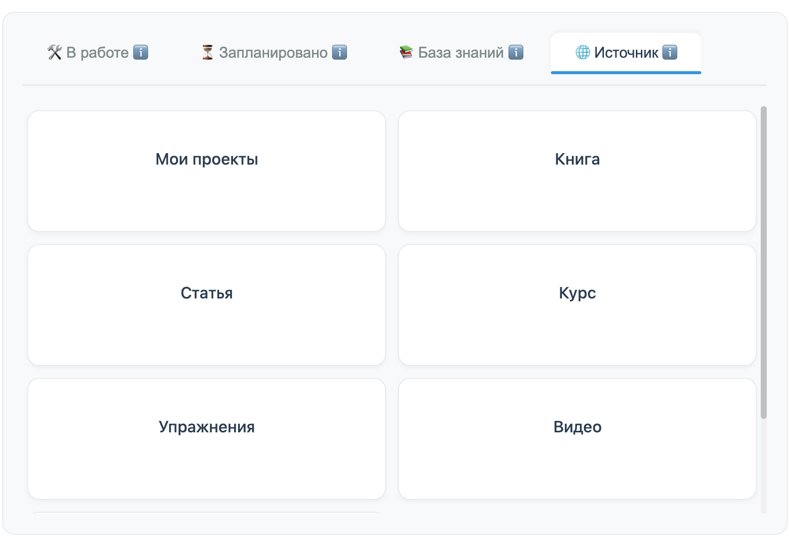
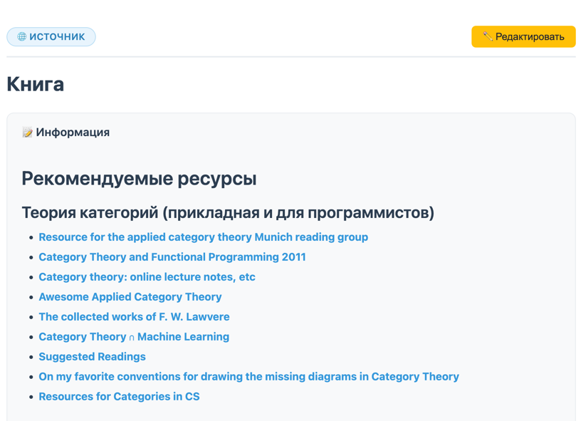

# Task Sources

When a user works with a large development plan, sooner or later the moment comes when tasks of a certain type run out. 
For example, all Scala books have been read, all articles in the chosen categories studied, and there is no material left to create new tasks from. 
The question arises: **where to find the next tasks?**

The **Task Sources** section solves this problem. 
For each type of task (book, article, course, video), a separate page is created 
where the user maintains a list of sources — specific books, websites, courses from which tasks can be drawn. 
This transforms the list of tasks from a static set into a **living stream** that can always be replenished.



## Data Model

A source is a separate entity associated with a task type and a user. 
It stores a text description (often in markdown format): a list of books, website links, course names.

### DTO for creating a source

```dotty
final case class CreateSource(
    taskTypeId: TaskTypeId,
    userId: UserId,
    information: String
)
```

- **`taskTypeId`** — the task type this source relates to. For example, "Books".
- **`userId`** — the owner of the source.
- **`information`** — the content of the source. Initially empty, filled via the editing page.

### Full source model

```dotty
final case class Source(
    id: SourceId,
    taskTypeId: TaskTypeId,
    userId: UserId,
    information: String
)

object Source:
  type SourceId = SourceId.T
  object SourceId extends RefinedType[Int, GreaterEqual[0]]
```

- **`SourceId`** — a refined type over `Int` with the `GreaterEqual[0]` constraint.
- **`information`** — the main content of the source. May be empty right after creation.

### Database migration

A new `sources` table is added to the migration:

```dotty
_ <- createSourcesTable.update.run
_ <- addUsersFKToTable("sources").update.run
_ <- taskTypeSourcesFK.update.run

private val createSourcesTable: Fragment =
  sql"""CREATE TABLE IF NOT EXISTS sources (
       id SERIAL PRIMARY KEY,
       task_type_id INT NOT NULL,
       user_id UUID NOT NULL,
       information TEXT
       );"""
```

**Field breakdown:**

- **`id SERIAL PRIMARY KEY`** — auto-incrementing identifier. PostgreSQL generates it automatically on `INSERT`.
- **`task_type_id INT NOT NULL`** — reference to the task type. `NOT NULL` guarantees that a source is always bound to a type.
- **`user_id UUID NOT NULL`** — reference to the user.
- **`information TEXT`** — main content. `TEXT` instead of `VARCHAR(n)` — because the information can be long (a list of books with annotations).

**Foreign keys:**

- **`addUsersFKToTable("sources")`** — guarantees that `user_id` references an existing user.
- **`taskTypeSourcesFK`** — guarantees that `task_type_id` references an existing task type.

## `SourcesService`

The service interface defines four operations: create, read, update, delete.

```dotty
private[services] trait SourcesService[F[_]]:

  /** Creates a new task source. */
  def create(newItem: CreateSource): F[SourceId]

  /** Gets a source by task type and user. */
  def get(taskTypeId: TaskTypeId, userId: UserId): F[Option[Source]]

  /** Updates a source */
  def update(source: Source): F[Boolean]

  /** Deletes a source of the given type. */
  def delete(taskTypeId: TaskTypeId, userId: UserId): F[Boolean]
```

**Key decisions:**

- **`get` returns `Option[Source]`** — a source may not exist (e.g., if the user just deleted it).
- **`delete` takes `taskTypeId` and `userId`**, not `SourceId`. This is more logical: the user deletes a source **by task type**, not by internal ID.
- **`create` returns `SourceId`** — so calling code can use it for further operations.

### `PostgreSQLSourcesService` implementation

```dotty
private[pdp] class PostgreSQLSourcesService[F[_]: MonadCancelThrow](
    xa: Transactor[F]
) extends SourcesService[F]:

  def create(newItem: CreateSource): F[SourceId] =
    sql"""INSERT INTO sources (task_type_id, user_id, information)
              VALUES (${newItem.taskTypeId}, ${newItem.userId}, ${newItem.information})
              RETURNING id"""
      .query[SourceId]
      .unique
      .transact(xa)

  def get(taskTypeId: TaskTypeId, userId: UserId): F[Option[Source]] =
    sql"""SELECT id, task_type_id, user_id, information FROM sources WHERE task_type_id = $taskTypeId AND user_id = $userId"""
      .query[Source]
      .option
      .transact(xa)

  def update(source: Source): F[Boolean] =
    sql"""UPDATE sources
         SET task_type_id = ${source.taskTypeId}, user_id = ${source.userId}, information = ${source.information}
         WHERE id = ${source.id}"""
      .update.run.transact(xa).map(_ > 0)

  def delete(taskTypeId: TaskTypeId, userId: UserId): F[Boolean] =
    sql"""DELETE FROM sources WHERE task_type_id = $taskTypeId AND user_id = $userId"""
      .update.run.transact(xa).map(_ > 0)
```

**Breakdown of each method:**

**`create`:** uses `RETURNING id` to obtain the PostgreSQL-generated ID in a single query. 
`INSERT` + `RETURNING` is an efficient way to create a record and learn its ID immediately.

**`get`:** returns `Option[Source]`. Doobie automatically converts the result to `Option` via `.option`.

**`update`:** updates all fields of the source. `WHERE id = ${source.id}` guarantees that exactly one record is updated. 
`.map(_ > 0` turns the number of affected rows into a `Boolean`.

**`delete`:** deletes the source by `taskTypeId` and `userId`, not by `id`. 
This is convenient: the user on the task type page can delete a source without knowing its internal ID.

## Integration into `SettingsService`

`SettingsService` is an aggregator that manages all reference data of the application: task types, sections, goals, and now — sources.

```dotty
final case class SettingsService[F[_]: MonadThrow](
    taskTypeService: TaskTypeService[F],
    sectionService: SectionService[F],
    goalService: GoalService[F],
    taskService: TaskService[F],
    sourcesService: SourcesService[F],
    periodicStepService: PeriodicStepService[F]
):

  def createTaskType(newItem: CreateTaskType): F[TaskTypeId] =
    createItem[TaskType, TaskTypeName, TaskTypeId](
      getAll = taskTypeService.getByUser(newItem.userId),
      getName = _.name,
      name = newItem.name,
      create =
        taskTypeService.create(newItem).flatTap { taskTypeId =>
          val newSource = CreateSource(
            taskTypeId = taskTypeId,
            userId = newItem.userId,
            information = ""
          )
          sourcesService.create(newSource)
        }
    )
```

**Key detail:** when a new task type is created, an **empty source is created automatically**. 
This guarantees that every task type always has an associated source page — even if the user hasn't filled it in yet.

### Deleting a task type

```dotty
def deleteTaskType(id: TaskTypeId, userId: UserId): F[Boolean] =
  taskService.existsTaskType(id, userId).ifM(
    MonadThrow[F].raiseError(
      new IllegalArgumentException(
        s"Cannot delete task type with ID $id: the type is used in tasks"
      )
    ),
    taskTypeService.get(id, userId).flatMap:
      case Some(_) =>
        sourcesService.delete(id, userId) *>
          taskTypeService.delete(id)
      case None => false.pure[F]
  )
```

**Step by step:**

1. **`taskService.existsTaskType(id, userId)`** — checks if there are any tasks with this type.
2. **If yes** — throws an `IllegalArgumentException` with a clear message. This protects against orphaned tasks.
3. **If no** — loads the task type via `taskTypeService.get(id, userId)`:
   - `get` takes `userId` and filters by owner: if the type exists **and** belongs to the user — delete the source (`sourcesService.delete`), then the type itself (`taskTypeService.delete`).
   - Otherwise — return `false`.

**Why source before type?** If we deleted the type first, and then the source, 
there would be an "orphaned" source with a non-existent `task_type_id` between the two operations.

## `DashboardService`

`DashboardService` is a separate service for operations related to the dashboard (the main page). 
It encapsulates work with task sources:

```dotty
final case class DashboardService[F[_]: Monad](
    sourcesService: SourcesService[F]
):
  def updateSource(
      taskTypeId: TaskTypeId,
      userId: UserId,
      information: String
  ): F[Boolean] =
    sourcesService.get(taskTypeId, userId).flatMap:
      case Some(source) =>
        sourcesService.update(source.copy(information = information))
      case None => false.pure[F]

  def getSource(taskTypeId: TaskTypeId, userId: UserId): F[Option[Source]] =
    sourcesService.get(taskTypeId, userId)
end DashboardService
```

**`updateSource`** — the "update or do nothing" method. If the source is found — update its `information`. 
If not — return `false` without an error. This is convenient for the UI: the user can open the edit form, 
the source has already been deleted — and instead of a crash, they see an error message.

**`getSource`** — simply delegates to `sourcesService.get`. 
Additional logic may be added here in the future (e.g., caching).

## UI: "Source" tab on the main page

On the main page (`Views.welcome`), a new tab appears:

```dotty
tabButton(
  activeIf("sources"),
  "sources",
  "🌐 Source",
  "Resources for Knowledge Base replenishment"
),
...
tabContent("tab-sources", activeIf("sources"), sources),

def tabButton(
    activeClass: String,
    dataTab: String,
    text: String,
    title: String
): Tag =
  button(
    cls              := s"tab-btn $activeClass",
    attr("data-tab") := dataTab,
    attr("onclick")  := s"switchTab('$dataTab')"
  )(text, span(attr("title") := title)(" ℹ️"))
  
def tabContent(
    tabId: String,
    activeClass: String,
    content: Modifier
): Tag =
  div(`id` := tabId, cls := s"tab-content $activeClass")(content)    
```

where `sources` is:

```dotty
def welcomeSources(taskTypes: Vector[TableTaskTypeCard]): Modifier =
  frag(
    div(cls := "tasks-grid")(
      taskTypes.map(_.render)*
    )
  )
  
final case class TableTaskTypeCard(
    id: TaskTypeId,
    name: TaskTypeName
):
  def render: Tag =
    div(
      attr("id") := id.value.toString,
      cls        := "task-card source-card",
      onclick    := s"openSource('${id.value}')",
      div(cls := "task-title")(name.value)
    )  
```

**Breakdown:**

- **Cards, not a table** — sources have no metrics (progress, dates), so a table is unnecessary. 
  Cards with the task type name — minimalist and readable.
- **`onclick="openSource('1')"`** — the JavaScript function `openSource` opens `/source/{id}` in a new tab.
- **Only `name` is displayed** — the task type ("Scala Books"), not the source information. This is a list of types, not a list of sources.

### Card model

```dotty
final case class TableTaskTypeCard(
    id: TaskTypeId,
    name: TaskTypeName
)
```

Minimal model — only ID and name. Used for rendering cards on the tab.

### JavaScript

```javascript
function openSource(sourceId) {
  const baseUrl = window.location.origin;
  window.open(baseUrl + "/source/" + sourceId, "_blank");
}
```

Opening in a new tab — so the user doesn't lose the context of the main page. Upon returning, they will see the same filters and tab.

## Source page route and handler

Source handlers are consolidated in the `SourceHandlers` class. Routes are declared
privately based on the common path `path = Path.root / "source" / taskTypeIdParam`.

### Route

```dotty
private val openSource = Route(
  Request.get(path).extractHeader[`Cookie`],
  Response.ok(Entity.html)
)
```

- **`taskTypeIdParam`** — a typed `Param[TaskTypeId]`: decodes the path
  directly to `TaskTypeId`, without manual `TaskTypeId.either`.
- **`extractHeader[`Cookie`]`** — extracts cookies to check authorization.

### Page DTO

```dotty
final case class SourceCard(
    id: TaskTypeId,
    name: String,
    information: String
)
```

- **`id`** — the task type ID (used for the edit URL).
- **`name`** — the task type name.
- **`information`** — the source content in markdown.

### `openHandler` handler

```dotty
val openHandler: Handler =
  openSource.handleIO: (taskTypeId: TaskTypeId, cookie: Cookie) =>
    withUserFromCookieOpt(cookie)(
      f = (user, jwtToken) =>
        for
          maybeTaskType <-
            settingsService.getTaskType(taskTypeId, user.id)
          maybeSource <-
            dashboardService.getSource(taskTypeId, user.id)
        yield (maybeTaskType, maybeSource).mapN {
          case (taskType, source) =>
            val html =
              Views.source(
                source = SourceCard(
                  id = taskTypeId,
                  name = taskType.name.value,
                  information = source.information
                ),
                token = jwtToken.show,
                errorMessage = none
              )
            Views.base(Title, html)
        },
      fallbackPage = NotFoundView
    )
```

**Step-by-step breakdown:**

1. **`withUserFromCookieOpt(cookie)(f, fallbackPage)`** — extracts the token from the `token` cookie, verifies
   it through middleware, and passes `(user, jwtToken)` to the lambda `f`. If there is no token or
   it is invalid — returns `fallbackPage` (404). Token extraction from the cookie is encapsulated
   in `AuthorizationHandler`.
2. **Typed ID** — `taskTypeIdParam` decodes the path directly to `TaskTypeId`,
   no `Right`/`Left` branches needed.
3. **Loading two entities:** the task type and the source.
4. **`(maybeTaskType, maybeSource).mapN`** — if both entities are found, we assemble a `SourceCard` and render `Views.source`. 
   If at least one is not found — `None`, and `withUserFromCookieOpt` will substitute `fallbackPage` (404).

`NotFoundView` — a ready-made HTML string from `WelcomeViews`, combining `Views.base(Title, ...)` and `Views.notFound()`. It is reused across all dashboard handlers.

## Source page

The `Views.source` method displays the name and information:

```dotty
def source(source: SourceCard, errorMessage: Option[String]): Frag =
  frag(
    div(
      `id` := "app",
      cls  := "app-container",
      div(
        `id` := "sourceDetailBlock",
        cls  := "task-detail-container",
        div(cls := "task-detail-header")(
          div(cls := "task-detail-nav")(
            span(
              cls := "task-detail-status-badge source-badge"
            )("🌐 Source")
          ),
          div(cls := "task-detail-actions")(
            editButton(s"/source/${source.id.value}/edit")
          )
        ),
        errorBlock(errorMessage),
        source.render
      )
    )
  )
  
final case class SourceCard(
    id: TaskTypeId,
    name: String,
    information: String
):
  def render: Frag =
    frag(
      titleCard(name),
      markdownSection(information)
    )
    
def markdownSection(value: String): Tag =
  div(
    cls := "task-detail-section full-width",
    h3("📝 Information"),
    div(
      cls                   := "task-detail-information markdown-content",
      attr("data-markdown") := value,
      if value.nonEmpty then frag()
      else p(cls := "empty-message")("No information")
    )
  )      
```

**Key points:**

- **`data-markdown`** — an attribute with markdown text. The JavaScript function `renderMarkdown` (in `pdp.js`) will find it and render it via `marked.js`.
- **Class `markdown-content`** — styling (headings, lists, code, links).
- **Placeholder for an empty source** — conditional rendering for empty `information`.

## Editing a source

### Routes

Routes are private, declared inside `SourceHandlers` on the common path
`path = Path.root / "source" / taskTypeIdParam`:

```dotty
private val editFormSource = Route(
  Request.get(path / "edit").extractHeader[Authorization],
  Response.ok(Entity.html).orNotFound
)
private val editSource = Route(
  Request.put(path).withEntity(Entity.formOf[EditSourceRequest]),
  Response.ok(Entity.html).orNotFound
)
```

- **GET `/source/{id}/edit`** — opens the edit form.
- **PUT `/source/{id}`** — saves changes.
- **`taskTypeIdParam`** — decodes the path segment directly to `TaskTypeId`.

### `EditSourceRequest` model

```dotty
final case class EditSourceRequest(
    token: String,
    name: String,
    information: String
) derives FormCodec
```

Three fields: a token for authentication, a name (not editable, but passed for display), and information.

### Edit form

The `Views.editSource` method contains a single editable field — `information`:

```dotty
def editSource(
    sourceId: TaskTypeId,
    source: EditSourceRequest,
    token: SignedJwt,
    errorMessage: Option[String]
): Frag =
  frag(
    div(
      `id` := "app",
      cls  := "app-container",
      div(
        `id` := "sourceDetailBlock",
        cls  := "task-detail-container",
        div(cls := "task-detail-header")(
          div(cls := "task-detail-nav")(
            span(
              cls := "task-detail-status-badge source-badge"
            )("🌐 Source")
          ),
          div(cls := "task-detail-actions")(
            saveButton("editSourceForm"),
            cancelButton(s"/source/${sourceId.value}")
          )
        ),
        EditSourceRequest.render(sourceId, source, token, errorMessage)
      )
    )
  )
  
object EditSourceRequest:
  def render(
      id: TaskTypeId,
      request: EditSourceRequest,
      token: SignedJwt,
      errorMessage: Option[String]
  ): Tag =
    form(
      attr("id")     := "editSourceForm",
      attr("hx-put") := s"/source/${id.value}",
      Htmx.appTarget,
      Htmx.appSwap,
      formErrorBlock(errorMessage),
      Htmx.hiddenToken(token.show),
      div(
        cls := "form-group",
        label(`for` := "sourceName")("Name:"),
        input(
          attr("id") := "sourceName",
          name       := "name",
          `type`     := "text",
          value      := request.name,
          cls        := "form-input",
          readonly
        )
      ),
      div(
        cls := "task-detail-section full-width",
        h3("📝 Information"),
        textarea(
          attr("id")  := "information",
          name        := "information",
          rows        := 20,
          cls         := "form-textarea",
          placeholder := "Enter source description in markdown format..."
        )(request.information)
      )
    )
  end render  
```

**`readonly` for `name`** — the user sees which task type the source belongs to, but cannot change this field. 
This matches the requirement: only information is editable.

**`rows="20"`** — height of the field for long descriptions (book lists, links, annotations).

### Edit form handler

```dotty
val editFormHandler: Handler =
  editFormSource.handleIO:
    (taskTypeId: TaskTypeId, authorization: Authorization) =>
      withUserFromHeaderOpt(authorization): (user, jwtToken) =>
        for
          maybeTaskType <-
            settingsService.getTaskType(taskTypeId, user.id)
          maybeSource <-
            dashboardService.getSource(taskTypeId, user.id)
        yield (maybeTaskType, maybeSource).mapN {
          case (taskType, source) =>
            Views.editSource(
              source = SourceCard(
                id = taskTypeId,
                name = taskType.name.value,
                information = source.information
              ),
              token = jwtToken.show,
              errorMessage = none
            ).render
        }
```

**What it does:**

1. **`withUserFromHeaderOpt(authorization)(...)`** — soft token check. `authorization`
   from the header — first argument, lambda `(user, jwtToken)` — second.
2. **Typed ID** — `taskTypeIdParam` has already decoded the path to `TaskTypeId`.
3. **Loading the task type and source.**
4. **Rendering `Views.editSource`** with populated information.

### Edit submission handler

```dotty
val editHandler: Handler =
  editSource.handleIO: (taskTypeId: TaskTypeId, request: EditSourceRequest) =>
    val run: ((UserInfo, SignedJwt)) => IO[Option[String]] =
      (user, jwtToken) =>
        val source = SourceCard(
          id = taskTypeId,
          name = request.name,
          information = request.information
        )

        dashboardService.updateSource(
          taskTypeId,
          user.id,
          request.information
        )
          .map: _ =>
            Views.source(
              source = source,
              token = jwtToken.show,
              errorMessage = none
            ).render.some
          .recover:
            case ex: IllegalArgumentException =>
              Views.editSource(
                source = source,
                token = jwtToken.show,
                errorMessage = ex.getMessage.some
              ).render.some
    // ToDo: https://github.com/creativescala/krop/pull/57
    val authorization: Authorization =
      Authorization(Token(AuthScheme.Bearer, request.token))
    withUserFromHeaderOpt(authorization)(run)
```

**Step-by-step breakdown:**

1. **Typed ID** — decoded from the path by `taskTypeIdParam`, no manual validation needed.
2. **Building `SourceCard`** from form data.
3. **`dashboardService.updateSource`** — updating information in the database.
4. **On success** — rendering the source page with updated information.
5. **On error** — rendering the edit form with an error message. The user can fix the data and resend.
6. **`withUserFromHeaderOpt(authorization)(run)`** — the token comes in the request body, so we manually
   build the `Authorization` header from `request.token` and call `withUserFromHeaderOpt`.

**Why use `SourceCard` instead of `Source`?** 
Because `Source` requires a `SourceId` (internal ID), which we don't have in the request — only `taskTypeId` comes in. 
`SourceCard` uses `TaskTypeId` instead of `SourceId`, which matches the UI data model.

## Complete workflow for working with sources

Consider the scenario:

1. **The user creates a task type "Books"** in settings. An empty source is created automatically.
2. **On the main page, a "🌐 Source" tab appears** with a "Books" card.
3. **The user clicks on the card** → `/source/{taskTypeId}` opens in a new tab.
4. **The source page displays** the name "Books" and empty information.
5. **The user clicks "✏️ Edit"** → a form opens with a `readonly` name and an empty textarea.
6. **The user enters a list of books** in markdown format:
    ```markdown
    ## Category Theory (applied and for programmers)
    
    - **[Resource for the applied category theory Munich reading group](https://github.com/drever/act-munich)**
    - **[Category Theory and Functional Programming 2011](https://wiki.portal.chalmers.se/cse/pmwiki.php/CTFP11/CTFP11)**
    - **[Category theory: online lecture notes, etc](https://www.logicmatters.net/categories)**
    - **[Awesome Applied Category Theory](https://github.com/statebox/awesome-applied-ct)**
    - **[The collected works of F. W. Lawvere](https://github.com/mattearnshaw/lawvere)**
    - **[Category Theory ∩ Machine Learning](https://github.com/bgavran/Category_Theory_Machine_Learning/blob/master/README.md)**
    - **[Suggested Readings](https://diliberti.github.io/Read/Read.html)**
    - **[On my favorite conventions for drawing the missing diagrams in Category Theory](http://angg.twu.net/math-b.html#favorite-conventions)**
    - **[Resources for Categories in CS](https://blog.hde.design/published/2015-12-06-Resources-CT-CS.html)**
    ```
7. **Clicks "💾 Save"** → a PUT request updates `information` in the database.
8. **htmx replaces `#app`** — the user sees the source page with rendered markdown: headings, checklists.
9. **A month later, when all books have been read and the Knowledge Base needs new books**, 
   the user returns to the source page and creates new tasks from the listed books.



## Advantages of this approach

**1. Separation of tasks and sources.** Tasks are concrete actions. 
Sources are a "warehouse" of materials from which tasks are drawn.

**2. Binding to task type.** A source belongs to a task type, not directly to a user. 
If a user has 5 task types, they will have 5 sources. 
This simplifies searching: "Where are my books?" — in the "Books" source.

**3. Markdown for flexibility.** The source information is text with markdown formatting. 
The user can structure it however they like: checklists, tables, links, headings. No format restrictions.

**4. Automatic creation.** A source is created together with a task type. 
The user doesn't need to remember that they "also need to create a source" — it happens automatically.

**5. Protection against deletion.** You cannot delete a task type if tasks are associated with it. 
This prevents orphaned tasks and preserves data integrity.

## Summary

**What was created:**

| Component                     | Purpose                                                            |
| ------------------------------ | ----------------------------------------------------------------- |
| **`sources` table**            | Storing sources in the database                                        |
| **`SourcesService`**           | CRUD operations on sources                                     |
| **`PostgreSQLSourcesService`** | PostgreSQL implementation                                         |
| **`DashboardService`**         | Operations for UI pages                                           |
| **`SettingsService`**          | Integration: create/delete source when working with a task type |
| **"Source" tab**             | On the main page                                               |
| **`SourceHandlers.openHandler`**      | Source page                                                |
| **`SourceHandlers.editFormHandler`**  | Edit form                                                      |
| **`SourceHandlers.editHandler`**      | Saving changes                                              |
| **`Views.source`**             | Displaying a source                                              |
| **`Views.editSource`**         | Edit form                                              |

**Key architectural decisions:**

- **A source is bound to a task type, not directly to a user.** This simplifies navigation and grouping.
- **Markdown for `information`.** Format flexibility is more important than strict structure.
- **Automatic source creation** upon task type creation.
- **Protection against task type deletion** if there are associated tasks.
- **Separate `DashboardService`** for UI operations, to avoid mixing them with the business logic of `SettingsService`.

Now the user always has a "next step" when current tasks are exhausted: 
open the source, create tasks from its materials, add new materials. 
The sources section transforms a static task list into a **living replenishment stream**.

---

**Links:**

- [Repository with source code][repo]

[repo]: https://gitverse.ru/scalabook/pdp
