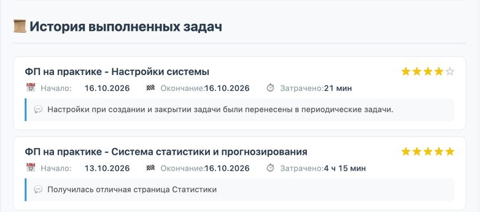

# History of Completed Tasks

History is the section that shows **the archive of all completed tasks**.
The user sees not just a list of to-dos, but their journey: what they did, in what time, with what rating, and with what insights.
This is simultaneously a **tool for reflection** (the user learns from their own experience)
and a **source of motivation** (visual confirmation of progress).

Unlike statistics, which aggregates data into numbers and percentages, history shows **each task individually**.
Each card is a small success story: what was done, how long it took, and how well.



## DTO `CompletedTaskCard`

Each history entry is a lightweight model of a completed task.
It does not contain a plan, information, or task type — only what is important for display in a list.

```dotty
final case class CompletedTaskCard(
    taskId: TaskId,
    name: TaskName,
    rating: Rating,
    review: Review,
    duration: FiniteDuration,
    startDate: LocalDate,
    endDate: LocalDate
)
```

**Fields breakdown:**

| Field           | Type           | Purpose                                                                            |
| --------------- | -------------- | ---------------------------------------------------------------------------------- |
| **`taskId`**    | `TaskId`       | Task identifier. Used for a link to `/task/{id}` on click                          |
| **`name`**      | `TaskName`     | Task name for display                                                              |
| **`rating`**    | `Rating`       | Rating the user assigned on completion (1–5)                                       |
| **`review`**    | `Review`       | Review — a short reflection on the completed work                                  |
| **`duration`**  | `FiniteDuration` | Actual task duration                                                             |
| **`startDate`** | `LocalDate`    | Work start date                                                                    |
| **`endDate`**   | `LocalDate`    | Actual completion date                                                             |

**Why these fields?** They form the **minimum sufficient set** for displaying a history entry:

- **What was done:** `name`.
- **How long:** `startDate`, `endDate`, `duration`.
- **How well:** `rating`, `review`.
- **Where to go:** `taskId`.

Nothing extra — no task type, no section, no goal.
If the user needs more details, they click on the task and navigate to its page.

## Rendering `Views.history`

`Views.history(completedTasks: Vector[CompletedTaskCard])` is a rendering method that takes a vector of completed tasks and returns ready HTML.

```dotty
def history(completedTasks: Vector[CompletedTaskCard]): String =
  frag(
    div(cls := "history-section")(
      h2(cls := "history-title")("📜 Completion History"),
      if completedTasks.nonEmpty then
        div(cls := "history-list")(
          completedTasks.map(_.render)*
        )
      else
        div(cls := "empty-message")(
          "History is empty. Complete your first task to see it here."
        )
    )
  ).render
```

**Breakdown:**

- **`.history-section`** — section container.
- **`📜 Completion History`** — title. A scroll is associated with history and archive.
- **`if completedTasks.nonEmpty`** — branching: if there are tasks, show the list; if not, show a placeholder.
- **`.empty-message`** — message for empty history with a hint: "Complete your first task to see it here."

Each `CompletedTaskCard` is rendered by the `.render()` method — the card contains `onclick`, name, rating, dates, duration, review. Details in the "Task Card" chapter.

## Complete Workflow

1. **User opens the "📜 History" tab** → the server loads the user's completed tasks.

2. **The server forms a `Vector[CompletedTaskCard]`** — for each completed task, it takes ID, name, rating, review, duration, dates.

3. **`Views.history` is rendered** — cards in a list.

4. **The user sees:**
    - Most recently completed tasks on top.
    - Star ratings.
    - Start and end dates.
    - Time spent.
    - Review.

5. **User clicks on a card** → `openTask('{task.taskId}')` opens `/task/{id}` in a new tab.

6. **User returns** — history stays in place, scroll and order are preserved.


History is a **mirror of progress**.
It transforms completed tasks from forgotten records into a meaningful archive of achievements.
Combined with statistics and goals, it makes the application a full-fledged tool for personal development:
not just "what to do", but "what has already been done".

---

**References:**

- [Source repository][repo]

[repo]: https://gitverse.ru/scalabook/pdp
