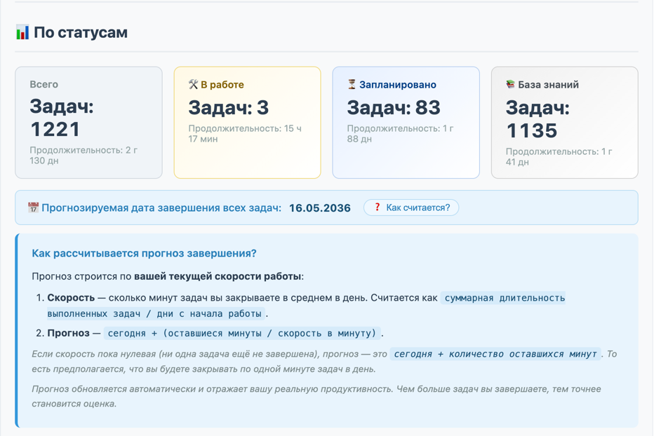
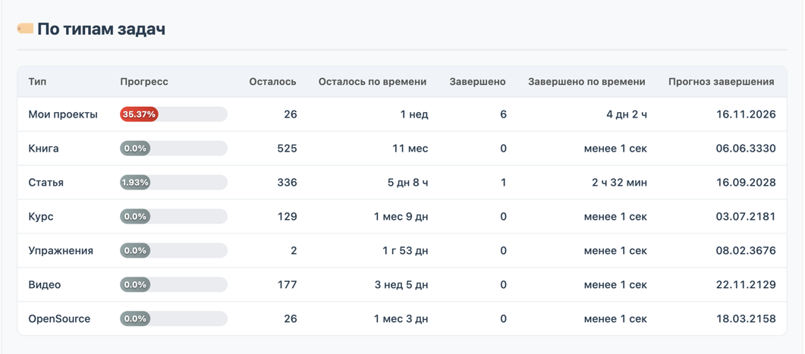
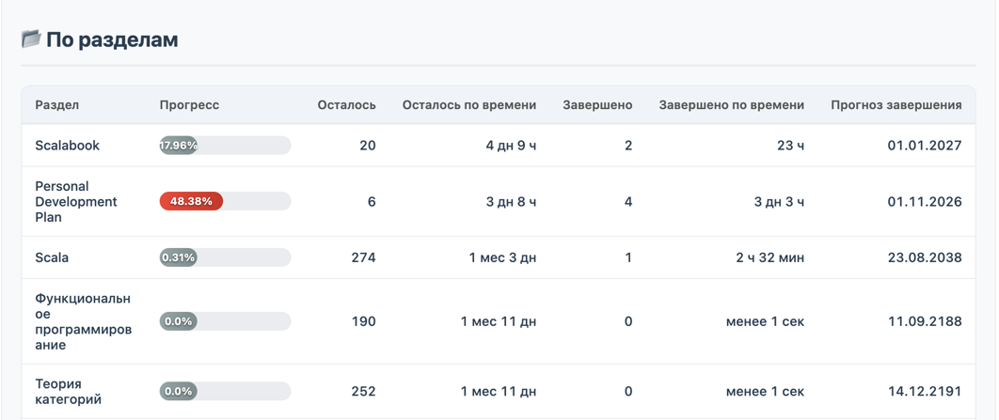

# Task Statistics

Statistics is the section that turns scattered tasks into a **meaningful picture of progress**.
The user sees not just a list of things to do, but answers to key questions: how much work is in what status,
which material types predominate, in which sections progress is being made, and when all of this will be finished.
Without statistics, working toward long-term goals turns into endless routine without a sense of movement —
statistics provides this sense and helps make decisions.

The section consists of three blocks:

1. **By status** (`byStatus`) — distribution of tasks across work statuses.
2. **By task type** (`byTaskType`) — distribution across material formats (book, video, article).
3. **By section** (`bySection`) — distribution across thematic sections.

All blocks are built from a **single data source** — a `Vector[TaskResult]`.
This guarantees consistency: the same task is counted identically in all slices.

## Completion Forecast

The completion forecast is the most complex and most useful part of statistics.
It answers the question: "If I continue working at the current pace, when will I finish?"
The calculation is based on **actual work speed**, not assumptions.

### Calculating Progress

```dotty
private[stats] def calculateProgress(
    current: FiniteDuration,
    all: FiniteDuration
): Double =
  if all.toMinutes == 0 then 0.0
  else (current.toMinutes * 10000 / all.toMinutes) / 100.00
```

**Breakdown:**

- **`current`** — how much is done (usually `completedDuration`).
- **`all`** — total duration (usually `restDuration + completedDuration`).
- **`if all.toMinutes == 0 then 0.0`** — protection against division by zero. If the total duration of all tasks is zero, progress is `0.0`.
- **`(current.toMinutes * 10000 / all.toMinutes) / 100.00`** — integer division followed by conversion to percentage.

**Example:** `current = 30 mins`, `all = 90 mins`:

- `30 * 10000 / 90 = 3333` (integer division)
- `3333 / 100.00 = 33.33` — progress 33.33%.

**Why progress by time, not by number of tasks?**

Because one large task can weigh more than ten small ones.
If one of two tasks is completed — one taking 1 hour, the other 10 hours — then progress by count is 50%, but by time it is only 9%.
The second approach is more honest: it reflects **actual effort**, not a formal count.

### Forecast of Completion Date

```dotty
private[stats] def calculatePlannedEndDate(
    completedTasks: Vector[TaskResult],
    restTasks: Vector[TaskResult]
): PlannedDate =
  val now = LocalDate.now()
  val statsStartDate =
    completedTasks.flatMap(_.startDate).minOption.getOrElse(now)
  val days           = 1 + (now.toEpochDay - statsStartDate.toEpochDay)
  val speedInMinutes = calculateDuration(completedTasks).toMinutes / days
  val restMinutes = calculateDuration(restTasks).toMinutes
  val restDays    =
    if speedInMinutes == 0 then restMinutes
    else restMinutes / speedInMinutes

  PlannedDate(restDays)
```

**Step-by-step breakdown:**

1. **`val now = LocalDate.now()`** — today's date, the reference point.
2. **`statsStartDate`** — work start date. Taken as the **minimum start date** among completed tasks.
   If no task has started yet — `now` is used.
3. **`days = 1 + (now.toEpochDay - statsStartDate.toEpochDay)`** — how many days have passed since work began.
   We add `1` to avoid zero: if a task started and finished today, `days = 1`, not `0`.
4. **`speedInMinutes = calculateDuration(completedTasks).toMinutes / days`** — **work speed** in minutes per day.
   How many minutes of tasks are closed per day on average.
   **Example:** 600 minutes completed in 10 days → `speedInMinutes = 60` minutes per day.
5. **`restMinutes = calculateDuration(restTasks).toMinutes`** — how many minutes remain for all incomplete tasks.
6. **`restDays`** — number of days until completion.
   If speed is zero (`speedInMinutes == 0`, nothing completed yet), `restMinutes` is taken as-is —
   this is a fallback that gives an "infinite" but not absurd forecast.
   **Example:** `restMinutes = 300`, `speedInMinutes = 60` → `restDays = 5` → forecast — `today + 5 days`.
7. **`PlannedDate(restDays)`** — the result is wrapped in `PlannedDate`.
   The function returns **not just a date**, but the number of days until it.

### `PlannedDate` Model

```dotty
final case class PlannedDate(
    daysUntil: Long
):
  val date: LocalDate = LocalDate.now().plusDays(daysUntil)

object PlannedDate:
  given Render[PlannedDate] with
    def render(value: PlannedDate): String =
      val module = value.daysUntil % 10
      val days   =
        if module == 1 then s"${value.daysUntil} day"
        else if module > 4 || module == 0 then s"${value.daysUntil} days"
        else s"${value.daysUntil} days"
      s"${value.date.render} ($days)"
```

**Breakdown:**

- **`daysUntil`** — how many days remain until the forecasted completion date.
- **`date`** — computed date: `today + daysUntil`. The date itself is not stored, but **rendered** from `daysUntil` each time.
  This ensures the model is always current relative to the current day, even if time has passed since the calculation.
- **`given Render[PlannedDate]`** — human-readable display: date in `dd.MM.yyyy` format plus a relative label
  ("day", "days") following the rules of Russian morphology. The standard `Render[LocalDate]` renders only the date itself.

**Why `PlannedDate` instead of just `LocalDate`?** Because the user cares not just about "when", but also "how much remains".
The model combines the absolute date and the relative number of days, and `Render` automatically selects the correct pluralization.
This makes the forecast intuitive: `07.11.2026 (5 days)` instead of a bare date.

The forecast is **dynamic**: the more tasks are completed, the more accurate the estimate becomes.
It requires no manual configuration and automatically adapts to the user's pace.

## Breakdown by Status



The block shows how many tasks and minutes are in each of the three active statuses: `InProgress`, `Planned`, `KnowledgeBase`.
Completed tasks are not included in the block — they are already done.

### `StatusDuration` Model

```dotty
final case class StatusDuration(
    tasks: Int,
    duration: FiniteDuration
)

object StatusDuration:
  def calculate(tasks: Vector[TaskResult]): StatusDuration =
    StatusDuration(
      tasks = tasks.length,
      duration = calculateDuration(tasks)
    )
```

**Breakdown:**

- **`tasks`** — number of tasks in status.
- **`duration`** — total duration of tasks in status.
- **`calculate`** — a simple aggregator. Takes a vector of tasks, returns a `StatusDuration` with count and sum of durations.

### `StatusStats` Model

```dotty
final case class StatusStats(
    inProgress: StatusDuration,
    planned: StatusDuration,
    knowledgeBase: StatusDuration,
    plannedEndDate: PlannedDate
):
  lazy val all: StatusDuration = StatusDuration(
    tasks = inProgress.tasks + planned.tasks + knowledgeBase.tasks,
    duration = inProgress.duration + planned.duration + knowledgeBase.duration
  )
```

**Breakdown:**

- **`inProgress`**, **`planned`**, **`knowledgeBase`** — three `StatusDuration` instances for three active statuses.
- **`plannedEndDate`** — forecasted completion date for all tasks (`PlannedDate`).
- **`all`** — aggregate across all three statuses.

### Factory method `calculate`

```dotty
object StatusStats:
  def calculate(tasks: Vector[TaskResult]): StatusStats =
    val grouped            = tasks.groupBy(_.status)
    val completedTasks     = grouped.getOrElse(Completed, Vector.empty)
    val inProgressTasks    = grouped.getOrElse(InProgress, Vector.empty)
    val plannedTasks       = grouped.getOrElse(Planned, Vector.empty)
    val knowledgeBaseTasks = grouped.getOrElse(KnowledgeBase, Vector.empty)

    StatusStats(
      inProgress = StatusDuration.calculate(inProgressTasks),
      planned = StatusDuration.calculate(plannedTasks),
      knowledgeBase = StatusDuration.calculate(knowledgeBaseTasks),
      plannedEndDate = calculatePlannedEndDate(
        completedTasks = completedTasks,
        restTasks = inProgressTasks ++ plannedTasks ++ knowledgeBaseTasks
      )
    )
```

**Step-by-step breakdown:**

1. **`tasks.groupBy(_.status)`** — grouping tasks by status. Results in `Map[Status, Vector[TaskResult]]`.
2. **`grouped.getOrElse(Completed, Vector.empty)`** — extracting tasks for each status.
   If a status is absent from the `grouped` map — an empty vector.
3. **Three `StatusDuration.calculate` calls** — aggregation by each active status.
4. **`plannedEndDate`** — completion forecast. Uses:
    - **`completedTasks`** — for speed calculation.
    - **`restTasks = inProgressTasks ++ plannedTasks ++ knowledgeBaseTasks`** — for remaining duration.
   **Why are all three statuses combined into `restTasks`?** Because for the forecast it does not matter
   what status a task is in — what matters is that it is not yet completed. The remaining time is the sum of all incomplete tasks.

**Why does `Completed` not belong to `StatusStats`?** Because the block shows **current work**, not history.
Completed tasks are displayed in the "Goals" block and other slices.
Including `Completed` in `StatusStats` would show the user many tasks that no longer need attention,
and blur the overall picture.

## Breakdown by Task Types



The block shows statistics for each task type: book, video, article.
For each type — how many tasks remain and are completed, how much time, progress, and forecast.

### `TaskTypeDuration` Model

```dotty
final case class TaskTypeDuration(
    name: TaskTypeName,
    restTasks: Int,
    restDuration: FiniteDuration,
    completedTasks: Int,
    completedDuration: FiniteDuration,
    plannedEndDate: PlannedDate
):
  lazy val progress: Double =
    calculateProgress(
      current = completedDuration,
      all = restDuration + completedDuration
    )
```

**Breakdown:**

- **`name`** — task type name (e.g., "Book").
- **`restTasks`**, **`restDuration`** — how many tasks and minutes remain.
- **`completedTasks`**, **`completedDuration`** — how many tasks and minutes are completed.
- **`plannedEndDate`** — forecasted completion date for this task type (`PlannedDate`).
- **`progress`** — share of completed time from the total.

**Why exactly `completedDuration / (restDuration + completedDuration)`?**
Because this is the **share of completed** work from the total volume.
When `restDuration = 0`, progress = 100%. When `completedDuration = 0`, progress = 0%.
This is an intuitive metric for the user: "how much I have advanced with this type of material".

### Factory method `calculate`

```dotty
object TaskTypeDuration:
  def calculate(
      name: TaskTypeName,
      tasks: Vector[TaskResult]
  ): TaskTypeDuration = {
    val (completedTasks, restTasks) = tasks.partition(_.status == Completed)
    val plannedEndDate: PlannedDate =
      calculatePlannedEndDate(
        completedTasks = completedTasks,
        restTasks = restTasks
      )

    TaskTypeDuration(
      name = name,
      restTasks = restTasks.length,
      restDuration = calculateDuration(restTasks),
      completedTasks = completedTasks.length,
      completedDuration = calculateDuration(completedTasks),
      plannedEndDate = plannedEndDate
    )
  }
```

**Step-by-step breakdown:**

1. **`tasks.partition(_.status == Completed)`** — separating tasks into completed and remaining. `partition` returns a tuple of two vectors.

2. **`plannedEndDate`** — forecast for this task type.
   Calculated **separately**, because work speed by different types may differ.
   For example, the user may work on books faster than on videos.

3. **Building `TaskTypeDuration`** — counts and durations for each group.

**Why is the forecast calculated for each type?** Because the type is a natural planning unit.
The user may realize: "I will finish books in a month, and videos in three months." This provides a basis for prioritization.

### `TaskTypesStats` Model

```dotty
final case class TaskTypesStats(
    taskTypes: Vector[TaskTypeDuration]
)
```

A simple container: a vector of stats by types. Order is set by sorting during construction.

### Factory method `calculate`

```dotty
object TaskTypesStats:
  def calculate(
      tasks: Vector[TaskResult],
      taskTypes: Map[TaskTypeId, TaskTypeName],
      sortedTaskTypes: Map[TaskTypeName, Ordinal]
  ): TaskTypesStats =
    TaskTypesStats(
      tasks
        .groupBy(_.taskTypeId)
        .toVector
        .flatMap { case (id, tasks) =>
          taskTypes.get(id).map(n => TaskTypeDuration.calculate(n, tasks))
        }.sortBy(taskTypeDuration =>
          sortedTaskTypes.getOrElse(taskTypeDuration.name, Ordinal.Max)
        )
    )
```

**Step-by-step breakdown:**

1. **`tasks.groupBy(_.taskTypeId)`** — grouping tasks by type ID. Results in `Map[TaskTypeId, Vector[TaskResult]]`.

2. **`.toVector.flatMap { case (id, tasks) => ... }`** — iterating over each group:
    - **`taskTypes.get(id)`** — finding the type name by ID. If the type is not in the reference data (e.g., it was deleted) —
      the task is **ignored** (`.flatMap` flattens `Option`).
    - **`TaskTypeDuration.calculate(n, tasks)`** — computing stats by type.

3. **`.sortBy(taskTypeDuration => sortedTaskTypes.getOrElse(taskTypeDuration.name, Ordinal.Max))`** — sorting by `Ordinal` from the reference data.
   If the type is not found in `sortedTaskTypes` — place it at the end (`Ordinal.Max`).

**Why `Ordinal.Max` for missing ones?** Because if a task type has no ordinal number
(e.g., just created), it is logical to place it at the end of the list, not at the beginning.
This does not break the existing order for known types.

## Breakdown by Sections



The block is fully analogous to the breakdown by task types, but works with sections.

### `SectionDuration` Model

```dotty
final case class SectionDuration(
    name: SectionName,
    restTasks: Int,
    restDuration: FiniteDuration,
    completedTasks: Int,
    completedDuration: FiniteDuration,
    plannedEndDate: PlannedDate
):
  lazy val progress: Double =
    calculateProgress(
      current = completedDuration,
      all = restDuration + completedDuration
    )
```

**Breakdown:** fully identical to `TaskTypeDuration`, only the name has type `SectionName`.

**Why are the models duplicated instead of generalized?**

Because name types differ (`TaskTypeName` vs `SectionName`).
Generalizing via a type parameter would complicate signatures and provide no benefit — two models are easy to read independently.
Moreover, if `SectionDuration` later acquires a specific field (e.g., "number of sub-sections"),
duplication becomes an advantage.

### Factory method `calculate`

```dotty
object SectionDuration:
  def calculate(
      name: SectionName,
      tasks: Vector[TaskResult]
  ): SectionDuration = {
    val (completedTasks, restTasks) = tasks.partition(_.status == Completed)
    val plannedEndDate: PlannedDate =
      calculatePlannedEndDate(
        completedTasks = completedTasks,
        restTasks = restTasks
      )

    SectionDuration(
      name = name,
      restTasks = restTasks.length,
      restDuration = calculateDuration(restTasks),
      completedTasks = completedTasks.length,
      completedDuration = calculateDuration(completedTasks),
      plannedEndDate = plannedEndDate
    )
  }
```

**Breakdown:** analogous to `TaskTypeDuration.calculate`. Separation into completed and remaining, forecast by section, model assembly.

### `SectionsStats` Model

```dotty
final case class SectionsStats(
    sections: Vector[SectionDuration]
)
```

### Factory method `calculate`

```dotty
object SectionsStats:
  def calculate(
      tasks: Vector[TaskResult],
      sections: Map[SectionId, SectionName],
      sortedSections: Map[SectionName, Ordinal]
  ): SectionsStats =
    SectionsStats(
      tasks
        .groupBy(_.sectionId)
        .toVector
        .flatMap { case (id, tasks) =>
          sections.get(id).map(n => SectionDuration.calculate(n, tasks))
        }.sortBy(sectionDuration =>
          sortedSections.getOrElse(sectionDuration.name, Ordinal.Max)
        )
    )
```

**Breakdown:** identical to `TaskTypesStats.calculate`, but with `SectionId`/`SectionName`.

## Putting It All Together

### `TasksStats` Model

```dotty
final case class TasksStats(
    byStatus: StatusStats,
    byTaskType: TaskTypesStats,
    bySection: SectionsStats
)
```

An aggregator of three slices: by status, task types, and sections.

### Factory method `calculate`

```dotty
object TasksStats:
  def calculate(
      tasks: Vector[TaskResult],
      taskTypes: Map[TaskTypeId, TaskTypeName],
      sections: Map[SectionId, SectionName],
      sortedTaskTypes: Map[TaskTypeName, Ordinal],
      sortedSections: Map[SectionName, Ordinal]
  ): TasksStats =
    TasksStats(
      byStatus = StatusStats.calculate(tasks),
      byTaskType = TaskTypesStats.calculate(tasks, taskTypes, sortedTaskTypes),
      bySection = SectionsStats.calculate(tasks, sections, sortedSections)
    )
```

**Breakdown:**

- **`byStatus = StatusStats.calculate(tasks)`** — does not require reference data, works with the tasks themselves.
- **`byTaskType`** and **`bySection`** — require name and ordinal maps for sorting.

**Why do all three slices use the same `tasks`?** Because there is a single data source.
This guarantees consistency: if a task is in `InProgress` status, it will appear in `byStatus.inProgress`,
in `byTaskType` for its type, and in `bySection` for its section.
No desynchronization.

### `Statistics` Model

```dotty
final case class Statistics(
    goalsStats: Vector[GoalsStats],
    tasksStats: TasksStats
)
```

A top-level aggregator for all statistics. `goalsStats` is the "Goals" block, `tasksStats` is the "By Tasks" block with three slices.

### Factory method `calculate`

```dotty
object Statistics:
  def calculate(
      tasks: Vector[TaskResult],
      taskTypes: Map[TaskTypeId, TaskTypeName],
      sections: Map[SectionId, SectionName],
      goals: Map[GoalId, GoalName],
      sortedTaskTypes: Map[TaskTypeName, Ordinal],
      sortedSections: Map[SectionName, Ordinal],
      sortedGoals: Map[GoalName, Ordinal]
  ): Statistics =
    Statistics(
      goalsStats = GoalsStats.calculate(tasks, goals).sortBy(stats =>
        sortedGoals.getOrElse(stats.name, Ordinal.Max)
      ),
      tasksStats = TasksStats.calculate(
        tasks = tasks,
        taskTypes = taskTypes,
        sections = sections,
        sortedTaskTypes = sortedTaskTypes,
        sortedSections = sortedSections
      )
    )
end Statistics
```

**Step-by-step breakdown:**

1. **`GoalsStats.calculate(tasks, goals)`** — computing stats by goals. Returns `Vector[GoalsStats]`.

2. **`.sortBy(stats => sortedGoals.getOrElse(stats.name, Ordinal.Max))`** — sorting goals by `Ordinal`. Missing ones at the end.

3. **`TasksStats.calculate(...)`** — computing stats by tasks with three slices.

4. **Building `Statistics`** — two blocks: goals and tasks.

## Complete Workflow

Consider the scenario from click to display:

1. **User opens the "📊 Statistics" tab** → the server assembles statistics.

2. **The handler loads data:**
    - All user tasks: `Vector[TaskResult]`.
    - Reference data: `taskTypes`, `sections`, `goals`.
    - Sorting orders: `sortedTaskTypes`, `sortedSections`, `sortedGoals`.

3. **`Statistics.calculate(...)` performs:**
    - **`GoalsStats.calculate(tasks, goals)`** — grouping tasks by goals, computing progress, forming the top-3 remaining tasks for each goal.
    - **`StatusStats.calculate(tasks)`** — grouping by statuses, computing progress and the total completion forecast.
    - **`TaskTypesStats.calculate(tasks, ...)`** — grouping by types, computing progress and forecast for each type.
    - **`SectionsStats.calculate(tasks, ...)`** — grouping by sections, computing progress and forecast for each section.

4. **The server renders `Views.statistics`, passing `TasksStats`.**
   Forecasted dates are output via `PlannedDate.render` — the user sees not a bare date,
   but a date with a "days remaining" label, e.g. `07.11.2026 (5 days)`.

5. **The user sees four blocks:**
    - **Goals** — with progress bars and motivation.
    - **By Status** — with cards and an overall forecast.
    - **By Task Types** — with a table and progress bars.
    - **By Sections** — with a table and progress bars.

## Summary

**What was created:**

| Component                                      | Purpose                                        |
| ---------------------------------------------- | ---------------------------------------------- |
| **`calculateProgress`**                        | Progress formula with zero-protection          |
| **`calculatePlannedEndDate`**                  | Date forecast based on speed                   |
| **`PlannedDate`**                              | Forecast as "date + number of days"            |
| **`StatusDuration`**, **`StatusStats`**        | Stats by statuses                              |
| **`TaskTypeDuration`**, **`TaskTypesStats`**   | Stats by task types                            |
| **`SectionDuration`**, **`SectionsStats`**     | Stats by sections                              |
| **`TasksStats`**                               | Aggregator of three task slices                |
| **`Statistics`**                               | Aggregator of all statistics (goals + tasks)   |

**Key decisions:**

- **Progress by time**, not by number of tasks — more honest and informative.
- **Forecast based on actual speed** — automatically adapts to the user's pace.
- **Protection against division by zero** — statistics does not crash on empty data.
- **Single data source** — all blocks are consistent.
- **Sorting by `Ordinal`** — the user sees elements in a familiar order.
- **Model uniformity** — `TaskTypeDuration` and `SectionDuration` are structurally identical, simplifying reading and maintenance.
- **Forecast as `PlannedDate`** — the model stores the number of days until completion, and the date is rendered from it.
  The renderer adds a relative "days remaining" label, making the forecast intuitive.

Statistics is a **decision-making and motivation tool**.
It shows where the user is, where they are heading, and when they will reach their goals.
Completion forecasts at different levels provide control points, and progress bars give an instant understanding of the state.
Without statistics, a personal development management system would be just a task list;
with statistics, it becomes a **navigator on the journey**.

---

**References:**

- [Source repository][repo]

[repo]: https://gitverse.ru/scalabook/pdp
