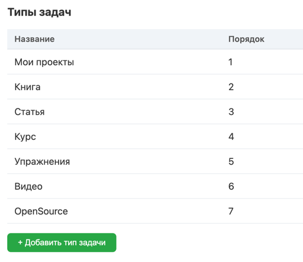
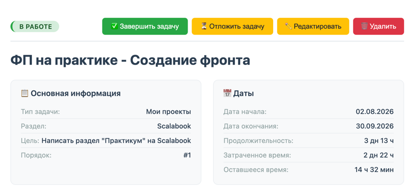

# Main Task Types

In the following chapters, we will focus on individual development plans (IDP) for developers.

## Key principle: Balance of motivation and support

Creating an effective development plan rests on two "pillars":

1. **Internal motivation.** This is the main engine. You cannot force an adult to learn under duress. 
   If an employee reads a book or takes a course only because "it's required," it leads to:
   - **Procrastination:** Constantly putting things off.
   - **Rejection:** Information is not truly absorbed.

   **Simple analogy:** A student who hangs out all semester, then frantically cramms for exams the week before. 
   They might even pass with "distinctions," but this knowledge will be superficial and quickly fade from memory. 
   Our goal is not to "pass the exam," but to acquire solid, long-lasting knowledge.

2. **External support.** Motivation alone is often not enough. The community's task is to help the developer by creating a favorable environment for growth:
   - **Ready-made plans:** Provide [proven learning routes](https://roadmap.sh/), 
     so the developer does not waste time searching for quality materials.
   - **Automation:** Simplify routine processes (e.g., tracking progress), 
     to lower the barrier to starting and reduce the risk of procrastination.

## What kinds of task types can be in a development plan?

For the plan to be diverse and effective, it may include tasks in different formats. 
Here are the main possible types:

**1. Book**

- **What is it?** Not only physical books, but also e-books (PDF, ePub), as well as specialized educational websites.
- **Why is it useful?** Despite the belief that books quickly go out of date, they remain the best source of **fundamental knowledge**. 
  A *good* book lays the foundation that remains relevant for years, unlike rapidly evolving technologies.

**2. Article / Blog**

- **What is it?** Individual articles or publication series in blogs, where an expert deeply explores a specific narrow topic.
- **Why is it useful?** An article allows you to dive deep into a single issue, often more deeply 
  than a book can. 
  It is an ideal format for studying a specific tool, method, or solving a particular problem.

**3. Podcast**

- **What is it?** Audio recordings, usually in the format of a conversation or monologue.
- **Why is it useful?** This format develops not so much technical skills (hard skills) as **soft skills**. 
  A live voice, intonations, and speakers' emotions create a closer connection with the listener. 
  Podcasts often inspire, motivate, and provide food for thought about careers, work approaches, and more.

**4. Video**

- **What is it?** Recordings of conference talks, online meetups, or specialized educational videos.
- **Why is it useful?** Video combines visual information with live context. 
  You not only listen to the talk but also see the audience's reactions, slides, and demonstrations. 
  Often, at the end of the talk, the audience (which may include other experts) ask questions, 
  which provides valuable **feedback** and reveals the topic from new angles.

**5. Course**

- **What is it?** A structured program that combines theory and **practice**. 
  Usually includes lectures, exercises, homework, and projects.
- **Why is it useful?** This is the most effective way to develop **practical skills**. 
  A course forces you not just to passively consume information, but to immediately apply it in practice, which improves learning quality.

**6. Custom type**

- **What is it?** Any other development-related tasks.
- **Examples:**
    - **Maintaining your own blog or podcast.** To explain something clearly to others, 
      you need to understand the topic even more deeply: a great venue for this is your own blog.
    - **Participating in open-source projects.** Allows you to work with real code, learn to read others' code, and interact with the community.
    - **Giving a presentation.** Systematizing and sharing knowledge with colleagues.
    - **Working on a pet project.** Implementing your own idea.

Using a combination of these task types makes the development plan balanced, interesting, and maximally effective.

## Task fields: detailed description

For the development plan to be structured, convenient for tracking and analyzing progress, 
each task has a set of fields.

1. **Name.**  
   A short task name that should clearly reflect its content.  
   Example: 
   - _Read the book "Clean Code"_
   - _Complete the Python course_

2. **User identifier.**
   The identifier of the user to whom the task belongs.

3. **Task type.**
   Indicates what format the task belongs to.  
   Example: 
   - _Book_
   - _Article_
   - _Course_

4. **Task status.**
   Reflects the current execution state of the task.  
   Status examples: 
   - _In progress_  
   - _Planned_  
   - _Knowledge base_  
   - _Completed_

5. **Task section.**  
   Allows grouping tasks by thematic sections within the IDP.  
   Example:
   - _Algorithms_ 
   - _Functional Programming_
   - _Soft skills_

6. **Task goal.** 
   Describes the global goal that the task leads to.
   Example: 
   - _Develop an application for task tracking_  
   - _Raise my level to Lead Developer_
   - _Write a book_
   - _Graduate from university_

7. **Ordinal position.** 
   Defines the sequence in which tasks should be performed.  
   Example: _1_, _2_, _3_

8. **Start date.**
   The date when the task was started.  
   Example:
   - _10/01/2025_

9. **End date.** 
   The planned end date.  
   Example: 
   - _10/15/2025_

10. **Information.**  
    Additional details about the task: comments, notes, goals, sources, etc.  
    Example:
    - _"Important to understand the fundamentals of clean code before starting project work."_

11. **Execution plan.**  
    A description of how the task will be performed, what steps are planned.  
    Example:
    - _"Read the first chapter, complete the exercises, list the key ideas."_

12. **Duration.**  
    Approximate time for the task.  
    Example:
    - _4 hours_

### Why is this needed?

Accounting for all these fields allows:

- **To plan development systematically**, without chaos.
- **To track progress** in real time.
- **To evaluate the effectiveness** of each task.
- **To flexibly adapt the plan** if something doesn't work.
- **To motivate yourself** through achievements and results.

Each item helps make learning more structured and manageable, 
which is especially important for long-term professional growth goals.

---

**Links:**

- [Repository with source code][repo]

[repo]: https://gitverse.ru/scalabook/pdp
