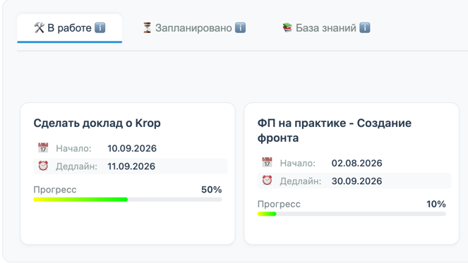

# Task Statuses and Types

## Task Statuses

Each task in the individual development plan has a status that defines its current state and execution stage.
Statuses allow tracking progress, planning workload, and analyzing learning efficiency.



Consider the following task statuses:

### **In Progress**

**Description:**

Tasks you are currently working on. These are active tasks that are in the process of execution.

**Characteristics:**

- All fields of the task are filled in.
- A **work start date** and **planned end date** are set.
- There is a detailed **execution plan** that can be updated as needed.
- Tasks in this status usually do not exceed 3-5 items, as it is important to maintain focus.

**Usage example:**

If you read the book "Clean Code" in the morning, listen to a developer career podcast during the day,
and watch a tutorial video in the evening — these three tasks will be in "In Progress" status.

### **Planned**

**Description:**

Tasks that are already detailed and waiting for their turn to be taken into work. They are in a queue for execution.

**Characteristics:**

- All task fields are filled in, except for the **work start date** and **end date**.
- There is a detailed **execution plan**, so the task can be taken into work at any time.
- These tasks can be used as the nearest reserve when "In Progress" tasks are done.

**Usage example:**

You have prepared a list of 10 articles you want to read.
Currently, you are reading one ("In Progress"), and the rest are in "Planned" status.

### **KnowledgeBase**

**Description:**

These are tasks that do not yet have a detailed execution plan.
They are in your "library" as potential goals, but are not yet ready to begin work.

**Characteristics:**

- The task **does not have an execution plan** filled in.
- Cannot be taken into work until a clear plan is formed.
- Represents a list of possibilities for future development.

**Usage example:**

You have decided that you would like to start your own blog, but do not yet know how.
This task is in the "KnowledgeBase" because you have not yet defined the implementation steps.

### **Completed**

**Description:**

Tasks that have been fully executed. This status records the completion of work and allows saving a history of achievements.

**Characteristics:**

- The task is fully executed according to the initial or updated plan.
- An **actual end date** is set.
- Tasks in this status serve as an archive of your progress and can be used to analyze the path traveled.

**Usage example:**

You have read the book "Clean Code", completed all the practical exercises for it, and prepared a summary of the main principles.
After this, you complete the task and specify the end date, marking this achievement in your plan.

### Status Implementation in Code

Statuses are implemented as an [enum](https://docs.scala-lang.org/scala3/reference/enums/enums.html).
An enum is a special data type that allows defining a fixed set of named constants.

Create a file `Status.scala` in the `pdp/src/main/scala/ru/scalabook/pdp/models` directory.

```dotty
// pdp/src/main/scala/ru/scalabook/pdp/models/Status.scala
package ru.scalabook.pdp.models

enum Status:
  case InProgress, Planned, KnowledgeBase, Completed
```

Thus, each task can have one of the listed statuses.

## Task Types

In an individual development plan (IDP) management system, it is important to be able to flexibly describe different task formats.
Each task type is associated with a specific content format or activity, for example:

- Studying a book
- Reading an article
- Listening to a podcast
- Watching a video
- Completing a course

For types, we create a `case class TaskType` with specified constraints on field types.

To work with type constraints (e.g., checking string length, minimum number value, etc.),
we will use the [Iron](https://github.com/Iltotore/iron) library,
which allows creating [**refined types**](../../libs/refined.md).

To use Iron, you need to add it to the project dependencies in the `Dependencies.scala` file:

```dotty
object Dependencies {
  // ...

  object iron {
    private val version = "3.4.1"
    val cats            = "io.github.iltotore" %% "iron-cats"       % version
    val circe           = "io.github.iltotore" %% "iron-circe"      % version
    val core            = "io.github.iltotore" %% "iron"            % version
    val pureconfig      = "io.github.iltotore" %% "iron-pureconfig" % version
  }

  val pdpLibs: Seq[ModuleID] =
    Seq(
      cats.catsEffect,
      iron.cats,
      iron.circe,
      iron.core,
      iron.pureconfig
    )

  // ...
}
```

### `TaskType`

Create a file `TaskType.scala` in the `pdp/src/main/scala/ru/scalabook/pdp/models` directory.

```dotty
// pdp/src/main/scala/ru/scalabook/pdp/models/TaskType.scala
final case class TaskType(
    id: TaskTypeId,
    name: TaskTypeName,
    userId: UserId,
    displayed: Boolean,
    ordinal: Ordinal
)

object TaskType:
  type TaskTypeId = TaskTypeId.T
  object TaskTypeId extends RefinedType[Int, GreaterEqual[0]]

  type TaskTypeName = TaskTypeName.T
  object TaskTypeName
      extends RefinedType[String, MinLength[2] & MaxLength[30] & Trimmed]
      
// pdp/src/main/scala/ru/scalabook/pdp/models/User.scala      
object User:
  type UserId = UserId.T
  object UserId extends PdpUUID
    
// pdp/src/main/scala/ru/scalabook/pdp/models/src.scala
trait PdpUUID extends RefinedType[String, ValidUUID]:
  inline def apply(uuid: UUID): T = applyUnsafe(uuid.toString)

type Ordinal = Ordinal.T
object Ordinal extends RefinedType[Int, Positive]:
  val Min: T = Ordinal(1)

  val Max: T = Ordinal(1000)

  given Ordering[Ordinal] with
    def compare(x: Ordinal, y: Ordinal): Int =
      x.value - y.value

  extension (ordinal: Ordinal)
    def next: Ordinal =
      Ordinal.applyUnsafe(ordinal.value + 1)          
```

This is a regular [**case class**](https://docs.scala-lang.org/ru/tour/case-classes.html):

- `final` — indicates the class cannot be extended (used for immutability and safety guarantees).
- `case class` automatically provides:
    - a constructor
    - `equals`, `hashCode`, `toString` methods
    - pattern matching support
- `id` — task type identifier
    - must be >= 0
- `name` — task type name
    - 2 to 30 characters
    - The string must be trimmed (no leading or trailing spaces)
- `userId` — user identifier
- `displayed` — flag indicating whether the task type is visible in the user interface
- `ordinal` — ordinal number of the type

### What Are "Refined Types"?

The Iron library allows creating types with constraints.
Instead of a plain `Int` or `String`, we create types that guarantee the data conforms to certain rules.

##### Example without refined types:

```dotty
// Problem: no checks!
case class TaskType(id: Int, name: String)

// Invalid data can be created:
val bad1 = TaskType(-1, "A")         // Negative ID, name too short
val bad2 = TaskType(1, "   test   ") // Extra spaces
```

##### Example with refined types:

```dotty
// Solution: types with constraints
case class TaskType(id: TaskTypeId, name: TaskTypeName)

// Invalid data won't compile!
val bad1 = TaskType(TaskTypeId(-1), TaskTypeName("name"))
// -- Constraint Error --------------------------------------------------------
// Could not satisfy a constraint for type scala.Int.
// 
// Value: -1
// Message: Should be greater than or equal to 0
// ----------------------------------------------------------------------------

val bad2 = TaskType(TaskTypeId(1), TaskTypeName("   test   "))
// -- Constraint Error --------------------------------------------------------
// Could not satisfy a constraint for type java.lang.String.
// 
// Value: test
// Message: Should have a minimum length of 2 & 
//          Should have a maximum length of 30 & 
//          Should not have leading or trailing whitespaces
// ----------------------------------------------------------------------------
```

#### Why Are Opaque Types Needed?

[Creating new types](https://iltotore.github.io/iron/docs/reference/newtypes.html) through

```dotty
type A = A.T
object A extends RefinedType...
```

creates an [opaque](https://docs.scala-lang.org/ru/scala3/book/types-opaque-types.html) type `A`.

The problem they solve:

Without opaque types:

```dotty
type UserId = Int
type ProductId = Int

def getUser(id: UserId): User = ???
def getProduct(id: ProductId): Product = ???

// Problem: IDs can be confused!
val userId: UserId = 123
getProduct(userId) // Error, but the compiler won't catch it!
```

With opaque types:

```dotty
type UserId = UserId.T
object UserId extends RefinedType[Int, Positive]

type ProductId = ProductId.T
object ProductId extends RefinedType[Int, Positive]

// Now they cannot be confused!
val userId: UserId = UserId(123)
getProduct(userId) 
// Compile error:
// Found: (userId : UserId)
// Required: ProductId
```

#### Practical Usage Examples

```dotty
// Correct examples:
TaskType(TaskTypeId(5), TaskTypeName("Blog"))
TaskType(TaskTypeId(6), TaskTypeName("Open Source"))

// Incorrect examples (won't compile):
// Error: -1 < 0
TaskType(TaskTypeId(-1), TaskTypeName("Test"))
// Error: name size is invalid
TaskType(TaskTypeId(5), TaskTypeName("A"))
TaskType(
  TaskTypeId(0),
  TaskTypeName("This is a very long name that does not fit")
)
// Error: has extra spaces
TaskType(TaskTypeId(5), TaskTypeName(" test "))
```

#### Advantages of This Approach

1. **Type safety** — the compiler validates data correctness
2. **Code clarity** — types document their own constraints
3. **Error prevention** — many errors are detected at compile time
4. **Easy refactoring** — type changes are automatically checked by the compiler

## Task Sections

In an IDP management system, it is important not only to describe individual tasks,
but also to group them by thematic sections.
This helps better structure content and simplifies task navigation.

**Sections** are task categorizations that allow:

- **Grouping similar tasks** (e.g., all algorithm-related tasks).
- **Simplifying search and filtering** of tasks in the interface.
- **Creating a logical sequence** in learning (e.g., first learn programming basics, then — advanced algorithms).
- **Tracking progress** in a specific topic.

Examples of typical sections:

- **Algorithms**
- **Functional Programming**
- **Soft Skills**
- **Databases**
- **Web Development**
- **Architecture Design**
- **Testing**

### Section Implementation in Code

To implement sections in the project, we create a `Section` class:

```dotty
// pdp/src/main/scala/ru/scalabook/pdp/models/Section.scala
final case class Section(
    id: SectionId,
    name: SectionName,
    userId: UserId,
    displayed: Boolean,
    ordinal: Ordinal
)

object Section:
  type SectionId = SectionId.T
  object SectionId extends RefinedType[Int, GreaterEqual[0]]

  type SectionName = SectionName.T
  object SectionName
      extends RefinedType[String, MinLength[2] & MaxLength[100] & Trimmed]    
```

### Usage Example

```dotty
Section(
  SectionId(1), 
  SectionName("Algorithms"), 
  UserId(UUID.randomUUID()), 
  true, 
  Ordinal(1)
)
```

## Global Goals

It is important not only to have tasks, but also to define their goals.
**Goals** are meta-descriptions that help understand why a particular task should be performed
and how it relates to professional growth.

**Task goals** are descriptions of expected results from performing a task, allowing:

- **Explaining the value of a task** — why perform it, what skills it develops.
- **Motivating the user** — showing how the task relates to career growth.
- **Linking tasks to competencies** — determining exactly which skills a task develops.
- **Evaluating task relevance** — helps understand if the task is appropriate for the current development level.

Examples of typical goals:

- **Learn to write clean and maintainable code**
- **Master the principles of functional programming**
- **Develop skills in working with databases**
- **Gain experience in designing distributed systems**
- **Improve teamwork and communication skills**
- **Understand the basics of software testing**

### Goal Implementation in Code

To implement goals in the project, we create a `Goal` class:

```dotty
// pdp/src/main/scala/ru/scalabook/pdp/models/Goal.scala
final case class Goal(
    id: GoalId,
    name: GoalName,
    userId: UserId,
    displayed: Boolean,
    ordinal: Ordinal
)

object Goal:
  type GoalId = GoalId.T
  object GoalId extends RefinedType[Int, GreaterEqual[0]]

  type GoalName = GoalName.T
  object GoalName
      extends RefinedType[String, MinLength[2] & MaxLength[200] & Trimmed]
```

### Usage Example

```dotty
Goal(
  GoalId(1), 
  GoalName("Master the basics of algorithmic thinking"), 
  UserId(UUID.randomUUID()), 
  true, 
  Ordinal(1)
)
```

### Linking Goals with Tasks

In practice, goals are typically linked to tasks via a "one-to-many" relationship:

**One goal** can be linked to **multiple tasks**
(e.g., the goal "Master functional programming" may include
tasks on studying monads, functors, and pure functions).

Using task goals provides the following advantages:

- **Learning transparency** — the user understands which skills they are developing by performing a task.
- **Motivational aspect** — understanding the "why" increases engagement.

Goals transform tasks from simple exercises into meaningful steps of professional development,
making the IDP system more effective and personalized.

---

**References:**

- [Source repository][repo]

[repo]: https://gitverse.ru/scalabook/pdp
