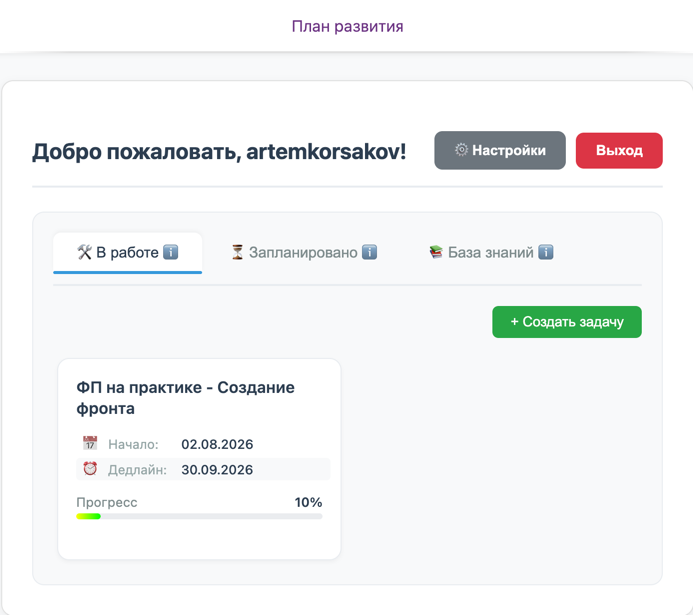
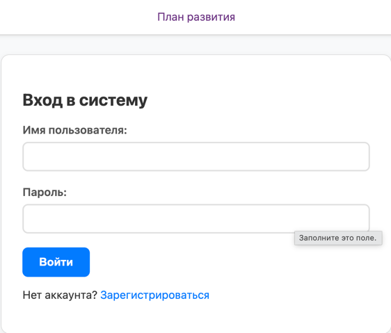

# Main page

Let's start with the main page of the application. This is the entry point where a user lands upon opening the site. The main page must solve two tasks:

1. **If the user is already authorized** (there is a valid JWT token in cookies) — show their dashboard
   with tasks broken down into tabs.
2. **If the user is not authorized** — show the login form.

This approach eliminates extra clicks: the user doesn't need to log in again each time
if they are already logged into the system.

## Main page route description

The main page route is declared directly in the handler. Its key difference from `/health_check` is
**extracting the HTTP Cookie header**: the JWT token is stored in cookies, which is how we determine
whether the user is logged in.

```dotty
private val route =
  Route(
    Request.get(Path.root).extractHeader[Cookie],
    Response.ok(Entity.html)
  )
```

**Route breakdown:**

- **`Request.get(Path.root)`** — GET request to the root path `/`.
- **`.extractHeader[Cookie]`** — extracts the `Cookie` header from the request. The `Cookie` type
  is defined in http4s and contains a list of all cookies sent by the browser. Krop automatically
  converts the header to this type and passes it to the handler.
- **`Response.ok(Entity.html)`** — successful response (200 OK) with an HTML body.

## Creating `InitialHandler`

`InitialHandler` is a handler that decides what to show the user: a dashboard or a login form.

```dotty
final case class InitialHandler(
    middleware: JwtAuthMiddleware[IO, UserInfo],
    taskLifecycleService: TaskLifecycleService[IO],
    periodicTaskLifecycleService: PeriodicTaskLifecycleService[IO],
    notesService: NotesService[IO],
    historyService: HistoryService[IO]
)(using Logger[IO]) extends AuthorizationHandler(middleware):
  private val route =
    Route(
      Request.get(Path.root).extractHeader[Cookie],
      Response.ok(Entity.html)
    )

  val handler: Handler =
    route.handleIO: (cookie: Cookie) =>
      withUserFromCookie(cookie)(
        f = (user, jwtToken) =>
          getViewWelcomeHtml(
            taskLifecycleService = taskLifecycleService,
            periodicTaskLifecycleService = periodicTaskLifecycleService,
            notesService = notesService,
            historyService = historyService,
            user = user,
            jwtToken = jwtToken,
            tab = DefaultTab
          ).map(welcome => Views.base(Title, raw(welcome))),
        fallbackPage = Views.base(Title, Views.login(none))
      )
```

**Step-by-step breakdown:**

1. **Handler dependencies:**
    - `middleware: JwtAuthMiddleware[IO, UserInfo]` — middleware for verifying JWT tokens.
      Can convert a token string into a `UserInfo` object (user information: id, username).
    - Services for loading tasks, periodic tasks, notes, and history.
    - `using Logger[IO]` — a logger for recording errors.

2. **`extends AuthorizationHandler(middleware)`** — inherits from the base class.
   This gives access to the methods `withUserFromCookie`/`withUserFromCookieOpt` (see "Base
   class `AuthorizationHandler`").

3. **`private val route`** — the route is declared inside the handler.

4. **`route.handleIO`** — registers a handler accepting `Cookie`. The `handleIO` method
   is used instead of `handle` because the logic requires an `IO` effect (token verification, task loading).

5. **`withUserFromCookie(cookie)(f, fallbackPage)`** — passes the cookie as the **first** argument,
   the lambda `f` and `fallbackPage` — as the second. The method itself:
    - Extracts the token from the `token` cookie.
    - Verifies it via `middleware.fromToken.run` and passes `(user, jwtToken)` to `f`.
    - If there is no token in the cookie or it is invalid — returns `fallbackPage`
      (a pre-formatted login page).

6. **`f = (user, jwtToken) => ...`** — formats the welcome page via
   `getViewWelcomeHtml` and wraps it in `Views.base(Title, ...)`. If the token is valid — the user
   sees their dashboard; otherwise — `fallbackPage` (login form).

Any problem with the token (expired, corrupted, incorrect signature) **does not crash the application**:
the user simply sees the login form, as if they were not authorized. The error is logged.

### Base class `AuthorizationHandler`

`AuthorizationHandler` is a helper trait that encapsulates token verification logic. It is used by all protected handlers (settings, tasks, timer, etc.).

The implementation looks like this:

```dotty
trait AuthorizationHandler(middleware: JwtAuthMiddleware[IO, UserInfo])(using
    Logger[IO]
):
  def withUserFromHeader(authorization: Authorization)(
      f: ((UserInfo, SignedJwt)) => IO[String]
  ): IO[Option[String]] =
    withUserFromHeaderOpt(authorization)(f(_).map(_.some))

  def withUserFromHeaderOpt(authorization: Authorization)(
      f: ((UserInfo, SignedJwt)) => IO[Option[String]]
  ): IO[Option[String]] =
    middleware
      .run(authorization)
      .flatMap(f)
      .recoverWith:
        case ex: AuthorizationException =>
          Logger[IO].error(ex)(
            s"Error parsing token: ${ex.getMessage}"
          ).as(Views.error().some)
        case ex =>
          Logger[IO].error(ex)(s"Error: ${ex.getMessage}").as(none)

  def withUserFromCookieOpt(cookie: Cookie)(
      f: ((UserInfo, SignedJwt)) => IO[Option[String]],
      fallbackPage: => String
  ): IO[String] =
    withUserFromCookie(cookie)(
      f(_).map(_.getOrElse(fallbackPage)),
      fallbackPage
    )

  def withUserFromCookie(cookie: Cookie)(
      f: ((UserInfo, SignedJwt)) => IO[String],
      fallbackPage: => String
  ): IO[String] =
    cookie.values
      .collectFirst {
        case rq if rq.name == "token" => rq.content
      } match
      case Some(token) =>
        middleware.fromToken.run(token)
          .flatMap(f)
          .recoverWith:
            case ex: AuthorizationException =>
              Logger[IO].error(ex)(
                s"Error parsing token: ${ex.getMessage}"
              )
                .as(fallbackPage)
            case ex =>
              Logger[IO].error(ex)(s"Error: ${ex.getMessage}")
                .as(fallbackPage)
      case None =>
        Logger[IO].debug("No user token found in cookies")
          .as(fallbackPage)
end AuthorizationHandler
```

**What it does:**

1. All methods take **two** arguments: the source data (`authorization` or `cookie`)
   **and** a curried function `f` to which `(user, token)` is passed.
2. The method calls middleware to verify the token.
3. If the token is valid — passes `(user, token)` to the user function `f`.
4. If there is no header/cookie or the token is invalid — returns `fallbackPage`.

**Two ways to pass a token:**

- **`withUserFromHeader` / `withUserFromHeaderOpt` with `Authorization`** — the token comes
  in the `Authorization: Bearer <token>` header (forms `/auth/login`, `/auth/logout`,
  task actions). Returns `IO[Option[String]]`.
- **`withUserFromCookie` / `withUserFromCookieOpt` with `Cookie`** — the token is stored in the `token` cookie
  (opening pages: `/home`, `/task/{uuid}`, `/note/{uuid}`, etc.). The trait itself
  extracts the token from the cookie and returns `IO[String]`, substituting `fallbackPage` on
  absence/invalidity of the token. `fallbackPage` is **by name** (`=> String`), meaning
  it is computed only when needed. For the soft version (`withUserFromCookieOpt`) the lambda
  returns `Option`, and on `None` the `fallbackPage` is also substituted.

**Advantages of this approach:**

- **Uniformity:** all protected handlers use the same verification mechanism.
- **Security by default:** if a developer forgets to verify the token — the compiler
  will force them to use `withUserFromHeader`, because a plain `handleIO` will not grant access
  to `UserInfo`.
- **A single point for token from cookie:** extracting `token` from the cookie and substituting
  `fallbackPage` is implemented once in `AuthorizationHandler`, not in every handler.

## What is `JwtAuthMiddleware`

`JwtAuthMiddleware` is a type-safe wrapper over JWT token verification.
It is built on `Kleisli` — a special type from Cats that represents a function
returning a value in the context of an `F` effect.

```dotty
type JwtAuthMiddleware[F[_], A] = Kleisli[F, Authorization, (A, SignedJwt)]
```

**Decoding the type:**

- **`F[_]`** — an effect (in our case `IO`).
- **`A`** — the user type (here `UserInfo`).
- **`Authorization`** — an HTTP request header containing the token.
- **`(A, SignedJwt)`** — the result: user + the token itself (needed for subsequent requests).

Simply put, `JwtAuthMiddleware[IO, UserInfo]` is a function of the form
`Authorization → IO[(UserInfo, SignedJwt)]`.

```dotty
object JwtAuthMiddleware:
  def apply[F[_]: MonadThrow as MT, A](
      verification: JwtVerification[F],
      authenticate: SignedJwt => F[Option[A]]
  ): JwtAuthMiddleware[F, A] =
    Kleisli {
      case Authorization(Token(AuthScheme.Bearer, token)) =>
        val parsedAndVerified: F[SignedJwt] =
          for
            signedJwt <- SignedJwt.fromString(token).liftTo[F]
            _         <- signedJwt.verifyWith(verification)
          yield signedJwt

        parsedAndVerified.attempt.flatMap:
          case Right(signedJwt) =>
            authenticate(signedJwt)
              .flatMap: opt =>
                MT.fromOption(opt, AuthorizationException("Not found"))
              .map(a => (a, signedJwt))
          case Left(_) =>
            MT.raiseError(AuthorizationException("Invalid access token"))
      case _ =>
        MT.raiseError(AuthorizationException("Bearer token not found"))
    }

  extension [F[_], A](middleware: JwtAuthMiddleware[F, A])
    def fromToken: Kleisli[F, String, (A, SignedJwt)] =
      middleware
        .local[String]((token: String) =>
          Authorization(Token(AuthScheme.Bearer, token))
        )
```

**What `apply` does:**

1. **Matching against the `Authorization` header:** expects the `Bearer <token>` scheme.
   If the header does not match this format — `AuthorizationException("Bearer token not found")`.

2. **Parsing and verifying the token:** the `token` string is converted to `SignedJwt` via
   `SignedJwt.fromString`, after which `verifyWith(verification)` checks the signature, expiration
   and integrity of the token. Both operations are placed into an `F` effect via `.liftTo[F]`.

3. **Processing the verification result:** via `.attempt` two outcomes are separated:
   - **Success** — `authenticate(signedJwt)` is called to find the user.
     If `None` is returned — `AuthorizationException("Not found")` is thrown.
   - **Failure** — any problem with the token (incorrect signature, expired, etc.)
     is converted to `AuthorizationException("Invalid access token")`.

4. **Returning the pair `(A, SignedJwt)`** — the authenticated user and the token itself.

The **`fromToken` extension** simplifies calling middleware when we only have a token string
(e.g., from a cookie). It "wraps" the string into the correct `Authorization: Bearer <token>` header
and calls the middleware.

## Forming the welcome page

If the token is valid, we form a welcome page with the user's tasks.
The logic is placed in the `WelcomeViews` object:

```dotty
object WelcomeViews:
  val Title: String       = "Development Plan"
  val DefaultTab: String  = "in-progress"

  def getViewWelcomeHtml(
      taskLifecycleService: TaskLifecycleService[IO],
      periodicTaskLifecycleService: PeriodicTaskLifecycleService[IO],
      notesService: NotesService[IO],
      historyService: HistoryService[IO],
      user: UserInfo,
      jwtToken: SignedJwt,
      tab: String
  ): IO[String] =
    for
      notes <- notesService.getByUser(user.id)
      (taskResults, taskTypes, sections, goals) <- taskLifecycleService.getAll(...)
      completedTasks <- historyService.getByUser(user.id)
      periodicTasks  <- periodicTaskLifecycleService.getTasks(user.id)
    yield
      val typesMap    = taskTypes.map(t => (t.id, t.name)).toMap
      val sectionsMap = sections.map(t => (t.id, t.name)).toMap
      val goalsMap    = goals.map(t => (t.id, t.name)).toMap
      ...
      // Tab cards
      val plannedTasks =
        plannedResults.map(task =>
          TablePlannedTaskCard.fromTaskResult(task, typesMap, sectionsMap, goalsMap))
      val knowledgeBaseTasks =
        knowledgeBaseResults.map(task =>
          TableKnowledgeBaseTaskCard.fromTaskResult(task, typesMap, sectionsMap, goalsMap))

      // Sets of IDs of the present types, sections, and goals
      val plannedGoalIds = plannedResults.map(task => task.goalId).toSet
      val knowledgeBaseGoalIds = knowledgeBaseResults.map(task => task.goalId).toSet

      // Filter option lists
      val plannedGoalFilters =
        goals.sortBy(_.ordinal).collect {
          case t if plannedGoalIds(t.id) => t.name.value
        }
      val knowledgeBaseGoalFilters =
        goals.sortBy(_.ordinal).collect {
          case t if knowledgeBaseGoalIds(t.id) => t.name.value
        }

      Views.welcome(
        username = user.username.value,
        token = jwtToken,
        tab = tab,
        inProgress = Views.welcomeInProgress(inProgressTasks, periodicTasks),
        planned = Views.welcomePlanned(plannedTasks, plannedTaskTypes, plannedSections, plannedGoalFilters),
        knowledgeBase = Views.welcomeKnowledgeBase(knowledgeBaseTasks, knowledgeBaseTaskTypes, knowledgeBaseSections, knowledgeBaseGoalFilters),
        goals = Views.goalsStats(currentGoals, plannedGoals, achievedGoals),
        statistics = Views.statistics(stats),
        sources = Views.welcomeSources(taskTypes),
        notes = Views.welcomeNotes(notes),
        history = Views.history(historyTasks)
      ).render
```

**What happens step by step:**

1. **`DefaultTab`** — the tab opened by default (`"in-progress"`).

2. **Loading data** via multiple services in a `for`-comprehension:
    - `taskLifecycleService.getAll(userId, none, none, none)` — tasks, types, sections, and goals;
    - `notesService.getByUser` — notes;
    - `historyService.getByUser` — completed tasks;
    - `periodicTaskLifecycleService.getTasks` — periodic tasks for today.

3. **Building maps `typesMap`, `sectionsMap`, `goalsMap`** — id → name, so that
   task cards can show "enriched" names instead of ids.

4. **Grouping tasks by status:**
    - **`inProgressResults`** — "In Progress" tasks, sorted by `(endDate, ordinal)`.
    - **`plannedResults`** — "Planned" tasks, sorted by `ordinal`.
    - **`knowledgeBaseResults`** — "Knowledge Base" tasks, sorted by name.

5. **Preparing options for filters.** This is an important point: **filters should show
   only those types, sections, and goals that actually appear in tasks on this tab.**
   Otherwise, the user will see values in the dropdown that are nowhere used,
   and this will create confusion.

    - **`plannedTaskTypeNames`, `plannedSectionNames`, `plannedGoalIds`** — id sets
      found in planned tasks.
    - **`knowledgeBaseTaskTypeNames`, `knowledgeBaseSectionNames`, `knowledgeBaseGoalIds`** —
      the same for the knowledge base.

6. **Building sorted option lists (including goals):**
    - We iterate over all `types`, `sections`, and `goals` in `ordinal` order and keep
      only those whose ids appear in the corresponding `Set`. This way the filter shows
      values in the correct order (not alphabetical, but by `ordinal`).
    - `plannedGoalFilters` and `knowledgeBaseGoalFilters` — **new** goal lists
      for the "Goal" filter on the "Planned" and "Knowledge Base" tabs.

7. **`Views.welcome(...)`** — assembles the page from already-rendered HTML fragments
   of the tabs. Each tab is rendered by a separate template: `welcomeInProgress`,
   `welcomePlanned`, `welcomeKnowledgeBase`, `goalsStats`, `statistics`, `welcomeSources`,
   `welcomeNotes`, `history`. Filter lists (`taskTypes`, `sections`, `goals`) are passed
   only to the tabs that need them.

## Page appearance

If everything went successfully, the user sees the welcome page with eight tabs
("In Progress", "Planned", "Knowledge Base", "Goals", "Statistics", "Source", "Notes",
"History"):



If something goes wrong — the user sees the login page:

```dotty
Views.base(Title, Views.login(none))
```



## Rendering views (scalatags)

HTML is formed using pure Scala functions with the [scalatags](https://github.com/lihaoyi/scalatags) DSL — a type-safe
library for building HTML in Scala code. This allows catching markup errors at
compile time, not at runtime. All render functions are collected in the `Views` object
(`Views.scala`). scalatags code is type-safe: the compiler checks the structure of the DOM tree,
presence of required attributes, and type correctness.

### Base render `Views.base`

A wrapper function for all pages of the application. Contains common elements: `<head>`,
CSS and JS includes, the top panel with the title.

```dotty
def base(pageTitle: String, pageContent: Modifier): String
```

Builds `<html lang="en">` with a `<head>` containing meta-information.
Then a `<body>` with `<header class="app-header">` (link to `/`) and
`<main class="main-content">`, wrapping the content.

**Parameters:**

- **`pageTitle: String`** — the page title, displayed in the browser tab and in the header.
  Clicking it navigates to the main page.
- **`pageContent: Modifier`** — the main page content (scalatags fragment), inserted
  into `<main>`. If an already-ready HTML string is passed (e.g., the result of `WelcomeViews`),
  it is wrapped in `raw(...)`.

**Important:** **htmx** is included here — a library for updating page parts without reload.
It is used on the welcome page for tab switching, form submission, and task list updates. Without it, all actions would require a full page reload.

### Render `Views.login`

The login form page. Shown when the user is not authorized.

```dotty
def login(errorMessage: Option[String]): Frag
```

The function renders a `<div id="app" class="app-container-narrow">` with a heading
`<h2>Sign In</h2>`, a form via `LoginRequest.render("loginForm", "/auth/login", "Sign In")`,
an error block via `errorBlock(errorMessage)` and a "Register" link with htmx attributes
(`hx-get="/register"`, `Htmx.appTarget`, `Htmx.appSwap`).

**Features:**

- **`errorMessage: Option[String]`** — an optional error message (e.g.,
  "Invalid login or password"). If present — displayed below the form in a `.error` block.
- The form is submitted via htmx: `hx-post="/auth/login"`, `hx-target="#app"`,
  `hx-swap="outerHTML"`.
- **`hx-post="/auth/login"`** — the form is submitted via htmx without reloading the page.
- **`hx-target="#app"`** — the server response replaces the content of the `#app` block. If login
  is successful, the server will return the welcome page; if not — the same form with an error message.
- **`hx-swap="outerHTML"`** — replaces the entire `#app` block, not just its content.
- **Registration link** — also uses htmx: `hx-get="/register"` loads
  the registration form instead of the login form.

## Registering the handler in Main

At the end, we add `initialHandler` to the application's handler chain:

```dotty
    val initialHandler =
      InitialHandler(middleware, services.taskLifecycleService)

    initialHandler.handler
      .orElse(healthHandler.handler)
      .orElse(assets)
      .orElse(Application.notFound)
```

**Order matters:**

1. **`initialHandler.handler`** — handles `/` (main page).
2. **`healthHandler.handler`** — handles `/health_check`.
3. **`assets`** — serves static files (`/assets/css/pdp.css`, `/assets/js/pdp.js`,
    `/assets/icons/favicon.ico`).
4. **`Application.notFound`** — fallback: if nothing matches, returns 404.

Krop tries handlers in sequence via `orElse` and stops at the first one
that "matches" the request.

## Summary

We set up the main page of the application with authorization verification via a JWT token in cookies.
If the user is authorized — they see their dashboard with tasks broken down into tabs.
If not — a login form with the option to proceed to registration. All error-handling logic
is isolated: token problems do not crash the application, but gently lead the user to the login form.

Key ideas:

- **JWT in cookies** — the token is stored in the HTTP cookie `token`, allowing it to be
  automatically submitted with each request to the same domain.
- **Middleware for verification** — `JwtAuthMiddleware` encapsulates all the token verification logic:
  decoding, signature validation, user lookup.
- **Forming contextual filters** — filters show only those types, sections
  and goals that actually appear in tasks on the tab.
- **htmx for interactivity** — tab switching, opening modals, and submitting
  forms without page reload.
- **scalatags for markup** — HTML is built in Scala code and checked by the compiler.

---

**Links:**

- [Repository with source code][repo]

[repo]: https://gitverse.ru/scalabook/pdp
