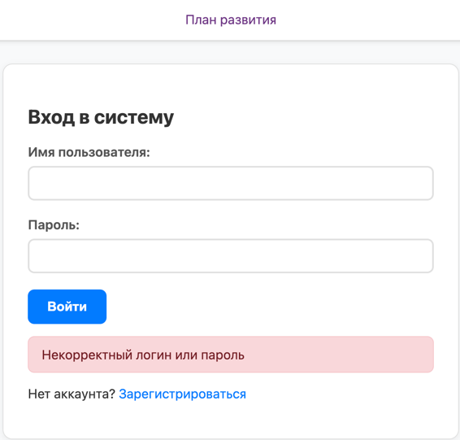

# Login and Logout Pages

After setting up the main page with authorization checking, we need to implement two key
endpoints: **login** (`/auth/login`) and **logout** (`/auth/logout`).
Login verifies user credentials and issues a JWT token, while logout invalidates the token
(in our case — removes it from Redis) so it cannot be reused.

## Login

### Route Description

For login, the route is declared as a private variable `route` in `LoginHandler`:

```dotty
private val route = Route(
  Request.post(Path.root / "auth" / "login")
    .withEntity(Entity.formOf[LoginRequest]),
  Response.ok(Entity.html)
)
```

**Route analysis:**

- **`Request.post(Path.root / "auth" / "login")`** — POST request to path `/auth/login`.
  Login is always POST because we transmit sensitive data (password) in the request body.
- **`.withEntity(Entity.formOf[LoginRequest])`** — the request body is of type `application/x-www-form-urlencoded`
  and is automatically deserialized into `LoginRequest`. This is the standard format for HTML forms
  that htmx sends by default. Krop with `FormCodec[LoginRequest]`
  (codec we described in the models section) transforms `username=...&password=...` pairs
  into a typed object.
- **`Response.ok(Entity.html)`** — successful response (200 OK) with HTML body. All response variants
  (success or form with error) are generated within the handler, so `.orNotFound` is not needed here.

### `LoginHandler` Handler

```dotty
final case class LoginHandler(
    authService: AuthService[IO],
    taskLifecycleService: TaskLifecycleService[IO]
)(using Logger[IO]):
  private val route = Route(
    Request.post(Path.root / "auth" / "login")
      .withEntity(Entity.formOf[LoginRequest]),
    Response.ok(Entity.html)
  )

  // Don't expose validation errors to the user.
  private val fallbackPage: String =
    Views.login("Invalid login or password".some).render

  val handler: Handler =
    route.handleIO: (request: LoginRequest) =>
      UserRegistration.parse(request)
        .map { registration =>
          authService
            .login(registration.username, registration.password)
            .flatMap: (token, id) =>
              getViewWelcome(
                taskLifecycleService = taskLifecycleService,
                user = UserInfo(id, registration.username),
                jwtToken = token,
                tab = DefaultTab
              )
            .recoverWith:
              case UserNotFound(_) | InvalidPassword(_) =>
                fallbackPage.pure[IO]
              case ex =>
                Logger[IO].error(ex)(s"Error: ${ex.getMessage}")
                  .as(fallbackPage)
        }.valueOr(_ => fallbackPage.pure[IO])
end LoginHandler
```

**Step-by-step analysis:**

1. **Dependencies:**
    - `authService: AuthService[IO]` — authentication service. Can verify login/password
      and generate JWT token.
    - `taskLifecycleService: TaskLifecycleService[IO]` — service for loading user tasks.
      Needed to show the welcome page with tasks right after login.
    - `using Logger[IO]` — logger for recording errors.

2. **`private val route`** — route declared within the handler.

3. **`fallbackPage`** — private `val` with login page HTML and message
   "Invalid login or password". This is the **only** fallback page that
   is returned on any error (wrong password, unknown login, validation error,
   internal error). The message is the same — to not reveal whether the user exists.

4. **`UserRegistration.parse(request)`** — validates request fields.
   Returns `ValidatedNec[String, UserRegistration]`:
   ```dotty
   object UserRegistration:
     def parse(request: LoginRequest): ValidatedNec[String, UserRegistration] =
       (
         UserName.either(request.username).left.map(er =>
           s"Login: $er"
         ).toValidatedNec,
         Password.either(request.password).left.map(er =>
           s"Password: $er"
         ).toValidatedNec
       ).mapN((username, password) =>
         UserRegistration(username = username, password = password)
       )
   ```
    - If fields are empty or don't meet constraints — an error is returned.
    - If everything is fine — returns `UserRegistration(username, password)`.

5. **`.map { registration => ... }`** — if validation succeeds, we get
   `UserRegistration` and call `authService.login(registration.username, registration.password)`.

6. **`authService.login`** — checks user in DB:
    - If user is found and password is correct — returns `(SignedJwt, UserId)`.
    - If user is not found — throws `UserNotFound`.
    - If password is wrong — throws `InvalidPassword`.

7. **`.flatMap: (token, id) => ...`** — on success, we build the welcome page
   via `getViewWelcome` (the same function used in `InitialHandler`).
   The result is the ready-made HTML string.

8. **`.recoverWith`** — error handling:
    - **`UserNotFound` / `InvalidPassword`** — return `fallbackPage` (login form
      with message "Invalid login or password").
    - **Any other exception** — log it and also return `fallbackPage`.

9. **`.valueOr(_ => fallbackPage.pure[IO])`** — handles the case when `UserRegistration.parse`
   returned an error. For example, if the user submitted an empty form. In this case, we also
   show the login form with an error message.

### Error Handling

If the user entered an incorrect login or password, they will see the login form with an error message:



The message is generated in `fallbackPage`:

```dotty
private val fallbackPage: String =
  Views.login("Invalid login or password".some).render
```

Note: the message is **the same** for both non-existent user and
wrong password. This is an intentional security decision: an attacker cannot
enumerate logins to determine which users are registered in the system.

## Logout

### Route Description

The route is declared within `LogoutHandler`:

```dotty
private val route = Route(
  Request.post(Path.root / "auth" / "logout").extractHeader[Authorization],
  Response.ok(Entity.html).orNotFound
)
```

**Route analysis:**

- **`Request.post(Path.root / "auth" / "logout")`** — POST request to `/auth/logout`.
  Logout must be POST, not GET, because it's a mutating operation (token invalidation).
  GET requests should be idempotent and not change state.
- **`.extractHeader[Authorization]`** — extracts the HTTP `Authorization` header from the request.
  This is where the JWT token is transmitted: `Authorization: Bearer <token>`.
- **`.orNotFound`** — fallback: 404 if the request doesn't match.

### `LogoutHandler` Handler

```dotty
final case class LogoutHandler(
    authService: AuthService[IO],
    middleware: JwtAuthMiddleware[IO, UserInfo]
)(using Logger[IO]) extends AuthorizationHandler(middleware):
  private val route = Route(
    Request.post(Path.root / "auth" / "logout").extractHeader[Authorization],
    Response.ok(Entity.html).orNotFound
  )

  val handler: Handler =
    route.handleIO: (authorization: Authorization) =>
      withUserFromHeader(authorization): (user: UserInfo, token: SignedJwt) =>
        authService.logout(token, user.username)
          .as(Views.login(none).render)
```

**Step-by-step analysis:**

1. **`extends AuthorizationHandler(middleware)`** — we extend the base class
   `AuthorizationHandler` which encapsulates token verification logic. This eliminates
   the need to manually extract the token from the header and validate it in each handler.

2. **`withUserFromHeader(authorization): (user: UserInfo, token: SignedJwt) => ...`** — a special
   method that takes **two** arguments:
    - First — `authorization` from the request header (what `handleIO` extracted).
    - Second (curried lambda) — `(user, token)`.

   The method:
    - Checks the token through middleware.
    - If the token is valid — passes `user` (user information)
      and `token` (the JWT token itself) to the lambda.
    - If invalid — automatically returns `AuthorizationException` error,
      which is handled by `AuthorizationHandler`.

3. **`authService.logout(token, user.username)`** — invalidates the token. In our implementation
   this means removing the token from Redis (active sessions store).
   After that, the token can no longer be used.

4. **`.as(Views.login(none).render)`** — after successful logout, we return the login page.
   `Views.login` returns a scalatags `Frag`; `.render` converts it to an HTML string.
   `none` means there is no error message.

**Return type `IO[String]`:**

Here the handler returns `IO[String]` — just the login HTML page. After logout
the user sees the login form, as if they just arrived at the site.

## Registering Handlers in Main

After creating `LoginHandler` and `LogoutHandler`, add them to the handler chain:

```dotty
val loginHandler  = LoginHandler(authService, services.taskLifecycleService)
val logoutHandler = LogoutHandler(authService, middleware)

initialHandler.handler
  .orElse(loginHandler.handler)
  .orElse(logoutHandler.handler)
  .orElse(healthHandler.handler)
  .orElse(assets)
  .orElse(Application.notFound)
```

## Summary

We implemented two key authentication endpoints:

1. **`/auth/login`** — accepts login and password in `application/x-www-form-urlencoded` format,
   checks them via `AuthService`, generates a JWT token, and shows the welcome
   page with tasks. On error, shows the login form with a message.

2. **`/auth/logout`** — accepts JWT token in `Authorization` header, invalidates it
   via `AuthService` (removes from Redis), then returns the login page.

Both endpoints use htmx for page content replacement without reload:
the client sends a request, the server returns HTML, htmx plugs it into `#app`.

**Key architectural decisions:**

- **Login form** doesn't distinguish between "user not found" and "wrong password" — this protects
  against login enumeration.
- **`AuthorizationHandler`** encapsulates token checking and makes protected
  handlers concise.
- **Single `Handler` interface** — simplifies composition via `orElse`.

---

**References:**

- [Source repository][repo]

[repo]: https://gitverse.ru/scalabook/pdp
