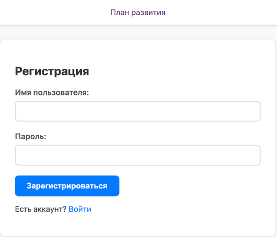
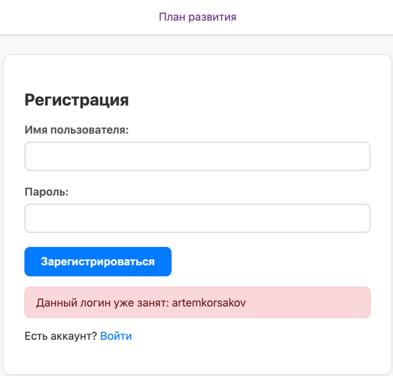
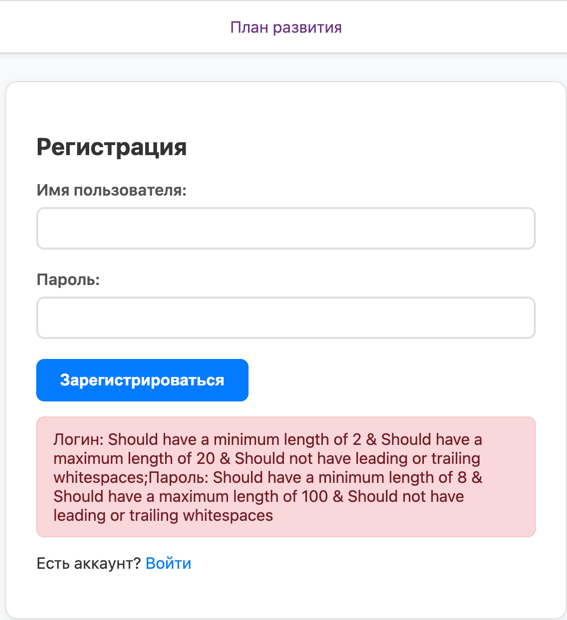

# User Registration

Registration is the first step a new user goes through when getting acquainted with the application.

## Registration Form

### Route

Each handler declares its own routes within itself. For the registration form, the route is declared as a private
variable `formRoute` inside `RegisterHandler`:

```dotty
private val formRoute =
  Route(
    Request.get(Path.root / "register"),
    Response.ok(Entity.html)
  )
```

**Route analysis:**

- **`Request.get(Path.root / "register")`** — GET request to path `/register`.
  This is simply serving a static form — we don't receive any data from the user.
- **`Response.ok(Entity.html)`** — successful response (200 OK) with HTML body.

### `RegisterHandler` Handler

The user creation handler `RegisterHandler` owns **two** handlers:
`formHandler` (serving the form) and `registerHandler` (handling POST requests).

```dotty
final case class RegisterHandler(
    authService: AuthService[IO],
    taskLifecycleService: TaskLifecycleService[IO]
)(using Logger[IO]):
  private val formRoute =
    Route(
      Request.get(Path.root / "register"),
      Response.ok(Entity.html)
    )

  val formHandler: Handler =
    formRoute.handle(() => Views.register(none).render)
```

Snippet from `Main.scala` where both handlers are registered:

```dotty
.orElse(registerHandler.formHandler)
.orElse(registerHandler.registerHandler)
```

**Handler analysis:**

- **`final case class RegisterHandler`** — this is a `case class` because
  the user creation handler needs dependencies (`authService`, services for welcome page).
  The form and user creation live in one handler.
- **`private val formRoute`** — route declared within the handler (routes moved out of `Routes.scala`).
- **`formRoute.handle`** — we use `handle` instead of `handleIO` because
  the logic is pure: no effects (`IO`) are needed, only template rendering.
- **`() => ...`** — lambda with no arguments, because the request has no parameters.
- **`Views.register(none).render`** — we call `Views.register` with `None` as
  the error message (`Frag`), then `.render` converts it to an HTML string.
  This means "no error, show a clean form".
- **`formHandler` / `registerHandler`** — two separate `Handler`s, each with its own route.
  In `Main.scala` they are connected via `.orElse`.

### Form Rendering `Views.register`

The `Views.register` method is a scalatags function in the `Views` object. It takes
`errorMessage: Option[String]` and returns `Frag` (a scalatags fragment that can be
converted to HTML via `.render`). Renders:

- Wrapper `<div id="app" class="app-container-narrow">`.
- Title `<h2>Registration</h2>`.
- Form — result of `LoginRequest.render("registerForm", "/register/new", "Register")`:
  `username` and `password` fields, button with `hx-post="/register/new"`, `hx-target="#app"`,
  `hx-swap="outerHTML"`.
- Error block `errorBlock(errorMessage)`.
- Link: `p("Already have an account?", a(href := "/")("Login"))` — regular anchor, not htmx.

**Key points:**

1. **`Views.register(errorMessage: Option[String])`** — method of the `Views` object.
   If there's an error — show it below the form.
2. **Registration form** — two fields: `username` and `password`. Both required (`required`).
   Rendered via `LoginRequest.render("registerForm", "/register/new", "Register")`.
3. **"Register" button** — uses htmx:
    - `hx-post="/register/new"` — sends a POST request to `/register/new`.
    - `hx-target="#app"` — server response replaces the content of `#app` block.
    - `hx-swap="outerHTML"` — replaces the entire block, not just its content.
4. **`errorBlock`** — optional error message (e.g., "Login is already taken").
5. **"Login" link** — regular `<a href="/">Login</a>`, not htmx.

This form opens as:



## Creating a New User

When the user fills the form and clicks "Register", htmx sends a POST request
to `/register/new`. This is where all the logic for creating a new user happens.

### Route

The route for user creation is declared in the same `RegisterHandler` as a private
variable `registerRoute`:

```dotty
private val registerRoute = Route(
  Request.post(Path.root / "register" / "new")
    .withEntity(Entity.formOf[LoginRequest]),
  Response.status(HttpStatus.Created, Entity.html)
    .orElse(Response.status(HttpStatus.Ok, Entity.html))
)
```

**Route analysis:**

- **`Request.post(Path.root / "register" / "new")`** — POST request to `/register/new`.
- **`.withEntity(Entity.formOf[LoginRequest])`** — request body in format
  `application/x-www-form-urlencoded`, deserialized into `LoginRequest`.
  We reuse `LoginRequest` because the fields are the same: `username` and `password`.
- **`Response.status(HttpStatus.Created, Entity.html)`** — successful `201 Created` response.
  This is the correct status for creating a new resource (user).
- **`.orElse(Response.status(HttpStatus.Ok, Entity.html))`** — fallback `200 OK`,
  if an error occurred during registration and it needs to be displayed to the user.

### `RegisterHandler` Handler (User Creation)

```dotty
final case class RegisterHandler(
    authService: AuthService[IO],
    taskLifecycleService: TaskLifecycleService[IO],
    periodicTaskLifecycleService: PeriodicTaskLifecycleService[IO],
    notesService: NotesService[IO],
    historyService: HistoryService[IO]
)(using Logger[IO]):
  // ...
  val registerHandler: Handler =
    registerRoute.handleIO {
      (request: LoginRequest) =>
        UserRegistration.parse(request)
          .map { registration =>
            authService
              .newUser(registration.username, registration.password)
              .flatMap: (token, id) =>
                getViewWelcome(
                  taskLifecycleService = taskLifecycleService,
                  periodicTaskLifecycleService = periodicTaskLifecycleService,
                  notesService = notesService,
                  historyService = historyService,
                  user = UserInfo(id, registration.username),
                  jwtToken = token,
                  tab = DefaultTab
                ).map(_.asRight)
              .recoverWith:
                case UserNameInUse(username) =>
                  asError(s"This login is already taken: $username")
                case ex =>
                  Logger[IO].error(ex)(s"Error: ${ex.getMessage}") *>
                    asError("An error occurred during registration.")
          }.valueOr(errors => asError(errors.mkString_(";")))
    }

  private def asError(error: String): IO[Either[String, String]] =
    Views.register(error.some).render.asLeft.pure[IO]
```

**Step-by-step analysis:**

1. **`UserRegistration.parse(request)`** — validates request fields, returns `ValidatedNec[String, UserRegistration]`:
    - If `username` or `password` are empty, too short, or too long — error.
    - If everything is fine — `UserRegistration(username, password)`.
2. **`.map { registration => ... }`** — on successful validation, call
   `authService.newUser(registration.username, registration.password)`.
3. **`authService.newUser`** — creates user in DB:
    - If login is free — creates the user and returns `(SignedJwt, UserId)`.
    - If login is taken — throws `UserNameInUse(username)`.
    - Other errors (e.g., DB issue) — regular exceptions.
4. **`.flatMap: (token, id) => ...`** — on success, build the welcome page
   via `getViewWelcome`, wrapping the result in `Right`.
5. **`.recoverWith`** — error handling:
    - **`UserNameInUse(username)`** — return registration form with message
      "This login is already taken: {username}".
    - **Any other exception** — log it and return the form with message
      "An error occurred during registration."
6. **`.valueOr(errors => asError(errors.mkString_(";")))`** — if `UserRegistration.parse` returned an error
   (e.g., empty login), generate registration form with error message.
   `errors.mkString_(";")` joins all errors into one string separated by `;`.

**Specifics of return type `IO[Either[String, String]]`:**

This type encodes two possible states:

| Type                | Value                | Status Code | Meaning                                                      |
| ------------------- | -------------------- | ----------- | ------------------------------------------------------------ |
| `Right(html)`       | Success              | 201         | Registration completed, showing welcome page                 |
| `Left(html)`        | Error                | 200         | Login taken or invalid data, showing form with error         |

This makes it easier for the **htmx client** to distinguish the result: on success, `201 Created` is returned;
on error — `200 OK` with form and message. There's no separate encoding for "internal error" —
any exception leads to a form with error (status `200`).

**`asError` method:**

```dotty
private def asError(error: String): IO[Either[String, String]] =
  Views.register(error.some).render.asLeft.pure[IO]
```

Returns the registration form with error message, wrapped in `Left`.
This signals to the client: "registration failed, show the form with error."

## Full Registration Flow

Let's consider the scenario from start to finish:

1. **User opens `/register`** → `RegisterHandler.formHandler` serves the registration form.
2. **User fills fields and clicks "Register"** → htmx sends
   POST to `/register/new`.
3. **Server validates data** → if login/password don't meet constraints,
   form with error is returned.
4. **Server creates user** → if login is free, `AuthService.newUser`
   creates a record in DB and generates JWT token.
5. **Server builds welcome page** → shows user their desktop
   (currently empty).
6. **htmx plugs in HTML** → welcome page is inserted into `#app` block.
   URL in browser doesn't change (htmx doesn't update the address bar automatically).
7. **User is authorized** → on future visits to `/`, the cookie token will be picked up
   automatically, and the user will immediately see their desktop.

## Error Handling

### Login Already Taken

If the user tries to register with a login that already exists,
they will see the form with a message:

```
This login is already taken: artemkorsakov
```

This message is generated in `.recoverWith`:

```dotty
case UserNameInUse(username) =>
  asError(s"This login is already taken: $username")
```



**Important:** we show the taken login name so the user can choose a different one.
This differs from the login case (where we hide whether the user exists),
because during registration hiding makes no sense — the user already knows
which login they are entering.

### Invalid Data

If login or password doesn't pass validation (e.g., too short),
the form is shown with an error message.
Errors accumulate in `Validated` and are joined via `;`.



### Internal Errors

If an internal error occurs (e.g., DB unavailable), detailed information
is written to the log, and the user sees the registration form with message
"An error occurred during registration."

## Summary

We implemented the full user registration flow:

- **`/register`** — serves the registration form (`formHandler`).
- **`/register/new`** — accepts form data, creates user, generates JWT token
  and shows welcome page (`registerHandler`).

**Key architectural decisions:**

- **Reusing `LoginRequest`** — registration and login forms have the same
  fields, so we use the same type for deserialization.
- **Two handlers in one `RegisterHandler`** — `formHandler` (serving form) and
  `registerHandler` (user creation) are combined into one handler with two routes.
- **Type `IO[Either[String, String]]`** — encodes two states (success / error) —
  `Right` gives `201 Created`, `Left` gives `200 OK` with form and error message.
- **htmx for interactivity** — all form transitions and submissions happen without
  page reload. User sees instant feedback on their actions.
- **Validation at multiple levels** — `UserRegistration.parse` checks data format,
  `authService.newUser` — business rules (e.g., login uniqueness).
- **Unified error mechanism** — all errors are returned as HTML forms with messages,
  simplifying client-side handling.

After registration, the user is automatically authorized: JWT token is written to cookie,
and on the next visit `InitialHandler` will immediately show them their desktop.

---

**References:**

- [Source repository][repo]

[repo]: https://gitverse.ru/scalabook/pdp
