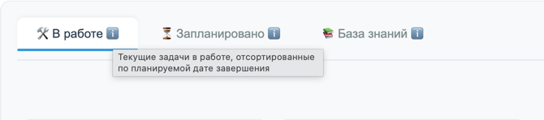
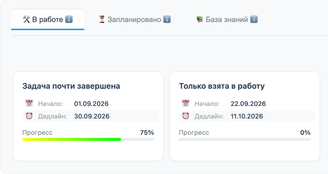
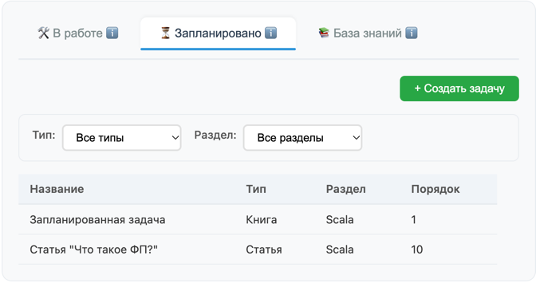
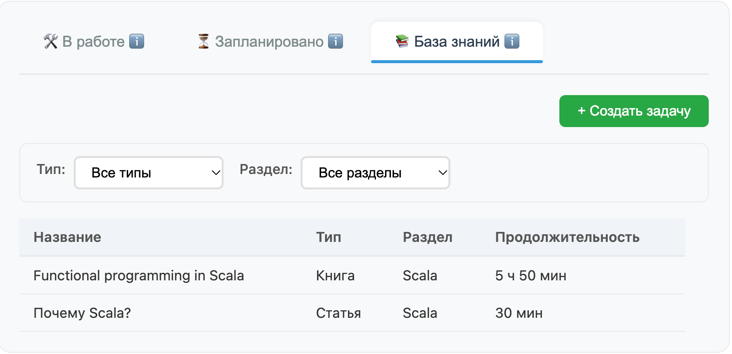

# Rendering the "Desktop" View

`views/Views.scala` — the object with all rendering methods of the application in the [repository](https://gitverse.ru/scalabook/pdp/content/master/pdp/src/main/scala/ru/scalabook/pdp/views/Views.scala).

This is the user's desktop where they land after authorization.
The `Views.welcome` method renders eight tabs (tasks in different statuses, goals, statistics,
sources, notes, history), control buttons (settings and logout), and also serves
as the "host" for all modal windows.

The main task of the method is to be a **single screen** for working with tasks: the user sees
their progress, can switch between tabs, filter tasks by type, section
and goal, create new tasks, open existing ones, and manage their statuses. All of this
happens without page reload thanks to htmx.

The `Views.welcome` method itself doesn't contain tab display logic — it only **composes**
already ready-made HTML fragments generated by separate renderer methods:

- `Views.welcomeInProgress` — "In Progress" tab;
- `Views.welcomePlanned` — "Planned" tab;
- `Views.welcomeKnowledgeBase` — "Knowledge Base" tab;
- `Views.goalsStats` — "Goals" tab;
- `Views.statistics` — "Statistics" tab;
- `Views.welcomeSources` — "Sources" tab;
- `Views.welcomeNotes` — "Notes" tab;
- `Views.history` — "History" tab.

## Imports and Parameters

```dotty
import ru.scalabook.pdp.views.Views
import jots.SignedJwt

def welcome(
    username: String,
    token: SignedJwt,
    tab: String,
    inProgress: Modifier,
    planned: Modifier,
    knowledgeBase: Modifier,
    goals: Modifier,
    statistics: Modifier,
    sources: Modifier,
    notes: Modifier,
    history: Modifier
): Frag
```

**Imports:**

- **`SignedJwt`** — JWT token type from the Jots library. Passed to `Views.welcome` so the render
  can save it to cookies and headers via a hidden iframe.
- **`Views`** — object with all rendering methods. Directly imported in handlers:
  `import ru.scalabook.pdp.views.Views`.

**Method parameters:**

| Parameter       | Type      | Purpose                                                                                    |
| --------------- | -------- | ------------------------------------------------------------------------------------------ |
| `username`      | `String` | Username for greeting. Displayed in the header: "Welcome, $username!"                       |
| `token`         | `SignedJwt` | JWT token. Used by the "Logout" button and cookie saving                                 |
| `tab`           | `String` | Current active tab: `"in-progress"`, `"planned"`, `"knowledge-base"`, `"goals"`, `"statistics"`, `"sources"`, `"notes"`, `"history"` |
| `inProgress`    | `Modifier` | Ready piece of "In Progress" tab (`Views.welcomeInProgress` method)                        |
| `planned`       | `Modifier` | Ready piece of "Planned" tab (`Views.welcomePlanned` method)                              |
| `knowledgeBase` | `Modifier` | Ready piece of "Knowledge Base" tab (`Views.welcomeKnowledgeBase` method)                  |
| `goals`         | `Modifier` | Ready piece of "Goals" tab (`Views.goalsStats` method)                                     |
| `statistics`    | `Modifier` | Ready piece of "Statistics" tab (`Views.statistics` method)                                |
| `sources`       | `Modifier` | Ready piece of "Sources" tab (`Views.welcomeSources` method)                               |
| `notes`         | `Modifier` | Ready piece of "Notes" tab (`Views.welcomeNotes` method)                                   |
| `history`       | `Modifier` | Ready piece of "History" tab (`Views.history` method)                                      |

**Why is each of the eight parameters a `Modifier` and not a data set?**

`Views.welcome` is a **composer**. It doesn't know about tasks, goals, or
statistics: it only arranges already ready scalatags fragments into tabs.
The return type `Frag` in handlers is converted to HTML string via `.render`.
This keeps the method trivial and pushes all logic for forming each tab
into separate renderer methods and `WelcomeViews`.

**Why aren't tab filters passed here?**

Lists of types, sections, and goals for filters are a **local** detail of the
"Planned" and "Knowledge Base" tabs. Each such list is prepared by `WelcomeViews`
only for the tab where it's needed, and passed to the corresponding renderer method.
`Views.welcome` doesn't know about filters.

## Markup Structure

The markup is organized around the `#app` container. This is a **key element** for htmx:
when the server returns a new page or fragment, htmx replaces the content of `#app`.

```dotty
frag(
  div(
    `id` := "app",
    cls  := "app-container",
    iframe(
      attr("onload") := s"""saveUserCookies('${token.show}')""",
      style          := "display:none;"
    ),
```

**Structure analysis:**

- **`#app`** — main container. The `app-container` class sets wide width
  (full page), as opposed to `app-container-narrow` which is used on
  login and registration pages.
- **`<iframe>`** — technical trick: a hidden iframe with `onload` that saves
  the token to `localStorage` and cookies on page load. The `style="display:none"`
  attribute hides it from the user.
- **`#welcomeBlock`** — block with greeting, buttons, and tabs.
- **`#modal-container`** — empty container into which htmx will load modal windows
  (task creation, planning, start, completion, etc.).

**Why is `#modal-container` placed outside?**

Modals are overlays that should cover the **entire** page, not just the
central part. If `#modal-container` were inside `#welcomeBlock`, modals would "fall off" when replacing
the content of `#app`. Placing it outside makes them independent
of the content of `#app`.

### Saving Token to Cookies

```dotty
iframe(
  attr("onload") := s"""saveUserCookies('${token.show}')""",
  style          := "display:none;"
)
```

**Why is this needed:**

When the user logs in, the server sets a `token` cookie via HTTP
`Set-Cookie` header. However, client-side JavaScript **cannot always** read this cookie if
it is marked as `HttpOnly`. Also, in some scenarios (e.g., when working
with htmx and HTML replacement) cookies might not update.

This iframe solves the problem: on page load `welcome` calls
`saveUserCookies('${token.show}')` which:

1. Saves the token to `localStorage` (accessible from JavaScript).
2. Duplicates the token into a regular cookie (non-`HttpOnly`), accessible from JS.

So JavaScript functions (e.g., `openTask`, `filterPlannedTasks`) can use the token
for requests.

## Top Bar

```dotty
div(
  cls := "welcome-header",
  div(cls := "welcome-user")(
    h2(s"Welcome, $username!")
  ),
  div(cls := "welcome-actions")(
    ...
  )
),
```

**Structure:**

- **`.welcome-user`** — block with greeting. Displays the username from `$username`.
- **`.welcome-actions`** — block with action buttons.

**"Settings" button:**

```dotty
button(
  `type`          := "button",
  attr("onclick") := "htmx.process(this); this.click();",
  attr("hx-get")  := "/settings",
  Htmx.appTarget,
  Htmx.appSwap,
  cls := "settings-btn"
)("\u2699\ufe0f Settings")
```

- **`hx-get="/settings"`** — GET request to the settings page.
- **`hx-target="#app"`** — replace the content of `#app` with the settings page.
- **`hx-swap="outerHTML"`** — replace the entire `#app` block, not just its content.
- **`onclick="htmx.process(this); this.click();"`** — important: after the HTML was inserted
  via `outerHTML`, htmx doesn't always automatically process new elements.
  `htmx.process(this)` "attaches" handlers to the element, and `this.click()` programmatically
  triggers the click — now htmx sends the request.

**"Logout" button:**

```dotty
button(
  `type`          := "button",
  attr("onclick") :=
    "clearUserCookies(); htmx.process(this); this.click();",
  attr("hx-post") := "/auth/logout",
  Htmx.appTarget,
  Htmx.appSwap,
  attr("hx-headers") :=
    s"""{"Authorization": "Bearer ${token.show}"}""",
  cls := "danger-btn"
)("Logout")
```

- **`onclick="clearUserCookies(); htmx.process(this); this.click();"`** — first we clear
  cookies (so even if the request doesn't go through, the user is logged out locally), then
  process and trigger the click.
- **`hx-post="/auth/logout"`** — POST request for logout.
- **`hx-headers='{"Authorization": "Bearer ${token.show}"}'`** — transmits the token in the header.
  This is important because after `clearUserCookies()` the token is no longer in the cookie, and on the server
  we need to validate it to remove it from the blocklist.

## Tabs

Tabs are a navigation mechanism between eight views of the desktop. Each
tab has its own display logic: "In Progress" shows cards with progress bars,
"Planned" and "Knowledge Base" — tables with filters, the rest — goals, statistics,
sources, notes and history.

In `Views.scala` tabs are built using private helpers `tabButton` and `tabContent`,
and the active tab class is computed by the `activeIf` function:

```dotty
val activeIf = (name: String) =>
  if tab == name then "active" else ""
```

```dotty
// Tab button: active tab class added via s"tab-btn $activeClass"
private def tabButton(activeClass: String, dataTab: String, text: String, title: String): Tag =
  button(
    cls              := s"tab-btn $activeClass",
    attr("data-tab") := dataTab,
    attr("onclick")  := s"switchTab('$dataTab')"
  )(text, span(attr("title") := title)("\u2139\ufe0f"))
```

Tab markup is assembled from eight `tabButton` and eight `tabContent` containers:

```dotty
div(
  cls := "tabs-container",
  div(cls := "tabs-header")(
    tabButton(
      activeIf("in-progress"),
      "in-progress",
      "\ud83d\udee0\ufe0f In Progress",
      "Current tasks in progress, sorted by planned completion date"
    ),
    tabButton(
      activeIf("planned"),
      "planned",
      "\u23f3 Planned",
      "Planned but not yet started tasks"
    ),
    tabButton(
      activeIf("knowledge-base"),
      "knowledge-base",
      "\ud83d\udcda Knowledge Base",
      "Study materials for which a detailed plan hasn't been formed yet"
    ),
    tabButton(
      activeIf("goals"),
      "goals",
      "\ud83c\udfaf Goals",
      "Goals statistics"
    ),
    tabButton(
      activeIf("statistics"),
      "statistics",
      "\ud83d\udcca Statistics",
      "Task statistics"
    ),
    tabButton(
      activeIf("sources"),
      "sources",
      "\ud83c\udf10 Sources",
      "Resources to replenish the Knowledge Base"
    ),
    tabButton(
      activeIf("notes"),
      "notes",
      "\ud83d\udcdd Notes",
      "Notes and records not tied to tasks"
    ),
    tabButton(
      activeIf("history"),
      "history",
      "\ud83d\udcdc History",
      "\ud83d\udcdc History of completed tasks"
    )
  ),
  tabContent(
    "tab-in-progress",
    activeIf("in-progress"),
    inProgress
  ),
  tabContent("tab-planned", activeIf("planned"), planned),
  tabContent(
    "tab-knowledge-base",
    activeIf("knowledge-base"),
    knowledgeBase
  ),
  tabContent("tab-goals", activeIf("goals"), goals),
  tabContent(
    "tab-statistics",
    activeIf("statistics"),
    statistics
  ),
  tabContent("tab-sources", activeIf("sources"), sources),
  tabContent("tab-notes", activeIf("notes"), notes),
  tabContent("tab-history", activeIf("history"), history)
)
```

**How tab switching works:**

1. **Each button** has a `data-tab` attribute with the tab name and `onclick="switchTab('...')"`.
2. **`switchTab` function** ([in pdp.js](https://gitverse.ru/scalabook/pdp/content/master/pdp/src/universal/assets/js/pdp.js),
   path `pdp/src/universal/assets/js/pdp.js`):
    - Removes the `active` class from all buttons and all `.tab-content` blocks.
    - Adds `active` to the clicked button and the corresponding block.
3. **On first load** the active tab is determined by the `tab` parameter:
   the class is computed by `activeIf(tab)` in Scala, and if the name matches, `"active"` is added.
4. **Tab content** is a ready HTML fragment plugged into the corresponding
   `#tab-...` container (for "In Progress" returns `Views.welcomeInProgress`, for
   "Planned" — `Views.welcomePlanned`, etc.). After replacing the content of `#app`
   (e.g., when creating a task), htmx updates only the fragments that changed on the server.

**Why is `<span title="...">\u2139\ufe0f</span>` needed?**

This is a hint icon. When hovering over it, the browser shows a popup explaining
what the tab means. For example, for "In Progress":
"Current tasks in progress, sorted by planned completion date."

This improves UX: a user visiting the page for the first time understands where things are.



## "In Progress" Tab



The `Views.welcomeInProgress` method takes
two parameters: `tasks` (regular tasks in progress, `TableInProgressTaskCard` cards)
and `periodicTasks` (periodic tasks for today, `TablePeriodicTaskCard` cards).
The host method `Views.welcome` plugs the result into the `#tab-in-progress` container.

```dotty
frag(
  div(cls := "tab-actions")(
    button(
      cls            := "add-btn",
      attr("hx-get") := "/task/create/in-progress",
      Htmx.modalTarget,
      Htmx.modalSwap,
      attr("onclick") := "openCreateTaskModal()"
    )("+ Create Task")
  ),
  if periodicTasks.nonEmpty then
    div(cls := "periodic-tasks-section")(
      h3(cls := "periodic-tasks-title")("\ud83d\udd04 Periodic Tasks"),
      div(cls := "tasks-grid")(
        periodicTasks.map(_.render)*
      )
    )
  else frag(),
  div(cls := "tasks-grid")(
    tasks.map(_.render)*
  )
)
```

**Tab specifics:**

- **Cards, not a table** — "In Progress" tasks are displayed as cards because
  they need progress bars and deadlines, not table metrics.
- **Periodic tasks** — if periodic tasks have been created for today (see
  [documentation on periodic tasks](../periodic.md)), they are displayed in a separate
  "\ud83d\udd04 Periodic Tasks" block above regular ones.
- **Click on card** — opens the task page in a new browser tab
  (`onclick="openTask('...')" `). The `openTask` function forms the URL `/task/{id}`
  and opens it in a new window.
- **"Create Task" button** — opens a modal window with the task creation form.
  Request goes to `/task/create/in-progress`, and the result is inserted into `#modal-container`.
- **No filters** — unlike "Planned" and "Knowledge Base", "In Progress" tasks
  are not filtered: there are usually not many of them, and context (progress and deadline) is more important.

**Card structure:**

```dotty
final case class TableInProgressTaskCard(
    id: TaskId,
    name: TaskName,
    startDate: Option[LocalDate],
    endDate: Option[LocalDate],
    progress: Double
):
  lazy val isOverdue: Boolean = endDate.exists(_.isBefore(LocalDate.now()))

  def render: Tag =
    div(
      attr("id") := id.toString,
      cls        := "task-card",
      onclick    := s"openTask('${id.value}')",
      div(cls := "task-title")(name.value),
      div(
        cls := "task-meta-grid",
        div(
          cls := "task-meta-item",
          span(cls := "meta-icon")("\ud83d\udcc5"),
          span(cls := "meta-label")("Start:"),
          span(cls := "meta-value")(startDate.render)
        ),
        div(
          cls := "task-meta-item" + (if isOverdue then " overdue" else ""),
          span(cls := "meta-icon")("\u23f0"),
          span(cls := "meta-label")("Deadline:"),
          span(cls := "meta-value")(endDate.render)
        )
      ),
      progressBar((progress * 100).toInt.toDouble)
    )
```

**Analysis:**

- **Task name** — card header.
- **Metadata** — start and deadline dates. Formatted via `DateTimeFormatter.ofPattern("dd.MM.yyyy")`.
  If no date (e.g., task not started) — displays `—`.
- **Progress bar** — progress visualization. `task.progress` is a number from 0.0 to 1.0,
  multiplied by 100 and rounded to integer. The width of `.progress-fill` is set via inline styles.

## "Planned" Tab



The `Views.welcomePlanned` method takes
four parameters: `tasks` (`TablePlannedTaskCard` cards), `taskTypes`, `sections`
and `goals` (filter lists). The host method plugs the result into the `#tab-planned` container.

The `filterGroup` helper forms a `<select>` with label and options:

```dotty
def welcomePlanned(
    tasks: Vector[TablePlannedTaskCard],
    taskTypes: Vector[String],
    sections: Vector[String],
    goals: Vector[String]
): Modifier =
  frag(
    div(cls := "tab-actions")(
      addTaskButton("/task/create/planned")
    ),
    div(cls := "filter-container")(
      filterGroup(
        "plannedTypeFilter",
        "Type:",
        taskTypes,
        "filterPlannedTasks()",
        "All types"
      ),
      filterGroup(
        "plannedSectionFilter",
        "Section:",
        sections,
        "filterPlannedTasks()",
        "All sections"
      ),
      filterGroup(
        "plannedGoalFilter",
        "Goal:",
        goals,
        "filterPlannedTasks()",
        "All goals"
      ),
      div(cls := "filter-group")(
        button(
          `type`          := "button",
          cls             := "reset-filter-btn",
          attr("onclick") := "resetPlannedFilters()"
        )("\ud83d\udd04 Reset Filters")
      ),
      div(cls := "filter-group filter-total")(
        span(cls := "filter-total-label")("Total:"),
        span(
          cls  := "filter-total-value",
          `id` := "plannedTotal"
        )(tasks.length)
      )
    ),
    div(cls := "tasks-table-container")(
      table(cls := "tasks-table", `id` := "plannedTasksTable")(
        thead(tr(th("Name"), th("Type"), th("Section"), th("Order"))),
        tbody(tasks.map(_.render)*)
      )
    )
  )
```

**Tab specifics:**

- **Table, not cards** — planned tasks are compared by type, section,
  goal, and order number, so a table is more convenient.
- **Three filters** — by type, section, and goal. Option lists (`taskTypes`, `sections`,
  `goals`) come from the service and contain **only the values that actually exist**
  in this tab. This is important: the user doesn't see useless options.
- **Client-side filtering** — JavaScript function `filterPlannedTasks()` hides rows
  that don't match the selected filters. This is fast (no server request needed)
  and convenient: the user can combine filters in real time.
- **"Reset Filters" button** — `resetPlannedFilters()` returns all three dropdowns
  to the "All" value.
- **"Total" counter** — the `#plannedTotal` element shows the number of rows visible at the
  moment and updates on each filter change.

**Rendering table rows:**

The table rows themselves are rendered by the `TablePlannedTaskCard` card via the
`Render` typeclass. The card contains already "enriched" data — type, section, and goal names instead of their IDs:

```dotty
final case class TablePlannedTaskCard(
    id: TaskId,
    name: TaskName,
    taskType: String,
    section: String,
    goal: String,
    ordinal: Ordinal
):
  def render: Tag =
    tr(
      cls                       := "task-row",
      attr("data-task-type")    := taskType,
      attr("data-task-section") := section,
      attr("data-task-goal")    := goal,
      onclick                   := s"openTask('${id.value}')",
      td(name.value),
      td(taskType),
      td(section),
      td(ordinal.value)
    )
```

**Key points:**

- **`data-task-type`, `data-task-section`, and `data-task-goal`** — attributes by which
  the JavaScript function `filterPlannedTasks()` understands whether to show or hide a row.
- **Click on row** — opens the task in a new tab. `onclick="openTask('...')"`.
- **"Order" column** — shows `task.ordinal` by which tasks are sorted.

## "Knowledge Base" Tab



The `Views.welcomeKnowledgeBase` method takes
four parameters: `tasks` (`TableKnowledgeBaseTaskCard` cards), `taskTypes`,
`sections` and `goals`. The host method plugs the result into the `#tab-knowledge-base` container.

```dotty
  def welcomeKnowledgeBase(
      tasks: Vector[TableKnowledgeBaseTaskCard],
      taskTypes: Vector[String],
      sections: Vector[String],
      goals: Vector[String]
  ): Modifier =
    frag(
      div(cls := "tab-actions")(
        addTaskButton("/task/create/knowledge-base")
      ),
      div(cls := "size-legend")(
        sizeLegendItem("size-small", "Small", "less than an hour"),
        sizeLegendItem("size-medium", "Medium", "less than 8 hours"),
        sizeLegendItem("size-large", "Large", "more than 8 hours")
      ),
      div(cls := "filter-container")(
        filterGroup(
          "knowledgeTypeFilter",
          "Type:",
          taskTypes,
          "filterKnowledgeTasks()",
          "All types"
        ),
        filterGroup(
          "knowledgeSectionFilter",
          "Section:",
          sections,
          "filterKnowledgeTasks()",
          "All sections"
        ),
        filterGroup(
          "knowledgeGoalFilter",
          "Goal:",
          goals,
          "filterKnowledgeTasks()",
          "All goals"
        ),
        div(cls := "filter-group")(
          button(
            `type`          := "button",
            cls             := "reset-filter-btn",
            attr("onclick") := "resetKnowledgeFilters()"
          )("\ud83d\udd04 Reset Filters")
        ),
        div(cls := "filter-group filter-total")(
          span(cls := "filter-total-label")("Total:"),
          span(cls := "filter-total-value", `id` := "knowledgeTotal")(
            tasks.length
          )
        )
      ),
      div(cls := "tasks-table-container")(
        table(cls := "tasks-table", `id` := "knowledgeTasksTable")(
          thead(
            tr(
              th("Name"),
              th("Type"),
              th("Section"),
              th("Duration")
            )
          ),
          tbody(tasks.map(_.render)*)
        )
      )
    )
```

**Differences from "Planned":**

- **Size legend** — at the top of the table there is a `.size-legend` block that explains
  the colored size badges (small / medium / large).
- **Last column** — "Duration" instead of "Order". For tasks in the knowledge base
  the effort estimation is important, since the task is not yet planned and all tasks have the same order.
- **Three filters** — `knowledgeTypeFilter`, `knowledgeSectionFilter`, and `knowledgeGoalFilter`.
- **`filterKnowledgeTasks()` and `resetKnowledgeFilters()` functions** — analogous to
  functions in the "Planned" tab, but work with a different table and counter.

**Rendering table rows:**

Rows are rendered by the `TableKnowledgeBaseTaskCard` card. Besides name, type, and section,
it displays duration as a badge with an icon reflecting the size category:

- `Small` (< 1 hour, \ud83c\udf31) — small task;
- `Medium` (< 8 hours, \ud83c\udf33) — medium task;
- `Large` (> 8 hours, \ud83c\udf32) — large task.

Each row carries `data-task-type`, `data-task-section`, and `data-task-goal`
attributes for client-side filtering and `onclick="openTask('...')"` for opening the task.

## Client-Side Filtering

Task filtering is **client-side** logic (implemented in `pdp.js`, without a server
request).

**Universal `filterTasks` function:**

```js
function filterTasks(tableId, typeFilterId, sectionFilterId, goalFilterId, totalId) {
    const typeFilter = document.getElementById(typeFilterId).value;
    const sectionFilter = document.getElementById(sectionFilterId).value;
    const goalFilter = document.getElementById(goalFilterId).value;

    const rows = document.querySelectorAll('#' + tableId + ' tbody tr');
    let visibleCount = 0;

    rows.forEach(function(row) {
        const taskType = row.getAttribute('data-task-type');
        const taskSection = row.getAttribute('data-task-section');
        const taskGoal = row.getAttribute('data-task-goal');

        const typeMatch = typeFilter === 'all' || taskType === typeFilter;
        const sectionMatch = sectionFilter === 'all' || taskSection === sectionFilter;
        const goalMatch = goalFilter === 'all' || taskGoal === goalFilter;

        if (typeMatch && sectionMatch && goalMatch) {
            row.style.display = '';
            visibleCount++;
        } else {
            row.style.display = 'none';
        }
    });

    const totalElement = document.getElementById(totalId);
    if (totalElement) {
        totalElement.textContent = visibleCount;
    }
}
```

**How it works:**

1. The function reads current values of three `<select>`s — type, section, and goal.
2. For each table row, it reads the `data-task-type`, `data-task-section`
   and `data-task-goal` attributes (set by the card during rendering).
3. A row is shown **only if it matches all three filters simultaneously**
   (AND logic). The value `"all"` means "filter is off".
4. The counter `#plannedTotal` / `#knowledgeTotal` updates in real time.

**Wrappers for each tab:**

```js
function filterPlannedTasks() {
    filterTasks('plannedTasksTable', 'plannedTypeFilter', 'plannedSectionFilter', 'plannedGoalFilter', 'plannedTotal');
}

function filterKnowledgeTasks() {
    filterTasks('knowledgeTasksTable', 'knowledgeTypeFilter', 'knowledgeSectionFilter', 'knowledgeGoalFilter', 'knowledgeTotal');
}

function resetPlannedFilters() {
    document.getElementById('plannedTypeFilter').value = 'all';
    document.getElementById('plannedSectionFilter').value = 'all';
    document.getElementById('plannedGoalFilter').value = 'all';
    filterPlannedTasks();
}

function resetKnowledgeFilters() {
    document.getElementById('knowledgeTypeFilter').value = 'all';
    document.getElementById('knowledgeSectionFilter').value = 'all';
    document.getElementById('knowledgeGoalFilter').value = 'all';
    filterKnowledgeTasks();
}
```

**Why is the filter stored on the client, not the server?**

The "Planned" and "Knowledge Base" tabs are fully rendered on the server (all rows
in the DOM). So they can be filtered instantly on the client — without additional requests.
The server only handles **preparing the list of available parameters**: `WelcomeViews`
collects from visible tasks the set of IDs and converts it to a sorted list
of names, passing it as the `goals` parameter of `Views.welcomePlanned` / `Views.welcomeKnowledgeBase`.

## Modal Container

```dotty
div(`id` := "modal-container")
```

Modal windows are separate HTML fragments loaded from the server on click
on "Create Task", "Take to Work", "Complete Task" buttons, etc. (These buttons will be covered in the "Task Page" section).
htmx inserts them into `#modal-container` via `hx-target="#modal-container"` and `hx-swap="innerHTML"`.

**Types of modal windows:**

| Modal Window  | Trigger                                              | Endpoint             |
| --------------- | --------------------------------------------------- | --------------------- |
| Task Creation   | "+ Create Task" button on any tab                    | `/task/create/{tab}`  |
| Planning        | "\ud83d\udccb Queue" button on task page             | `/task/{id}/queue`    |
| Start Work      | "\ud83d\ude80 Take to Work" button on task page      | `/task/{id}/start`    |
| Completion      | "\u2705 Complete Task" button on task page           | `/task/{id}/complete` |

## How It All Works Together

Let's consider a full scenario:

1. **User logs in** → server returns `Views.welcome` with eight tabs.
   "In Progress" is open by default.
2. **User clicks on "Planned" tab** → JavaScript `switchTab`
   changes the active class. **No server request** — all tabs are already rendered.
3. **User selects a goal filter** → `filterPlannedTasks()` instantly hides
   rows that don't match the selected goal (combining with type and section filters).
   The "Total" counter updates. **No server request** — all rows are already in the DOM.
4. **User clicks "+ Create Task"** → htmx sends GET to
   `/task/create/planned`. Server returns modal HTML. htmx inserts
   it into `#modal-container`.
5. **User fills the form and clicks "Create"** → htmx sends POST
   to `/tasks`. Server creates the task and returns the updated `Views.welcome`.
   htmx replaces the content of `#app` — user sees the new task in the table.
6. **User clicks on a task row** → JavaScript `openTask` opens
   a new browser tab with URL `/task/{id}`. A detailed task page is displayed there.
7. **User clicks "Logout"** → `clearUserCookies()` clears cookies, then htmx
   sends POST to `/auth/logout`. Server invalidates the token and returns the login form.
   htmx replaces `#app` — user sees the login form.

## Summary

The `Views.welcome` method is the user's **desktop** which:

1. **Displays eight views**: tasks in progress, planned, knowledge base,
   goals, statistics, sources, notes, and history.
2. **Allows filtering tasks** by type, section, and goal right on the client,
   with a reset button and live counter.
3. **Integrates with htmx** for loading modals and submitting forms without reload.
4. **Stores JWT token** in cookies and `localStorage` for subsequent requests.
5. **Provides quick access** to settings and logout via top bar buttons.

The renderer method is built to **minimize server requests**:
tab switching and filtering happen on the client, and the server is used only
for state-changing operations (creating, updating, deleting tasks).

---

**References:**

- [Source repository][repo]

[repo]: https://gitverse.ru/scalabook/pdp
