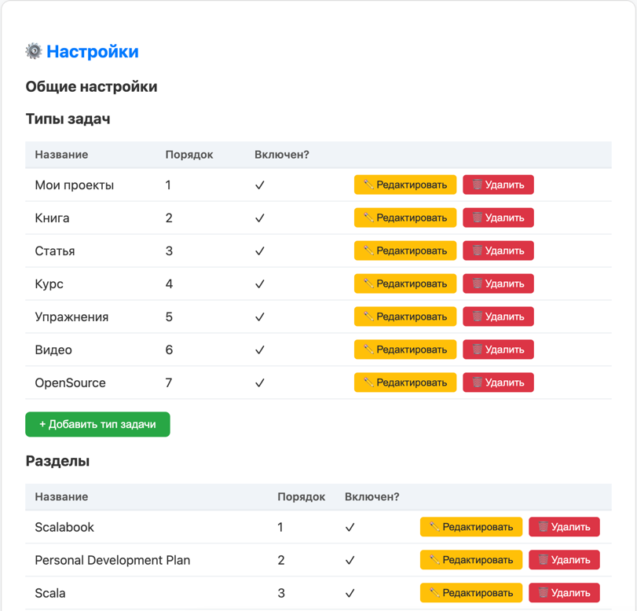
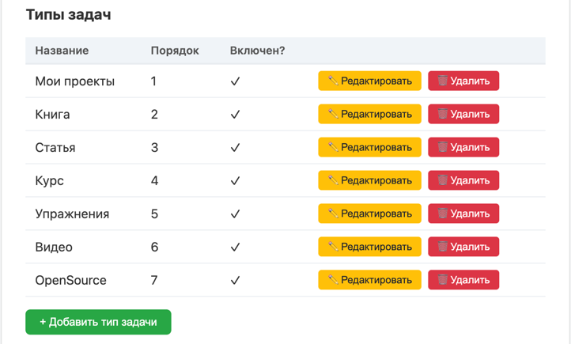
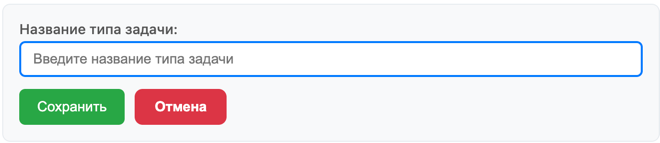
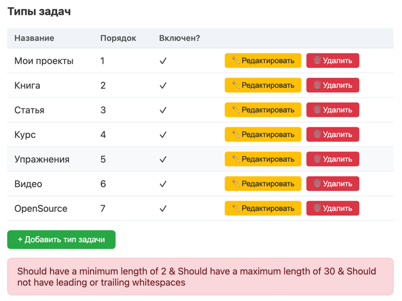
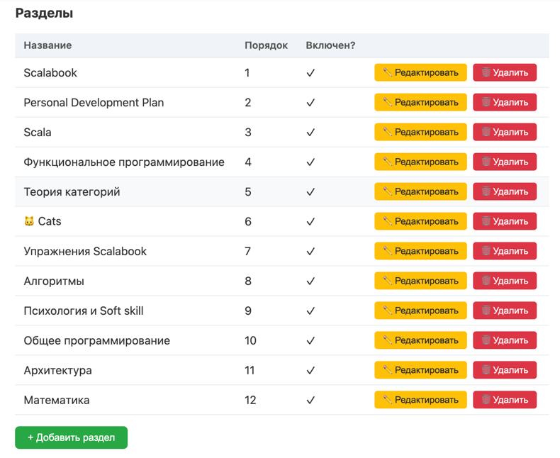

# Settings page

The Settings page is the control center for the application's reference data. 
Here, the user configures **task types**, **sections**, **goals**, and **periodic tasks** — the four reference tables
that are then used when creating and filtering tasks.

The Settings page follows a unified template for each of the four sections:

1. A **table** with a list of existing records.
2. A **form for adding** a new record (hidden by default).
3. An **error message** (if the previous operation failed).

Each table row supports three actions:

- **Editing** — opens the edit form directly in the row.
- **Deletion** — deletes the record with confirmation.
- **Indication** — shows the order and an "enabled" flag.



## Route

The route is declared privately inside `SettingsHandler`:

```dotty
private val route = Route(
  Request.get(Path.root / "settings").extractHeader[Authorization],
  Response.ok(Entity.html).orNotFound
)
```

**Route breakdown:**

- **`Request.get(Path.root / "settings")`** — GET request to `/settings`.
  This is a protected endpoint, available only to authorized users.
- **`.extractHeader[Authorization]`** — extracts the `Authorization` header, containing
  the JWT token in `Bearer <token>` format. Through this header, we identify
  who is requesting the settings.
- **`Response.ok(Entity.html).orNotFound`** — successful response (200 OK) with an HTML body.
  `.orNotFound` — a fallback (404), though in practice it rarely triggers,
  because errors are handled inside the handler.

## `SettingsHandler` handler

```dotty
final case class SettingsHandler(
    middleware: JwtAuthMiddleware[IO, UserInfo],
    settingsService: SettingsService[IO]
)(using Logger[IO]) extends AuthorizationHandler(middleware):
  private val route = Route(
    Request.get(Path.root / "settings").extractHeader[Authorization],
    Response.ok(Entity.html).orNotFound
  )

  val handler: Handler =
    route.handleIO: (authorization: Authorization) =>
      withUserFromHeader(authorization): (user, jwtToken) =>
        SettingsViews.getViewSettings(
          settingsService = settingsService,
          userId = user.id,
          jwtToken = jwtToken
        )
```

**Step-by-step breakdown:**

1. **Dependencies:**
    - `middleware: JwtAuthMiddleware[IO, UserInfo]` — middleware for token verification.
      Can convert a token string into a `UserInfo` object (id, username).
    - `settingsService: SettingsService[IO]` — service for working with reference data.
      Can load task types, sections, and goals for the user.
    - `using Logger[IO]` — a logger.

2. **`extends AuthorizationHandler(middleware)`** — inherits from the base class,
   which encapsulates token verification logic. This eliminates the need to
   manually extract the `Authorization` header and validate it.

3. **`withUserFromHeader(authorization): (user, token) => ...`** — a special method that
   takes two arguments: `authorization` (extracted by `handleIO` from the header) and
   a curried lambda `(user, token)`. The method:
    - Verifies the token via middleware.
    - If the token is valid, passes to the lambda `user` (user information)
      and `token` (the JWT token itself).
    - If invalid — automatically returns `AuthorizationException`,
      which is handled by `AuthorizationHandler`.

4. **`SettingsViews.getViewSettings(...)`** — a view helper function from `SettingsViews`
   formats the Settings HTML page, loading all the user's reference data.

## Forming the settings page

The reference data loading logic is placed in the `SettingsViews` object as two overloaded
`getViewSettings` functions. The first — simplified, without error messages. The second — full,
taking four optional messages (one for each reference table).

### Simplified version

```dotty
def getViewSettings(
    settingsService: SettingsService[IO],
    userId: UserId,
    jwtToken: SignedJwt
): IO[String] =
  getViewSettings(
    settingsService = settingsService,
    userId = userId,
    jwtToken = jwtToken,
    errorTaskTypeMessage = none,
    errorSectionMessage = none,
    errorGoalMessage = none,
    errorPeriodicStepMessage = none
  )
```

This version is used when the page opens "from scratch" (e.g., when clicking the "Settings" button). 
No errors are present, so all four messages are `none`.

### Full version

```dotty
def getViewSettings(
    settingsService: SettingsService[IO],
    userId: UserId,
    jwtToken: SignedJwt,
    errorTaskTypeMessage: Option[String],
    errorSectionMessage: Option[String],
    errorGoalMessage: Option[String],
    errorPeriodicStepMessage: Option[String]
): IO[String] =
  for
    taskTypes     <- settingsService.getTaskTypes(userId)
    sections      <- settingsService.getSections(userId)
    goals         <- settingsService.getGoals(userId)
    periodicSteps <- settingsService.getSteps(userId)
  yield
    val sortedSteps: Vector[PeriodicStep] =
      periodicSteps.sortBy(step => (step.periodicType.ordinal, step.number))

    Views.settings(
      token = jwtToken,
      taskTypes = taskTypes,
      sections = sections,
      goals = goals,
      periodicSteps = sortedSteps,
      errorTaskTypeMessage = errorTaskTypeMessage,
      errorSectionMessage = errorSectionMessage,
      errorGoalMessage = errorGoalMessage,
      errorPeriodicStepMessage = errorPeriodicStepMessage
    ).render
```

**What happens:**

1. **Load task types, sections, goals, and periodic steps for the user.**
   Steps are sorted by periodicity type and number (`step.periodicType.ordinal`, `step.number`).
2. **Render the `Views.settings(...)` view** — pass to the scalatags method:
    - `token` — the JWT token for htmx headers.
    - `taskTypes`, `sections`, `goals`, `periodicSteps` — the loaded reference data.
    - Four optional error messages.

**Why four separate error messages?**

Each reference table is an independent entity. 
The user can make a mistake when adding a task type (e.g., entering a blank name), 
but successfully add a section at the same time. 
Having four separate messages displays an error **directly under** the corresponding section.

## `Views.settings` view render

The scalatags method in `Views.scala`:

```dotty
def settings(
    token: SignedJwt,
    taskTypes: Vector[TaskType],
    sections: Vector[Section],
    goals: Vector[Goal],
    periodicSteps: Vector[PeriodicStep],
    errorTaskTypeMessage: Option[String],
    errorSectionMessage: Option[String],
    errorGoalMessage: Option[String],
    errorPeriodicStepMessage: Option[String]
): Frag
```

**Method parameters:**

| Parameter                 | Type               | Purpose                                |
| ------------------------ | ------------------ | -------------------------------------- |
| `token`                  | `SignedJwt`         | JWT token for htmx headers             |
| `taskTypes`              | `Vector[TaskType]` | User's task type list                |
| `sections`               | `Vector[Section]`  | User's section list                  |
| `goals`                  | `Vector[Goal]`     | User's goals list                  |
| `periodicSteps`          | `Vector[PeriodicStep]` | User's periodic steps list      |
| `errorTaskTypeMessage`   | `Option[String]`   | Error message for the task types section |
| `errorSectionMessage`    | `Option[String]`   | Error message for the sections section   |
| `errorGoalMessage`       | `Option[String]`   | Error message for the goals section      |
| `errorPeriodicStepMessage` | `Option[String]` | Error message for the periodic steps section |

### General structure

```dotty
frag(
  div(
    `id` := "app",
    cls  := "app-container",
    div(
      `id` := "welcomeBlock",
      cls  := "welcome-container",
      div(cls := "welcome-header")(
        div(cls := "welcome-user")(
          h2("⚙️ Settings"),
          ...
```

**Key points:**

- **`#app`** — the container that htmx replaces on navigation.
- **`#welcomeBlock`** — the block with the header and sections.

### "Task Types" section

Three reference tables (task types, sections, goals) are rendered by a single scalatags function `settingsTable(tableClass, rows, emptyMessage)`, which generates a `<table>` with `<thead>` and `<tbody hx-target="closest tr" hx-swap="outerHTML">`. Each row is built by a local function `row(...)`.

Here is an example of the `<thead>` column structure:

```dotty
def settingsTable(
    tableClass: String,
    rows: Vector[Tag],
    emptyMessage: String
): Tag =
  if rows.nonEmpty then
    div(cls := "settings-list")(
      table(cls := tableClass)(
        thead(tr(th("Name"), th("Order"), th("Enabled?"), th(""))),
        tbody(
          attr("hx-target") := "closest tr",
          attr("hx-swap")   := "outerHTML"
        )(rows*)
      )
    )
  else p(cls := "empty-message")(emptyMessage)
```

The `<tbody>` attributes — `hx-target="closest tr"`, `hx-swap="outerHTML"` — allow replacing only the `<tr>` (not the entire table) when deleting or editing a row.

**Table breakdown:**

Each row is generated by a scalatags helper `row(...)`. The `<tbody>` consists of `tr` for each element, with values substituted from the object card.

- **Sorting** — `taskTypes.sortBy(_.ordinal.value)` sorts records by order.
  The user sees them in the order they set themselves.
- **`data-task-type-id`** — an attribute with the record ID. Used for debugging and potential
  client-side filtering.
- **"Enabled?" column** — shows `✓` if `displayed = true`, and `✗` otherwise.
  This allows the user to see which records are active and which are hidden (e.g.,
  archived).
- **"Edit" button** — uses `hx-trigger="edit"` instead of `click`. This means
  the request is sent **only** when the JavaScript function `handleEditClick()`
  programmatically triggers the `edit` event. This approach allows implementing **simultaneous
  editing of only one row**: if the user tries to edit a second row, `handleEditClick`
  will show a warning and ask to close the current row first.
- **"Delete" button** — uses `hx-delete` and `hx-confirm`. On click the browser
  shows a confirmation dialog with the record name. If the user
  agrees — htmx sends a DELETE request.
- **`hx-target="#app"` for deletion** — after deletion, the server returns the updated
  settings page entirely, and htmx replaces `#app`.



**Add task type form:**

```dotty
CreateItemRequest.render(
  "addTaskTypeForm",
  "taskTypeForm",
  "task_types",
  token,
  "taskTypeName",
  "task type",
  "hideAddTaskTypeForm()"
),
button(
  cls             := "add-btn",
  attr("onclick") := "showAddTaskTypeForm()"
)(
  "+ Add task type"
),

object CreateItemRequest:
  def render(
      divId: String,
      formId: String,
      link: String,
      token: SignedJwt,
      nameId: String,
      entityLabel: String,
      onClick: String
  ): Tag =
    div(
      attr("id") := divId,
      cls        := "add-form",
      style      := "display: none;",
      form(
        attr("id")      := formId,
        attr("hx-post") := s"/settings/$link",
        Htmx.appTarget,
        Htmx.appSwap,
        Htmx.hiddenToken(token.show),
        div(
          cls := "form-group",
          label(`for` := nameId)(s"Name of $entityLabel:"),
          input(
            attr("id") := nameId,
            name       := "name",
            `type`     := "text",
            required,
            placeholder := s"Enter $entityLabel name"
          )
        ),
        div(
          cls := "form-actions",
          button(`type` := "submit", cls := "add-btn")("Save"),
          button(
            `type`  := "button",
            cls     := "danger-btn",
            onclick := onClick
          )("Cancel")
        )
      )
    )
```



**Key points:**

- **The form is hidden by default** (`style="display: none;"`). It is shown
  by the JavaScript function `showAddTaskTypeForm()` on clicking the "+ Add" button.
- **`hx-post="/settings/task_types"`** — a POST request to create a new task type.
- **`hx-target="#app"`** — after creation, the server returns the updated page,
  htmx replaces `#app`.
- **`<input type="hidden" name="token" value="{token.show}" />`** — the token is passed
  in the form body due to an [issue in the Krop framework](https://github.com/creativescala/krop/issues/55).
  The value is taken from the JWT token (`token: SignedJwt` parameter).
- **"Cancel" button** — calls `hideAddTaskTypeForm()`, which hides the form
  and clears its fields.

**Key points:**

- Each reference table has **its own** error message (`errorXxxMessage`),
  which is rendered under the corresponding section. This allows displaying the error
  **directly under** the corresponding section.
- If the corresponding message is `None` — the block is not displayed.



### "Sections" and "Goals" sections

The sections and goals sections are arranged similarly to the task types section. The differences
are only in:

- **Table name** — `sections-table` instead of `task-types-table`.
- **Row class** — `section-row` instead of `task-type-row`.
- **Attribute** — `data-section-id` instead of `data-task-type-id`.
- **URLs** — `/settings/sections` instead of `/settings/task_types`.
- **Error message** — `errorSectionMessage`.

This uniformity is a deliberate decision. Copying code for each reference table
is **better** than premature abstraction: if in the future it becomes necessary to
specialize the behavior of one of the reference tables, it can be done easily without breaking
the others.



### "Periodic Tasks" section

In `Views.settings`, there is a fourth section — periodic tasks. Unlike the three
reference tables above, a separate structure is used here:

- Periodic steps are grouped by periodicity type (`PeriodicType`).
- For each type, a `div.periodic-type-section` with an `h4.periodic-type-title` header is generated.
- Inside the table with class `periodic-steps-table`, the columns are: **"Number"**, **"Name"**.
- Each row is `tr.periodic-step-row[data-periodic-step-id="{id}"]`.
  The first column is the number (`step.number`), the second is the name with markdown content
  (`step.name`, rendered via `data-markdown`).
- Buttons: **✏️ Edit** (`hx-get="/settings/periodic_steps/{id}/edit"`, `hx-trigger="edit"`,
  `onclick="handleEditClick(this)"`) and **🗑️ Delete** (`hx-delete="/settings/periodic_steps/{id}"`,
  `hx-target="#app"`, `hx-swap="outerHTML"`, `hx-confirm="Are you sure you want to delete periodic task '...'?"`).

The section is formed in `Views.settings` via the `periodicSteps: Vector[PeriodicStep]` parameter.
The order is determined by sorting in `SettingsViews.getViewSettings`.

Details of working with periodic steps are covered [in the periodic tasks section](periodic.md).

## Workflow for the settings page

Consider a typical scenario:

1. **The user clicks "⚙️ Settings"** on the main page → htmx sends a
    GET to `/settings` with the `Authorization: Bearer <token>` header.
2. **`SettingsHandler`** checks the token and loads the user's reference data
    (task types, sections, goals, periodic steps).
3. **The server returns HTML** with reference tables. htmx replaces
    the content of `#app`.
4. **The user clicks "+ Add task type"** → JavaScript shows the hidden
    form. The form becomes visible.
5. **The user enters a name and clicks "Save"** → htmx sends a POST
    to `/settings/task_types` with the form body (including the token).
6. **The server validates the data**, creates the record, and returns the updated page
    for settings. htmx replaces `#app` — the user sees the new row in the table.
7. **If there was an error** (e.g., an empty name) — the server returns the same page,
    but with `errorTaskTypeMessage = Some("...")`. The user sees a red message
    under the table.

## Summary

We implemented the Settings page — a control center for four application reference tables:

1. **Task types** — classifying tasks by format (book, article, video).
2. **Sections** — thematic grouping of tasks (Programming, Psychology).
3. **Goals** — strategic targets to which tasks are bound.
4. **Periodic steps** — tasks that repeat on a schedule, grouped by periodicity type.

---

**Links:**

- [Repository with source code][repo]

[repo]: https://gitverse.ru/scalabook/pdp
