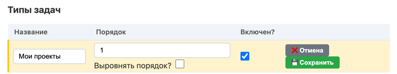
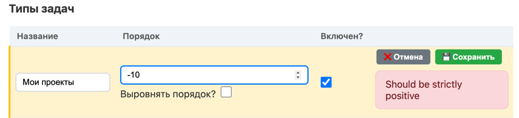

# Setting Task Types, Sections, and Goals

After implementing the settings page, we need to add functionality for managing
reference data: **creation**, **editing**, **deletion**, and **display** of task types,
sections, goals, and periodic tasks. Each of these entities follows the same pattern, so we'll cover
task types in detail and only note the differences for sections and goals.

## Common CRUD Pattern

For each entity, we implement **one handler class** (with several `val` handlers).
Renderer methods for table rows are in `Views` (the `getTaskTypeRow` method),
and the editable row is rendered via `EditItemRequest.render`:

All operations of one entity are collected in **one class** `TaskTypeHandlers`. Each operation is a
separate public `val` handler, declaratively bound to its private route.

This separation is a consequence of using htmx: each action requires a **specific
HTML fragment** in the response. We can't "just update a row" — the server must return
ready markup that htmx will insert into the DOM.

## Creating a Task Type

### `TaskTypeHandlers` — Class

All operations (creation, deletion, editing, row display) are collected in one class
`TaskTypeHandlers`. The common path with typed parameter `taskTypeIdParam` is extracted into `path`,
and five operations are declaratively bound to their private routes:

```dotty
final case class TaskTypeHandlers(
    middleware: JwtAuthMiddleware[IO, UserInfo],
    settingsService: SettingsService[IO]
)(using Logger[IO]) extends AuthorizationHandler(middleware):
  private val path = Path.root / "settings" / "task_types" / taskTypeIdParam
  private val createRoute = Route(
    Request.post(Path.root / "settings" / "task_types")
      .withEntity(Entity.formOf[CreateItemRequest]),
    Response.ok(Entity.html).orNotFound
  )
  private val editRoute = Route(
    Request.put(path).withEntity(Entity.formOf[EditItemRequest]),
    Response.ok(Entity.html).orNotFound
  )
  private val editRowRoute = Route(
    Request.get(path / "edit").extractHeader[Authorization],
    Response.ok(Entity.html).orNotFound
  )
  private val getRowRoute = Route(
    Request.get(path).extractHeader[Authorization],
    Response.ok(Entity.html).orNotFound
  )
  private val deleteRoute = Route(
    Request.delete(path).extractHeader[Authorization],
    Response.ok(Entity.html).orNotFound
  )

  val createHandler: Handler = ...
  val editHandler: Handler = ...
  val editRowHandler: Handler = ...
  val getRowHandler: Handler = ...
  val deleteHandler: Handler = ...
end TaskTypeHandlers
```

`taskTypeIdParam` is a typed path parameter (`Param[TaskTypeId]`), so the handler
receives the record ID already as `TaskTypeId`, not `Int`, and manual call to `TaskTypeId.either` is not needed.

### `createHandler` — Creation

```dotty
val createHandler: Handler =
  createRoute.handleIO: (request: CreateItemRequest) =>
    val create: ((UserInfo, SignedJwt)) => IO[String] =
      (user, jwtToken) =>
        TaskTypeName.either(request.name) match
          case Right(name) =>
            val newItem = CreateTaskType(name, user.id)
            settingsService
              .createTaskType(newItem)
              .flatMap: _ =>
                getViewSettings(
                  settingsService = settingsService,
                  userId = user.id,
                  jwtToken = jwtToken
                )
              .recoverWith:
                case ex: IllegalArgumentException =>
                  getViewSettings(
                    settingsService = settingsService,
                    userId = user.id,
                    jwtToken = jwtToken,
                    errorTaskTypeMessage = ex.getMessage.some,
                    errorSectionMessage = none,
                    errorGoalMessage = none,
                    errorPeriodicStepMessage = none
                  )
          case Left(error) =>
            getViewSettings(
              settingsService = settingsService,
              userId = user.id,
              jwtToken = jwtToken,
              errorTaskTypeMessage = error.some,
              errorSectionMessage = none,
              errorGoalMessage = none,
              errorPeriodicStepMessage = none
            )

    // ToDo: https://github.com/creativescala/krop/pull/57
    val authorization: Authorization =
      Authorization(Token(AuthScheme.Bearer, request.token))
    withUserFromHeader(authorization)(create)
```

**Step-by-step analysis:**

1. **`createRoute.handleIO: (request: CreateItemRequest) => ...`** — register handler
   for `createRoute`, accepting `CreateItemRequest` (contains `name` and `token`).
   ```dotty
   final case class CreateItemRequest(token: String, name: String) derives FormCodec
   ```
2. **`val create: ((UserInfo, SignedJwt)) => IO[String] = ...`** — define a lambda
   that takes a `(user, jwtToken)` pair.
3. **`TaskTypeName.either(request.name)`** — name validation. Returns
   `Either[String, TaskTypeName]`:
    - **`Right(name)`** — name is valid (2–200 characters, no extreme spaces).
    - **`Left(error)`** — name is invalid, contains error message.
4. **On successful validation:**
    - Create `CreateTaskType(name, user.id)`.
    - Call `settingsService.createTaskType(newItem)`.
    - On success, load the updated settings page via `getViewSettings`.
    - On error (e.g., duplicate name) — catch `IllegalArgumentException`
      and load the page with an error message.
5. **On validation error** — immediately load settings page with error message.
6. **`withUserFromHeader(authorization)(create)`** — the token comes in the request body, not in the header.
   So we manually build the `Authorization` header from `request.token`:
   ```dotty
   val authorization: Authorization =
     Authorization(Token(AuthScheme.Bearer, request.token))
   ```
   Then `withUserFromHeader` validates it through middleware and passes
   `(user, jwtToken)` to the `create` lambda.

    > Note: this is a temporary solution (see `// ToDo` — waiting for token in form
    > support in krop, https://github.com/creativescala/krop/pull/57).

### Route

```dotty
private val createRoute = Route(
  Request.post(Path.root / "settings" / "task_types")
    .withEntity(Entity.formOf[CreateItemRequest]),
  Response.ok(Entity.html).orNotFound
)
```

- POST request to `/settings/task_types`.
- Body is a form (`application/x-www-form-urlencoded`), deserialized into `CreateItemRequest`.
- Response: 200 OK with HTML (reloaded settings page) or 404 Not Found for unexpected errors.

## Deleting a Task Type

### `deleteHandler` Handler

```dotty
val deleteHandler: Handler =
  deleteRoute.handleIO:
    (taskTypeId: TaskTypeId, authorization: Authorization) =>
      withUserFromHeader(
        authorization
      ): (user: UserInfo, jwtToken: SignedJwt) =>
        for
          _    <- settingsService.deleteTaskType(taskTypeId, user.id)
          view <- getViewSettings(
            settingsService = settingsService,
            userId = user.id,
            jwtToken = jwtToken
          )
        yield view
```

**Step-by-step analysis:**

1. **`(taskTypeId: TaskTypeId, authorization: Authorization)`** — handler accepts
   a typed record ID (from path via `taskTypeIdParam`) and `Authorization` header.
2. **`withUserFromHeader(authorization)(...)`** — standard token check through
   `AuthorizationHandler`. Unlike creation, the token comes **in the header** here:
   `authorization` is the first argument, and the lambda `(user, jwtToken)` is the second.
3. **`settingsService.deleteTaskType(taskTypeId, user.id)`** — deleting the record. The typed
   `TaskTypeId` guarantees ID validity at the type level, so no `Right`/`Left` branches are needed.
4. **`getViewSettings(...)`** — loading the updated settings page.

    > The syntax `withUserFromHeader(authorization): (user, jwtToken) => ...` is a
    > curried call: `authorization`/`token` as the first argument, the lambda
    > processing `(user, jwtToken)` as the second. The `:` introduces the lambda type/body.

### Route

```dotty
private val deleteRoute = Route(
  Request.delete(path).extractHeader[Authorization],
  Response.ok(Entity.html).orNotFound
)
```

where `path = Path.root / "settings" / "task_types" / taskTypeIdParam`.

- DELETE request to `/settings/task_types/{id}`.
- ID is extracted from the path via typed parameter `taskTypeIdParam`.
- Token is extracted from the `Authorization` header.

## Displaying Row for Editing

### `editRowHandler` Handler

```dotty
val editRowHandler: Handler =
  editRowRoute.handleIO:
    (taskTypeId: TaskTypeId, authorization: Authorization) =>
      withUserFromHeader(
        authorization
      ): (user: UserInfo, jwtToken: SignedJwt) =>
          getTaskType(taskTypeId, user.id).map: taskType =>
            EditItemRequest.render(taskType, jwtToken, none).render
```

**Step-by-step analysis:**

1. **`taskTypeId: TaskTypeId`** — ID comes typed from the path via `taskTypeIdParam`.
2. **`getTaskType(taskTypeId, user.id)`** — private helper method that finds the desired task type:
   ```dotty
   private def getTaskType(id: TaskTypeId, userId: UserId): IO[TaskType] =
     for
       maybeTaskType <- settingsService.getTaskType(id, userId)
       taskType      <- IO.fromOption(maybeTaskType)(
         new IllegalArgumentException("Task not found")
       )
     yield taskType
   ```
3. **`EditItemRequest.render(...)`** — render scalatags card `EditItemRequest`
   (returns `Tag`), then `.render` converts it to an HTML string
   (without error).

### Route

```dotty
private val editRowRoute = Route(
  Request.get(path / "edit").extractHeader[Authorization],
  Response.ok(Entity.html).orNotFound
)
```

where `path = Path.root / "settings" / "task_types" / taskTypeIdParam`.

- GET request to `/settings/task_types/{id}/edit`.
- Returns an HTML string of the table in edit mode.



## Rendering Editable Row

The editable row is rendered via scalatags method `EditItemRequest.render`:

```dotty
object EditItemRequest:
  def render(
      item: TaskType,
      token: SignedJwt,
      maybeError: Option[String]
  ): Tag =
    renderItem(
      row = "task-type-row",
      name = item.name.value,
      displayed = item.displayed,
      ordinal = item.ordinal,
      token = token,
      path = s"/settings/task_types/${item.id.value}",
      maybeError = maybeError
    )

  def render(
      item: Section,
      token: SignedJwt,
      maybeError: Option[String]
  ): Tag =
    renderItem(
      row = "section-row",
      name = item.name.value,
      displayed = item.displayed,
      ordinal = item.ordinal,
      token = token,
      path = s"/settings/sections/${item.id.value}",
      maybeError = maybeError
    )

  def render(
      item: Goal,
      token: SignedJwt,
      maybeError: Option[String]
  ): Tag =
    renderItem(
      row = "goal-row",
      name = item.name.value,
      displayed = item.displayed,
      ordinal = item.ordinal,
      token = token,
      path = s"/settings/goals/${item.id.value}",
      maybeError = maybeError
    )

  private def renderItem(
      row: String,
      name: String,
      displayed: Boolean,
      ordinal: Ordinal,
      token: SignedJwt,
      path: String,
      maybeError: Option[String]
  ): Tag =
    tr(
      cls                := s"$row editing",
      attr("hx-trigger") := "cancel",
      attr("hx-get")     := path,
      td(
        input(
          cls          := "edit-input",
          attr("name") := "name",
          value        := name,
          autofocus
        )
      ),
      td(
        input(
          cls          := "edit-input",
          attr("name") := "ordinal",
          `type`       := "number",
          value        := ordinal.value.toString,
          min          := "0"
        ),
        "Rearrange order?",
        input(
          cls          := "edit-checkbox",
          attr("name") := "ordinalShift",
          `type`       := "checkbox"
        )
      ),
      td(
        input(
          cls          := "edit-checkbox",
          attr("name") := "displayed",
          `type`       := "checkbox",
          if displayed then List[Modifier](checked) else List.empty[Modifier]
        )
      ),
      td(
        Htmx.hiddenToken(token.show),
        button(cls := "cancel-btn", attr("hx-get") := path)("\u274c Cancel"),
        button(
          cls                := "save-btn",
          attr("hx-put")     := path,
          attr("hx-include") := "closest tr"
        )("\ud83d\udcbe Save"),
        maybeError.map(msg => div(cls := "error")(msg)).getOrElse(frag())
      )
    )
  end renderItem

end EditItemRequest
```

The method generates `<tr class="task-type-row editing" hx-trigger="cancel" hx-get="{path}">`:

- First `<td>`: `<input.edit-input>` with `name="name"`, `autofocus`, `value="{name}"`.
- Second `<td>`: `<input.edit-input>` with `name="ordinal"`, `type="number"`, `min="0"`,
  plus text "Rearrange order?" and `<input.edit-checkbox>` with `name="ordinalShift"`.
- Third `<td>`: `<input.edit-checkbox>` with `name="displayed"`, `type="checkbox"` — `checked` if `displayed`.
- Fourth `<td>`:
  - `<input type="hidden" name="token" value="{token.show}"/>` — token for PUT request,
    generated via `Htmx.hiddenToken(token.show)`.
  - "Cancel" button — `hx-get="{path}"`.
  - "Save" button — `hx-put="{path}"`, `hx-include="closest tr"`.
  - Error: `maybeError.map(msg => div.err(msg))`.

**Key features:**

1. **`class="task-type-row editing"`** — additional `editing` class is used
   for implementing "only one row can be edited simultaneously". The
   `handleEditClick` function searches for `.editing` and offers to close the previous row.

2. **`hx-trigger="cancel"`** — the row reacts to the `cancel` event. When the user
   opens another row, `handleEditClick` sends a `cancel` event to the current one,
   which triggers a GET request to `/settings/task_types/{id}` (get the regular row).

3. **`autofocus`** on the `name` field — the cursor automatically moves to the edit field.

4. **`hx-include="closest tr"`** — when submitting the PUT request, it includes **all fields
     from the nearest row (`tr`). This eliminates the need to manually collect
     data from fields. Included: `name`, `ordinal`, `ordinalShift`, `displayed`, `token`.

5. **`<input type="hidden" name="token">`** — token is passed in the PUT request body.
     Generated via `Htmx.hiddenToken(token.show)`.

6. **"Cancel" button** — GET request to `/settings/task_types/{id}`, which returns the regular row.

7. **"Save" button** — PUT request with data from the row.

8. **Error message** — if `maybeError` is not `None`, it's displayed in a red block.



## Saving Changes

### `editHandler` Handler

This is the most complex of all handlers — it supports **reordering** of records.

```dotty
val editHandler: Handler =
  editRoute.handleIO: (taskTypeId: TaskTypeId, request: EditItemRequest) =>
    val edit: ((UserInfo, SignedJwt)) => IO[String] =
      (user, jwtToken) =>
        val rearrange = request.ordinalShift.contains("on")
        (
          TaskTypeName.either(request.name).toValidatedNec,
          Ordinal.either(request.ordinal).toValidatedNec
        ).mapN { case (name, ordinal) =>
          val updated =
            TaskType(
              id = taskTypeId,
              name = name,
              userId = user.id,
              displayed = request.displayed.contains("on"),
              ordinal = ordinal
            )

          val run =
            if rearrange then
              for
                items <- settingsService.getTaskTypes(user.id)
                _     <- settingsService.updateTaskType(updated)
                (beforeUpdated, afterUpdated) =
                  items
                    .filterNot(_.id == updated.id)
                    .partition(_.ordinal < updated.ordinal)
                ids = NonEmptyVector.one(updated.id)
                  .prependVector(
                    beforeUpdated.sortBy(_.ordinal).map(_.id)
                  )
                  .appendVector(afterUpdated.sortBy(_.ordinal).map(_.id))
                _ <- settingsService.reorderTaskTypes(ids, user.id)
              yield ()
            else
              settingsService.updateTaskType(updated).void

          run.map: _ =>
            Views.getTaskTypeRow(
              updated
            )
          .recoverWith:
            case ex: IllegalArgumentException =>
              editError(
                id = taskTypeId,
                userId = user.id,
                jwtToken = jwtToken,
                error = ex.getMessage
              )
        }.valueOr(error =>
          editError(
            id = taskTypeId,
            userId = user.id,
            jwtToken = jwtToken,
            error = error.mkString_(";")
          )
        )
    // ToDo: https://github.com/creativescala/krop/pull/57
    val authorization: Authorization =
      Authorization(Token(AuthScheme.Bearer, request.token))
    withUserFromHeader(authorization)(edit)
```

**Step-by-step analysis:**

1. **`(taskTypeId: TaskTypeId, request: EditItemRequest)`** — handler accepts
   typed ID from the path and form body with new data.
   ```dotty
   final case class EditItemRequest(
      token: String,
      name: String,
      ordinal: Int,
      ordinalShift: Option[String],
      displayed: Option[String]
   ) derives FormCodec
   ```

2. **`val rearrange = request.ordinalShift.contains("on")`** — check if
   the "Rearrange order?" checkbox is set. If yes — after updating the record,
   re-indexing of order numbers for other records is performed.

3. **Validation via `ValidatedNec`:**
    - `TaskTypeName.either(request.name)` — name validation.
    - `Ordinal.either(request.ordinal)` — order number validation.

   The identifier is already typed (`TaskTypeId`), so no validation is needed.
   `.mapN { ... }` combines results: if **all** are valid — the lambda is executed;
   if there are errors — they are accumulated in `ValidatedNec` and handled via
   `.valueOr`.

4. **Creating updated `TaskType`:**
    - `id = taskTypeId` — typed ID from the path.
    - `displayed = request.displayed.contains("on")` — checkbox checked → `true`.
    - `ordinal = ordinal` — new order value.

5. **Two execution scenarios:**
    - **With reordering:**
        - Load all user types.
        - Update the current type.
        - Split remaining types into two groups: those that go **before** the new order number,
          and those that go **after**.
        - Form new order: `[before] + [updated] + [after]`.
        - Call `reorderTaskTypes` to save the new order.
    - **Without reordering:** just `updateTaskType(updated)`.

6. **Success:** return updated row via `Views.getTaskTypeRow`.

7. **Business logic error:** catch `IllegalArgumentException` and call
   `editError`, which renders the row in edit mode with a message.

8. **`editError`** — private helper method that:
    - Loads the original `TaskType` (by ID) via `getTaskType`.
    - Renders `EditItemRequest.render(taskType, jwtToken, error)` with the message.

**Why is `ordinalShift` needed?**

Imagine a user has records with order numbers `1, 2, 3, 4`.
The user wants to change the number of record `4` to `2`.
If we just update it, we'll get `1, 2, 2, 3` — two records with the same number.
As a result, we'd have to update the order by +1 for two records.
To avoid this, reordering is enabled: the system recalculates numbers so they
remain unique (`1, 2, 3, 4` with the updated record in a new position).

### Route

```dotty
private val editRoute = Route(
  Request.put(path).withEntity(Entity.formOf[EditItemRequest]),
  Response.ok(Entity.html).orNotFound
)
```

where `path = Path.root / "settings" / "task_types" / taskTypeIdParam`.

- PUT request to `/settings/task_types/{id}`.
- Body is a form with new data.
- Returns the updated table row.

## Displaying the Regular Row

### `getRowHandler` Handler

```dotty
val getRowHandler: Handler =
  getRowRoute.handleIO:
    (taskTypeId: TaskTypeId, authorization: Authorization) =>
      withUserFromHeader(
        authorization
      ): (user: UserInfo, jwtToken: SignedJwt) =>
        getTaskType(taskTypeId, user.id).map: taskType =>
          Views.getTaskTypeRow(
            taskType
          )
```

**Purpose:** returns the table row in regular (non-editable) mode.
Used when:

- User clicked "Cancel" in edit mode.
- User cancelled editing via `cancel` event.
- After saving.

### Route

```dotty
private val getRowRoute = Route(
  Request.get(path).extractHeader[Authorization],
  Response.ok(Entity.html).orNotFound
)
```

where `path = Path.root / "settings" / "task_types" / taskTypeIdParam`.

## Rendering the Regular Row

The regular row is rendered via scalatags method `getTaskTypeRow` in `Views`:

```dotty
def getTaskTypeRow(taskType: TaskType): String =
  rowWithRefresh(
    rowClass = "task-type-row",
    dataAttr = "data-task-type-id",
    dataValue = taskType.id.value.toString,
    name = taskType.name.value,
    ordinal = taskType.ordinal.value,
    displayed = taskType.displayed,
    editPath = s"/settings/task_types/${taskType.id.value}/edit",
    deletePath = s"/settings/task_types/${taskType.id.value}",
    confirm =
      s"""Are you sure you want to delete task type "${taskType.name.value}"?"""
  ).render
  
private def rowWithRefresh(
    rowClass: String,
    dataAttr: String,
    dataValue: String,
    name: String,
    ordinal: Int,
    displayed: Boolean,
    editPath: String,
    deletePath: String,
    confirm: String
): Tag =
  tr(cls := rowClass, attr(dataAttr) := dataValue)(
    td(
      button(
        cls             := "refresh-btn",
        attr("onclick") := "htmx.process(this); this.click();",
        attr("hx-get")  := "/settings",
        Htmx.appTarget,
        Htmx.appSwap
      )("\ud83d\udd04 Refresh"),
      name
    ),
    td(ordinal),
    td(if displayed then "\u2713" else "\u2717"),
    td(
      button(
        cls                := "edit-btn",
        attr("hx-get")     := editPath,
        attr("hx-trigger") := "edit",
        attr("onclick")    := "handleEditClick(this)"
      )("\u270f\ufe0f Edit"),
      button(
        cls               := "delete-btn",
        attr("hx-delete") := deletePath,
        Htmx.appTarget,
        Htmx.appSwap,
        attr("hx-confirm") := confirm
      )("\ud83d\uddd1\ufe0f Delete")
    )
  )
```

The method generates `<tr class="task-type-row" data-task-type-id="{id}">`:

- First `<td>`: "Refresh" button (`hx-get="/settings"`, `hx-target="#app"`,
  `hx-swap="outerHTML"`, `onclick="htmx.process(this); this.click();"`)
  and `name` value (displayed as plain text).
- Second `<td>`: `ordinal` value (plain text).
- Third `<td>`: `\u2713` or `\u2717` depending on `displayed`.
- Fourth `<td>`:
  - "Edit" button — `hx-get="/settings/task_types/{id}/edit"`,
    `hx-trigger="edit"`, `onclick="handleEditClick(this)"`.
  - "Delete" button — `hx-delete="/settings/task_types/{id}"`,
    `hx-target="#app"`, `hx-swap="outerHTML"`, `hx-confirm="Are you sure you want to delete task type "{name}"?"`.

**Specifics:**

- **`data-task-type-id`** — attribute with ID for debugging.
- **"Refresh" button** — reloads the entire settings page.
  The button is necessary because after editing only the edited row is updated,
  though the order in other rows might have changed — to display this, the full page needs to be reloaded via the button.
- **"Edit" button** — `hx-trigger="edit"` — the request is sent **only**
  when the `handleEditClick` function programmatically triggers the `edit` event. This allows
  closing previously opened edit rows.
- **"Delete" button** — standard confirmation and deletion.

## Sections and Goals

Handlers and templates for sections and goals are **absolutely identical**. Differences are only in:

| Aspect              | Task Types         | Sections            | Goals              |
| ------------------- | ------------------ | ------------------- | ------------------ |
| ID Type             | `TaskTypeId`       | `SectionId`         | `GoalId`           |
| Name Type           | `TaskTypeName`     | `SectionName`       | `GoalName`         |
| URL prefix          | `/settings/task_types` | `/settings/sections` | `/settings/goals` |
| Regular row         | `getTaskTypeRow`   | `getSectionRow`     | `getGoalRow`       |
| Editable row        | `EditItemRequest.render` | `EditItemRequest.render` | `EditItemRequest.render` |
| Error message       | `errorTaskTypeMessage` | `errorSectionMessage` | `errorGoalMessage` |

This duplication is an conscious decision. It allows us to **specialize** the behavior of one
entity in the future (e.g., add a "deadline" field to goals),
without affecting the rest.

## Settings Workflow

Let's consider a typical editing scenario:

1. **User clicks "\u270f\ufe0f Edit"** → JavaScript function `handleEditClick`:
    - Checks if there's already an editing row (`.editing`).
    - If yes — offers to close it.
    - Sends the `edit` event on the current button.
2. **htmx sends GET** to `/settings/task_types/{id}/edit`.
3. **Server returns HTML** with input fields. htmx replaces `<tr>` with the editable row.
4. **User changes fields and clicks "\ud83d\udcbe Save"** → htmx sends PUT
   to `/settings/task_types/{id}` with data from the row (`hx-include="closest tr"`).
5. **Server validates data and updates the record** → returns the regular row
   (or the row with an error if validation failed).
6. **htmx replaces `<tr>`** with the new version.

## Summary

We implemented full CRUD for four reference datasets, collecting all operations of each entity
in a single `TaskTypeHandlers` class:

1. **Creation** (`TaskTypeHandlers.createHandler`) — adds a new record and reloads
   the settings page.
2. **Deletion** (`TaskTypeHandlers.deleteHandler`) — deletes the record and reloads the page.
3. **Editing** (`TaskTypeHandlers.editRowHandler` + `TaskTypeHandlers.editHandler`) —
   opens the edit form directly in the table row and saves changes.
4. **Cancellation** (`TaskTypeHandlers.getRowHandler`) — returns the row to normal view.

**Key architectural decisions:**

- **`ValidatedNec` for validation** — accumulates all errors, not stopping at the first.
- **"Rearrange order" option** — allows reordering records while preserving
  uniqueness of order numbers.
- **Uniformity for four reference datasets** — simplifies maintenance and code understanding.
- **Unified rendering approach** — regular rows use scalatags `Views` methods,
  while editable ones use `EditItemRequest.render`, which works for all entities.

After implementing this functionality, the user can fully manage
their reference data through the UI: create task types, sections, goals, and periodic steps,
edit their names, order, and displayed status, as well as delete unnecessary records.
All of this — without a single page reload.

---

**References:**

- [Source repository][repo]

[repo]: https://gitverse.ru/scalabook/pdp
