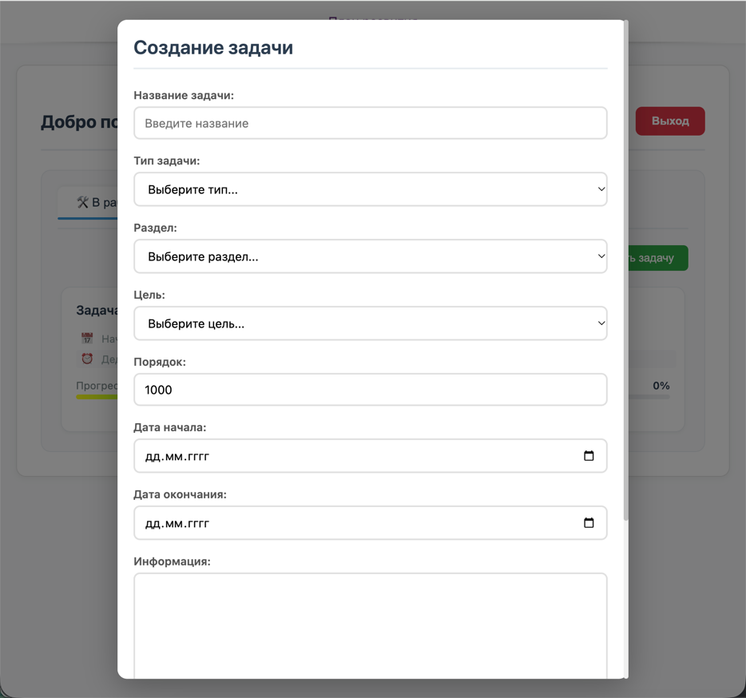
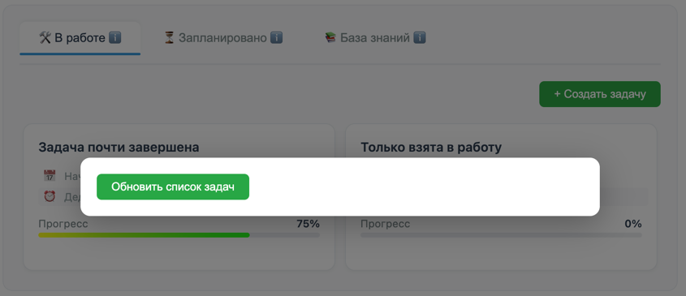
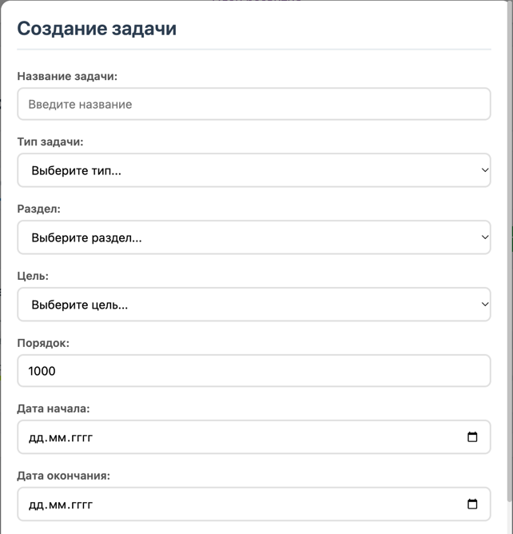
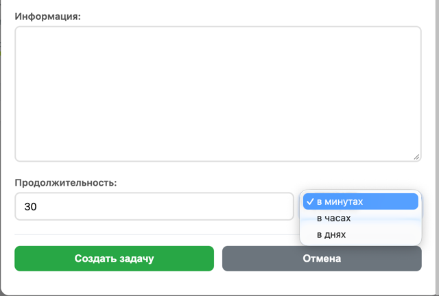

# Creating a task

Creating a task is the central operation of the entire application. A user can create a task
from any of the three tabs on the main page ("In Progress", "Planned", "Knowledge Base"),
and the set of required fields depends on the selected tab. For example, for "In Progress" tasks,
start and end dates are required, while for "Knowledge Base" they are optional.

Unlike the Settings page, where CRUD operations happen directly in the table, task creation
is implemented via a **modal window**: the user clicks "+ Create Task",
a popup form opens, after filling it, the task is created,
and the user returns to the same tab they came from.



## Displaying the modal window

### Route

The route is declared privately inside `TaskHandlers`:

```dotty
private val createModalRoute = Route(
  Request.get(Path.root / "task" / "create" / Param.string)
    .extractHeader[Authorization],
  Response.ok(Entity.html).orNotFound
)
```

**Route breakdown:**

- **`Request.get(Path.root / "task" / "create" / Param.string)`** — GET request to
  `/task/create/{tab}`, where `{tab}` — the tab name (`"in-progress"`, `"planned"`,
  `"knowledge-base"`). The `tab` parameter determines which fields will be mandatory.
- **`.extractHeader[Authorization]`** — the token is passed in the `Authorization` header.
- **`Response.ok(Entity.html).orNotFound`** — successful response (200 OK) with an HTML body
  of the modal window.

### `createModalHandler` (`TaskHandlers` class)

```dotty
val createModalHandler: Handler =
  createModalRoute.handleIO: (tab: String, authorization: Authorization) =>
    withUserFromHeader(authorization): (user, token) =>
      val ordinalIO: IO[Ordinal] =
        TaskStatus.find(tab) match
          case Some(status)
              if status == TaskStatus.InProgress ||
                status == TaskStatus.Planned =>
            taskLifecycleService.taskService
              .getAll(
                userId = user.id,
                maybeStatus = status.some,
                maybeTaskType = none,
                maybeSectionId = none
              )
              .map(_.map(_.ordinal.next).maxOption.getOrElse(Ordinal.Min))
          case _ => Ordinal.Max.pure[IO]

      ordinalIO.flatMap: ordinal =>
        val request = CreateTaskRequest.empty(
          token = token.show,
          tab = tab,
          ordinal = ordinal.value
        )

        TaskViews.getViewEmptyCreateTaskModal(
          settingsService = settingsService,
          userId = user.id,
          request = request
        )
```

**Step-by-step breakdown:**

1. **`withUserFromHeader(authorization)(...)`** — standard token verification via
   `AuthorizationHandler`. `authorization` from the header is passed as the first argument;
   the lambda `(user, token)` — as the second. After successful verification, we get `user` and `token`.

2. **Calculating the ordinal number (`ordinalIO`)** — determined dynamically
   for "In Progress" and "Planned" tabs: the maximum `ordinal`
   among existing tasks of this status is taken and incremented via `ordinal.next`
   (or `Ordinal.Min` if there are no tasks yet). For "Knowledge Base", `Ordinal.Max` is used — all tasks have the same order, as they are not yet planned.

3. **`CreateTaskRequest.empty(token, tab, ordinal.value)`** — creates an empty
   request with the already-calculated ordinal number.

4. **`TaskViews.getViewEmptyCreateTaskModal(...)`** — a helper view function
   from `TaskViews` formats the modal HTML, passing `request` — default field values.

## Forming the modal window

Helper view functions are placed in the `TaskViews` object:

```dotty
def getViewEmptyCreateTaskModal(
    settingsService: SettingsService[IO],
    userId: UserId,
    request: CreateTaskRequest
): IO[String] =
  getViewCreateTaskModal(
    settingsService = settingsService,
    isOpen = true,
    userId = userId,
    request = request,
    errorMessage = none
  )

def getViewCreateTaskModal(
    settingsService: SettingsService[IO],
    isOpen: Boolean,
    userId: UserId,
    request: CreateTaskRequest,
    errorMessage: Option[String]
): IO[String] =
  for
    taskTypes <- settingsService.getTaskTypes(userId)
    sections  <- settingsService.getSections(userId)
    goals     <- settingsService.getGoals(userId)
  yield Views.createTask(
    isOpen = isOpen,
    req = request,
    taskTypes = taskTypes,
    sections = sections,
    goals = goals,
    errorMessage = errorMessage
  ).render
```

**What happens:**

1. **Loading reference data** — three requests to `settingsService`:
   - `taskTypes` — user's task types.
   - `sections` — user's sections.
   - `goals` — user's goals.

2. **Forming `CreateTaskRequest`:**
   - `request` — pre-filled field values

## `CreateTaskRequest` model

`CreateTaskRequest` is a DTO (Data Transfer Object) into which the form body
is deserialized. It differs from the domain `CreateTask` in that it contains **only the fields**
**that come from the form**, and uses simple types (`Int`, `Long`, `String`)
rather than refined types (`TaskId`, `Ordinal`, `FiniteDuration`).

### Definition

```dotty
final case class CreateTaskRequest(
    token: String,
    tab: String,
    name: String,
    taskTypeId: Int,
    sectionId: Int,
    goalId: Int,
    ordinal: Int,
    ordinalShift: Option[String],
    startDate: Option[LocalDate],
    endDate: Option[LocalDate],
    information: String,
    durationValue: Long,
    durationUnit: TimeUnit
) derives FormCodec
```

**Fields:**

| Field            | Purpose                                                                        |
| ---------------- | ------------------------------------------------------------------------------ |
| `token`          | JWT token from the hidden form field                                           |
| `tab`            | The tab from which the task is created (`in-progress`, `planned`, `knowledge-base`) |
| `name`           | Task name                                                                      |
| `taskTypeId`     | Task type ID                                                                   |
| `sectionId`      | Section ID                                                                     |
| `goalId`         | Goal ID                                                                        |
| `ordinal`        | Ordinal position                                                               |
| `ordinalShift`   | Flag for shifting ordinal numbers (`"on"` if the checkbox is checked)          |
| `startDate`      | Start date (optional)                                                          |
| `endDate`        | End date (optional)                                                            |
| `information`    | Description                                                                    |
| `durationValue`  | Numerical duration value                                                       |
| `durationUnit`   | Unit of measure (`MINUTES`, `HOURS`, `DAYS`)                                   |

**Why `durationValue` and `durationUnit` — as separate fields?**

Because the form contains **two** `<input>`/`<select>` for duration.
The user enters a number and selects the unit of measure. 
Only at the `CreateTask.parse` level are these two fields combined into `FiniteDuration`.

### `empty` method

```dotty
def empty(token: String, tab: String, ordinal: Int): CreateTaskRequest =
  CreateTaskRequest(
    token = token,
    tab = tab,
    name = "",
    taskTypeId = 0,
    sectionId = 0,
    goalId = 0,
    ordinal = ordinal,
    ordinalShift = none,
    startDate = none,
    endDate = none,
    information = "",
    durationValue = 30,
    durationUnit = TimeUnit.MINUTES
  )
```

Returns an "empty" request with default values. 
Used on the first open of the form when no `errorRequest` exists. 
The ordinal number (`ordinal`) is not fixed, but computed in `createModalHandler`:
for "In Progress" and "Planned" tabs — it is the next number after the last one,
while for "Knowledge Base" — it is `Ordinal.Max`, so the new task goes to the end of the list.

## Rendering form `Views.createTask`

The template consists of two branches: a closed modal and an open one. 
The first is used after successful task creation to "softly" close the window.

### "Modal closed" branch

```dotty
frag(
  div(
    `id`  := "task-modal",
    cls   := "uk-modal uk-open",
    style := "display:block;"
  )(
    div(cls := "uk-modal-dialog uk-modal-body")(
      if isOpen then
        frag(
          h2(cls := "uk-modal-title")("Creating a task"),
          CreateTaskRequest.render(req, taskTypes, sections, goals),
          errorBlock(errorMessage)
        )
      else
        button(
          cls            := "add-btn",
          attr("hx-get") := s"/home/${req.tab}",
          Htmx.appTarget,
          Htmx.appSwap,
          attr("onclick") := "closeCreateTaskModal()"
        )("Reload task list")
    )
  )
)
```



**Why is this branch needed?**

After successful task creation, the server returns this HTML fragment instead of the form.
It is inserted into `#modal-container` and shows the user a "Reload task list" button.
Clicking it reloads the main page from the same tab where the
task was created — and the user sees their new task in the list.

**Why not redirect immediately?**

Because after successful creation, htmx replaces **only** `#modal-container`,
not `#app`. This keeps the main page in place but hides the form. The "Reload task list"
button gives the user control over the timing of the reload —
they can read the message first, then click.

### "Modal open" branch

```dotty
frag(
  div(
    `id`  := "task-modal",
    cls   := "uk-modal uk-open",
    style := "display:block;"
  )(
    div(cls := "uk-modal-dialog uk-modal-body")(
      if isOpen then
        frag(
          h2(cls := "uk-modal-title")("Creating a task"),
          CreateTaskRequest.render(req, taskTypes, sections, goals),
          errorBlock(errorMessage)
        )
      else
        button(
          cls            := "add-btn",
          attr("hx-get") := s"/home/${req.tab}",
          Htmx.appTarget,
          Htmx.appSwap,
          attr("onclick") := "closeCreateTaskModal()"
        )("Reload task list")
    )
  )
)
```

**Key points of the form:**

1. **`hx-post="/tasks"`** — POST request to create a task.
2. **`hx-target="#modal-container"`** — the server response is inserted into the modal
    container, not into `#app`. This is important: after successful creation, the task should not
    "redirect" the user to another page — they stay on the current tab.
3. **`hx-swap="innerHTML"`** — replaces the content of `#modal-container`, not the container itself.
4. **Hidden `token` and `tab` fields** — passed in the request body. `tab` is needed so that
    the server knows which tab to return the user to after task creation.

### Form fields



**Task name:**

```dotty
group("taskName", "Task name:")(input(
  attr("id")   := "taskName",
  attr("name") := "name",
  attr("type") := "text",
  required,
  placeholder   := "Enter name",
  attr("value") := request.name
)),
```

A simple text field. The value is taken from `req.name`, which allows preserving
typed data on validation errors.

**Task type, section, goal:**

```dotty
group("taskTypeId", "Task type:")(select(
  attr("id")   := "taskTypeId",
  attr("name") := "taskTypeId",
  required,
  List[Modifier](option(value := "")("Select type..."))
    ++ taskTypes.filter(_.displayed).sortBy(_.ordinal.value).map { t =>
      selectedOption(
        t.id.value.toString,
        t.name.toString,
        t.id.value == request.taskTypeId
      )
    }
)),
```

Three similar dropdown lists. Features:

- **`.filter(_.displayed)`** — show only enabled elements. Hidden
  (archived) ones should not be available for selection.
- **`.sortBy(_.ordinal.value)`** — sorted by the order set by the user
  in the settings.

**Ordinal position:**

```dotty
group("ordinal", "Ordinal:")(input(
  attr("id")    := "ordinal",
  attr("name")  := "ordinal",
  attr("type")  := "number",
  attr("min")   := "1",
  attr("value") := request.ordinal,
  required
)),
```

The ordinal position of the task. Defaults to `1000`, so new tasks go to the end
of the list if the user does not set another value.

**Dates (with conditional mandatory):**

```dotty
group(
  "startDate",
  "Start date:"
)(dateInput("startDate", request.startDate)),
      
def dateInput(label: String, maybeDate: Option[LocalDate]): Modifier =
  input(
    attr("id")    := label,
    attr("name")  := label,
    attr("type")  := "date",
    attr("value") := maybeDate.map(_.toString).getOrElse(""),
    if request.tab == "in-progress" then List[Modifier](required)
    else List.empty[Modifier]
  )
```

The key detail here: the `required` attribute is **conditional**. For the `"in-progress"` tab,
the `required` attribute is conditionally added by scalatags, and the date value is substituted
via `.fold("")(d => d.toString)`. For
`"planned"` and `"knowledge-base"` — optional.

**Information:**

```dotty
group("information", "Information:")(textarea(
  attr("id")   := "information",
  attr("name") := "information",
  attr("rows") := 10
)(request.information)),
```

A multi-line text field for the task description, links, and notes.



**Duration (two-part field):**

```dotty
group("durationValue", "Duration:")(
  div(
    cls := "duration-group",
    input(
      attr("id")    := "durationValue",
      attr("name")  := "durationValue",
      attr("type")  := "number",
      attr("min")   := "1",
      attr("value") := request.durationValue,
      required,
      cls         := "duration-input",
      placeholder := "Value"
    ),
    select(
      attr("id")   := "durationUnit",
      attr("name") := "durationUnit",
      cls          := "duration-select",
      required,
      durationOption(
        "minutes",
        TimeUnit.MINUTES,
        request.durationUnit,
        "in minutes"
      ),
      durationOption(
        "hours",
        TimeUnit.HOURS,
        request.durationUnit,
        "in hours"
      ),
      durationOption(
        "days",
        TimeUnit.DAYS,
        request.durationUnit,
        "in days"
      )
    )
  )
),
```

**Why two parts instead of one?**

It is more convenient for the user to enter duration in different units of measure: 
for quick tasks these are minutes, for larger projects — days. 
If we had hardcoded minutes, the user would have to manually count: 3 days = 4320 minutes. 
The two-part field solves this problem: the user enters the value and selects the unit of measure.

On form submission, the server receives `durationValue` and `durationUnit` separately and converts them to `FiniteDuration`.

**Buttons:**

```dotty
div(
  cls := "form-actions",
  button(`type` := "submit", cls := "save-btn")("Create task"),
  button(
    `type`  := "button",
    cls     := "cancel-btn",
    onclick := "closeCreateTaskModal()"
  )("Cancel")
)
```

- **"Create task"** — `type="submit"`, submits the form via htmx.
- **"Cancel"** — `type="button"`, calls the JavaScript function `closeCreateTaskModal()`,
  which closes the modal window without creating a task.

**Error message:**

```dotty
def errorBlock(error: Option[String]): Tag =
  div(
    cls := "messageBlock",
    error.map(msg => div(cls := "error")(msg)).getOrElse(frag())
  )
```

If there is an error message — displayed in a red block. Usually these are validation errors
("Name cannot be empty") or business logic errors ("End date is earlier than start date").

## Task creation handler

Once the user has filled the form and clicked "Create task", htmx sends
a POST request to `/tasks`. This is where all the creation logic happens.

### `createHandler` handler (`TaskHandlers` class)

```dotty
val createHandler: Handler =
  createRoute.handleIO: (request: CreateTaskRequest) =>
    val create: ((UserInfo, SignedJwt)) => IO[String] =
      (user, jwtToken) =>
        CreateTask.parse(request, user.id) match
          case Validated.Valid(task) =>
            val runReorderTasks: IO[Boolean] =
              if request.ordinalShift.contains("on") then
                taskLifecycleService.reorderTasks(
                  userId = user.id,
                  ordinal = task.ordinal,
                  status = task.status
                )
              else IO(true)

            val run: IO[String] =
              for
                _    <- runReorderTasks
                _    <- taskLifecycleService.create(task)
                view <-
                  TaskViews.getViewAfterCreateTask(
                    settingsService = settingsService,
                    userId = user.id,
                    token = jwtToken,
                    tab = request.tab
                  )
              yield view

            run
              .recoverWith:
                case ex: IllegalArgumentException =>
                  TaskViews.getViewCreateTaskModalWithError(
                    settingsService = settingsService,
                    userId = user.id,
                    errorRequest = request,
                    errorMessage = ex.getMessage
                  )
          case Validated.Invalid(errors) =>
            TaskViews.getViewCreateTaskModalWithError(
              settingsService = settingsService,
              userId = user.id,
              errorRequest = request,
              errorMessage = errors.toChain.toVector.mkString("; ")
            )
    // ToDo: https://github.com/creativescala/krop/pull/57
    val authorization: Authorization =
      Authorization(Token(AuthScheme.Bearer, request.token))
    withUserFromHeader(authorization)(create)
```

**Step-by-step breakdown:**

1. **`handleIO: (request: CreateTaskRequest) => ...`** — the handler accepts
    `CreateTaskRequest`, which was deserialized from the form via `FormCodec`.

2. **`CreateTask.parse(request, user.id)`** — validates and converts the request
    to the domain object `CreateTask`. Returns `ValidatedNec[String, CreateTask]`:
    - **`Valid`** — all fields are correct, the task is ready to be created.
    - **`Invalid`** — there are validation errors (empty name, negative ordinal, etc.).

3. **`Valid` branch:**
    - **`runReorderTasks`** — if the form had the shift checkbox checked
      (`request.ordinalShift.contains("on")`), `taskLifecycleService.reorderTasks` is called,
      which shifts the ordinal numbers of existing tasks, making room for the new one. Otherwise — `IO(true)` (no shift).
    - `taskLifecycleService.create(task)` — a method that performs
      **additional validation** (checking the existence of a type, section, goal,
      date checks for the status) and saves the task to the database.
    - **Success** → returns `getViewAfterCreateTask`. This is
      the "closed" modal window with a "Reload task list" button.
    - **Error** (`IllegalArgumentException`) → returns the same modal window
      with saved data and an error message (`getViewCreateTaskModalWithError`).

4. **`Invalid` branch:** returns the modal window with validation errors combined
    via `"; "`.

`TaskViews.getViewAfterCreateTask` and `TaskViews.getViewCreateTaskModalWithError` use the same
`getViewCreateTaskModal` from `TaskViews` as when opening the modal window:

```dotty
def getViewAfterCreateTask(
    settingsService: SettingsService[IO],
    userId: UserId,
    token: SignedJwt,
    tab: String
): IO[String] =
  getViewCreateTaskModal(
    settingsService = settingsService,
    isOpen = false,
    userId = userId,
    request =
      CreateTaskRequest.empty(
        token = token.show,
        tab = tab,
        ordinal = Ordinal.Max.value
      ),
    errorMessage = none
  )

def getViewCreateTaskModalWithError(
    settingsService: SettingsService[IO],
    userId: UserId,
    errorRequest: CreateTaskRequest,
    errorMessage: String
): IO[String] =
  getViewCreateTaskModal(
    settingsService = settingsService,
    isOpen = true,
    userId = userId,
    request = errorRequest,
    errorMessage = errorMessage.some
  )
```

**Why is the validation two-level?**

`CreateTask.parse` checks **structural** invariants:

- Incorrect task UUID.
- Empty name.
- Negative ordinal.

```dotty
object CreateTask:
  def parse(
      request: CreateTaskRequest,
      userId: UserId
  ): ValidatedNec[String, CreateTask] =
    (
      TaskName.either(request.name).toValidatedNec,
      TaskTypeId.either(request.taskTypeId).toValidatedNec,
      Status.find(request.tab).toValidNec(s"Status not found: ${request.tab}"),
      SectionId.either(request.sectionId).toValidatedNec,
      GoalId.either(request.goalId).toValidatedNec,
      Ordinal.either(request.ordinal).toValidatedNec
    ).mapN {
      case (name, taskTypeId, status, sectionId, goalId, ordinal) =>
        CreateTask(
          name = name,
          userId = userId,
          taskTypeId = taskTypeId,
          status = status,
          sectionId = sectionId,
          goalId = goalId,
          ordinal = ordinal,
          startDate = request.startDate,
          endDate = request.endDate,
          information = request.information,
          plan = Plan.Empty,
          duration =
            FiniteDuration(request.durationValue, request.durationUnit),
          timeSpent = FiniteDuration(0, TimeUnit.MINUTES)
        )
    }
```

`taskLifecycleService.create` checks **business** invariants:

- Does a task type with this ID exist and belong to the user.
- Does a section exist.
- Does a goal exist.
- Are the dates correct for the selected status (e.g., end date not earlier than
  start date).

This separation allows reusing `CreateTask.parse` in other contexts
(e.g., in an API), while keeping business validation in the service.

## Returning to the main page

After creating a task, the user can click "Reload task list"
in the closed modal window. This will trigger a GET request to `/home/{tab}`.

### Route

The `/home/{tab}` route is declared directly in `HomeHandler`:

```dotty
private val route =
  Route(
    Request.get(Path.root / "home" / Param.string).extractHeader[Cookie],
    Response.ok(Entity.html)
  )
```

### `HomeHandler` handler

```dotty
final case class HomeHandler(
    middleware: JwtAuthMiddleware[IO, UserInfo],
    taskLifecycleService: TaskLifecycleService[IO],
    periodicTaskLifecycleService: PeriodicTaskLifecycleService[IO],
    notesService: NotesService[IO],
    historyService: HistoryService[IO]
)(using Logger[IO]) extends AuthorizationHandler(middleware):
  private val route =
    Route(
      Request.get(Path.root / "home" / Param.string).extractHeader[Cookie],
      Response.ok(Entity.html)
    )

  val handler: Handler =
    route.handleIO: (tab: String, cookie: Cookie) =>
      withUserFromCookie(cookie)(
        f = (user, jwtToken) =>
          getViewWelcome(
            taskLifecycleService = taskLifecycleService,
            periodicTaskLifecycleService = periodicTaskLifecycleService,
            notesService = notesService,
            historyService = historyService,
            user = user,
            jwtToken = jwtToken,
            tab = tab
          ),
        fallbackPage = Views.login(None).render
      )
```

**Step-by-step breakdown:**

1. **`extends AuthorizationHandler(middleware)`** — gives access to `withUserFromCookie(cookie)`.
2. **`private val route`** — the route is declared inside the handler.
3. **`withUserFromCookie(cookie)(f, fallbackPage)`** — extracts the token from the `token` cookie,
    verifies it and passes `(user, jwtToken)` to `f`. If the token is missing/invalid —
    returns `fallbackPage` (the login form).
4. **`f`** — builds the welcome page for the correct tab via `getViewWelcome`.
5. All errors (`AuthorizationException` and others) are handled inside `AuthorizationHandler`
    and boil down to returning `fallbackPage` — the application does not crash.

**Why does `HomeHandler` differ from `InitialHandler`?**

| Aspect            | `InitialHandler`    | `HomeHandler` |
| --------------- | ------------------- | ------------- |
| Path            | `/`                 | `/home/{tab}` |
| Parameters       | none                | `tab: String` |
| Tab             | Always `DefaultTab` | Any from the URL  |
| Token source | Cookie              | Cookie        |
| Returns      | Full page           | Only `#app` |

`InitialHandler` is used when the user first lands on the site:
they do not know which tab they want to open, so `DefaultTab` is shown.
`HomeHandler` is used for navigation within the application: the user already knows
where they want to go, and passes `tab` in the URL.

## Complete task creation workflow

Consider the scenario:

1. **The user is on the "Planned" tab** and clicks "+ Create task".
2. **htmx sends a GET** to `/task/create/planned` with the token in the header.
3. **`TaskHandlers.createModalHandler`** verifies the token, loads reference data,
    returns the modal HTML.
4. **htmx inserts the HTML** into `#modal-container`. The user sees the form.
5. **The user fills in the form** and clicks "Create task".
6. **htmx sends a POST** to `/tasks` with the form data.
7. **`TaskHandlers.createHandler`** validates the request, and on checked shift checkbox calls
    `taskLifecycleService.reorderTasks`, then `taskLifecycleService.create`,
    creating the task in the database.

    **If there is an error on step 7** (e.g., end date is earlier than start date):

    - A modal window is returned with **saved data** and an error message.
    - The user fixes the data and resubmits the form.
8. **On success** a "closed" modal window with a "Reload task list" button is returned.
9. **The user clicks** this button → GET to `/home/planned`.
10. **`HomeHandler`** returns the updated welcome page with the new task in the table.

## Summary

We implemented the full task creation cycle:

1. **`TaskHandlers.createModalHandler`** — opens the modal window with the form.
2. **`Views.createTask`** — renders the form with conditionally mandatory fields
    (dates are required only for "In Progress").
3. **`TaskHandlers.createHandler`** — validates data, creates the task, handles
    errors.
4. **`HomeHandler`** — returns the user to their tab with an updated list.

**Key architectural decisions:**

- **Preserving entered data** — `errorRequest` prevents losing data
  on error.
- **Conditional field mandatory** — the `required` attribute is set depending on
  the selected tab.
- **Soft closing of the modal window** — after success, the user sees a "Reload"
  button, giving control over the moment of transition.

This architecture makes task creation fast and convenient: the user does not lose
context, can fix errors, and their data does not disappear on a failed attempt.

---

**Links:**

- [Repository with source code][repo]

[repo]: https://gitverse.ru/scalabook/pdp
