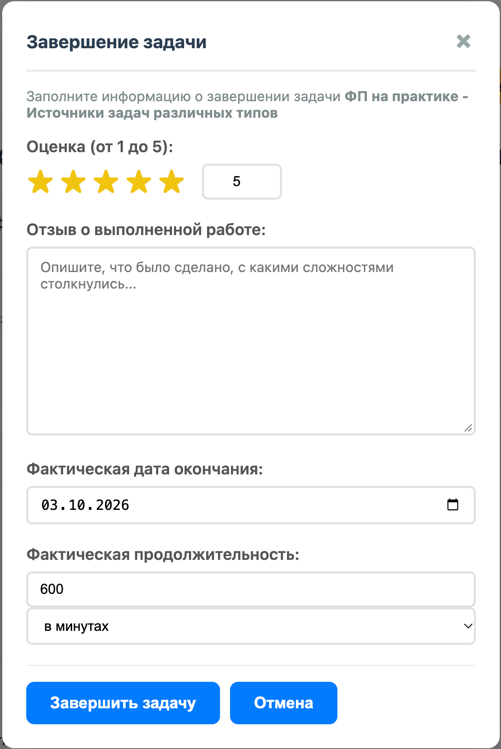
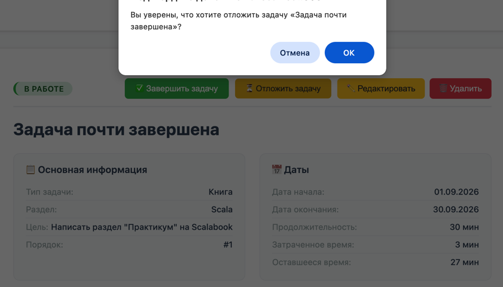
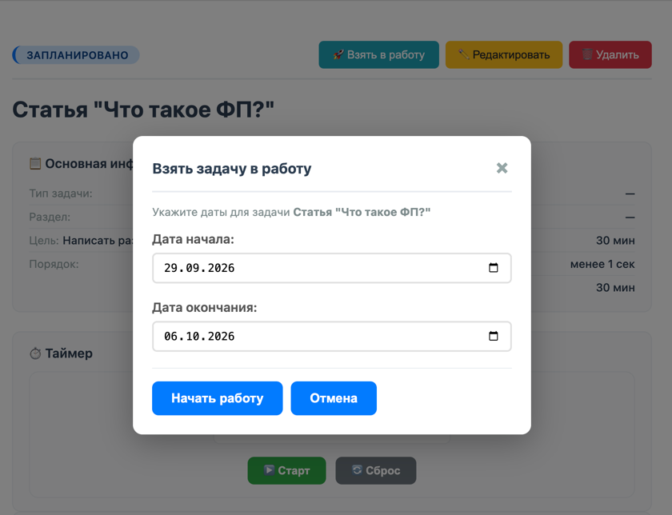
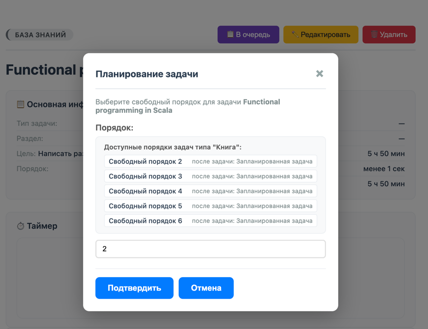
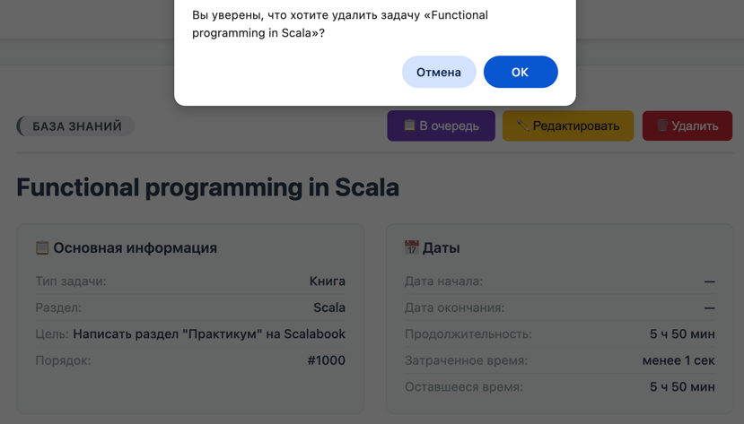

# Task Actions

After a task has been created and is on the `/task/{id}` page, the user can perform
various actions on it depending on the current status. All actions are implemented
as separate handlers that accept PUT or DELETE requests and return the updated
view of the task or the main page.

List of actions:

| Action                  | Task Status     | HTTP Method | Returns                        |
| ----------------------- | --------------- | ---------- | ------------------------------ |
| **Complete**            | `InProgress`    | PUT        | Main page (`HomeView`)         |
| **Defer**               | `InProgress`    | PUT        | Updated task page              |
| **Take to Work**        | `Planned`       | PUT        | Updated task page              |
| **Queue**               | `KnowledgeBase` | PUT        | Updated task page              |
| **Delete**              | Any             | DELETE     | Main page (`HomeView`)         |

**Why do completion and deletion return the main page, not the task?**

Because after completion or deletion, the task **leaves the active list** — it's
logical for the user to see the list of remaining tasks, not the page of a task that no longer exists
in the current tab. Other actions don't change the task's "belonging" to a tab,
so the same task page with updated status is returned.

## Completing a Task

Completion is the final action for a task in `InProgress` status. It requires
user reflection: rating (1-5), review, actual end date, and actual
duration. This data is recorded in the task history and used in statistics.



### Route

The route is declared privately inside `TaskHandlers` based on the common path `taskPath`
(`Path.root / "task" / uuidParam`):

```dotty
private val completeFormRoute = Route(
  Request.put(taskPath / "complete")
    .withEntity(Entity.formOf[CompileTaskRequest]),
  Response.ok(Entity.html).orNotFound
)
```

**Analysis:**

- **`Request.put(taskPath / "complete")`** — PUT request to
  `/task/{uuid}/complete`. `uuidParam` decodes the path directly to `UUID`.
- **`.withEntity(Entity.formOf[CompileTaskRequest])`** — request body in format
  `application/x-www-form-urlencoded`, deserialized into `CompileTaskRequest`.
- **`Response.ok(Entity.html).orNotFound`** — successful response with HTML or 404.

### `completeHandler` (class `TaskHandlers`)

```dotty
val completeHandler: Handler =
  completeFormRoute.handleIO: (uuid: UUID, request: CompileTaskRequest) =>
    val run: ((UserInfo, SignedJwt)) => IO[Option[String]] =
      (user, jwtToken) =>
        val taskId = TaskId(uuid)
        (
          Rating.values
            .find(_.r == request.rating)
            .toValidNec(
              s"Rating (1-5) not found: ${request.rating}"
            ),
          Review.either(request.review.trim).toValidatedNec,
          request.endDate.toValidNec("End date not filled")
        ).mapN { case (rating, review, endDate) =>
          taskLifecycleService.complete(
            id = taskId,
            userId = user.id,
            rating = rating,
            review = review,
            endDate = endDate,
            duration = FiniteDuration(
              request.durationValue,
              request.durationUnit
            )
          ).map(_ => HomeView.some)
        }.valueOr(errors =>
          getViewTask(
            taskLifecycleService = taskLifecycleService,
            userId = user.id,
            taskId = taskId,
            jwtToken = jwtToken,
            errorMessage = errors.mkString_(";").some
          )
        )
    // ToDo: https://github.com/creativescala/krop/pull/57
    val authorization: Authorization =
      Authorization(Token(AuthScheme.Bearer, request.token))
    withUserFromHeaderOpt(authorization)(run)
```

**Step-by-step analysis:**

1. **`TaskId(uuid)`** — unary fold of ready `UUID` into `TaskId`. Manual parsing from string
   is no longer needed: `uuidParam` in the route already decoded the path to `UUID`.

2. **Triple validation via `ValidatedNec`:**
    - **`Rating.values.find(_.r == request.rating)`** — searches for `Rating` by numeric
      value. If not found — error `"Rating (1-5) not found: {rating}"`.
    - **`Review.either(request.review.trim)`** — review validation. `trim` removes
      leading/trailing spaces, `either` checks for non-emptiness. If review is empty — error.
    - **`request.endDate.toValidNec("End date not filled")`** — end date
      is required. If `None` — error.

3. **`.mapN { case (rating, review, endDate) => ... }`** — if all three are valid,
   execute completion:
    - `taskLifecycleService.complete(...)` with parameters `id`, `userId`, `rating`,
      `review`, `endDate`, `duration`.
    - `duration` is converted from minutes (`request.duration`) to `FiniteDuration`.
    - On success, return `HomeView.some` — a special marker meaning
      "show the main page". `HomeView` contains the HTML of the main page.

4. **`.valueOr(errors => ...)`** — if there are validation errors, show the task form
   with an error message. The user can fix the data and try again.

### What is `HomeView`?

`HomeView` is a constant from `WelcomeViews` that returns the HTML of the main page:

```dotty
val HomeView: String = Views.home()

object View:
  def home(): String =
    div(cls := "home-container")(
      a(href := "/", cls := "home-button")("\ud83c\udfe0 Go to Main Page")
    ).render
```

### `CompileTaskRequest` Model

```dotty
final case class CompileTaskRequest(
    token: String,
    rating: Int,
    review: String,
    endDate: Option[LocalDate],
    durationValue: Long,
    durationUnit: TimeUnit
) derives FormCodec
```

**Fields:**

| Field                | Purpose                                  |
| -------------------- | ---------------------------------------- |
| `token`              | JWT token from hidden form field         |
| `rating`             | Rating from 1 to 5                       |
| `review`             | Review of completed work                 |
| `endDate`            | Actual end date                          |
| `durationValue`      | Actual duration value                    |
| `durationUnit`       | Duration unit of measurement             |

### "Complete Task" Modal Window

```dotty
object CompileTaskRequest:
  def render(id: TaskId, token: SignedJwt, timeSpent: FiniteDuration): Tag =
    val now = LocalDate.now().format(DateTimeFormatter.ISO_DATE)

    form(
      attr("id")     := "completeForm",
      attr("hx-put") := s"/task/$id/complete",
      Htmx.appTarget,
      Htmx.appSwap,
      attr("hx-on::after-request") :=
        "if(event.detail.xhr.status === 200) closeModal('completeModal')",
      Htmx.hiddenToken(token.show),
      div(
        cls := "form-group",
        label(`for` := "ratingInput")("Rating (1-5):"),
        div(
          cls := "rating-container",
          div(
            cls := "rating-stars",
            (1 to 5).map { n =>
              span(
                cls                := "star",
                attr("data-value") := n,
                onclick            := s"setRating($n)"
              )("\u2606")
            }
          ),
          input(
            attr("id")    := "ratingInput",
            attr("name")  := "rating",
            attr("type")  := "number",
            cls           := "form-input rating-input",
            placeholder   := "Rating 1-5",
            attr("value") := "5",
            attr("min")   := "1",
            attr("max")   := "5",
            required
          )
        )
      ),
      div(
        cls := "form-group",
        label(`for` := "reviewInput")("Review of completed work:"),
        textarea(
          attr("id")   := "reviewInput",
          attr("name") := "review",
          cls          := "form-textarea",
          attr("rows") := 10,
          placeholder  :=
            "Describe what was done, what difficulties you encountered...",
          required
        )()
      ),
      div(
        cls := "form-group",
        label(`for` := "completeEndDateInput")("Actual end date:"),
        input(
          attr("id")    := "completeEndDateInput",
          attr("name")  := "endDate",
          attr("type")  := "date",
          cls           := "form-input",
          attr("value") := now,
          required
        )
      ),
      durationGroup(timeSpent),
      div(
        cls := "modal-actions",
        button(`type` := "submit", cls := "save-btn")("Complete Task"),
        button(
          `type`  := "button",
          cls     := "cancel-btn",
          onclick := "closeModal('completeModal')"
        )("Cancel")
      )
    )
  end render

  private def durationGroup(timeSpent: FiniteDuration): Tag =
    div(
      cls := "form-group",
      label(`for` := "completeDurationValue")("Actual duration:"),
      div(
        cls := "duration-group",
        input(
          attr("id")    := "completeDurationValue",
          attr("name")  := "durationValue",
          attr("type")  := "number",
          attr("min")   := "1",
          cls           := "form-input duration-input",
          placeholder   := "Value",
          attr("value") := timeSpent.length,
          required
        ),
        select(
          attr("id")   := "completeDurationUnit",
          attr("name") := "durationUnit",
          cls          := "form-select duration-select",
          required,
          option(value := "", disabled, selected)("Select unit..."),
          durationOption(
            "minutes",
            TimeUnit.MINUTES,
            timeSpent.unit,
            "in minutes"
          ),
          durationOption("hours", TimeUnit.HOURS, timeSpent.unit, "in hours"),
          durationOption("days", TimeUnit.DAYS, timeSpent.unit, "in days")
        )
      )
    )

  private def durationOption(
      optValue: String,
      optionUnit: TimeUnit,
      selectedUnit: TimeUnit,
      text: String
  ): Modifier =
    option(
      (value := optValue) ::
        (if optionUnit == selectedUnit then List[Modifier](selected)
         else List.empty[Modifier])
    )(text)
```

**Features:**

1. **Star rating** — JavaScript function `setRating(value)` updates
   the value of the `rating` field and highlights the stars. The `rating` field is hidden by styles,
   but remains functional.

2. **Review** — required field (checked on the server). This is an intentional decision:
   completing a task without reflection is less valuable.

3. **End date** — defaults to today. The user can change if
   completing a task retroactively.

4. **Duration** — defaults to the planned duration (`task.duration`).
   The user adjusts if the actual time differs.

5. **`hx-put="/task/{id}/complete"`** — form submission goes via PUT request.

6. **`hx-target="#app"`** — after completion, the entire `#app` container is replaced
   (main page).

## Deferring a Task

Deferring moves a task from `InProgress` back to `Planned`. Start and end
dates are **cleared**, because when re-taking to work they will be different.
This allows the user to temporarily pause work on a task without losing it.



### Route

The route is declared privately inside `TaskHandlers` based on the common path `taskPath`
(`Path.root / "task" / uuidParam`):

```dotty
private val deferFormRoute = Route(
  Request.put(taskPath / "defer")
    .extractHeader[Authorization],
  Response.ok(Entity.html).orNotFound
)
```

**Difference from `complete`:** there is **no** request body here, because all data is already
known (task ID from the path, user — from the token). Only the
`Authorization` header is used. `uuidParam` decodes the path directly to `UUID`.

### `deferHandler` (class `TaskHandlers`)

```dotty
val deferHandler: Handler =
  deferFormRoute.handleIO: (uuid: UUID, authorization: Authorization) =>
    withUserFromHeaderOpt(authorization): (user, jwtToken) =>
      val taskId = TaskId(uuid)
      for
        _ <- taskLifecycleService.defer(
          id = taskId,
          userId = user.id
        )
        maybeView <- getViewTask(
          taskLifecycleService = taskLifecycleService,
          userId = user.id,
          taskId = taskId,
          jwtToken = jwtToken,
          errorMessage = none
        )
      yield maybeView
```

**Step-by-step analysis:**

1. **`withUserFromHeaderOpt(authorization)`** — soft token check from the header
   (invalid token → `None`, not an exception). `authorization` — first argument,
   lambda `(user, jwtToken)` — second.

2. **`TaskId(uuid)`** — unary fold of ready `UUID` to `TaskId`. No parsing from string
   needed — `uuidParam` already decoded the path.

3. **`taskLifecycleService.defer(id, userId)`** — performs deferral:
    - Checks that the task is in `InProgress` status.
    - Changes status to `Planned`.
    - Clears `startDate` and `endDate`.

4. **`getViewTask(...)`** — loads the updated task page. The user
   sees the same task, but now with a "\ud83d\ude80 Take to Work" button.

**Why is there no form and request body?**

Because all the necessary data is already known. The user clicks "\u23f3 Defer
Task" — that's enough. Confirmation is provided via `hx-confirm`
in the HTML button.

Render ``Views.task`` (scalatags):

```dotty
button(
  cls            := "postpone-task-btn",
  attr("hx-put") := s"/task/${task.id.value}/defer",
  Htmx.appTarget,
  Htmx.appSwap,
  attr("hx-confirm") :=
    s"""Are you sure you want to defer task "${task.name.value}"?"""
)("\\u23f3 Defer Task")
```

## Taking to Work

Moves a task from `Planned` to `InProgress`. Requires specifying start and
end dates.



### Route

The route is declared privately inside `TaskHandlers` based on the common path `taskPath`
(`Path.root / "task" / uuidParam`):

```dotty
private val startFormRoute = Route(
  Request.put(taskPath / "start")
    .withEntity(Entity.formOf[StartTaskRequest]),
  Response.ok(Entity.html).orNotFound
)
```

### `startHandler` (class `TaskHandlers`)

```dotty
val startHandler: Handler =
  startFormRoute.handleIO: (uuid: UUID, request: StartTaskRequest) =>
    val run: ((UserInfo, SignedJwt)) => IO[Option[String]] =
      (user, jwtToken) =>
        val taskId = TaskId(uuid)
        (
          request.startDate.toValidNec("Start date not filled"),
          request.endDate.toValidNec("End date not filled")
        ).mapN { case (startDate, endDate) =>
          for
            _ <- taskLifecycleService.start(
              id = taskId,
              userId = user.id,
              startDate = startDate,
              endDate = endDate
            )
            maybeView <- getViewTask(
              taskLifecycleService = taskLifecycleService,
              userId = user.id,
              taskId = taskId,
              jwtToken = jwtToken,
              errorMessage = none
            )
          yield maybeView
        }.valueOr(errors =>
          getViewTask(
            taskLifecycleService = taskLifecycleService,
            userId = user.id,
            taskId = taskId,
            jwtToken = jwtToken,
            errorMessage = errors.mkString_(";").some
          )
        )
    // ToDo: https://github.com/creativescala/krop/pull/57
    val authorization: Authorization =
      Authorization(Token(AuthScheme.Bearer, request.token))
    withUserFromHeaderOpt(authorization)(run)
```

**Step-by-step analysis:**

1. **Date validation** via `ValidatedNec`:
   - `startDate` — required.
   - `endDate` — required.

   `uuid` arrives already as `UUID` (`uuidParam` in the route), so `TaskId(uuid)`
   is assembled immediately, without `Right`/`Left` branches.

2. **`.mapN { case (startDate, endDate) => ... }`** — on success, call
   `taskLifecycleService.start(...)` which:
    - Checks that the task is in `Planned` status.
    - Changes status to `InProgress`.
    - Sets `startDate` and `endDate`.

3. **`.valueOr(...)`** — on validation error, show the task form
   with a message.

### `StartTaskRequest` Model

```dotty
final case class StartTaskRequest(
    token: String,
    startDate: Option[LocalDate],
    endDate: Option[LocalDate]
) derives FormCodec
```

Minimal DTO: only token and two dates. `derives FormCodec` automatically
generates a codec for deserialization from the form.

### "Start Work" Modal Window

```dotty
object StartTaskRequest:
  def render(id: TaskId, token: SignedJwt): Tag =
    val now        = LocalDate.now().format(DateTimeFormatter.ISO_DATE)
    val weeksLater =
      LocalDate.now().plusWeeks(1).format(DateTimeFormatter.ISO_DATE)

    form(
      attr("id")     := "startForm",
      attr("hx-put") := s"/task/${id.value}/start",
      Htmx.appTarget,
      Htmx.appSwap,
      Htmx.hiddenToken(token.show),
      div(
        cls := "form-group",
        label(`for` := "startDateInput")("Start date:"),
        input(
          attr("id")    := "startDateInput",
          attr("name")  := "startDate",
          attr("type")  := "date",
          cls           := "form-input",
          attr("value") := now
        )
      ),
      div(
        cls := "form-group",
        label(`for` := "endDateInput")("End date:"),
        input(
          attr("id")    := "endDateInput",
          attr("name")  := "endDate",
          attr("type")  := "date",
          cls           := "form-input",
          attr("value") := weeksLater
        )
      ),
      div(
        cls := "modal-actions",
        button(
          `type`  := "submit",
          cls     := "save-btn",
          onclick := "closeModal('startModal')"
        )("Start Work"),
        button(
          `type`  := "button",
          cls     := "cancel-btn",
          onclick := "closeModal('startModal')"
        )("Cancel")
      )
    )
  end render
```

**Default values** are optimally chosen:

- **Start date** — today. Logical: the user is taking the task to work right now.
- **End date** — one week from now. A typical term for a medium-sized task.

The user can immediately click "Start Work" without changing dates, or can update only the end date — this reduces friction.

## Queuing

Moves a task from `KnowledgeBase` to `Planned`. Requires specifying an order number.



### Route

The route is declared privately inside `TaskHandlers` based on the common path `taskPath`
(`Path.root / "task" / uuidParam`):

```dotty
private val queueFormRoute = Route(
  Request.put(taskPath / "queue")
    .withEntity(Entity.formOf[QueueTaskRequest]),
  Response.ok(Entity.html).orNotFound
)
```

### `queueHandler` (class `TaskHandlers`)

```dotty
val queueHandler: Handler =
  queueFormRoute.handleIO: (uuid: UUID, request: QueueTaskRequest) =>
    val run: ((UserInfo, SignedJwt)) => IO[Option[String]] =
      (user, jwtToken) =>
        val taskId = TaskId(uuid)
        Ordinal.either(request.ordinal) match
          case Right(ordinal) =>
            val runReorderTasks: IO[Boolean] =
              if request.ordinalShift.contains("on") then
                taskLifecycleService.reorderTasks(
                  userId = user.id,
                  ordinal = ordinal,
                  status = Status.Planned
                )
              else IO(true)

            for
              _ <- runReorderTasks
              _ <- taskLifecycleService.enqueue(
                id = taskId,
                userId = user.id,
                ordinal = ordinal
              )
              maybeView <- getViewTask(
                taskLifecycleService = taskLifecycleService,
                userId = user.id,
                taskId = taskId,
                jwtToken = jwtToken,
                errorMessage = none
              )
            yield maybeView
          case Left(error) =>
            getViewTask(
              taskLifecycleService = taskLifecycleService,
              userId = user.id,
              taskId = taskId,
              jwtToken = jwtToken,
              errorMessage = error.some
            )
        end match
    // ToDo: https://github.com/creativescala/krop/pull/57
    val authorization: Authorization =
      Authorization(Token(AuthScheme.Bearer, request.token))
    withUserFromHeaderOpt(authorization)(run)
```

**Step-by-step analysis:**

1. **`Ordinal.either(request.ordinal)`** — order number validation
   (must be positive). `taskId = TaskId(uuid)` — unary fold of the already
   route-decoded `UUID`.

2. **`runReorderTasks`** — if the `ordinalShift` flag is set in the form (value `"on"`),
   `reorderTasks` is called first, which "spreads out" already occupied order numbers
   to make room for the new task.

3. **`taskLifecycleService.enqueue(id, userId, ordinal)`** — moves the task:
    - Checks that the task is in `KnowledgeBase` status.
    - Changes status to `Planned`.
    - Sets the specified order number.
   If reordering was enabled — it is performed **before** queuing.

4. **On `ordinal` validation error** — show the task form with the error.

### `QueueTaskRequest` Model

```dotty
final case class QueueTaskRequest(
    token: String,
    ordinal: Int,
    ordinalShift: Option[String]
) derives FormCodec
```

- **`token`** — JWT token from the hidden form field.
- **`ordinal`** — order number.
- **`ordinalShift`** — optional flag (e.g., "shift order" checkbox).
  If it equals `"on"`, order reordering is performed before queuing.
  `Option[String]` means the flag might not be set — then no shifting is performed.

### "Queue" Modal Window

```dotty
object QueueTaskRequest:
  def render(
      id: TaskId,
      token: SignedJwt,
      taskType: String,
      availableOrdinals: Vector[OrdinalCard]
  ): Tag =
    val ordinal = availableOrdinals.headOption.map(_.ordinal).getOrElse(1)

    val ordinalListChildren: Seq[Tag] =
      if availableOrdinals.nonEmpty then availableOrdinals.map(_.render)
      else Vector(div(cls := "ordinal-info-empty")("No available ordinals"))

    form(
      attr("id")     := "ordinalForm",
      attr("hx-put") := s"/task/${id.value}/queue",
      Htmx.appTarget,
      Htmx.appSwap,
      Htmx.hiddenToken(token.show),
      div(
        cls := "form-group",
        label(`for` := "ordinalSelect")("Order:"),
        div(
          cls := "ordinal-info-block compact",
          div(cls := "ordinal-info-title")(
            s"""Available orders for task type "$taskType":"""
          ),
          div(cls := "ordinal-info-list")(ordinalListChildren*)
        ),
        input(
          attr("id")    := "ordinalSelect",
          attr("name")  := "ordinal",
          attr("type")  := "number",
          cls           := "form-input",
          placeholder   := "Enter order",
          attr("value") := ordinal
        ),
        div(
          cls := "form-group",
          label(`for` := "ordinalShift")("Rearrange order?"),
          input(
            attr("id")   := "ordinalShift",
            attr("name") := "ordinalShift",
            attr("type") := "checkbox"
          )
        )
      ),
      div(
        cls := "modal-actions",
        button(
          `type`  := "submit",
          cls     := "save-btn",
          onclick := "closeModal('ordinalModal')"
        )("Confirm"),
        button(
          `type`  := "button",
          cls     := "cancel-btn",
          onclick := "closeModal('ordinalModal')"
        )("Cancel")
      )
    )
  end render
```

**Key points:**

1. **Available ordinals list** — `availableOrdinals` comes from `getViewTask`
   (we covered it in the task page documentation). Each element is
   `OrdinalCard(ordinal, after)`, where `after` — the name of the task after which
   this free number goes.

2. **Pre-filled value** — the first available value is plugged as the default.
   The user usually just needs to click "Confirm".

3. **`hx-put="/task/{id}/queue"`** — PUT request.

4. **`hx-target="#app"`** — on success, the task page is returned
   with the new status (`Planned`).

## Deleting a Task

Deletion is the final and irreversible action. Available for tasks in any status.
Requires confirmation (`hx-confirm`) on the client.



### Route

The route is declared privately inside `TaskHandlers` based on the common path `taskPath`
(`Path.root / "task" / uuidParam`):

```dotty
private val deleteRoute = Route(
  Request.delete(taskPath).extractHeader[Authorization],
  Response.ok(Entity.html).orNotFound
)
```

**Analysis:**

- **`Request.delete(taskPath)`** — DELETE request to `/task/{uuid}`.
  `uuidParam` decodes the path directly to `UUID`.
- **`.extractHeader[Authorization]`** — token from the header.
- **`Response.ok(Entity.html).orNotFound`** — successful response with HTML.

### `deleteHandler` (class `TaskHandlers`)

```dotty
val deleteHandler: Handler =
  deleteRoute.handleIO: (uuid: UUID, authorization: Authorization) =>
    withUserFromHeaderOpt(authorization): (user, token) =>
      val taskId = TaskId(uuid)
      taskLifecycleService
        .delete(
          id = taskId,
          userId = user.id
        ).map(_ => HomeView.some)
```

**Step-by-step analysis:**

1. **`withUserFromHeaderOpt(authorization)`** — soft token check from the header:
   `authorization` — first argument, lambda `(user, token)` — second.

2. **`TaskId(uuid)`** — unary fold of the route-decoded `UUID`.

3. **`taskLifecycleService.delete(id, userId)`** — deletes the task:
    - Checks that the task belongs to the user.
    - Deletes the record from the DB.

4. **`.map(_ => HomeView.some)`** — after deletion, return the main page
   (`HomeView` from `WelcomeViews`). The user sees the list of remaining tasks,
   and the deleted task disappears.

### Delete HTML Button

On the task page:

```dotty
def deleteButton(path: String, name: String, subject: String): Tag =
  button(
    cls               := "delete-task-btn",
    attr("hx-delete") := path,
    Htmx.appTarget,
    Htmx.appSwap,
    attr("hx-confirm") :=
      s"Are you sure you want to delete $subject \"$name\"?"
  )("\ud83d\uddd1\ufe0f Delete")
```

**Features:**

- **`hx-delete`** — sends a DELETE request.
- **`hx-confirm`** — the browser shows a confirmation dialog with the task name.
  This protects against accidental deletions.
- **`hx-target="#app"`** — after successful deletion, the entire page is replaced.

## Common Action Pattern

All five actions follow the same pattern:

1. **Route** — PUT or DELETE on `/task/{uuid}/{action}`. Routes are private,
   declared inside `TaskHandlers` on the common path `taskPath`.
2. **Handler** — `val` handler (`completeHandler`, `deferHandler`, `startHandler`,
   `queueHandler`, `deleteHandler`) inside `TaskHandlers`; checks the token,
   receives UUID already decoded by the route (`uuidParam`), calls the corresponding
   method of `taskLifecycleService`.
3. **Request model** — DTO with `derives FormCodec` (if there's a body).
4. **HTML button/form** — uses htmx to send the request without reload.
5. **Response** — either the task page with updated status, or the main page
   (for completion and deletion).

These actions cover the full lifecycle of a task: from creation through
planning, work, completion, to deletion. Each action is only available
in the appropriate status and is protected by token check and task ownership
verification.

---

**References:**

- [Source repository][repo]

[repo]: https://gitverse.ru/scalabook/pdp
