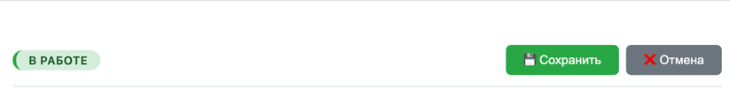
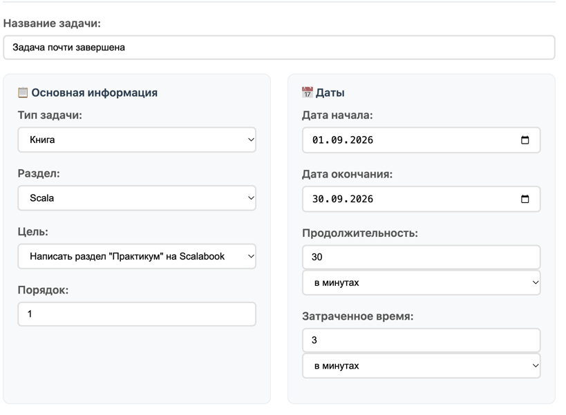
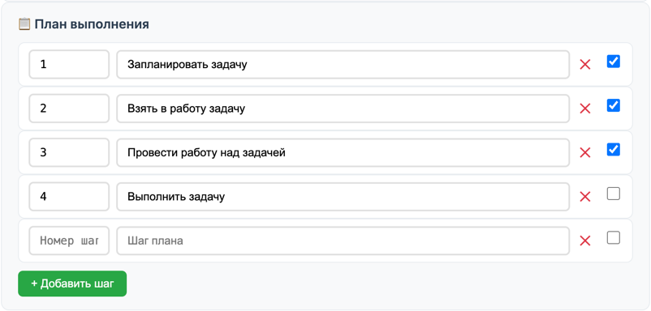
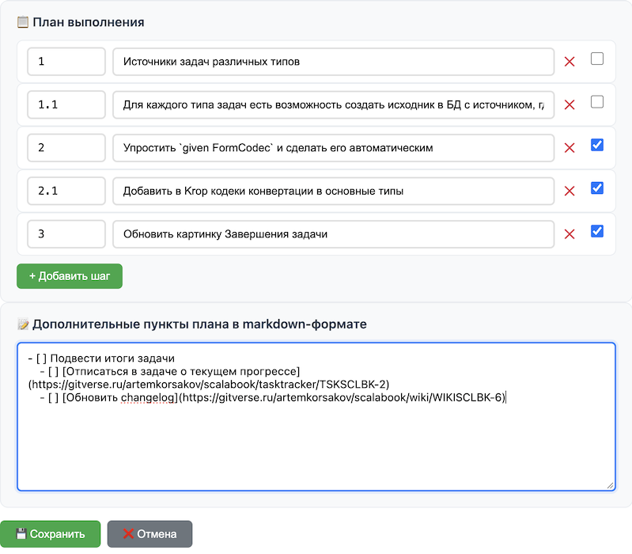
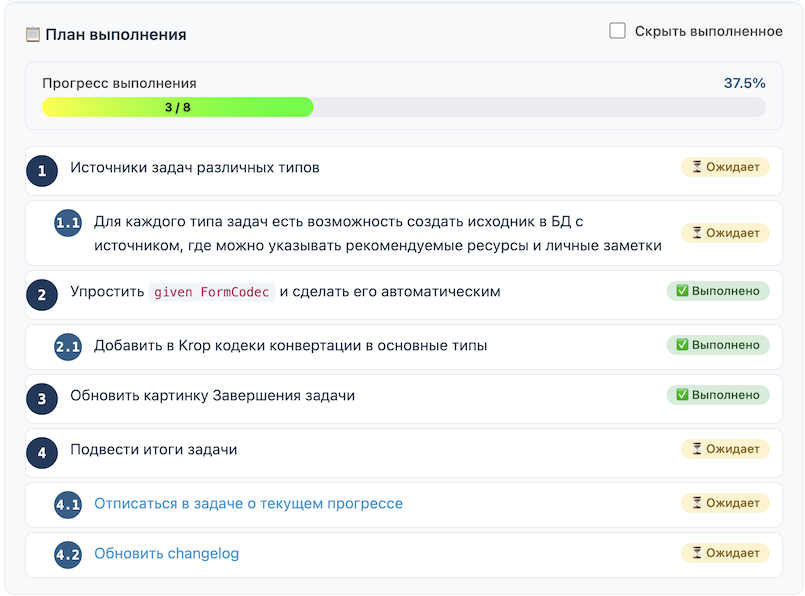

# Task Editing

The task editing page is a form that allows the user to modify every aspect of a task: name, type, section, goal, ordinal, dates, duration, time spent, description, and execution plan. It opens via the "✏️ Edit" button on the task page and replaces the content within the `#app` container.

Editing is implemented via **two handlers** in the `TaskHandlers` class:

1. **`TaskHandlers.editFormHandler`** — displays the editing form with pre-filled fields.
2. **`TaskHandlers.editHandler`** — accepts the submitted data and saves the changes.

## Displaying the Editing Form

### Route

The route is declared privately inside `TaskHandlers` based on the common path `taskPath`
(`Path.root / "task" / uuidParam`):

```dotty
private val editFormRoute = Route(
  Request.get(taskPath / "edit").extractHeader[Authorization],
  Response.ok(Entity.html).orNotFound
)
```

**Route breakdown:**

- **`Request.get(taskPath / "edit")`** — GET request to
  `/task/{uuid}/edit`, where `{uuid}` is the task identifier. `uuidParam` decodes
  the path directly to `UUID`.
- **`.extractHeader[Authorization]`** — the token is passed in the header
- **`Response.ok(Entity.html).orNotFound`** — successful response with the HTML edit
  form, or 404 if the task is not found.

### `editFormHandler` Handler

```dotty
val editFormHandler: Handler =
  editFormRoute.handleIO: (uuid: UUID, authorization: Authorization) =>
    withUserFromHeaderOpt(authorization): (user, jwtToken) =>
      getViewEditTaskModal(
        settingsService = settingsService,
        taskLifecycleService = taskLifecycleService,
        userId = user.id,
        taskId = TaskId(uuid),
        jwtToken = jwtToken,
        errorMessage = none
      )
```

### Form Generation

The `getViewEditTaskModal` function is extracted into the `TaskViews` object:

```dotty
private[tasks] object TaskViews:
  def getViewEditTaskModal(
      settingsService: SettingsService[IO],
      taskLifecycleService: TaskLifecycleService[IO],
      userId: UserId,
      taskId: TaskId,
      jwtToken: SignedJwt,
      errorMessage: Option[String]
  ): IO[Option[String]] =
    for
      taskTypes     <- settingsService.getTaskTypes(userId)
      sections      <- settingsService.getSections(userId)
      goals         <- settingsService.getGoals(userId)
      maybeTaskCard <- taskLifecycleService.get(taskId, userId)
    yield maybeTaskCard.map: card =>
      Views.editTask(
        task = card,
        token = jwtToken.show,
        taskTypes = taskTypes,
        sections = sections,
        goals = goals,
        errorMessage = errorMessage,
        editUrl = none
      ).render
```

**What happens:**

1. **Four queries:**
    - `taskTypes` — user's task types.
    - `sections` — user's sections.
    - `goals` — user's goals.
    - `maybeTaskCard` — the current task (`Option[TaskCard]`).

2. **If the task is found** (`Some(card)`) — we render the editing form, passing:
    - `task` — the current task data.
    - `token` — JWT token.
    - `taskTypes`, `sections`, `goals` — for dropdown lists.
    - `errorMessage` — optional error message.

3. **If the task is not found** — we return `None`, which results in 404.

**Why is the `errorMessage` parameter optional?**

The form can be shown in two scenarios:

- **First time** — when the user clicks "Edit". Then `errorMessage = None`.
- **After a save error** — when `TaskHandlers.editHandler` failed to save
  changes and returned the form with preserved data and an error message.

## Form Rendering `Views.editTask`

The template is a large form that structurally resembles the task page,
but with input fields instead of plain text. Let's examine it in parts.

### Top Bar

```dotty
def editTask(
    taskId: TaskId,
    request: EditTaskRequest,
    token: SignedJwt,
    taskTypes: Vector[TaskType],
    sections: Vector[Section],
    goals: Vector[Goal],
    errorMessage: Option[String],
    editUrl: Option[String]
): Frag =
  val urlScript: Modifier =
    editUrl.fold(frag())(url =>
      raw(s"""<script>history.replaceState(null, '', '$url')</script>""")
    )

  frag(
    div(
      `id` := "app",
      cls  := "app-container",
      div(
        `id` := "taskDetailBlock",
        cls  := "task-detail-container",
        editHeader(
          statusBadge = span(
            cls := s"task-detail-status-badge ${request.status.toLowerCase}"
          )(request.status),
          cancelPath = s"/task/${taskId.value}",
          form = "editTaskForm"
        ),
        EditTaskRequest.render(
          taskId,
          request,
          token,
          taskTypes,
          sections,
          goals,
          errorMessage
        )
      ),
      urlScript
    )
  )
end editTask
  
private def editHeader(
    statusBadge: Modifier,
    cancelPath: String,
    form: String
): Tag =
  div(cls := "task-detail-header")(
    div(cls := "task-detail-nav")(statusBadge),
    div(cls := "task-detail-actions")(
      saveButton(form),
      cancelButton(cancelPath)
    )
  )
  
private def saveButton(form: String): Tag =
  button(
    cls          := "save-task-btn",
    attr("form") := form,
    `type`       := "submit"
  )("💾 Save")

private def cancelButton(cancelPath: String): Tag =
  button(
    cls            := "cancel-task-btn",
    attr("hx-get") := cancelPath,
    Htmx.appTarget,
    Htmx.appSwap
  )("❌ Cancel")      
```

**Special features:**

1. The **"Save" button** uses the `form="editTaskForm"` attribute — an HTML mechanism
   that associates the button with a form even when the button is **outside** the form.
   This way the header button can submit the form in the page body. This is convenient:
   the user doesn't need to scroll down to save changes.

2. The **"Cancel" button** sends a GET request to `/task/{id}`, which returns the
   task page in view mode. Changes are not saved.

**The `editUrl` parameter:**

`editTask` accepts an optional `editUrl: Option[String]`. If provided, the page code
inserts `<script>history.replaceState(null, '', '<url>')</script>` —
it seamlessly updates the browser's address bar without a reload.

This is needed for **task copying** (`copyHandler`), where a new task is created
and the user is immediately redirected to its editing form. Without `editUrl`, the
address bar would still point to the original (copied) task, meaning that on page
reload the user would end up on the wrong task. `editUrl` sets the
actual URL like `/task/{newId}/edit`, so the URL matches the copied task being edited.
In all other cases `none` is passed, and the `history.replaceState` block is not rendered.



### Editing Form

```dotty
def render(
    id: TaskId,
    request: EditTaskRequest,
    token: SignedJwt,
    taskTypes: Vector[TaskType],
    sections: Vector[Section],
    goals: Vector[Goal],
    errorMessage: Option[String]
): Tag =
  val sDate = dateOptC.encode(request.startDate)
  val eDate = dateOptC.encode(request.endDate)

  def selectOptions(
      selectedValue: String,
      options: (String, String)*
  ): Seq[Modifier] =
    options.map { (optValue, text) =>
      option(
        (value := optValue) ::
          (if optValue == selectedValue then List[Modifier](selected)
           else List.empty[Modifier])
      )(text)
    }

  val typeSection = div(
    cls := "task-detail-section",
    h3("📋 Basic Information"),
    group("taskTypeId", "Task Type:")(
      select(
        attr("id")   := "taskTypeId",
        attr("name") := "taskTypeId",
        cls          := "form-select",
        required,
        selectOptions(
          request.taskTypeId.toString,
          taskTypes.filter(_.displayed).sortBy(_.ordinal.value).map(t =>
            t.id.value.toString -> t.name.toString
          )*
        )
      )
    ),
    group("sectionId", "Section:")(
      select(
        attr("id")   := "sectionId",
        attr("name") := "sectionId",
        cls          := "form-select",
        required,
        selectOptions(
          request.sectionId.toString,
          sections.filter(_.displayed).sortBy(_.ordinal.value).map(s =>
            s.id.value.toString -> s.name.toString
          )*
        )
      )
    ),
    group("goalId", "Goal:")(
      select(
        attr("id")   := "goalId",
        attr("name") := "goalId",
        cls          := "form-select",
        required,
        selectOptions(
          request.goalId.toString,
          goals.filter(_.displayed).sortBy(_.ordinal.value).map(g =>
            g.id.value.toString -> g.name.toString
          )*
        )
      )
    ),
    group("ordinal", "Ordinal:")(
      input(
        attr("id")    := "ordinal",
        attr("name")  := "ordinal",
        attr("type")  := "number",
        attr("min")   := "1",
        attr("value") := request.ordinal,
        cls           := "form-input",
        required
      )
    ),
    group("ordinalShift", "Align Ordinals?")(
      input(
        attr("id")   := "ordinalShift",
        attr("name") := "ordinalShift",
        attr("type") := "checkbox"
      )
    )
  )

  val datesSection = div(
    cls := "task-detail-section",
    h3("📅 Dates"),
    group("startDate", "Start Date:")(
      input(
        attr("id")    := "startDate",
        attr("name")  := "startDate",
        attr("type")  := "date",
        attr("value") := sDate,
        cls           := "form-input"
      )
    ),
    group("endDate", "End Date:")(
      input(
        attr("id")    := "endDate",
        attr("name")  := "endDate",
        attr("type")  := "date",
        attr("value") := eDate,
        cls           := "form-input"
      )
    ),
    durationGroup(
      inputId = "durationValue",
      text = "Duration:",
      value = request.durationValue,
      unit = request.durationUnit,
      selectId = "durationUnit",
      min = "1"
    ),
    durationGroup(
      inputId = "timeSpentValue",
      text = "Time Spent:",
      value = request.timeSpentValue,
      unit = request.timeSpentUnit,
      selectId = "timeSpentUnit",
      min = "0"
    )
  )

  form(
    attr("id")     := "editTaskForm",
    attr("hx-put") := s"/task/${id.value}",
    Htmx.appTarget,
    Htmx.appSwap,
    formErrorBlock(errorMessage),
    Htmx.hiddenToken(token.show),
    input(
      `type` := "hidden",
      name   := "status",
      value  := request.status.toLowerCase
    ),
    group("taskName", "Task Name:")(
      input(
        attr("id")   := "taskName",
        attr("name") := "name",
        attr("type") := "text",
        required,
        attr("value") := request.name,
        cls           := "form-input"
      )
    ),
    div(
      cls := "task-detail-grid",
      typeSection,
      datesSection
    ),
    div(
      cls := "task-detail-section full-width",
      h3("📝 Information"),
      textarea(
        attr("id")   := "information",
        attr("name") := "information",
        attr("rows") := 10,
        cls          := "form-textarea"
      )(request.information)
    ),
    renderEditPlan(request.plan),
    div(
      cls := "task-detail-section full-width",
      h3("📝 Additional plan items in markdown format"),
      p("Tasks should be in the format: - [ ] Item 1"),
      textarea(
        attr("id")   := "additional_plan",
        attr("name") := "additional_plan",
        attr("rows") := 10,
        cls          := "form-textarea"
      )()
    ),
    formErrorBlock(errorMessage)
  )
end render
```

**Key points:**

- **`hx-put="/task/{id}"`** — PUT request to save the task.
- **`hx-target="#app"`** — the server response replaces the entire `#app` container.
- **`hx-swap="outerHTML"`** — we replace the block itself, not its contents.
- **Hidden `token` field** — for server authentication.
- **Hidden `status` field** — the current task status, so the server knows
  how to validate dates (for `in-progress` they are required).



### Task Name

```dotty
group("taskName", "Task Name:")(
  input(
    attr("id")   := "taskName",
    attr("name") := "name",
    attr("type") := "text",
    required,
    attr("value") := request.name,
    cls           := "form-input"
  )
),
```

A simple text field with a pre-filled value. `required` ensures the
user cannot leave the field empty.

### Basic Information

```dotty
val typeSection = div(
  cls := "task-detail-section",
  h3("📋 Basic Information"),
  group("taskTypeId", "Task Type:")(
    select(
      attr("id")   := "taskTypeId",
      attr("name") := "taskTypeId",
      cls          := "form-select",
      required,
      selectOptions(
        request.taskTypeId.toString,
        taskTypes.filter(_.displayed).sortBy(_.ordinal.value).map(t =>
          t.id.value.toString -> t.name.toString
        )*
      )
    )
  ),
  group("sectionId", "Section:")(
    select(
      attr("id")   := "sectionId",
      attr("name") := "sectionId",
      cls          := "form-select",
      required,
      selectOptions(
        request.sectionId.toString,
        sections.filter(_.displayed).sortBy(_.ordinal.value).map(s =>
          s.id.value.toString -> s.name.toString
        )*
      )
    )
  ),
  group("goalId", "Goal:")(
    select(
      attr("id")   := "goalId",
      attr("name") := "goalId",
      cls          := "form-select",
      required,
      selectOptions(
        request.goalId.toString,
        goals.filter(_.displayed).sortBy(_.ordinal.value).map(g =>
          g.id.value.toString -> g.name.toString
        )*
      )
    )
  ),
  group("ordinal", "Ordinal:")(
    input(
      attr("id")    := "ordinal",
      attr("name")  := "ordinal",
      attr("type")  := "number",
      attr("min")   := "1",
      attr("value") := request.ordinal,
      cls           := "form-input",
      required
    )
  ),
  group("ordinalShift", "Align Ordinals?")(
    input(
      attr("id")   := "ordinalShift",
      attr("name") := "ordinalShift",
      attr("type") := "checkbox"
    )
  )
)

def selectOptions(
    selectedValue: String,
    options: (String, String)*
): Seq[Modifier] =
  options.map { (optValue, text) =>
    option(
      (value := optValue) ::
        (if optValue == selectedValue then List[Modifier](selected)
         else List.empty[Modifier])
    )(text)
  }
```

**Three dropdowns** (type, section, goal). Special features:

- **`.filter(_.displayed)`** — show only enabled items.
- **`.sortBy(_.ordinal.value)`** — sort by ordinal.
- **Highlighting the currently selected option** — for `<option>` elements where
  `task.taskTypeId == taskType.id.value`, the `selected` attribute is added.

### Dates

```dotty
val datesSection = div(
  cls := "task-detail-section",
  h3("📅 Dates"),
  group("startDate", "Start Date:")(
    input(
      attr("id")    := "startDate",
      attr("name")  := "startDate",
      attr("type")  := "date",
      attr("value") := sDate,
      cls           := "form-input"
    )
  ),
  group("endDate", "End Date:")(
    input(
      attr("id")    := "endDate",
      attr("name")  := "endDate",
      attr("type")  := "date",
      attr("value") := eDate,
      cls           := "form-input"
    )
  ),
)
```

### Duration (two-component field)

```dotty
durationGroup(
  inputId = "durationValue",
  text = "Duration:",
  value = request.durationValue,
  unit = request.durationUnit,
  selectId = "durationUnit",
  min = "1"
),
durationGroup(
  inputId = "timeSpentValue",
  text = "Time Spent:",
  value = request.timeSpentValue,
  unit = request.timeSpentUnit,
  selectId = "timeSpentUnit",
  min = "0"
)
```

**Key difference from the task creation page:** here we use the **`TaskDuration`** type, not
`FiniteDuration`, which stores a **number and unit separately**.
The fields `task.duration.length` and `task.duration.unit` are parts of this structure.

Why is it like this? Because when editing, we want to show the user
**the same value they entered** — for example, "3 days", not "4320 minutes".

### Time Spent

Similar to duration, but with `min="0"` — time spent can be zero.

### Information

```dotty
div(
  cls := "task-detail-section full-width",
  h3("📝 Information"),
  textarea(
    attr("id")   := "information",
    attr("name") := "information",
    attr("rows") := 10,
    cls          := "form-textarea"
  )(request.information)
),
```

A multi-line field for the task description. The value is inserted as **content**
of `<textarea>`, not as an attribute (`<textarea>` has no `value` attribute).

### Plan Editor



```dotty
def renderEditPlan(plan: List[PlanStepRequest]): Tag =
  div(
    cls := "task-detail-section full-width",
    h3("📋 Execution Plan"),
    div(
      cls := "plan-editor",
      div(
        id := "planContainer",
        PlanStepRequest.render(plan)
      ),
      div(cls := "plan-editor-actions")(
        button(
          `type`  := "button",
          cls     := "add-step-btn",
          onclick := "addStep()"
        )("+ Add Step"),
        button(
          `type`  := "button",
          cls     := "clear-plan-btn",
          onclick := "clearPlan()"
        )("🗑️ Clear Plan")
      )
    )
  )
  
final case class PlanStepRequest(
    number: String,
    step: String,
    completed: Boolean
)

object PlanStepRequest:
  def apply(row: PlanRowCard): PlanStepRequest =
    PlanStepRequest(
      number = row.number,
      step = row.step,
      completed = row.completed
    )

  def render(plan: List[PlanStepRequest]): Frag =
    if plan.nonEmpty then
      frag(
        plan.zipWithIndex.map { (step, index) =>
          div(
            cls                := "plan-step-editor",
            attr("data-index") := index,
            div(
              cls := "plan-step-input-group",
              input(
                `type`        := "text",
                name          := s"plan[$index].number",
                value         := step.number,
                cls           := "form-input plan-step-number-input",
                placeholder   := "Step Number",
                pattern       := "^\\d+(?:\\.\\d+)*$",
                attr("title") := "Digits and dots only (e.g.: 1.2.3)"
              ),
              input(
                `type`      := "text",
                name        := s"plan[$index].step",
                value       := step.step,
                cls         := "form-input plan-step-input",
                placeholder := "Plan Step"
              ),
              button(
                `type`  := "button",
                cls     := "remove-step-btn",
                onclick := "removeStep(this)"
              )("✕")
            ),
            div(
              cls := "plan-step-status-toggle",
              label(
                input(
                  List[Modifier](
                    `type`   := "checkbox",
                    onchange := "toggleStepStatus(this)"
                  )
                    :::
                      (if step.completed then List[Modifier](checked)
                       else List.empty[Modifier])*
                )
              ),
              input(
                `type` := "hidden",
                name   := s"plan[$index].completed",
                value  := (if step.completed then "true" else "false")
              )
            )
          )
        }*
      )
    else
      p(cls := "empty-message", id := "emptyPlanMessage")("Plan not set")
end PlanStepRequest  
```

**How the plan editor works:**

1. **Each step** — a separate `.plan-step-editor` block with three fields:
    - `plan[index].number` — step number (e.g., `1.2.3`). Validated via
      `pattern="^\d+(?:\.\d+)*$"`.
    - `plan[index].step` — step text.
    - `plan[index].completed` — hidden field, synced with the checkbox.

2. **Checkbox** — controlled by the JavaScript function `toggleStepStatus`, which
   updates the hidden `completed` field.

3. **"✕" button** — removes the step. The JavaScript function
   `removeStep` removes the parent `.plan-step-editor`.

4. **"+ Add Step" button** — adds a new empty step. The JavaScript function
   `addStep` generates HTML and adds it to `#planContainer`.

5. **"🗑️ Clear Plan" button** — clears the step container. The JavaScript function
   `clearPlan` removes all `.plan-step-editor` elements and displays the
   "Plan not set" message (`#emptyPlanMessage`).

6. **`data-index`** — step index. When adding/removing steps, JavaScript
   re-indexes the `name` of all fields to maintain correct indices.

**Why is `completed` a hidden field, not the checkbox itself?**

Because HTML forms **do not submit** a checkbox value if it is unchecked.
If we relied on the checkbox, the request would not include `plan[i].completed`
for unchecked steps, and the server could not distinguish "unchecked" from "missing".
A hidden field solves this problem: `true` or `false` is always submitted.

### Importing Additional Plan Items

In addition to the main plan editor where each step is a separate field,
the task editing form contains an **additional field** for
quickly entering an entire plan in **markdown format**. This allows the user
to copy a ready-made checklist from notes, documentation, or another application
and paste it in one block, without manually splitting it into individual steps.

### Why This Is Needed

The main plan editor is convenient for targeted editing: changing step text,
reordering, marking completion. But when a plan consists of 15–20 items,
entering them one by one through the form is tedious. The markdown field solves this:

- **Bulk input.** The user copies a plan from Obsidian, Notion, or
  a regular `.md` file and pastes it into a single field.
- **Familiar syntax.** Markdown checklists (`- [ ] Item`) are intuitive for
  most developers.
- **Nesting via indentation.** Nesting is set via indentation, as in a regular
  markdown list.

### Input Format

The user enters the plan as a markdown checklist:

```text
- [ ] Item 1
    - [ ] Sub-item 1.1
    - [ ] Sub-item 1.2
        - [ ] Sub-item 1.2.1
- [ ] Item 2
```

**Syntax rules:**

- **Each item starts with `- [ ]`.** Spaces inside the square brackets are required.
- **Nesting level is determined by indentation.** One level = 4 spaces.
  This is the markdown standard followed by most editors.
- **Item text follows `- [ ]`.** It can contain any characters:
  Cyrillic, Latin, punctuation, links, inline code.
- **Empty lines are ignored.** Empty lines between items can be left —
  they will not create "phantom" steps.

### HTML Markup



```dotty
div(
  cls := "task-detail-section full-width",
  h3("📝 Additional plan items in markdown format"),
  p("Tasks should be in the format: - [ ] Item 1"),
  textarea(
    attr("id")   := "additional_plan",
    attr("name") := "additional_plan",
    attr("rows") := 10,
    cls          := "form-textarea"
  )()
),
```

**Markup breakdown:**

- **`<h3>` with 📝 icon** — section heading, visually separates the markdown field
  from the main plan editor.
- **`<p>` with example** — a hint to the user about the input format.
  Contains a small example with hierarchy.
- **`<textarea>` with `name="additional_plan"`** — input field. The name `additional_plan`
  is used by the server to extract the value from the form.
- **`rows="10"`** — field height, sufficient for a medium plan (10–15 items).

### Server-Side Processing

After form submission, the server extracts the `additional_plan` field and parses it
into a list of steps via the `decodeAdditionalPlanSteps` method:

```dotty
private[dto] def decodeAdditionalPlanSteps(
    urlForm: UrlForm,
    maxStepNumber: StepNumber
): List[PlanStepRequest] = {
  @tailrec
  def loop(
      sources: List[String],
      stepNumber: StepNumber,
      acc: Vector[PlanStepRequest]
  ): List[PlanStepRequest] =
    sources match
      case Nil          => acc.toList
      case head :: tail =>
        // We analyze only such lines for import:
        // "    - [ ] Statistics ..."
        val parts = head.split("- \\[ \\]", 2)

        val step = parts.drop(1).mkString("").trim

        if step.nonEmpty then
          // Indentation is standard 4 spaces in markdown format
          val level = parts.headOption.getOrElse("").count(_.isSpaceChar) / 4
          val nextStepNumber = stepNumber.next(level)

          val newAcc =
            acc :+ PlanStepRequest(
              number = nextStepNumber.value,
              step = step,
              completed = false
            )

          loop(
            sources = tail,
            stepNumber = nextStepNumber,
            acc = newAcc
          )
        else
          loop(
            sources = tail,
            stepNumber = stepNumber,
            acc = acc
          )
        end if

  loop(
    sources = urlForm
      .getFirstOrElse("additional_plan", "")
      .split("\\n").toList,
    stepNumber = maxStepNumber,
    acc = Vector.empty[PlanStepRequest]
  )
}
```

### Algorithm Breakdown

**1. Input data:**

- **`urlForm`** — form with the `additional_plan` field.
- **`maxStepNumber`** — the number of the last existing plan step. New
  items will be added **after it**.

**2. Extracting and splitting text:**

```dotty
urlForm.getFirstOrElse("additional_plan", "").split("\\n").toList
```

- **`.getFirstOrElse("additional_plan", "")`** — extracts the field content
  or an empty string if the field is not filled.
- **`.split("\\n")`** — splits into lines.

**3. Recursive line traversal (`loop`):**

The `loop` function processes lines one by one, accumulating the result:

- **`sources`** — remaining lines to process.
- **`stepNumber`** — current step number (updated after each addition).
- **`acc`** — accumulated list of steps.

**4. Parsing a line:**

```dotty
val parts = head.split("- \\[ \\]", 2)
```

- **`split("- \\[ \\]", 2)`** — splits the line by the `- [ ]` pattern,
  limiting the result to two parts:
    - `parts(0)` — prefix (indentation before `- [ ]`).
    - `parts(1)` — step text after `- [ ]`.

**Why `2` in `split`?** This limits the number of parts. If the step text
accidentally contains `- [ ]` (e.g., in a description of another checklist),
it won't split the line further — the rest will go into the second part.

**5. Extracting step text:**

```dotty
val step = parts.drop(1).mkString("").trim
```

- **`.drop(1)`** — takes everything except the prefix.
- **`.mkString("")`** — joins remaining parts (practically one).
- **`.trim`** — removes extra spaces around the text.

**6. Skipping empty lines:**

```dotty
if step.nonEmpty then ...
else
  loop(sources = tail, stepNumber = stepNumber, acc = acc)
```

If there is no text after `- [ ]` (or the line doesn't contain `- [ ]` at all),
no step is created. We simply move to the next line, **without incrementing
`stepNumber`** — this is important so empty lines don't disrupt numbering.

**7. Computing nesting level:**

```dotty
val level = parts.headOption.getOrElse("").count(_.isSpaceChar) / 4
```

- **`.count(_.isSpaceChar)`** — counts whitespace characters in the prefix.
- **`/ 4`** — divides by 4, because one level = 4 spaces. Result —
  nesting level (0, 1, 2...).

**8. Calculating the next step number:**

```dotty
val nextStepNumber = stepNumber.next(level)
```

We use the `next(level)` method, which [we discussed in the previous section](../task_types/tasks.md).
It takes the current number and desired level, returning a correct step number.

**9. Adding step to accumulator:**

```dotty
acc :+ PlanStepRequest(
  number = nextStepNumber.value,
  step = step,
  completed = false
)
```

All new steps are created with `completed = false`. This is logical: the user
has just added items to the plan and hasn't started executing them yet.

**10. Recursion:**

```dotty
loop(sources = tail, stepNumber = nextStepNumber, acc = newAcc)
```

Move to the next line, updating `stepNumber` for correct numbering.

### Example Walkthrough

Let's examine step-by-step parsing for the following input text:

```text
- [ ] Statistics by status
    - [ ] Progress bar
    - [ ] Label
- [ ] Statistics by type
```

Assuming `maxStepNumber = StepNumber("1")`:

| Line                            | `step`              | `level` | `nextStepNumber` | `acc` after      |
| ------------------------------- | ------------------- | ------- | ---------------- | ---------------- |
| `- [ ] Statistics by status`    | `Statistics by…`    | `0`     | `2`              | `[2]`            |
| `    - [ ] Progress bar`        | `Progress bar`      | `1`     | `2.1`            | `[2, 2.1]`       |
| `    - [ ] Label`               | `Label`             | `1`     | `2.2`            | `[2, 2.1, 2.2]`  |
| `- [ ] Statistics by type`      | `Statistics by…`    | `0`     | `3`              | `[2, 2.1, 2.2, 3]` |

### What the User Sees as a Result



After form submission, new items appear in the task's general plan list
with correct numbers and hierarchy. They can be further edited via the
main editor — for example, changing order or marking as completed.

### Important Details

**1. Items are appended to the end of the plan.**

The provided `maxStepNumber` is the number of the last existing step. All
new items are numbered **after** it. If the plan already has steps `1`, `1.1`,
`1.2`, and the user adds a markdown plan with two top-level items,
they will receive numbers `2` and `3`. This preserves order: old steps
stay in place, new ones are added at the end.

**2. Empty lines don't create steps.**

If the user leaves empty lines between items for readability,
the algorithm skips them. `stepNumber` is not incremented, so
numbering remains correct.

**3. Only `- [ ]`, not `- [x]`.**

The algorithm recognizes only **unchecked** items. If the user pastes
a checklist with already marked items (`- [x]`), they won't be recognized as
steps — the line doesn't contain `- [ ]`, so it's skipped.

This is an intentional decision: the markdown field is meant for **adding new**
items. If existing items need to be marked as completed, it's done in the main
editor.

**4. Nesting via indentation.**

Nesting level is computed as `whitespace_count / 4`. If the user
uses tabs instead of spaces — the algorithm may produce unexpected results,
because `\t` is one character, not 4 spaces. But most modern
editors automatically convert tabs to spaces, so this issue
is rare in practice.

**5. The `- [ ]` symbol is an exact pattern.**

The regex `- \\[ \\]` requires **exactly one space** between `-` and `[`,
and **exactly one space** between `[` and `]`. Formats like `-[ ]`, `-  [ ]`, or
`- []` won't be recognized. This is the standard GitHub Flavored Markdown, which
Obsidian, Notion, and other editors follow.

**6. Parsing errors don't roll back the insertion.**

If one line has an error (e.g., wrong format), it's simply
skipped. Other items will be added. The user can
edit them manually.

### Advantages of This Approach

Importing a plan through the markdown field reduces **user friction**.
Instead of manually entering 20 items through a form, the user copies the plan
from their favorite editor in one operation. The server takes care of all
the routine work of computing numbers and building a hierarchy.

This is a typical example of **user-friendly automation**: the user does
a simple action (copy-paste text), while the complex logic (parsing,
numbering, hierarchy) stays on the server.

## Saving Changes

### Route

The route is declared privately inside `TaskHandlers` based on the common path `taskPath`
(`Path.root / "task" / uuidParam`):

```dotty
private val editRoute = Route(
  Request.put(taskPath).withEntity(Entity.formOf[EditTaskRequest]),
  Response.ok(Entity.html).orNotFound
)
```

**Breakdown:**

- **`Request.put(taskPath)`** — PUT request to `/task/{uuid}`.
  `uuidParam` decodes the path directly to `UUID`.
- **`.withEntity(Entity.formOf[EditTaskRequest])`** — request body in
  `application/x-www-form-urlencoded` format, deserialized into `EditTaskRequest`.
- **`Response.ok(Entity.html).orNotFound`** — successful response with HTML or 404.

### `editHandler` Handler (`TaskHandlers` class)

```dotty
val editHandler: Handler =
  editRoute.handleIO: (taskId: UUID, request: EditTaskRequest) =>
    val run: ((UserInfo, SignedJwt)) => IO[Option[String]] =
      (user, jwtToken) =>
        Task.parse(request, user.id, taskId) match
          case Validated.Valid(task) =>
            val runReorderTasks: IO[Boolean] =
              if request.ordinalShift.contains("on") then
                taskLifecycleService.reorderTasks(
                  userId = user.id,
                  ordinal = task.ordinal,
                  status = task.status
                )
              else IO(true)

            val run: IO[Option[String]] =
              for
                _    <- runReorderTasks
                _    <- taskLifecycleService.update(task)
                view <- getViewTask(
                  taskLifecycleService = taskLifecycleService,
                  userId = user.id,
                  taskId = task.id,
                  jwtToken = jwtToken,
                  errorMessage = none
                )
              yield view

            run
              .recoverWith:
                case ex: IllegalArgumentException =>
                  getViewEditTaskModal(
                    settingsService = settingsService,
                    taskLifecycleService = taskLifecycleService,
                    userId = user.id,
                    taskId = task.id,
                    jwtToken = jwtToken,
                    errorMessage = ex.getMessage.some
                  )
          case Validated.Invalid(errors) =>
            Logger[IO].error(errors.toChain.toVector.mkString("; ")).as(none)
    // ToDo: https://github.com/creativescala/krop/pull/57
    val authorization: Authorization =
      Authorization(Token(AuthScheme.Bearer, request.token))
    withUserFromHeaderOpt(authorization)(run)
```

**Step-by-step breakdown:**

1. **`(taskId: UUID, request: EditTaskRequest)`** — the handler accepts the UUID
   from the path (already decoded to `UUID` by the `uuidParam` route) and form data.

2. **`Task.parse(request, user.id, taskId)`** — parses the request into a domain `Task`:
    - Validates all fields.
    - Converts `durationValue`/`durationUnit` to `FiniteDuration`.
    - Converts `plan` from `List[PlanStepRequest]` to `Plan`.
    - UUID is not parsed from string — `taskId` arrives as `UUID`, validity
      guaranteed by the route.
    ```dotty
    def parse(
          request: EditTaskRequest,
          userId: UserId,
          taskId: UUID
      ): ValidatedNec[String, Task] =
        (
          TaskName.either(request.name).toValidatedNec,
          TaskTypeId.either(request.taskTypeId).toValidatedNec,
          Status.find(
            request.status
          ).toValidNec(s"Status not found: ${request.status}"),
          SectionId.either(request.sectionId).toValidatedNec,
          GoalId.either(request.goalId).toValidatedNec,
          Ordinal.either(request.ordinal).toValidatedNec,
          request.plan.traverse(PlanStep.parse)
        ).mapN {
          case (name, taskTypeId, status, sectionId, goalId, ordinal, steps) =>
            Task(
              id = TaskId(taskId),
              name = name,
              userId = userId,
              taskTypeId = taskTypeId,
              status = status,
              sectionId = sectionId,
              goalId = goalId,
              ordinal = ordinal,
              startDate = request.startDate,
              endDate = request.endDate,
              information = request.information,
              plan = Plan(steps.sortBy(_.number)),
              duration =
                FiniteDuration(request.durationValue, request.durationUnit),
              timeSpent =
                FiniteDuration(request.timeSpentValue, request.timeSpentUnit)
            )
        }
    ```

3. **Reordering** — if the "Align Ordinals" checkbox is checked
   (`request.ordinalShift.contains("on")`), `taskLifecycleService.reorderTasks` is called
   before saving, which recalculates the ordinal numbers of other tasks to keep them unique.

4. **`Valid(task)` branch:**
    - First, we perform reordering (if needed).
    - Call `taskLifecycleService.update(task)` — update the task in the DB
      with additional validation.
    - **Success** → return the updated task page via `getViewTask`.
    - **Error** → return the editing form with the error and preserved data.

5. **`Invalid(errors)` branch:**
    - Log errors and return `None`. This leads to 404 (or other
      "soft" behavior). In practice, validation errors are handled
      in `taskLifecycleService.update`, so this branch is rarely triggered.

**Why does a successful update return `getViewTask` instead of `getViewEditTaskModal`?**

Because after saving, the user should see the **result** of their
changes — the task page in view mode.
This is more logical than leaving the user in the editing form.

## `EditTaskRequest` Model

`EditTaskRequest` — DTO for the editing form. Differs from `CreateTaskRequest`
by having `timeSpent*` fields and a `plan` structure.

### Definition

```dotty
final case class EditTaskRequest(
    token: String,
    status: String,
    name: String,
    taskTypeId: Int,
    sectionId: Int,
    goalId: Int,
    ordinal: Int,
    ordinalShift: Option[String],
    startDate: Option[LocalDate],
    endDate: Option[LocalDate],
    information: String,
    plan: List[PlanStepRequest],
    durationValue: Long,
    durationUnit: TimeUnit,
    timeSpentValue: Long,
    timeSpentUnit: TimeUnit
)

final case class PlanStepRequest(
    number: String,
    step: String,
    completed: Boolean
)
```

**Differences from `CreateTaskRequest`:**

| Field        | `CreateTaskRequest` | `EditTaskRequest`       |
| ------------ | ---------------- | ------------------------|
| `status`     | —                | Present (for date validation) |
| `plan`       | —                | `List[PlanStepRequest]` |
| `timeSpent*` | —                | Present                 |

### `FormCodec[EditTaskRequest]`

The most interesting part — **decoding the plan** from the form. The issue is that
HTML forms don't support nested structures: all fields are flat, with names like
`plan[0].number`, `plan[0].step`, `plan[0].completed`, `plan[1].number`, etc.

**Plan decoding algorithm:**

```dotty
// Extract all keys starting with "plan["
val planKeys = urlForm.values.keys
  .filter(_.startsWith("plan["))
  .toList

// Group keys by index
val planMap: Map[Int, Map[String, String]] =
  planKeys.foldLeft(Map.empty[Int, Map[String, String]]) {
    case (acc, key) =>
      val pattern = "plan\\[(\\d+)\\]\\.(.*)".r
      key match
        case pattern(indexStr, field) =>
          indexStr.toIntOption match
            case Some(index) =>
              val value      = urlForm.getFirst(key).getOrElse("")
              val updatedMap = acc.getOrElse(index, Map.empty) + (field -> value)
              acc + (index -> updatedMap)
            case None => acc
        case _ => acc
  }

// Sort by index and collect PlanStepRequest
val planSteps: List[PlanStepRequest] = planMap.toList
  .sortBy(_._1)
  .flatMap { case (_, fields) =>
    val number = fields.getOrElse("number", "")
    val step   = fields.getOrElse("step", "")
    if number.nonEmpty && step.nonEmpty then
      val completed = fields.get("completed").contains("true")

      PlanStepRequest(number, step, completed).some
    else none
  }
  .filter(_.step.nonEmpty)
```

**Breakdown:**

1. **Regular expression** `plan\\[(\\d+)\\]\\.(.*)` parses the key into two parts:
    - `(\d+)` — index (e.g., `0`, `1`, `2`).
    - `(.*)` — field name (e.g., `number`, `step`, `completed`).

2. **Grouping** — we build `Map[Int, Map[String, String]]`, where the outer key is
   the step index, and the inner key is the field.

3. **Sorting** — `sortBy(_._1)` ensures steps are in the correct order,
   even if HTML fields arrive out of order.

4. **Filtering** — we skip steps with empty `number` or `step`.
   This protects against empty lines that may appear if the user
   added a step but didn't fill it.

5. **`fields.get("completed").contains("true")`** — the checkbox arrives as a string
   `"true"` or `"false"` (from the hidden field). We convert to `Boolean`.

**Encoding** — similar, but in reverse: we iterate over `plan.zipWithIndex`
and create flat keys like `plan[0].number`, `plan[0].step`, `plan[0].completed`.

## Full Editing Flow

1. **User on task page** clicks "✏️ Edit".
2. **htmx sends GET** to `/task/{uuid}/edit`.
3. **`TaskHandlers.editFormHandler`** checks the token, loads the task and dictionaries,
   returns the form HTML.
4. **htmx replaces `#app`** — the user sees the form with pre-filled fields.
5. **User changes fields** and clicks "💾 Save".
6. **htmx sends PUT** to `/task/{uuid}` with form data.
7. **`TaskHandlers.editHandler`** parses the request, performs
   reordering if needed, updates the task in the DB.
8. **On success** the updated task page is returned — the user
   sees the result of their changes.
9. **On error** the same form is returned with an error message and preserved
   data.

## Summary

We implemented a full task editing cycle:

1. **`TaskHandlers.editFormHandler`** — opens the form with pre-filled fields.
2. **`Views.editTask`** — renders the form with plan editor and two-component
   duration fields.
3. **`TaskHandlers.editHandler`** — accepts data, validates, saves.
4. **`EditTaskRequest`** — DTO with non-trivial plan decoding logic.

**Key architectural decisions:**

- **"Save" button outside the form** — via the `form="editTaskForm"` attribute.
  This allows placing the button in the header without duplicating it.
- **Two-component duration fields** — preserve the original units of measurement
  (`length` and `unit` separately), so the user doesn't see "4320 minutes" instead of "3 days".
- **Hidden field for `completed`** — ensures all plan steps submit
  their state, even if the checkbox is not checked.
- **Flat plan encoding** — `plan[i].field` — solves the HTML form nesting problem.
- **Two-level validation** — structural (`Task.parse`) and business logic
  (`TaskLifecycleService.update`).
- **Preserving data on error** — `errorRequest` (in our case — `EditTaskRequest`)
  avoids losing entered data on a failed attempt.

The editing form is a powerful tool: it allows modifying **every** aspect
 of a task, including the execution plan, which on other pages is available
only for viewing. This makes the editing page a key element in working
with a task after its creation.

---

**Links:**

- [Repository with source code][repo]

[repo]: https://gitverse.ru/scalabook/pdp
