# Task Page

The task page is a detailed screen where the user works with a specific task.
Here they can review the full description, view the execution plan, start the timer,
change the task status, and more. The page opens in a **new browser tab**
when clicking on a task from the list — this allows the user to work on multiple tasks
simultaneously without losing the context of the main page.

The page route is `/task/{uuid}`, where `{uuid}` is the unique task identifier.

## `openHandler` Handler (`TaskHandlers` class)

All operations on the task page are collected into a single `TaskHandlers` class. The task opening
operation is a public `val openHandler`, declaratively linked to its private route
`openRoute`:

```dotty
final case class TaskHandlers(
    middleware: JwtAuthMiddleware[IO, UserInfo],
    settingsService: SettingsService[IO],
    taskLifecycleService: TaskLifecycleService[IO]
)(using Logger[IO]) extends AuthorizationHandler(middleware):
  private val taskPath = Path.root / "task" / uuidParam

  private val openRoute = Route(
    Request.get(taskPath).extractHeader[`Cookie`],
    Response.ok(Entity.html)
  )

  val openHandler: Handler =
    openRoute.handleIO: (uuid: UUID, cookie: Cookie) =>
      withUserFromCookieOpt(cookie)(
        f = (user, jwtToken) =>
          getViewTask(
            taskLifecycleService = taskLifecycleService,
            userId = user.id,
            taskId = TaskId(uuid),
            jwtToken = jwtToken,
            errorMessage = none
          ).map(_.map(html => Views.base(Title, raw(html)))),
        fallbackPage = NotFoundView
      )

  val editFormHandler: Handler = ...
  val editHandler: Handler = ...
  val createHandler: Handler = ...
  val completeHandler: Handler = ...
  // ... remaining operations
end TaskHandlers
```

**Step-by-step breakdown:**

1. **`handleIO: (uuid: UUID, cookie: Cookie) => ...`** — the handler accepts
   the task UUID from the path and the cookie from the header. Note: `uuid` already has
   type `UUID`, not `String` — the `/task/{uuid}` route uses `uuidParam`
   (`Param[UUID]`), so manual UUID parsing in the handler is no longer needed.

2. **`withUserFromCookieOpt(cookie)(f, fallbackPage)`** — extracts the token from the `token` cookie,
   validates it via middleware, and passes `(user, jwtToken)` to the lambda `f`.
   If there is no token or it is invalid — returns `fallbackPage` (404 page).
   Token extraction from the cookie is encapsulated in `AuthorizationHandler`
   (the method does it internally), so manual `cookie.getToken` is not needed.

3. **Lambda `f`** — immediately loads the task via `getViewTask` with `TaskId(uuid)`
   without `Right`/`Left` branches, because `uuid` is already valid by type. Wraps
   the result in `Views.base(...)` — a full HTML page. Since `getViewTask`
   returns a string, it's wrapped in `raw(...)` because `Views.base` accepts
   a scalatags fragment `Modifier`.

4. **`Option` return**: `f` returns `IO[Option[String]]`. If the task is not found —
   `None`, and `withUserFromCookieOpt` substitutes `fallbackPage` (404).

5. **`fallbackPage = NotFoundView`** — a constant from `WelcomeViews`, a common 404
   template for the entire application.

## Task Page Generation

The `getViewTask` function is extracted into the `TaskViews` object, which groups all helper
functions for building task views:

```dotty
private[tasks] object TaskViews:
  def getViewTask(
      taskLifecycleService: TaskLifecycleService[IO],
      userId: UserId,
      taskId: TaskId,
      jwtToken: SignedJwt,
      errorMessage: Option[String]
  ): IO[Option[String]] =
    for
      (tasks, taskTypes, sections, goals) <- taskLifecycleService.getAll(
        userId = userId,
        maybeStatus = Status.Planned.some,
        maybeTaskType = none,
        maybeSectionId = none
      )
      maybeTask <- taskLifecycleService.get(taskId, userId)
    yield maybeTask.map: card =>
      val typesMap     = taskTypes.map(t => (t.id, t.name)).toMap
      val sectionsMap  = sections.map(t => (t.id, t.name)).toMap
      val goalsMap     = goals.map(t => (t.id, t.name)).toMap
      val plannedTasks =
        tasks.map(task =>
          TablePlannedTaskCard.fromTaskResult(task, typesMap, sectionsMap, goalsMap)
        )
      val availableOrdinals = getAvailableOrdinals(plannedTasks)
      Views.task(
        task = card,
        token = jwtToken.show,
        availableOrdinals = availableOrdinals,
        errorMessage = errorMessage
      ).render
```

**What happens:**

1. **Data loading** — `taskLifecycleService.getAll` returns a tuple
    `(tasks, taskTypes, sections, goals)`. Tasks with status `Planned` are needed for
    computing available ordinal numbers when queueing a task, and the reference data —
    for enriching table rows with readable names.

2. **Row enrichment** — tasks are converted to `TablePlannedTaskCard` via
    `TablePlannedTaskCard.fromTaskResult`, substituting type, section, and goal names instead of IDs.

3. **Loading a specific task** — `taskLifecycleService.get(taskId, userId)`
    returns `Option[TaskCard]`. If the task is not found or doesn't belong to
    the user — it will be `None`.

4. **Template rendering** — `Views.task(...)` returns a `Frag`; `.render` converts it
    to an HTML string wrapped in `Option` (if the task is found).

## Computing Available Ordinal Numbers

```dotty
def getAvailableOrdinals(plannedTasks: Vector[TablePlannedTaskCard])
    : Vector[OrdinalCard] =
  val top = 5

  val orderingTasks: Vector[(Ordinal, String)] =
    plannedTasks.sortBy(_.ordinal).map: task =>
      (task.ordinal, task.name.value)

  val start = orderingTasks.headOption.map(_._1.value + 1).getOrElse(1)
  (start to (start + orderingTasks.length + top))
    .filterNot(i => orderingTasks.exists(_._1.value == i))
    .map: i =>
      val name = orderingTasks.takeWhile(
        _._1.value <= i
      ).lastOption.map(_._2).getOrElse("-")
      OrdinalCard(i, name)
    .take(top)
    .toVector
```

**Goal:** offer the user **5 available ordinal numbers** that can be
used for a new task or for reordering.

This info is shown [in the "Queue" modal window](ui_task_actions.md) — the user sees which
ordinal numbers are available and after which task they will be placed.

## Data Models

### `TaskCard`

```dotty
final case class TaskCard(
    id: TaskId,
    name: TaskName,
    taskType: String,
    status: Status,
    section: String,
    goal: String,
    ordinal: Ordinal,
    startDate: Option[LocalDate],
    endDate: Option[LocalDate],
    information: String,
    plan: List[PlanRowCard],
    completedCount: Int,
    count: Int,
    progress: Double,
    duration: FiniteDuration,
    durationDesc: String,
    timeSpent: FiniteDuration,
    timeSpentDesc: String,
    remainingTimeDesc: String
)
```

**Fields:**

| Field                         | Purpose                                           |
| ----------------------------- | ------------------------------------------------- |
| `id`, `name`                  | Task identifier and name                          |
| `taskType`, `section`, `goal` | Readable names of type, section, and goal (not IDs) |
| `status`                      | Current status                                    |
| `ordinal`                     | Ordinal number                                    |
| `startDate`, `endDate`        | Start and end dates                               |
| `information`                 | Description                                       |
| `plan`                        | Plan steps list (`PlanRowCard`)                   |
| `completedCount`, `count`     | Steps completed / total                           |
| `progress`                    | Progress as percentage (0–100)                    |
| `duration`, `durationDesc`    | Planned duration (number and description)         |
| `timeSpent`, `timeSpentDesc`  | Time spent (number and description)               |
| `remainingTimeDesc`           | Remaining time description                        |

**Why `String` for `taskType`/`section`/`goal` instead of ID?**

This is a **view model** (`Card`). It's used only in the template, so
it contains **enriched** data: names instead of IDs. This allows the template
to avoid extra computations.

### `PlanRowCard`

```dotty
final case class PlanRowCard(number: String, step: String, completed: Boolean)
```

A plan row model. `number` — a string like `"1.2.3"`, `step` — step text,
`completed` — completion flag.

### `OrdinalCard`

```dotty
final case class OrdinalCard(ordinal: Int, after: String)
```

An available ordinal number model. `ordinal` — the number, `after` — the name of the
task after which this number is placed.

## Task Card Rendering `Views.task`

The template consists of three main blocks: **top bar with actions**,
**task information**, **plan and modals**.

### Top Bar

```dotty
val statusButtons: Modifier = task.status match
  case Status.InProgress =>
    frag(
      button(
        cls             := "complete-task-btn",
        attr("onclick") := "openModal('completeModal')"
      )("✅ Complete Task"),
      button(
        cls            := "postpone-task-btn",
        attr("hx-put") := s"/task/${task.id.value}/defer",
        Htmx.appTarget,
        Htmx.appSwap,
        attr("hx-confirm") :=
          s"""Are you sure you want to postpone task "${task.name.value}"?"""
      )("⏳ Postpone Task")
    )
  case Status.Planned =>
    if task.plan.isEmpty then
      button(
        cls           := "start-task-btn",
        disabled      := true,
        attr("title") := "Cannot start a task without an execution plan"
      )("🚀 Start Task")
    else
      button(
        cls             := "start-task-btn",
        attr("onclick") := "openModal('startModal')"
      )("🚀 Start Task")
  case Status.KnowledgeBase =>
    if task.plan.isEmpty then
      button(
        cls      := "queue-task-btn",
        disabled := true,
        attr(
          "title"
        ) := "Cannot queue a task without an execution plan"
      )("📋 Queue")
    else
      button(
        cls             := "queue-task-btn",
        attr("onclick") := "openModal('ordinalModal')"
      )("📋 Queue")
  case _ =>
    frag()
```

**How action buttons work:**

The set of buttons depends on the task status:

| Status          | Buttons                                                       |
| --------------- | ------------------------------------------------------------- |
| `InProgress`    | ✅ Complete Task, ⏳ Postpone Task                            |
| `Planned`       | 🚀 Start Task (active if plan exists, otherwise disabled)     |
| `KnowledgeBase` | 📋 Queue (active if plan exists, otherwise disabled)          |

In progress:

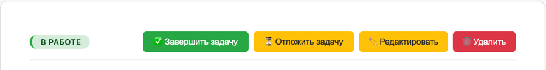

Planned:

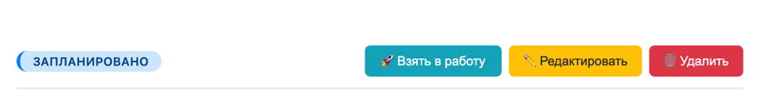

Knowledge base:

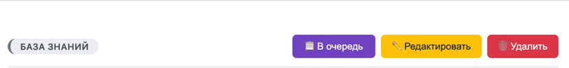

**"Postpone Task" feature:**

```dotty
button(
  cls            := "postpone-task-btn",
  attr("hx-put") := s"/task/${task.id.value}/defer",
  Htmx.appTarget,
  Htmx.appSwap,
  attr("hx-confirm") :=
    s"""Are you sure you want to postpone task "${task.name.value}"?"""
)("⏳ Postpone Task")
```

- **`hx-put="/task/{id}/defer"`** — PUT request for postponing the task.
- **`hx-target="#app"`** — after postponing, **the entire task page is replaced**
  with the updated view (now the task is in `Planned` status).
- **`hx-confirm`** — confirmation dialog.

**"Start Task" and "Queue" features:**

```dotty
if task.plan.isEmpty then
  button(
    cls           := "start-task-btn",
    disabled      := true,
    attr("title") := "Cannot start a task without an execution plan"
  )("🚀 Start Task")
else
  button(
    cls             := "start-task-btn",
    attr("onclick") := "openModal('startModal')"
  )("🚀 Start Task")
```

- If the task has **no plan** — the button is **disabled** with a tooltip.
- If a plan exists — a [modal window opens](ui_task_actions.md).

Planned:

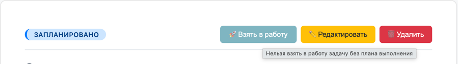

Knowledge base:

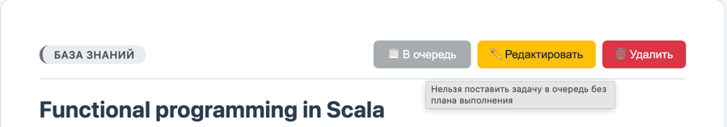

### Main Information

```dotty
div(
  `id` := "taskDetailBlock",
  cls  := "task-detail-container",
  div(cls := "task-detail-header")(
    div(cls := "task-detail-nav")(
      span(
        cls :=
          s"task-detail-status-badge ${task.status.toString.toLowerCase}"
      )(task.status.show)
    ),
    div(cls := "task-detail-actions")(
      statusButtons,
      editButton(s"/task/${task.id.value}/edit"),
      deleteButton(
        s"/task/${task.id.value}",
        task.name.value,
        "task"
      )
    )
  ),
  errorBlock(errorMessage),
  task.render,
  ...
)

final case class TaskCard(...):
  ...
  def render: Frag =
    val mainInfo =
      detailSection(
        "📋 Basic Information",
        Seq(
          "Task Type" -> taskType,
          "Section"   -> section,
          "Goal"      -> goal,
          "Ordinal"   -> s"#${ordinal.value}"
        )
      )

    val dates =
      detailSection(
        "📅 Dates",
        Seq(
          "Start Date"        -> startDate.render,
          "End Date"          -> endDate.render,
          "Duration"          -> durationDesc,
          "Time Spent"        -> timeSpentDesc,
          "Remaining Time"    -> remainingTimeDesc
        )
      )

    frag(
      titleCard(name.value),
      div(
        cls := "task-detail-grid",
        mainInfo,
        dates
      )
    )
  end render
```

Two blocks in a grid: on the left — basic information (type, section, goal, ordinal),
on the right — dates and duration.

**Date formatting:**

```dotty
private inline def formatter: DateTimeFormatter =
  DateTimeFormatter.ofPattern("dd.MM.yyyy")

given Render[LocalDate] with
  def render(value: LocalDate): String =
    value.format(formatter)

given Render[Option[LocalDate]] with
  def render(value: Option[LocalDate]): String =
    value.map(_.render).getOrElse("—")
```

- If a date exists — it's formatted as `25.07.2026`.
- If not — `—` is displayed.

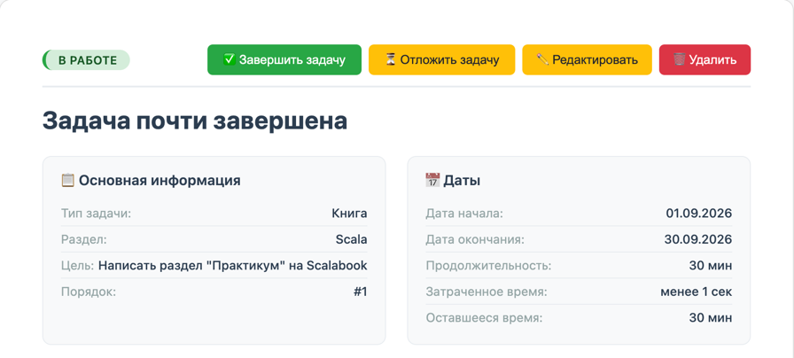

### Timer

```dotty
div(cls := "task-detail-section full-width")(
  h3("⏱️ Timer"),
  div(
    cls                  := "timer-container",
    attr("data-task-id") := task.id.value.toString
  )(
    div(cls := "timer-display", `id` := "timerDisplay")("00:00:00"),
    div(cls := "timer-actions")(
      button(
        cls             := "timer-btn start-btn",
        `id`            := "startTimerBtn",
        attr("onclick") := s"startTimer('${task.id.value}')"
      )("▶️ Start"),
      button(
        cls             := "timer-btn stop-btn",
        `id`            := "stopTimerBtn",
        attr("onclick") :=
          s"stopTimer('${task.id.value}', '${token.show}')",
        style := "display: none;"
      )("⏹️ Record"),
      button(
        cls             := "timer-btn reset-btn",
        `id`            := "resetTimerBtn",
        attr("onclick") := "resetTimer()"
      )("🔄 Reset")
    )
  )
)
```

**How the timer works:**

1. **Initial state:** "Start" and "Reset" buttons are visible, "Stop" is hidden.
2. **"Start" click** — JavaScript starts the interval and switches buttons.
3. **"Stop" click** — JavaScript stops the interval and sends a PUT request
   to `/task/{id}/spent` with the number of minutes.
4. **"Reset" click** — JavaScript resets the counter.

**Why is the timer on JavaScript, not htmx?**

The timer must update **every second** — that's 60 requests per minute.
If we used htmx for every tick, the server would be overloaded.
So the counter updates on the client, and only
the final value is sent to the server upon stopping.

Initial state:

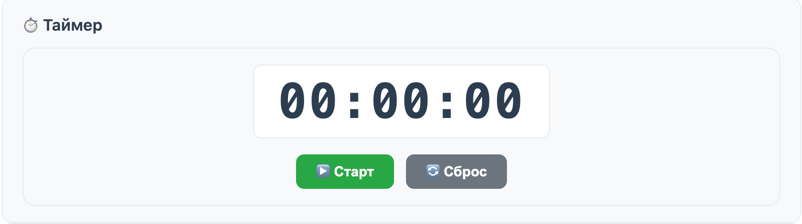

Timer running:

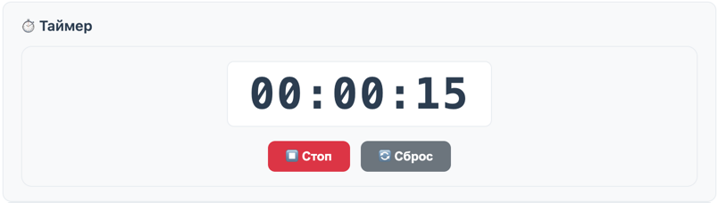

### Execution Plan

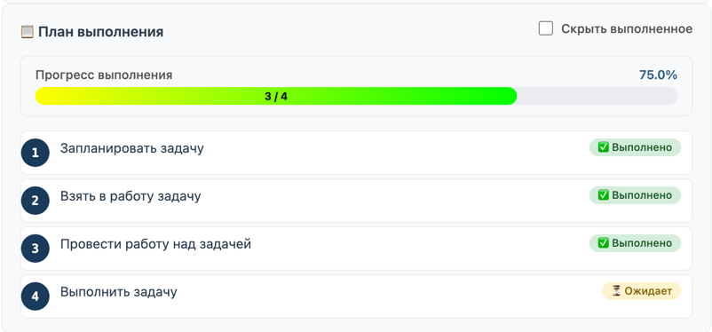

```dotty
def renderPlan(
    plan: List[PlanRowCard],
    progress: ProgressCard,
    link: String
): Tag =
  div(
    cls := "task-detail-section full-width",
    div(
      cls := "plan-header",
      h3("📋 Execution Plan"),
      label(
        cls := "hide-completed-label",
        input(
          `type`   := "checkbox",
          id       := "hideCompleted",
          onchange := "toggleCompleted()",
          checked
        ),
        " Hide Completed"
      )
    ),
    if plan.nonEmpty then
      frag(
        progress.render,
        div(
          cls := "task-plan-list",
          id  := "planList",
          plan.map(_.render(link))
        )
      )
    else p(cls := "empty-message")("Plan not set")
  )
```

**"Hide Completed" checkbox** — the JavaScript function `toggleCompleted()`
hides all plan steps with `data-completed="true"`.

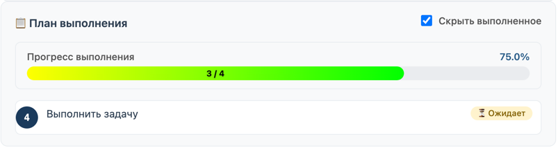

**Progress bar:**

```dotty
final case class ProgressCard(
    progress: Double,
    completedCount: Int,
    count: Int
):
  def render: Tag =
    div(
      cls := "plan-progress-container",
      div(
        cls := "plan-progress-label",
        span("Execution Progress"),
        span(cls := "plan-progress-percent")(s"$progress%")
      ),
      div(
        cls := "plan-progress-bar",
        div(
          cls   := "plan-progress-fill",
          style := s"width: $progress%;",
          span(cls := "plan-progress-text")(completedCount / count)
        )
      )
    )
```

Shows the completion percentage and the `completed / total` counter.

**Plan step list:**

```dotty
div(
  cls := "task-plan-list",
  id  := "planList",
  plan.map(_.render(link))
)

final case class PlanRowCard(number: String, step: String, completed: Boolean):
  def render(link: String): Tag =
    val level = number.count(_ == '.')
    div(
      cls := "task-plan-item" + (if completed then " completed-hidden" else ""),
      attr("data-level")     := level,
      attr("data-completed") := completed,
      div(
        cls := s"plan-step-number level-$level",
        number
      ),
      div(
        cls := "plan-step-content",
        div(
          cls                   := "plan-step-text markdown-content",
          attr("data-markdown") := step
        ),
        if completed then
          span(cls := "plan-step-status completed")("✅ Completed")
        else
          button(
            cls            := "plan-step-complete-btn",
            attr("hx-put") := s"$link/$number",
            Htmx.appTarget,
            Htmx.appSwap,
            title := "Mark step as completed"
          )("✅ Complete")
      )
    )
```

**Hierarchy levels:** `plan.number.count(_ == '.')` counts dots in the number:

- `1` → level 0
- `1.2` → level 1
- `1.2.3` → level 2, etc.

CSS uses `data-level` for indentation and color differentiation.

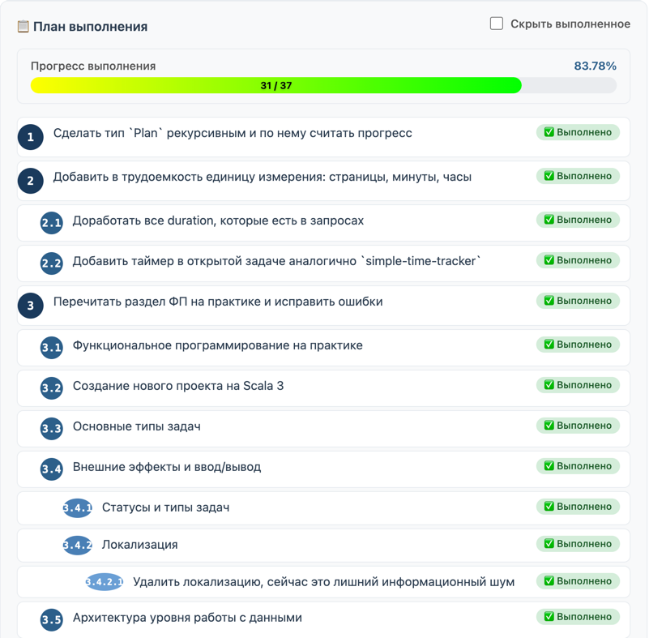

### Modal Windows

Modal windows are covered on the ["Task Actions"](ui_task_actions.md) page.

## Handling "task not found"

```dotty
def notFound(): Modifier =
  div(cls := "home-container")(
    div(cls := "not-found-content")(
      h1(cls := "not-found-title")("404"),
      p(cls := "not-found-text")("Page not found"),
      a(href := "/", cls := "home-button")("🏠 Home")
    )
  )
```

Rendering of `Views.notFound` is used in `TaskHandlers.openHandler` when:

- A task with that UUID does not exist.
- The task belongs to another user.
- The token is invalid or missing.

This is a safe error handling approach: the user sees a friendly 404 page
with a "Home" button, not a technical error.

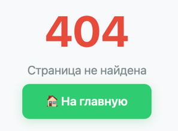

## Summary

The task page is a fully-functional screen for working with a specific task:

1. **Viewing full information:** name, type, section, goal, ordinal, dates,
   duration, time spent, and remaining time.
2. **Managing status:** completion, postponing, starting, queuing —
   each operation is available only for the corresponding status.
3. **Working with the plan:** step list with hierarchical levels, progress bar,
   "Hide Completed" filter.
4. **Timer:** start, stop, and reset, with time spent
   saved to the server.
5. **Editing and deleting:** navigating to the editing form or deleting
   with confirmation.

**Key architectural decisions:**

- **`TaskCard` model** — a "fat" view model with ready-to-use strings
  for the template (names instead of IDs, duration descriptions, etc.).
- **`availableOrdinals`** — the algorithm offers 5 available ordinal numbers
  with hints about which task they will be placed after.

The task page is the central place where the user works with a single task.
It combines informativeness (all task data on one screen)
and interactivity (fast status switching, plan work, timer).

---

**Links:**

- [Repository with source code][repo]

[repo]: https://gitverse.ru/scalabook/pdp
