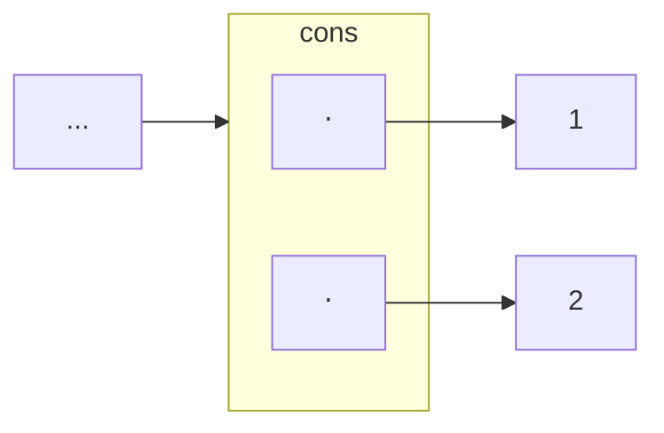
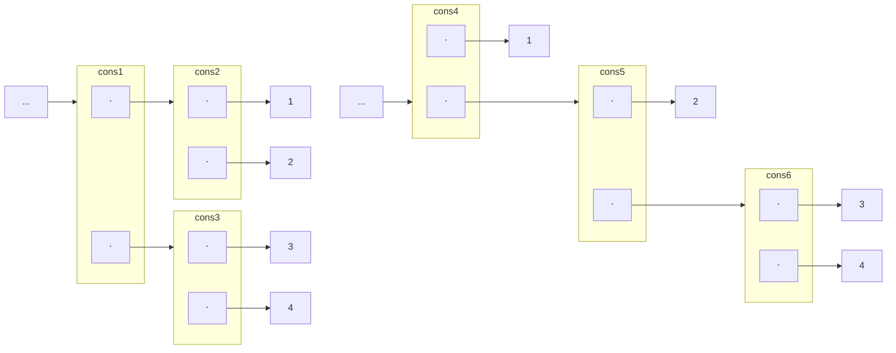
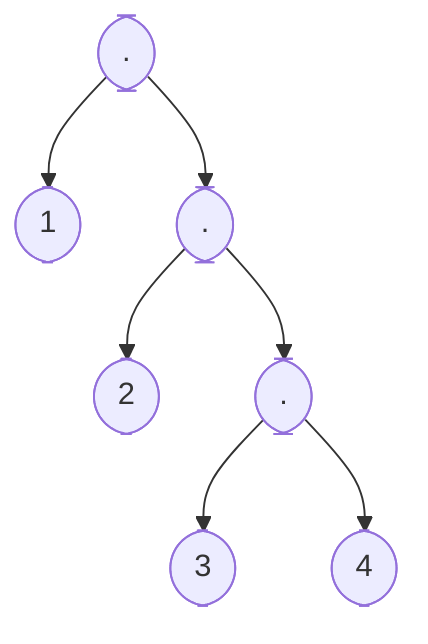
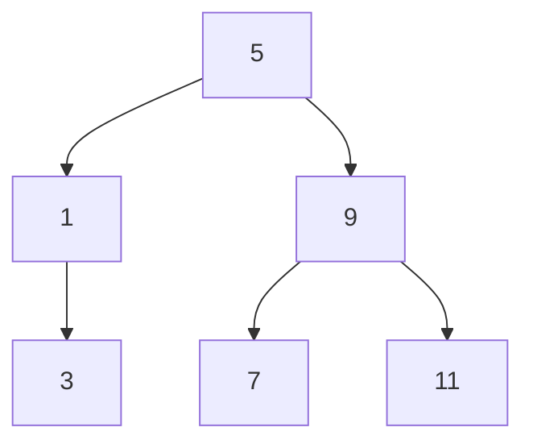

# SICP: Chapter 2
{: .no_toc }



# Chapter 2. Building Abstractions with Data

This chapter turns to another important feature of any programming language:
the means it provides for creating abstractions through the combination
of data objects and the construction of _compound data_.

A _compound data object_ is a data structure
that consists of several data elements of various types.
These elements can be both simple (e.g., numbers, strings)
and complex (e.g., arrays, other compound objects).

A general approach to separating parts of a program that deal with the representation
of data objects from those parts where these data objects are used is a powerful
design methodology called _data abstraction_.

Abstraction is a method of managing complexity. Data abstraction allows us to build useful
 abstractions between different parts of a program.

An important idea in working with compound data is the notion of _closure_:
the means for combining data objects should allow not only combining elementary data objects, but also compound ones.
Another important idea is that compound data objects can serve as
_conventional interfaces_, so that program modules can be combined via substitution.

_symbolic expressions_ — data whose
elementary parts can be arbitrary symbols, not just numbers.

_generic operations_ handle many different types of data.
Supporting modularity in the presence of generic operations requires more powerful abstraction barriers
than those obtained via simple data abstraction.
Namely, we introduce _data-directed programming_ as a method
that allows designing data representations separately,
and then combining them _additively_ (i.e., without modification).

## 2.1. Introduction to Data Abstraction

_data abstraction_ is a methodology that allows separating the manner of using
a compound data object from the details of how it is composed from elementary data.

The main idea of data abstraction is to build programs working with compound data
so that they deal with "abstract data."
That is, when using data, our programs should not make any assumptions about them,
except those absolutely necessary for solving the given task.
At the same time, the _concrete_ representation of data is defined independently of the programs
that use this data. The interface between these two parts of the system is a
set of procedures called _selectors_ and _constructors_ that
implement abstract data in terms of the concrete representation.

### 2.1.1. Example: Arithmetic Operations on Rational Numbers

##### Pairs

To implement the concrete level of data abstraction in our language, there is a compound structure
called a _tuple_.
Data objects composed of tuples are called _list-structured data_.

```dotty
opaque type Pair = (Long, Long)
val cons: Pair = (-5, 7)
// cons: Tuple2[Long, Long] = (-5L, 7L)
val car = cons._1
// car: Long = -5L
val cdr = cons._2
// cdr: Long = 7L
```

##### Representation of Rational Numbers

Representation of rational numbers as a `case class`:

```dotty
final case class Rational private (numer: Long, denom: Long):
  import Rational.makeRat

  lazy val print: String = s"$numer/$denom"

  def +(that: Rational): Rational =
    makeRat(numer * that.denom + that.numer * denom, denom * that.denom)

  def -(that: Rational): Rational =
    makeRat(numer * that.denom - that.numer * denom, denom * that.denom)

  def *(that: Rational): Rational =
    makeRat(numer * that.numer, denom * that.denom)

  def /(that: Rational): Rational =
    makeRat(numer * that.denom, denom * that.numer)

  def ===(that: Rational): Boolean =
    numer * that.denom == denom * that.numer

object Rational:
  def makeRat(numer: Long, denom: Long): Rational =
    Rational(numer, denom)

Rational.makeRat(-5, 7).print
// res0: String = "-5/7"
Rational.makeRat(-5, 7) + Rational.makeRat(3, 7)
// res1: Rational = Rational(numer = -14L, denom = 49L)
Rational.makeRat(-5, 7) - Rational.makeRat(3, 7)
// res2: Rational = Rational(numer = -56L, denom = 49L)
Rational.makeRat(-5, 7) * Rational.makeRat(3, 7)
// res3: Rational = Rational(numer = -15L, denom = 49L)
Rational.makeRat(-5, 7) / Rational.makeRat(3, 7)
// res4: Rational = Rational(numer = -35L, denom = 21L)
Rational.makeRat(-5, 7) === Rational.makeRat(-10, 14)
// res5: Boolean = true
```

#### Exercise 2.1

> Define an improved version of `make-rat` that handles both positive and negative arguments.
> `make-rat` should normalize the sign so that
> if the rational number is positive, both its numerator and denominator are positive;
> if it is negative, only the numerator is negative.

```dotty
object Rational:
  def makeRat(numer: Long, denom: Long): Rational =
    val g = gcd(numer, denom)
    val sign = if denom < 0 then -1 else 1
    Rational(sign * numer / g, sign * denom / g)
```

```dotty
Rational.makeRat(14, 49).print
// res7: String = "2/7"
Rational.makeRat(1, 2).print
// res8: String = "1/2"
Rational.makeRat(-1, -2).print
// res9: String = "1/2"
Rational.makeRat(-1, 2).print
// res10: String = "-1/2"
Rational.makeRat(1, -2).print
// res11: String = "-1/2"
```

[Scala Worksheet](https://scastie.scala-lang.org/B9k1gvnISCqx9BEH9pEvtw)

### 2.1.2. The Abstraction Barrier

#### Exercise 2.2

> Consider the problem of representing line segments on a plane.
> Each segment is represented as a pair of points: start and end.
> Define constructor `make-segment` and selectors `start-segment` and `end-segment`,
> which define the representation of segments in terms of points.
> Next, a point can be represented as a pair of numbers: x coordinate and y coordinate.
> Accordingly, write constructor `make-point` and selectors `x-point` and `y-point` that define such a representation.
> Finally, using your selectors and constructor, write procedure `midpoint-segment`,
> which takes a segment as an argument and returns its midpoint
> (a point whose coordinates are the average of the segment endpoints).
> To test these procedures, you will need a way to print point coordinates.

```dotty
final case class Point(x: Double, y: Double):
  override def toString(): String = s"($x,$y)"

final case class Segment(start: Point, end: Point):
  lazy val midpoint: Point = Point((start.x + end.x) / 2, (start.y + end.y) / 2)

Segment(Point(1, 0), Point(0, 1)).midpoint.toString
// res12: String = "(0.5,0.5)"
```

[Scala Worksheet](https://scastie.scala-lang.org/3SvZKbYZRPaSqiCyNtwikQ)

#### Exercise 2.3

> Implement a representation for rectangles on a plane.
> (Hint: you may need the results from exercise 2.2.)
> Define procedures to calculate the perimeter and area of a rectangle in terms of your constructors and selectors.
> Now implement another representation for rectangles.
> Can you design your system with suitable abstraction barriers so that
> the same perimeter and area procedures work with any of your representations?

```dotty
final case class Point(x: Double, y: Double):
  override def toString(): String = s"($x,$y)"

final case class Segment(start: Point, end: Point):
  lazy val midpoint: Point = Point((start.x + end.x) / 2, (start.y + end.y) / 2)
  lazy val length: Double =
    math.sqrt(math.pow(start.x - end.x, 2.0) + math.pow(start.y - end.y, 2.0))

final case class Rectangle(
    topLeft: Point,
    topRight: Point,
    bottomRight: Point,
    bottomLeft: Point
):
  private lazy val topSideLength: Double = Segment(topLeft, topRight).length
  private lazy val leftSideLength: Double = Segment(topLeft, bottomLeft).length

  lazy val perimeter: Double =
    2 * (topSideLength + leftSideLength)
  lazy val square: Double =
    topSideLength * leftSideLength

object Rectangle:
  def apply(segment1: Segment, segment2: Segment): Rectangle =
    Rectangle(segment1.start, segment1.end, segment2.start, segment2.end)

val rect = Rectangle(Point(0, 0), Point(1, 0), Point(1, 1), Point(0, 1))
rect.perimeter
// res14: Double = 4.0
rect.square
// res15: Double = 1.0
```

[Scala Worksheet](https://scastie.scala-lang.org/WOqHhQ9qRBmR8K0fueiA3g)

### 2.1.3. What Do We Mean by "Data"?

Data is something defined by a set of selectors and constructors,
along with certain conditions that these procedures must satisfy to be a correct representation.

A pair can be implemented using only procedures:

```dotty
def cons[A, B](a: A, b: B): Boolean => A | B =
  def dispatch(m: Boolean): A | B =
    if m then a else b

  dispatch

def car[A, B](a: A, b: B): A | B =
  cons(a, b)(true)

def cdr[A, B](a: A, b: B): A | B =
  cons(a, b)(false)
```

#### Exercise 2.4

> Here is another procedural representation for pairs.
> Check that for this representation, for any two objects x and y, `(car (cons x y))` returns x.
>
> ```
> (define (cons x y)
>   (lambda (m) (m x y)))
> (define (car z)
>   (z (lambda (p q) p)))
> ```
>
> What is the corresponding definition of `cdr`?
> (Hint: to check that this works, use the substitution model from section 1.1.5.)

```dotty
final case class Cons[A](x: A, y: A):
  def lambda(f: (A, A) => A): A =
    f(x, y)

def car[A](z: Cons[A]): A =
  z.lambda((p: A, q: A) => p)

def cdr[A](z: Cons[A]): A =
  z.lambda((p: A, q: A) => q)
```

Consider the chain of transformations:

- `(car (cons x y))`
- `(cons x y).lambda((p: A, q: A) => p)`
- `((p: A, q: A) => p)(x, y)`
- `x`

Similarly for `cdr`.

#### Exercise 2.5

> Show that we can represent pairs of non-negative integers
> using only numbers and arithmetic operations, if we represent the pair a and b
> as the product \\(2^{a} \times 3^{b}\\).
> Give the corresponding definitions of procedures `cons`, `car`, and `cdr`.

```dotty
final case class Cons(x: Int, y: Int):
  lazy val cons: Int = math.pow(2, x).toInt * math.pow(3, y).toInt

  def degreeOfFactor(a: Int): Int =
    def loop(n: Int, count: Int): Int =
      if n % a == 0 then loop(n / a, count + 1)
      else count 
    loop(cons, 0)

def car(z: Cons): Int =
  z.degreeOfFactor(2)

def cdr(z: Cons): Int =
  z.degreeOfFactor(3)
```

#### Exercise 2.6

> If the representation of pairs as procedures seemed not crazy enough to you,
> note that in a language capable of manipulating procedures,
> we can do without numbers (at least as far as non-negative numbers are concerned),
> by defining 0 and the add-1 operation as follows:
>
> ```
> (define zero (lambda (f) (lambda (x) x)))
>
> (define (add-1 n)
>   (lambda (f) (lambda (x) (f ((n f) x)))))
> ```
>
> This representation is known as Church numerals,
> named after its inventor, Alonzo Church, the same logician who invented the lambda calculus.
> Define `one` and `two` directly (not via `zero` and `add-1`).
> (Hint: compute `(add-1 zero)` using substitution.)
> Give a direct definition of the addition procedure `+` (not in terms of repeated application of `add-1`).

A Church number can be defined as the n-fold application of a given function to an argument.

For example, like this:

```dotty
def zero[A](f: A => A): A => A = x => x

def add1[A](f: A => A, n: Int): A => A =
  if n == 0 then zero(f)
  else (a: A) => add1(f, n - 1)(a)
```

Then one is a single application of the function, two is a double application, and addition of `a` and `b` is applying
the function `f` to argument `a + b` times.

### 2.1.4. Advanced Example: Interval Arithmetic

#### Exercise 2.7

> Lisa's program is incomplete because she did not define how the interval abstraction is implemented.
> Here is the interval constructor definition: `(define (make-interval a b) (cons a b))`
> Complete the implementation by defining selectors `upper-bound` and `lower-bound`.

```dotty
final case class Interval(a: Double, b: Double):
  lazy val upperBound: Double = math.max(a, b)
  lazy val lowerBound: Double = math.min(a, b)

  def add(that: Interval): Interval =
    Interval(
      this.lowerBound + that.lowerBound,
      this.upperBound + that.upperBound
    )

  def mul(that: Interval): Interval =
    val p1 = this.lowerBound * that.lowerBound
    val p2 = this.lowerBound * that.upperBound
    val p3 = this.upperBound * that.lowerBound
    val p4 = this.upperBound * that.upperBound
    Interval(
      math.min(math.min(p1, p2), math.min(p3, p4)),
      math.max(math.max(p1, p2), math.max(p3, p4))
    )

  def div(that: Interval): Interval =
    mul(Interval(1.0 / that.upperBound, 1.0 / that.lowerBound))
```

[Scala Worksheet](https://scastie.scala-lang.org/vZmsk52FRryWBvPmGz1bvA)

#### Exercise 2.8

> Reasoning in the spirit of Lisa, describe how to compute the difference of two intervals.
> Write the corresponding subtraction procedure, called `sub-interval`.

```dotty
def sub(that: Interval): Interval =
  Interval(
    this.lowerBound - that.upperBound,
    this.upperBound - that.lowerBound
  )
```

#### Exercise 2.9

> The width of an interval is defined as half the distance between its upper and lower bounds.
> Width is a measure of uncertainty of the number that the interval denotes.
> There are arithmetic operations for which the width of the result depends only on the widths of the argument intervals,
> and there are operations for which the width of the result is not a function of the widths of the arguments.
> Show that the width of the sum (or difference) of two intervals depends only on the widths of the intervals
> that are being added (or subtracted).
> Give examples that show that this is not the case for multiplication or division.

```dotty
lazy val width: Double = (upperBound - lowerBound) / 2.0
```

The width of the sum of intervals is computed as follows:

- `((this.upperBound + that.upperBound) - (this.lowerBound + that.lowerBound)) / 2.0`
- `((this.upperBound - this.lowerBound) / 2.0 + (that.upperBound - that.lowerBound) / 2.0)`
- `this.width + that.width`

The width of the difference of intervals is computed as follows:

- `((this.upperBound - that.lowerBound) - (this.lowerBound - that.upperBound)) / 2.0`
- `((this.upperBound - this.lowerBound) / 2.0 + (that.upperBound - that.lowerBound) / 2.0)`
- `this.width + that.width`

For multiplication and division, the situation is different: if we take two intervals of width `1`: `(0, 2)` and `(2, 4)`,
then the product of intervals will be the interval `(0, 8)` with width `4`,
and the result of division will be the interval `(0, 1)` with width `0.5`.

#### Exercise 2.10

> Ben Bitdiddle, the systems programmer, looks over Lisa's shoulder and notices:
> it is unclear what dividing by an interval that crosses zero should mean.
> Modify Lisa's code so that the program checks this condition and reports an error if it occurs.

```dotty
def div(that: Interval): Option[Interval] =
  if that.lowerBound <= 0.0 && that.upperBound >= 0.0 then None
  else Some(mul(Interval(1.0 / that.upperBound, 1.0 / that.lowerBound)))
```

#### Exercise 2.11

> Passing by, Ben makes a cryptic remark:
> "If you check the signs of the interval endpoints, you can divide `mul-interval` into nine cases,
> of which only one requires more than two multiplications."
> Rewrite this procedure according to Ben's suggestion.

```dotty
def mul(that: Interval): Interval =
  (
    this.lowerBound < 0,
    this.upperBound < 0,
    that.lowerBound < 0,
    that.upperBound < 0
  ) match
    case (true, true, true, true) =>
      Interval(
        this.upperBound * that.upperBound,
        this.lowerBound * that.lowerBound
      )
    case (true, true, true, false) =>
      Interval(
        this.lowerBound * that.upperBound,
        this.lowerBound * that.lowerBound
      )
    case (true, true, false, false) =>
      Interval(
        this.lowerBound * that.upperBound,
        this.upperBound * that.lowerBound
      )
    case (true, false, true, true) =>
      Interval(
        this.upperBound * that.lowerBound,
        this.lowerBound * that.lowerBound
      )
    case (true, false, true, false) =>
      val p1 = this.lowerBound * that.lowerBound
      val p2 = this.lowerBound * that.upperBound
      val p3 = this.upperBound * that.lowerBound
      val p4 = this.upperBound * that.upperBound
      Interval(
        math.min(p2, p3),
        math.max(p1, p4)
      )
    case (true, false, false, false) =>
      Interval(
        this.lowerBound * that.upperBound,
        this.upperBound * that.upperBound
      )
    case (false, false, true, true) =>
      Interval(
        this.upperBound * that.lowerBound,
        this.lowerBound * that.upperBound
      )
    case (false, false, true, false) =>
      Interval(
        this.upperBound * that.lowerBound,
        this.upperBound * that.upperBound
      )
    case (false, false, false, false) =>
      Interval(
        this.lowerBound * that.lowerBound,
        this.upperBound * that.upperBound
      )
```

#### Exercise 2.12

> Define constructor `make-center-percent`,
> which takes a center value and a percentage error and produces the required interval.
> You also need to define selector `percent`, which for a given interval produces the percentage error.
> The `center` selector remains the same as shown above.

```dotty
final case class Interval(a: Double, b: Double):
  lazy val upperBound: Double = math.max(a, b)
  lazy val lowerBound: Double = math.min(a, b)
  lazy val center: Double = (upperBound + lowerBound) / 2.0
  lazy val width: Double = (upperBound - lowerBound) / 2.0
  lazy val percent: Double = (width / center) * 100

  // ...

object Interval:
  def makeCenterWidth(center: Double, width: Double): Interval =
    Interval(center - width, center + width)

  def makeCenterPercent(center: Double, percent: Double): Interval =
    val width: Double = percent * center / 100.0
    makeCenterWidth(center, width)
```

#### Exercise 2.13

> Show that, assuming the error is a small fraction of the interval magnitude,
> the percentage error of the product of two intervals can be obtained
> from the percentage errors of the original intervals using a simple approximate formula.
> The problem can be simplified by assuming all numbers are positive.

Consider the product of two intervals with a small error:

- `Interval(c1 - w1, c1 + w1) * Interval(c2 - w2, c2 + w2)`
- `Interval((c1 - w1) * (c2 - w2), (c1 + w1) * (c2 + w2))`
- `mulCenter = ((c1 * c2 + w1 * c2 + w2 * c1 + w1 * w2) + (c1 * c2 - w1 * c2 - w2 * c1 + w1 * w2)) / 2`
- `mulCenter = (c1 * c2 + w1 * w2)`
- since the error is a small value, the term `w1 * w2` can be ignored
- `mulWidth = ((c1 * c2 + w1 * c2 + w2 * c1 + w1 * w2) - (c1 * c2 - w1 * c2 - w2 * c1 + w1 * w2)) / 2`
- `mulWidth = (w1 * c2 + w2 * c1)`
- `mulPercent = ((w1 * c2 + w2 * c1) / (c1 * c2)) * 100 = (w1 / c1) * 100 + (w2 / c2) * 100`
- thus the percentage error of the product is approximately equal to the sum of the percentage errors of the factors

#### Exercise 2.14

> Show that Dayko is right.
> Investigate the behavior of the system on various arithmetic expressions.
> Create several intervals A and B and compute expressions A/A and A/B with them.
> You will get the most benefit if you use intervals
> whose width is a small fraction of the center value.
> Investigate the results in center/percent form (see exercise 2.12).

```dotty
def par1(r1: Interval, r2: Interval): Option[Interval] =
  (r1.mul(r2)).div(r1.add(r2))

def par2(r1: Interval, r2: Interval): Option[Interval] =
  for
    one <- Interval(1, 2).div(Interval(1, 2))
    oneDivR1 <- one.div(r1)
    oneDivR2 <- one.div(r2)
    result <- one.div(oneDivR1.add(oneDivR2))
  yield result

val r1 = Interval.makeCenterWidth(10, 0.01)
// r1: Interval = Interval(a = 9.99, b = 10.01)
val r2 = Interval.makeCenterWidth(20, 0.01)
// r2: Interval = Interval(a = 19.99, b = 20.01)
par1(r1, r2)
// res17: Option[Interval] = Some(
//   value = Interval(a = 6.652235176548966, b = 6.681124082721815)
// )
par2(r1, r2)
// res18: Option[Interval] = Some(
//   value = Interval(a = 1.6652776851234157, b = 26.6888874083944)
// )
```

The methods do indeed produce different results, because dividing an interval by itself (A/A) is not unity,
but an interval having a small error.

[Scala Worksheet](https://scastie.scala-lang.org/56fiIZVmSTitSmDRQmMFtw)

## 2.2. Hierarchical Data and the Closure Property

The representation of `(cons 1 2)` as a pointer diagram:



In this representation, which is called _box-and-pointer notation_,
each object is depicted as a _pointer_, pointing to some cell.
A cell representing an elementary object contains a representation of that object.
For example, a cell corresponding to a number contains a numeric constant.
A pair is depicted as two cells, the upper one containing (a pointer to the) car of this pair, and the lower one containing its cdr.

The diagram below shows two ways to connect numbers 1, 2, 3, and 4 using pairs:

- `((1, 2), (3, 4))`
- `(1, (2, (3, 4)))`



The ability to create pairs whose elements are themselves pairs
determines the significance of list structure as a data representation means.
We call this property the _closure property_ for `cons`.
In general, an operation of combining data objects has the closure property if
the results of combining objects with this operation can themselves be combined with this same operation.
Closure is the key to expressive power for any means of combination,
since it allows building _hierarchical_ structures,
i.e., structures composed of parts that are themselves composed of parts, and so on.

### 2.2.1. Representing Sequences

One of the useful structures that can be built using pairs is a _sequence_,
i.e., an ordered collection of data objects.

`Cons(1, Cons(2, Cons(3, Cons(4, Nil))))` — such a sequence of pairs,
generated by nested conses, is called a _list_.
Or more briefly: `1 :: 2 :: 3 :: 4 :: Nil`.
The value `Nil`, which terminates the chain of pairs, can be viewed as an empty sequence,
an _empty list_.
The word nil comes from the contraction of the Latin "nihil," meaning "nothing."

#### Operations on Lists

The procedure `list-ref` takes a list and a number n as arguments and returns the n-th element of the list.
Elements of the list are usually numbered starting from 0. The computation method of `list-ref` is as follows:

- If n = 0, `list-ref` should return the car of the list.
- Otherwise, `list-ref` should return the (n − 1)-th element of the cdr of the list.

```dotty
def listRef[A](items: List[A], n: Int): Option[A] =
  if n <= 0 then items.headOption
  else
    items match
      case Nil          => None
      case head :: tail => listRef(tail, n - 1)

listRef(List(1, 4, 9, 16, 25), 3)
// Some(16)
```

The procedure `length`, which returns the number of elements in a list:

```dotty
def length[A](items: List[A]): Int =
  items match
    case Nil       => 0
    case _ :: tail => 1 + length(tail)

length(List(1, 3, 5, 7))
// 4
```

The procedure `length` implements a simple recursive pattern. The reduction step is:

- The length of any list equals 1 plus the length of the cdr of that list.

This step is applied sequentially until we reach the base case:

- The length of an empty list is `0`.

We can compute `length` in an iterative style as well:

```dotty
def length[A](items: List[A]): Int =
  @tailrec
  def loop(items: List[A], l: Int): Int =
    items match
      case Nil       => l
      case _ :: tail => loop(tail, l + 1)

  loop(items, 0)

length(List(1, 3, 5, 7))
// 4
```

`Append` is also implemented by a recursive pattern.
To concatenate lists `list1` and `list2`, we should do the following:

- If list `list1` is empty, then the result is simply `list2`.
- Otherwise, we need to concatenate the cdr of `list1` with `list2`,
  and prepend the car of `list1` to the result using `cons`:

```dotty
def append[A](list1: List[A], list2: List[A]): List[A] =
  list1 match
    case Nil => list2
    case head :: tail =>
      head :: append(tail, list2)

append(List(1, 4, 9, 16, 25), List(1, 3, 5, 7))
// List(1, 4, 9, 16, 25, 1, 3, 5, 7)
```

#### Exercise 2.17

> Define procedure `last-pair`, which returns a list
> containing only the last element of a given (non-empty) list.
> `(last-pair (list 23 72 149 34))`
> `(34)`

```dotty
def lastPair[A](list: List[A]): List[A] =
  list match
    case Nil      => Nil
    case h :: Nil => List(h)
    case _ :: t   => lastPair(t)

lastPair(List(23, 72, 149, 34)) 
// List(34)
```

#### Exercise 2.18

> Define procedure `reverse`, which takes a list as an argument and returns a list
> consisting of the same elements in reverse order:
> `(reverse (list 1 4 9 16 25))`
> `(25 16 9 4 1)`

```dotty
def reverse[A](list: List[A]): List[A] =
  list match
    case Nil => Nil
    case h :: t   => t.reverse :+ h

reverse(List(1, 4, 9, 16, 25)) // List(25, 16, 9, 4, 1)
```

#### Exercise 2.19

> Consider the program for counting change from section 1.2.2.
> It would be nice to be able to easily change the currency that the program uses,
> so that one could, for example, compute how many ways there are to change a British pound.
> This program is written such that knowledge about currency is distributed between procedures `first-denomination`
> and `count-change` (which knows that there are five types of American coins).
> It would be nicer to have a way to simply specify a list of coins that can be used for change.
>
> We want to rewrite procedure `cc` so that its second argument is a list of coins,
> rather than an integer indicating which coins to use.
> Then we could have lists defining types of currencies:
>
> `val usCoins = List(50, 25, 10, 5, 1)`
>
> `val ukCoins = List(100, 50, 20, 10, 5, 2, 1, 0.5)`
>
> We could call `cc` as follows:
>
> `cc(100.0, usCoins) // 292`
>
> This will require some changes to the `cc` program.
> Its shape will remain the same, but it will work differently with the second argument, like this:
>
> ```dotty
> def noMore(coinValues: List[Double]): Boolean = ???
>
> def exceptFirstDenomination(coinValues: List[Double]): List[Double] = ???
>
> def firstDenomination(coinValues: List[Double]): Double = ???
>
> def cc(amount: Double, coinValues: List[Double]): Int =
>   if amount == 0 then 1
>   else if amount < 0 || noMore(coinValues) then 0
>   else
>     cc(amount, exceptFirstDenomination(coinValues)) +
>     cc(amount - firstDenomination(coinValues), coinValues)
> ```
>
> Define procedures `first-denomination`, `except-first-denomination`, and `no-more`
> in terms of elementary operations on list structures.
> Does the order of the `coinValues` list affect the result produced by `cc`?
> Why?

```dotty
def noMore(coinValues: List[Double]): Boolean =
  coinValues match
    case Nil => true
    case _   => false

def exceptFirstDenomination(coinValues: List[Double]): List[Double] =
  coinValues match
    case Nil    => Nil
    case _ :: t => t

def firstDenomination(coinValues: List[Double]): Double =
  coinValues match
    case Nil    => 0.0
    case h :: _ => h
```

[Scala Worksheet](https://scastie.scala-lang.org/2Yd4XGN2RKicv3pFSWUepA)

The order of the `coinValues` list does not affect the result, because regardless of which coin comes first,
all possibilities can be divided into two categories: the sum uses the first coin or it does not.

#### Exercise 2.20

> Procedures `+`, `*`, and `list` accept an arbitrary number of arguments.
> One way to define such procedures is by using _dotted-tail notation_.
> In the definition of a procedure, a dot before the name of the last parameter means
> that when the procedure is called, the initial parameters (if any) will have as values
> the initial arguments, as usual,
> but the value of the last parameter will be a _list_ of all remaining arguments.
> For example, if given the definition
>
> `(define (f x y . z) <body>)`
>
> then procedure `f` can be called with two or more arguments. If we evaluate
>
> `(f 1 2 3 4 5 6)`
>
> then inside `f`, variable `x` will be `1`, `y` will be `2`, and `z` will be the list `(3 4 5 6)`.
> If given the definition
>
> `(define (g . w) <body>)`
>
> then procedure `g` can be called with zero or more arguments. If we evaluate
>
> `(g 1 2 3 4 5 6)`
>
> then inside `g`, the value of variable `w` will be the list `(1 2 3 4 5 6)`.
>
> Using this notation, write procedure `same-parity`, which takes one or more integers
> and returns a list of all arguments whose parity is the same as the first argument.
> For example,
>
> `(same-parity 1 2 3 4 5 6 7)`
>
> `(1 3 5 7)`
>
> `(same-parity 2 3 4 5 6 7)`
>
> `(2 4 6)`

```dotty
import scala.annotation.tailrec

def sameParity(first: Int, others: Int*): List[Int] =
  @tailrec
  def loop(rest: List[Int], acc: List[Int]): List[Int] =
    rest match
      case Nil => acc
      case head :: tail if head % 2 == first % 2 =>
        loop(tail, head :: acc)
      case _ :: tail =>
        loop(tail, acc)

  loop(others.toList, List(first))

sameParity(1, 2, 3, 4, 5, 6, 7)
// List(7, 5, 3, 1)
sameParity(2, 3, 4, 5, 6, 7)
// List(6, 4, 2)
```

#### Mapping Lists

An extremely useful operation is applying some transformation to each element of a list
and generating a list of results.
For example, the following procedure multiplies each element of a list by a given number.

```dotty
def scaleList(items: List[Int], factor: Int): List[Int] =
  items match
    case Nil => Nil
    case h :: t =>
      (h * factor) :: scaleList(t, factor)

scaleList(List(1, 2, 3, 4, 5), 10)
// List(10, 20, 30, 40, 50)
```

We can extract the common idea here and fix it as a pattern,
expressed as a higher-order procedure, exactly as in section 1.3.
Here this higher-order procedure is called `map`.
`map` takes as arguments a single-argument procedure and a list,
and returns a list of results obtained by applying the procedure to each element of the list:

```dotty
def map[A, B](items: List[A], proc: A => B): List[B] =
  items match
    case Nil => Nil
    case h :: t =>
      proc(h) :: map(t, proc)

map(List(-10, 2.5, -11.6, 17), math.abs)
// List(10.0, 2.5, 11.6, 17.0)
map(List(1, 2, 3, 4), x => x * x)
// List(1, 4, 9, 16)
```

Now we can give a new definition of `scale-list` via `map`:

```dotty
def scaleList(items: List[Int], factor: Int): List[Int] =
  map(items, _ * factor)
```

#### Exercise 2.21

> Procedure `square-list` takes a list of numbers as an argument and returns a list of squares of those numbers.
>
> `(square-list (list 1 2 3 4))`
>
> `(1 4 9 16)`
>
> Here are two different definitions of square-list. Complete them by filling in the missing expressions:
>
> ```
> (define (square-list items)
>   (if (null? items)
>       nil
>       (cons <??> <??>)))
>
> (define (square-list items)
>   (map <??> <??>))
> ```

```dotty
def squareList(items: List[Int]): List[Int] =
  if items.isEmpty then Nil
  else
    val h = items.head
    (h * h) :: squareList(items.tail)

def squareList(items: List[Int]): List[Int] =
  map(items, x => x * x)
```

#### Exercise 2.22

> Hughie Dummy is trying to rewrite the first procedure from exercise 2.21 to work as an iterative process:
>
> ```
> (define (square-list items)
>   (define (iter things answer)
>     (if (null? things)
>         answer
>         (iter (cdr things)
>               (cons (square (car things))
>                     answer))))
>   (iter items nil))
> ```
>
> Unfortunately, this definition of square-list returns the list of results in reverse order. Why?
>
> Then Hughie tries to fix the error, swapping the arguments of cons:
>
> ```
> (define (square-list items)
>   (define (iter things answer)
>     (if (null? things)
>         answer
>         (iter (cdr things)
>               (cons answer
>                     (square (car things))))))
>   (iter items nil))
> ```
>
> And this program still doesn't work. Explain why.

In the first case, each transformed element is prepended to the beginning of the answer.
As a result, after all transformations, the last element of the original list will be transformed
and placed at the beginning of the final answer, with elements appearing in reverse order from the source.

In the second case, we get not a list of elements, but a list of many lists:
`List(List(List(List(List(List(0), 1), 2), 3), 4), 5)`

#### Exercise 2.23

> Procedure `for-each` is similar to `map`. As arguments it takes a procedure and a list of elements.
> However, instead of building a list of results, `for-each` simply
> applies the procedure sequentially to all elements from left to right.
> The results of applying the procedure to arguments are not used at all —
> `for-each` is applied to procedures that perform some action like printing.
> For example,
>
> ```
> (for-each (lambda (x) (newline) (display x))
>
> (list 57 321 88))
> 57
> 321
> 88
> ```
>
> The value returned by calling `for-each` (not shown in the listing) can be anything, e.g., true.
> Write an implementation of `for-each`.

```dotty
def foreach[A](items: List[A], proc: A => Unit): Unit =
  items match
    case Nil => ()
    case h :: t =>
      proc(h) 
      foreach(t, proc)

foreach(List(1, 2, 3), i => println(i))
```

### 2.2.2. Hierarchical Structures

Another way to think about sequences of sequences is as _trees_.
The elements of the sequence are branches of the tree, and elements
that are themselves sequences are subtrees.

Recursion is a natural tool for working with trees,
since often operations on trees can be reduced to operations on their branches,
which themselves reduce to operations on branches of branches, and so on,
until we reach the leaves of the tree.

For example, counting the leaves of a tree:

```dotty
enum Tree[+A]:
  self =>

  case Leaf(value: A)
  case Branch(left: Tree[A], right: Tree[A])

  lazy val countLeaves: Int =
    self match
      case Leaf(_)             => 1
      case Branch(left, right) => left.countLeaves + right.countLeaves

import Tree.*

val tree = Branch(Branch(Leaf(1), Leaf(2)), Branch(Leaf(3), Leaf(4)))
tree.countLeaves // 4
```

#### Exercise 2.24

> Suppose we evaluate the expression `(list 1 (list 2 (list 3 4)))`.
> Show what the interpreter would print, illustrate it with a box-and-pointer diagram,
> and its interpretation as a tree (as in figure 2.6).

Box-and-pointer diagram:



#### Exercise 2.28

> Write procedure `fringe`, which takes a tree
> (represented as a list) as an argument and returns a list whose elements are all the leaves of the tree,
> ordered from left to right.
> For example,
>
> `(define x (list (list 1 2) (list 3 4)))`
>
> `(fringe x)`
>
> `(1 2 3 4)`
>
> `(fringe (list x x))`
>
> `(1 2 3 4 1 2 3 4)`

```dotty
val tree = Branch(Branch(Leaf(1), Leaf(2)), Branch(Leaf(3), Leaf(4)))

def fringe[A](tree: Tree[A]): List[A] =
  tree match
    case Leaf(a)             => List(a)
    case Branch(left, right) => fringe(left) ++ fringe(right)

fringe(tree) 
// List(1, 2, 3, 4)
fringe(Branch(tree, tree))
// List(1, 2, 3, 4, 1, 2, 3, 4)
```

#### Mapping Trees

Transforming a tree is implemented similarly to transforming a list:

```dotty
enum Tree[+A]:
  self =>

  case Leaf(value: A)
  case Branch(left: Tree[A], right: Tree[A])

  def map[B](f: A => B): Tree[B] =
    self match
      case Leaf(value) => Leaf(f(value))
      case Branch(left, right) =>
        Branch(left.map(f), right.map(f))
```

#### Exercise 2.30

> Define procedure `square-tree`, similar to procedure `square-list` from exercise 2.21.
> Specifically, `square-tree` should behave as follows:
>
> ```text
> (square-tree
>   (list 1
>         (list 2 (list 3 4) 5)
>         (list 6 7)))
> (1 (4 (9 16) 25) (36 49))
> ```
>
> Define `square-tree` both directly (i.e., without using higher-order procedures),
> and using `map` and recursion.

```dotty
def squareTree(tree: Tree[Int]): Tree[Int] =
  tree match
    case Tree.Leaf(value) => Tree.Leaf(value * value)
    case Tree.Branch(left, right) =>
      Tree.Branch(squareTree(left), squareTree(right))

def squareTree2(tree: Tree[Int]): Tree[Int] =
  tree.map(x => x * x)

val tree = Tree.Branch(Tree.Leaf(1), Tree.Branch(Tree.Leaf(2), Tree.Leaf(3)))
squareTree2(tree)
// Branch(Leaf(1),Branch(Leaf(4),Leaf(9)))
```

#### Exercise 2.31

> Abstract your answer to exercise 2.30 to obtain a procedure `tree-map`, so that
> `square-tree` can be defined as follows:
>
> ```
> (define (square-tree tree) (tree-map square tree))
> ```

```dotty
def squareTree3[A, B](tree: Tree[A])(
    fmap: (Tree[A], A => B) => Tree[B],
    f: A => B
): Tree[B] =
  fmap(tree, f)

val tree = Tree.Branch(Tree.Leaf(1), Tree.Branch(Tree.Leaf(2), Tree.Leaf(3)))
squareTree3[Int, Int](tree)((t, f) => t.map(f), x => x * x)
// Branch(Leaf(1),Branch(Leaf(4),Leaf(9)))
```

#### Exercise 2.32

> A set can be represented as a list of its distinct elements,
> and a set of its subsets as a list of lists.
> For example, if the set is `(1 2 3)`, then the set of its subsets is
> `( () (3) (2) (2 3) (1) (1 3) (1 2) (1 2 3) )`.
> Complete the following definition of the procedure that generates the set of subsets,
> and give a clear explanation of why it works:
>
> ```
> (define (subsets s)
>   (if (null? s)
>       (list nil)
>       (let ((rest (subsets (cdr s))))
>         (append rest (map <??> rest)))))
> ```

For an empty input list, the set of distinct elements is a list containing a single element — the empty list itself.
If the list is non-empty, then the set of its elements can be divided into two parts: the set of elements without the first member of the list,
and the same set with the first member added.

```dotty
def subset[A](list: List[A]): List[List[A]] =
  list match
    case Nil => List(Nil)
    case head :: tail =>
      val rest = subset(tail)
      rest ++ rest.map(head :: _)

subset(List(1, 2, 3))
// List(List(), List(3), List(2), List(2, 3), List(1), List(1, 3), List(1, 2), List(1, 2, 3))      
```

### 2.2.3. Sequences as Conventional Interfaces

This section presents another powerful design principle for working with data structures —
the use of _conventional interfaces_.

#### Operations on Sequences

Filtering a sequence by selecting only those elements
that satisfy a given predicate is done via:

```dotty
def filter[A](predicate: A => Boolean, sequence: List[A]): List[A] =
  if sequence.isEmpty then Nil
  else if predicate(sequence.head) then
    sequence.head :: filter(predicate, sequence.tail)
  else filter(predicate, sequence.tail)

filter[Int](_ % 2 == 0, List(1, 2, 3, 4, 5))
// List(2, 4)  
```

Accumulation is done via:

```dotty
def accumulate[A, B](op: (A, B) => B, initial: B, sequence: List[A]): B =
  sequence match
    case Nil          => initial
    case head :: tail => op(head, accumulate(op, initial, tail))

accumulate[Int, Int](_ * _, 1, List(1, 2, 3, 4, 5))
// 120
accumulate[String, String](_ + _, "", List("a", "b", "c", "d", "e"))
// "abcde"
```

#### Exercise 2.33

> Fill in the missing expressions so that we get definitions of some basic operations on lists
> in the form of accumulation:
>
> ```
> (define (map p sequence)
>   (accumulate (lambda (x y) <??>) nil sequence))
> 
> (define (append seq1 seq2)
>   (accumulate cons <??> <??>))
> 
> (define (length sequence)
>   (accumulate <??> 0 sequence))
> ```

```dotty
def map[A, B](f: A => B, sequence: List[A]): List[B] =
  accumulate[A, List[B]]((a, listB) => f(a) :: listB, List.empty[B], sequence)

def append[A](seq1: List[A], seq2: List[A]): List[A] =
  accumulate[A, List[A]]((a, listA) => a :: listA, seq1, seq2)

def length[A](list: List[A]): Int =
  accumulate[A, Int]((_, acc) => acc + 1, 0, list)

map[Int, Int](_ * 2, List(1, 2, 3, 4, 5))
// List(2, 4, 6, 8, 10)
append[Int](List(1, 2, 3), List(4, 5, 6))
// List(4, 5, 6, 1, 2, 3)
length[Int](List(1, 2, 3, 4, 5))
// 5 
```

#### Exercise 2.34

> Evaluating a polynomial in variable x at a given value of x can be formulated as an accumulation.
> We evaluate the polynomial \\(a_{n}x^{n} + a_{n-1}x^{n-1} + ... + a_{1}x + a_{0}\\) using a well-known algorithm
> called _Horner's rule_, which rewrites the formula as
> \\((... (a_{n}x + a_{n-1})x + ... + a_{1})x + a_{0})\\)
>
> In other words, we start with \\(a_{n}\\}, multiply by x, and so on, until we reach \\(a_{0}\\}.
> Fill in the blanks in the following template to get a procedure that evaluates polynomials using Horner's rule.
> It is assumed that the coefficients of the polynomial are represented as a sequence, from \\(a_{0}\\) to \\(a_{n}\\}.
>
> ```
> (define (horner-eval x coefficient-sequence)
>   (accumulate (lambda (this-coeff higher-terms) <??>)
>               0
>               coefficient-sequence))
> ```
>
> For example, to evaluate \\(1 + 3x + 5x^{3} + x^{5}\\) at x = 2, we input `(horner-eval 2 (list 1 3 0 5 0 1))`

```dotty
def hornerEval(x: Int, coeff: List[Int]): Int =
  accumulate[Int, Int]((c, acc) => c + acc * x, 0, coeff)

hornerEval(2, List(1, 3, 0, 5, 0, 1)) 
// 79
```

#### Exercise 2.35

> Redefine `count-leaves` from section 2.2.2 as an accumulation:
>
> ```
> (define (count-leaves t)
>   (accumulate <??> <??> (map <??> <??>)))
> ```

```dotty
enum Tree[+A]:
  self =>

  case Leaf(value: A)
  case Branch(left: Tree[A], right: Tree[A])

  def map[B](f: A => B): Tree[B] =
    self match
      case Leaf(value) => Leaf(f(value))
      case Branch(left, right) =>
        Branch(left.map(f), right.map(f))

def accumulate[A, B](op: (A, B) => B, initial: B, tree: Tree[A]): B =
  tree match
    case Tree.Leaf(value) => op(value, initial)
    case Tree.Branch(left, right) =>
      accumulate(op, accumulate(op, initial, left), right)

def countLeaves[A](tree: Tree[A]): Int =
  accumulate[Int, Int](_ + _, 0, tree.map(_ => 1))

countLeaves(Tree.Branch(Tree.Leaf(1), Tree.Branch(Tree.Leaf(2), Tree.Leaf(3))))
// 3
```

#### Exercise 2.36

> Procedure `accumulate-n` is like `accumulate`, except its third argument is a sequence of sequences,
> with the assumption that all of them contain the same number of elements.
> It applies the specified accumulation operation to all first elements of the sequences,
> to all second elements of the sequences, and so on, and returns a sequence of results.
> For example, if s is a sequence consisting of four sequences, `((1 2 3) (4 5 6) (7 8 9) (10 11 12))`,
> then the value of `(accumulate-n + 0 s)` will be the sequence `(22 26 30)`.
> Fill in the blanks in the following definition of `accumulate-n`:
>
> ```
> (define (accumulate-n op init seqs)
>   (if (null? (car seqs))
>       nil
>       (cons (accumulate op init <??>)
>             (accumulate-n op init <??>))))
> ```

```dotty
def accumulateN[A, B](
    op: (A, B) => B,
    initial: B,
    seqs: List[List[A]]
): List[B] =
  seqs match
    case head :: tail if head.nonEmpty =>
      accumulate(op, initial, seqs.map(_.head)) ::
        accumulateN(op, initial, seqs.map(_.tail))
    case _ => Nil

accumulateN[Int, Int]((x, y) => x + y, 0, List(List(1, 2, 3), List(4, 5, 6), List(7, 8, 9), List(10,11,12)))
// List(22, 26, 30) 
```

#### Exercise 2.37

> Suppose we represent vectors \\(v = (v_{i})\\) as sequences of numbers,
> and matrices \\(m = (m_{ij})\\) as sequences of vectors (rows of the matrix).
> For example, the matrix
>
> \\(\begin{bmatrix} 1 & 2 & 3 & 4 \\\\ 4 & 5 & 6 & 6 \\\\ 6 & 7 & 8 & 9 \end{bmatrix}\\)
>
> is represented as a sequence `((1 2 3 4) (4 5 6 6) (6 7 8 9))`.
> With such a representation, we can use operations on sequences
> to concisely express basic matrix and vector operations.
> These operations (described in any book on matrix algebra) are as follows:
>
> **Dot product** `(dot-product v w)` — returns the sum \\(\sum_{i} v_{i}w_{i}\\);
>
> **Matrix-vector product** `(matrix-*-vector m v)` returns a vector \\(t\\), where \\(t_{i} = \sum_{i} m_{ij}v_{i}\\);
>
> **Matrix-matrix product** `(matrix-*-matrix m n)` returns a matrix \\(p\\}, where \\(p_{ij} = \sum_{k} m_{ik}n_{kj}\\)
>
> **Transpose** `(transpose m)` returns a matrix \\(n\\), where \\(n_{ij} = m_{ji}\\)
>
> We can define the dot product as follows:
>
> ```
> (define (dot-product v w)
>   (accumulate + 0 (map * v w)))
> ```
>
> Fill in the blanks in the following procedures for computing the remaining matrix operations.
>
> ```
> (define (matrix-*-vector m v)
>   (map <??> m))
>
> (define (transpose mat)
>   (accumulate-n <??> <??> mat))
>
> (define (matrix-*-matrix m n)
>   (let ((cols (transpose n)))
>     (map <??> m)))
> ```

Let's define operation `map2`, which takes two lists and returns a list in which each element is
the result of applying the given function to the corresponding pair of elements from the two given lists.
`dotProduct` is defined via `map2`:

```dotty
def map2[A, B, C](seq1: List[A], seq2: List[B], f: (A, B) => C): List[C] =
  seq1.lazyZip(seq2).map{ case (a, b) => f(a, b) }

def dotProduct(v: List[Int], w: List[Int]): Int =
  accumulate[Int, Int](_ + _, 0, map2(v, w, _ * _))

dotProduct(List(1, 2, 3), List(4, 5, 6))
// 32
```

The remaining operations are defined via `dotProduct`:

```dotty
def matrixVectorMultiply(m: List[List[Int]], v: List[Int]): List[Int] =
  map(row => dotProduct(row, v), m)

matrixVectorMultiply(
  List(List(1, 2, 3), List(4, 5, 6), List(7, 8, 9)),
  List(1, 2, 3)
)
// List(14, 32, 50)

def transpose[A](m: List[List[A]]): List[List[A]] =
  accumulateN[A, List[A]]((a, acc) => a :: acc, List.empty, m)

transpose(List(List(1, 2, 3), List(4, 5, 6), List(7, 8, 9)))
// List(List(1, 4, 7), List(2, 5, 8), List(3, 6, 9))

def matrixMatrixMultiply(m: List[List[Int]],  n: List[List[Int]]): List[List[Int]] =
  val cols = transpose(n)
  val matrix =  map((col: List[Int]) => matrixVectorMultiply(m, col), cols)
  transpose(matrix)

matrixMatrixMultiply(
  List(List(1, 2, 3), List(4, 5, 6), List(7, 8, 9)),
  List(List(1, 4, 7), List(2, 5, 8), List(3, 6, 9))
)
// List(List(14, 32, 50), List(32, 77, 122), List(50, 122, 194))
```

#### Exercise 2.38

> Procedure `accumulate` is also known as `fold-right` (right fold),
> since it combines the first element of the sequence with the result of combining all elements to its right.
> There is also a `fold-left` (left fold) procedure, which is like `fold-right`,
> but combines elements in the opposite direction:
>
> ```
> (define (fold-left op initial sequence)
>   (define (iter result rest)
>     (if (null? rest)
>         result
>         (iter (op result (car rest))
>               (cdr rest))))
>   (iter initial sequence))
> ```
>
> What are the values of the following expressions?
>
> ```
> (fold-right / 1 (list 1 2 3))
> (fold-left / 1 (list 1 2 3))
> (fold-right list nil (list 1 2 3))
> (fold-left list nil (list 1 2 3))
> ```
>
> Specify the property that `op` must satisfy
> so that for any sequence, `fold-right` and `fold-left` give the same results.

Scala procedure `foldLeft`:

```dotty
def foldLeft[A, B](op: (B, A) => B, initial: B, sequence: List[A]): B =
  def iter(result: B, rest: List[A]): B =
    rest match
      case Nil => result
      case head :: next =>
        iter(op(result, head), next)

  iter(initial, sequence)
```

Results of executing operations:

```dotty
foldRight[Double, Double](_ / _, 1.0, List(1.0, 2.0, 3.0))
// 1.5
foldLeft[Double, Double](_ / _, 1.0, List(1.0, 2.0, 3.0))
// 0.16666666666666666

foldRight[Int, List[Int]](_ :: _, Nil, List(1, 2, 3))
// List(1, 2, 3)
foldLeft[Int, List[Int]]((b, a) => a :: b, Nil, List(1, 2, 3))
// List(3, 2, 1)
```

If operation `op` is associative, then the results of `foldLeft` and `foldRight` will be the same.
Associativity of an operation means that for any three arguments `a`, `b`, and `c` the following condition holds:
`op(a, op(b, c)) = op(op(a, b), c)`.

#### Exercise 2.39

> Complete the following definitions of `reverse` (exercise 2.18) in terms of `fold-right` and `fold-left` from exercise 2.38.
>
> ```
> (define (reverse sequence)
>   (fold-right (lambda (x y) <??>) nil sequence))
> (define (reverse sequence)
>   (fold-left (lambda (x y) <??>) nil sequence))
> ```

```dotty
def reverseViaFoldRight[A](sequence: List[A]): List[A] =
  foldRight((a: A, b: List[A]) => b :+ a, Nil, sequence)

def reverseViaFoldLeft[A](sequence: List[A]): List[A] =
  foldLeft((b: List[A], a: A) => a :: b, Nil, sequence)

reverseViaFoldRight(List(1, 2, 3))
// List(3, 2, 1)
reverseViaFoldLeft(List(1, 2, 3))
// List(3, 2, 1)
```

#### Nested Mappings

Here is a way to generate a sequence of pairs:
for each integer i ≤ n, enumerate all integers j < i, and for each such i and j, produce the pair (i, j).
In terms of sequence operations, we map over the sequence `(enumerate-interval 1 n).
For each i in this sequence, we map over the sequence `(enumerate-interval 1 (- i 1))`.
For each j in this sequence, we produce the pair `(list i j)`.
This gives us a sequence of pairs for each i.
By combining the sequences for all i (via accumulation through append), we get the required sequence of pairs.

```dotty
val n = 6  
val lists = map((i: Int) => map((j: Int) => List(i, j), (1 until i).toList), (1 to n).toList)
accumulate(append[List[Int]], Nil, lists)
```

The combination of mapping and accumulation through `append` is so common in such programs
that we express it as a separate procedure:

```dotty
def flatMap[A, B](proc: A => List[B], sequence: List[A]): List[B] =
  accumulate(
    (a: A, listB: List[B]) => append(proc(a), listB),
    Nil: List[B],
    sequence
  )
```

Suppose we need to enumerate all permutations of a set S, i.e., all ways to order this set.
For example, the permutations of the set {1, 2, 3} are {1, 2, 3}, {1, 3, 2}, {2, 1, 3}, {2, 3, 1}, {3, 1, 2}, and {3, 2, 1}.
Here is a plan for generating all permutations of S:
For each element x from S, we need to recursively generate the set of all permutations of S−x,
then prepend x to each of them.
For each x from S, this gives the set of all permutations of S starting with x.
Combining all sequences for all x gives us all permutations of S:

```dotty
def permutations[A](sequence: List[A]): List[List[A]] =
  sequence match
    case Nil => List(Nil)
    case _ =>
      flatMap(
        (a: A) =>
          map((b: List[A]) => a :: b, permutations(sequence.filterNot(_ == a))),
        sequence
      )

permutations(List(1, 2, 3))
// List(List(3, 2, 1), List(3, 1, 2), List(2, 3, 1), List(2, 1, 3), List(1, 3, 2), List(1, 2, 3))
```

Note that this strategy reduces the problem of generating permutations of S to the problem of generating permutations for a set smaller than S.
In the base case, we reach the empty list, which represents a set containing no elements.
For this set we produce (`List(Nil)`), which is a sequence with one member — namely, the empty set.

#### Exercise 2.40

> Define procedure `unique-pairs`, which, given an integer n,
> produces a sequence of pairs (i, j) such that 1 ≤ j < i ≤ n.
> Use `unique-pairs` to simplify the definition of `prime-sum-pairs` above.

```dotty
def uniquePairs(n: Int): List[(Int, Int)] =
  flatMap(
    (i: Int) => map((j: Int) => (i, j), (1 until i).toList),
    (1 to n).toList
  )

uniquePairs(6)
// List((6,1), (6,2), (6,3), (6,4), (6,5), (5,1), (5,2), (5,3), (5,4), (4,1), (4,2), (4,3), (3,1), (3,2), (2,1))
```

#### Exercise 2.41

> Write a procedure that finds all such ordered triples of distinct positive integers i, j, and k,
> less than or equal to a given integer n, whose sum equals a given number s.

```dotty
def filter[A](p: A => Boolean, list: List[A]): List[A] =
  flatMap(
    (a: A) => if p(a) then List(a) else Nil,
    list
  )

// 1 <= k < j < i <= n
def trimples(n: Int, sum: Int): List[(Int, Int, Int)] =
  filter(
    (i, j, k) => i + j + k == sum,
    flatMap(
      (i: Int) =>
        flatMap(
          (j: Int) => map((k: Int) => (i, j, k), (1 until j).toList),
          (1 until i).toList
        ),
      (1 to n).toList
    )
  )

trimples(6, 8)
// List((4,3,1), (5,2,1))
```

#### Exercise 2.42

> The "Eight Queens puzzle" asks how to place eight queens on a chessboard so that
> no queen attacks another (i.e., no two queens share the same row, column, or diagonal).
> One way to solve this problem is to go across the board, placing one queen in each column.
> After placing k − 1 queens, we must place the k-th queen in a position
> where it does not attack any of the queens already on the board.
> This approach can be formulated recursively: suppose
> we have already generated a sequence of all possible ways to place k − 1 queens on the first k − 1 columns of the board.
> For each of these ways, we generate an extended set of positions by adding a queen to each row of the k-th column.
> Then these positions must be filtered, keeping only those where the queen in the k-th column
> is not attacked by any of the others.
> By continuing this process, we will produce not just one solution, but all solutions to this problem.
>
> We implement this solution in procedure `queens`, which returns a sequence of solutions to the n-queens problem on an n × n board.
> Procedure `queens` has an internal procedure `queen-cols`,
> which returns a sequence of all ways to place queens on the first k columns of the board.
>
> ```
> (define (queens board-size)
>   (define (queen-cols k)
>     (if (= k 0)
>         (list empty-board)
>         (filter
>           (lambda (positions) (safe? k positions))
>           (flatmap
>             (lambda (rest-of-queens)
>               (map (lambda (new-row)
>                      (adjoin-position new-row k rest-of-queens))
>                    (enumerate-interval 1 board-size)))
>             (queen-cols (- k 1))))))
>   (queen-cols board-size))
> ```
>
> In this procedure, `rest-of-queens` is a way to place k − 1 queens on the first k − 1 columns,
> and `new-row` is the row on which to place the queen in the k-th column.
>
> Complete this program by implementing a representation of queen positions on the board, including procedure `adjoin-position`,
> which adds a new queen at the given row and column to the given set of positions,
> and `empty-board`, which represents the empty set of positions.
> We also need to write procedure `safe?`, which for a set of positions determines whether the queen in the k-th column
> is safe from the others.
> (Note that we only need to check whether the new queen is safe —
> the others are already guaranteed to be safe from each other.)

- method `adjoinPosition` adds a new position in the k-th column to the beginning of positions
- method `isSafe` checks whether the first queen is safe from the others.
  Since new queens are always added to the beginning, we only check the first queen.
  Checking "same column" is redundant, as columns are always different, but it is kept here for symmetry.

```dotty
def queens(boardSize: Int): List[List[(Int, Int)]] =
  val emptyBoard: List[(Int, Int)] = List.empty

  def adjoinPosition(
      newRow: Int,
      k: Int,
      restOfQueens: List[(Int, Int)]
  ): List[(Int, Int)] = (newRow, k) :: restOfQueens

  def isSafe(positions: List[(Int, Int)]): Boolean =
    positions match
      case Nil => true
      case head :: tail =>
        val (row, col) = head
        tail.forall: (r, c) =>
          r != row && c != col &&                  // same row or column
            math.abs(r - row) != math.abs(c - col) // same diagonal

  def queenCols(k: Int): List[List[(Int, Int)]] =
    if k == 0 then List(emptyBoard)
    else
      filter(
        (positions: List[(Int, Int)]) => isSafe(positions),
        flatMap(
          (restOfQueens: List[(Int, Int)]) =>
            map(
              (newRow: Int) => adjoinPosition(newRow, k, restOfQueens),
              (1 to boardSize).toList
            ),
          queenCols(k - 1)
        )
      )

  queenCols(boardSize)
end queens

queens(8).head
// List((5,8), (7,7), (2,6), (6,5), (3,4), (1,3), (4,2), (8,1))
```

#### Exercise 2.43

> Hughie Dummy has terrible difficulties solving exercise 2.42.
> His `queens` procedure seems to work, but incredibly slowly.
> (Hughie never waits long enough for it to solve even a 6 × 6 problem.)
> When Hughie asks for help from Eve Lu Ator, she points out that he swapped the order
> of nested mappings in the `flatmap` call, writing it as
>
> ```
> (flatmap
>   (lambda (new-row)
>     (map (lambda (rest-of-queens)
>            (adjoin-position new-row k rest-of-queens))
>          (queen-cols (- k 1))))
>   (enumerate-interval 1 board-size))
> ```
>
> Explain why this permutation makes the program slow.
> Estimate how long Hughie's program will take to solve the eight-queens problem,
> assuming the program from exercise 2.42 solves it in time T.

The problem is that for each new row `new-row`, `queen-cols (- k 1)` is called recursively —
the most time-consuming operation, though it is not necessary.

## 2.3. Symbolic Data

### 2.3.1. Quotes

To work with symbols, the language needs a new element: the ability to _quote_ a data object.
Suppose we want to build the list `(a b)`. This cannot be achieved via `(list a b)`,
since this expression builds a list from the values of symbols `a` and `b`, not from the symbols themselves.

### 2.3.2. Example: Symbolic Differentiation

[Example discussed in the Algorithms section](../../algorithms/derivative.md)

### 2.3.3. Example: Representation of Sets

Informally speaking, a set is simply a collection of distinct objects.
To give it a more precise definition, we can use the method of data abstraction.
Namely, we define a "set" by specifying operations that can be performed on sets.
These are the `unionSet` (union), `intersectionSet` (intersection),
`elementOfSet` (membership check), and `adjoinSet` (add element) operations.
`elementOfSet` is a predicate that determines whether a given object is an element of the set.
`adjoinSet` takes an object and a set as arguments, and returns a set
that contains all elements of the original set plus the added element.
`unionSet` computes the union of two sets, i.e., a set
that contains elements present in at least one of the arguments.
`intersectionSet` computes the intersection of two sets, i.e., a set
that contains only elements present in both arguments.
From the perspective of data abstraction, we are entitled to choose any representation
that allows us to use these operations in a way consistent with the above interpretation.

#### Sets as Unordered Lists

A set can be represented as a list in which no element appears more than once.
The empty set is represented by an empty list.
With this representation, `elementOfSet` is similar to procedure `memq` from section 2.3.1.

```dotty
def elementOfSet[A](set: List[A], a: A): Boolean =
  set match
    case Nil => false
    case h :: _ if h == a => true
    case _ :: t => elementOfSet(t, a)
```

Using this procedure, we can write `adjoinSet`.
If the object to be added already belongs to the set, we simply return the original set.
Otherwise, we use `cons` to add the object to the list representing the set:

```dotty
def adjoinSet[A](set: List[A], a: A): List[A] =
  if elementOfSet(set, a) then set else a :: set
```

For `intersectionSet`, we can use a recursive strategy.
If we know how to get the intersection of set2 and the cdr of set1, we only need to figure out
whether to add the car of set1 to it.
This depends on whether (car set1) also belongs to set2.
This gives us the following procedure:

```dotty
def intersectionSet[A](set1: List[A], set2: List[A]): List[A] =
  (set1, set2) match
    case (Nil, _) => Nil
    case (_, Nil) => Nil
    case (head :: tail, _) if elementOfSet(set2, head) =>
      head :: intersectionSet(tail, set2)
    case (head :: tail, _) => intersectionSet(tail, set2)
```

The complexity of `elementOfSet` and `adjoinSet` is \\(\Theta(n)\\).
The complexity of `intersectionSet` and `unionSet` is \\(\Theta(n^2)\\).

#### Exercise 2.59

> Implement `union-set` for the representation of sets as unordered lists.

`unionSet` returns the union of sets `set1` and `set2`.
It works by checking each element of set1, and if the element is not found in set2, it adds it to the result.
If the element is found, it is skipped to avoid duplicate elements in the result.

```dotty
def unionSet[A](set1: List[A], set2: List[A]): List[A] =
  (set1, set2) match
    case (Nil, _) => set2
    case (_, Nil) => set1
    case (head :: tail, _) if elementOfSet(set2, head) =>
      unionSet(tail, set2)
    case (head :: tail, _) =>
      head :: unionSet(tail, set2)
```

#### Exercise 2.60

> We noted that a set is represented as a list without repeating elements.
> Now suppose we allow repeating elements.
> For example, a set {1, 2, 3} could be represented as list `(2 3 2 1 3 2 2)`.
> Develop procedures `element-of-set?`, `adjoin-set`, `union-set`, and `intersection-set` that work with this representation.
> How does the efficiency of these procedures compare to the corresponding procedures for the representation without repetitions?
> Are there applications where you would rather use this representation than the representation without repetitions?

`elementOfSet` does not change in the case of allowing duplicates — we still search for the first element that equals the given one.

The complexity of `elementOfSet` is \\(\Theta(n)\\).

```dotty
def elementOfSet[A](set: List[A], a: A): Boolean =
  set match
    case Nil              => false
    case h :: _ if h == a => true
    case _ :: t           => elementOfSet(t, a)

elementOfSet(List(1, 2, 3, 2, 3, 1), 2) // true
elementOfSet(List(1, 2, 3, 2, 3, 1), 4) // false
```

Adding an element is simplified — there is no need to check whether it is already in the set.

The complexity of `adjoinSet` is \\(\Theta(1)\\).

```dotty
def adjoinSet[A](set: List[A], a: A): List[A] =
  a :: set

adjoinSet(List(1, 2, 3), 2)  // List(2, 1, 2, 3)
adjoinSet(List(1, 2, 3), 4)  // List(4, 1, 2, 3)
```

The intersection of sets does not change — we still check for the presence of an element in the second set.

The complexity of `intersectionSet` is \\(\Theta(n^2)\\).

```dotty
def intersectionSet[A](set1: List[A], set2: List[A]): List[A] =
  (set1, set2) match
    case (Nil, _) => Nil
    case (_, Nil) => Nil
    case (head :: tail, _) if elementOfSet(set2, head) =>
      head :: intersectionSet(tail, set2)
    case (head :: tail, _) => intersectionSet(tail, set2)

intersectionSet(List(1, 2, 3, 2, 3), List(2, 3, 4, 4, 3))
// List(2, 3, 2, 3)
intersectionSet(List(1, 2, 3), List())
// List()
```

The union of sets is simplified — there is no need to check for the presence of an element of one set in the other.

The complexity of `unionSet` is \\(\Theta(n)\\).

```dotty
def unionSet[A](set1: List[A], set2: List[A]): List[A] =
  (set1, set2) match
    case (Nil, _) => set2
    case (head :: tail, _) =>
      head :: unionSet(tail, set2)

unionSet(List(1, 2, 3, 2, 3), List(2, 3, 4, 4, 3))
// List(1, 2, 3, 2, 3, 2, 3, 4, 4, 3)
```

In applications where the most used operations are adding an element and union of sets, the second approach can be used.
But in this case, the dimension of the set grows significantly, and as a result, the running time of all operations except adding an element.

#### Sets as Ordered Lists

One way to speed up set operations is to change
the representation so that elements of the set appear in ascending order.
For this, we will need a way to compare objects, so that we can say which is greater.
While the first implementation allowed representing the set `{1, 3, 6, 10} `
by listing its elements in arbitrary order,
the new representation allows only the list `(1 3 6 10)`.

One advantage of ordering appears in `element-of-set?`: when checking for the presence of an element, there is no need to scan the entire set anymore.
If we reach an element that is greater than the object we are looking for,
we can immediately conclude that the sought element is not in the list:

```dotty
def elementOfSet[A: Ordering](set: List[A], a: A): Boolean =
  val ord = summon[Ordering[A]]
  set match
    case Nil                       => false
    case h :: _ if ord.equiv(h, a) => true
    case h :: _ if ord.lt(a, h)    => false
    case _ :: t                    => elementOfSet(t, a)

elementOfSet(List(1, 2, 3, 4, 5), 3) // true
elementOfSet(List(1, 3, 4, 5, 6), 2) // false
```

How many steps do we save here?
In the worst case, the object we are looking for could be the largest in the set,
so the number of steps is the same as for the unordered representation.
On the other hand, if we are looking for elements of different sizes,
we can expect that sometimes we will be able to stop near the beginning of the list,
and sometimes we will still need to scan a large part of it.
On average, we can expect to scan about half of the set elements.
Thus, the average number of required steps will be approximately n/2.
This is still \\(\Theta(n)\\) growth, but it saves us half the steps on average compared to the previous implementation.

More impressive speedup is achieved in `intersection-set`.
With unordered representation, this operation required \\(\Theta(n^2)\\) steps,
since we performed a full search in set2 for each element of set1.
However, with ordered representation, we can use a more sensible method.
We start by comparing the first elements of the two sets, x1 and x2.
If x1 equals x2, we get one element of the intersection, and the remaining elements of the intersection can be obtained by
intersecting the remaining elements of the list-sets.
However, suppose x1 is less than x2.
Since x2 is the smallest element of set2, we can immediately conclude
that x1 cannot occur anywhere in set2 and, therefore, does not belong to the intersection.
Thus, the intersection of the two sets is equal to the intersection of set2 with the cdr of set1.
Similarly, if x2 is less than x1, then the intersection of the sets is obtained by intersecting set1 with the cdr of set2.
Here is the procedure:

```dotty
def intersectionSet[A: Ordering](set1: List[A], set2: List[A]): List[A] =
  val ord = summon[Ordering[A]]
  (set1, set2) match
    case (Nil, _) => Nil
    case (_, Nil) => Nil
    case (head1 :: tail1, head2 :: tail2) if ord.equiv(head1, head2) =>
      head1 :: intersectionSet(tail1, tail2)
    case (head1 :: tail1, head2 :: _) if ord.lt(head1, head2) =>
      intersectionSet(tail1, set2)
    case (_, _ :: tail2) =>
      intersectionSet(set1, tail2)

intersectionSet(List(1, 2, 3, 4, 5), List(4, 5, 6, 7, 8))
// List(4, 5)
intersectionSet(List(1, 3, 5, 7, 9), List(2, 4, 6, 8, 10))
// List()
intersectionSet(List(1, 2, 3, 4, 5), List(1, 2, 3, 4, 5))
// List(1, 2, 3, 4, 5)
```

To evaluate the number of steps required for this process, note that
at each step we reduce the problem of finding the intersection to
computing the intersection of smaller sets — removing the first element from either set1 or set2, or from both.
Thus, the number of required steps is no greater than the sum of sizes of set1 and set2,
and not their product, as with unordered representation.
This is \\(\Theta(n)\\) growth, not \\(\Theta(n^2)\\) — noticeable speedup, even for small sets.

#### Exercise 2.61

> Write an implementation of `adjoin-set` for the ordered representation.
> Analogously to `element-of-set?`, show how to use the ordering
> to obtain a procedure that requires on average only half the number of steps
> required with unordered representation.

The algorithm of method `adjoinSet`:

- If the set is empty, return a new set with a single element.
- If the element is already in the set, return the original set.
- If the element is less than the first element of the set, prepend the element to the set and return the new set.
- If the element is greater than the first element of the set, recursively call `adjoinSet`
  for the rest of the set and prepend the first element to the result.

```dotty
def adjoinSet[A: Ordering](set: List[A], a: A): List[A] =
  val ord = summon[Ordering[A]]
  set match
    case Nil                       => a :: Nil
    case h :: _ if ord.equiv(h, a) => set
    case h :: _ if ord.lt(a, h)    => a :: set
    case h :: t                    => h :: adjoinSet(t, a)

adjoinSet(List(1, 2, 3, 4, 5), 3)
// List(1, 2, 3, 4, 5)
adjoinSet(List(1, 3, 4, 5, 6), 2)
// List(1, 2, 3, 4, 5, 6)
adjoinSet(List(1, 2, 3, 4, 5), 6)
// List(1, 2, 3, 4, 5, 6)
```

#### Exercise 2.62

> Give a \\(\Theta(n)\\) implementation of `union-set` with ordered list representation.

The algorithm of method `unionSet`:

- If the first set is empty, return the second set.
- If the second set is empty, return the first set.
- If the first elements in both sets are equal, add the first element to the result and
  recursively call `unionSet` for the remaining elements of the sets.
- If the first element from the first set is less than the first element from the second set,
  add the element from the first set to the result and recursively call `unionSet`
  for the remaining elements of the first set and the entire second set.
- If the first element from the first set is greater than the first element from the second set,
  add the first element from the second set to the result and recursively call `unionSet`
  for the entire first set and the remaining elements of the second set.

```dotty
def unionSet[A: Ordering](set1: List[A], set2: List[A]): List[A] =
  val ord = summon[Ordering[A]]
  (set1, set2) match
    case (Nil, _) => set2
    case (_, Nil) => set1
    case (head1 :: tail1, head2 :: tail2) if ord.equiv(head1, head2) =>
      head1 :: unionSet(tail1, tail2)
    case (head1 :: tail1, head2 :: _) if ord.lt(head1, head2) =>
      head1 :: unionSet(tail1, set2)
    case (_, head2 :: tail2) =>
      head2 :: unionSet(set1, tail2)

unionSet(List(1, 2, 3, 4, 5), List(4, 5, 6, 7, 8))
// List(1, 2, 3, 4, 5, 6, 7, 8)
unionSet(List(1, 3, 5, 7, 9), List(2, 4, 6, 8, 10))
// List(1, 2, 3, 4, 5, 6, 7, 8, 9, 10)
unionSet(List(1, 2, 3, 4, 5), List(1, 2, 3, 4, 5))
// List(1, 2, 3, 4, 5)
```

#### Sets as Binary Trees

Even better results than with ordered list representation can be achieved
by arranging the elements of the set as a tree.
Each node of the tree contains one set element, called the "entry" of that node,
and pointers (possibly empty) to two other nodes.
The "left" pointer points to elements smaller than the one contained in the node,
and the "right" pointer to elements greater than the one contained in the node.

We can describe a tree using a case class:

```dotty
sealed trait Tree
case object Empty extends Tree
case class Node(entry: Int, leftBranch: Tree, rightBranch: Tree) extends Tree

object Tree:
  def makeTree(entry: Int, leftBranch: Tree, rightBranch: Tree): Tree =
    Node(entry, leftBranch, rightBranch)
```

The advantage of tree representation is as follows.
Suppose we want to check whether a number x is contained in the set.
We start by comparing x with the entry of the root node.
If x is less, we already know that we only need to scan the left subtree;
if x is greater, we only need to scan the right subtree.
If the tree is "balanced," then each subtree will be
roughly half the size.
Thus, in one step we reduced the problem of searching in a tree of size n
to the problem of searching in a tree of size n/2.
Since the tree size halves at each step, we should expect
the number of steps required to search in a tree of size n to grow as \\(\Theta(log(n))\\).

Now we can write procedure `elementOfSet` using the strategy described above:

```dotty
def elementOfSet(tree: Tree, element: Int): Boolean =
  tree match
    case Empty                                 => false
    case Node(entry, _, _) if entry == element => true
    case Node(entry, leftBranch, _) if element < entry =>
      elementOfSet(leftBranch, element)
    case Node(entry, _, rightBranch) =>
      elementOfSet(rightBranch, element)

elementOfSet(Node(5, Node(3, Empty, Empty), Node(7, Empty, Empty)), 3)
// true
```

Adding an element to a set is implemented similarly and also requires \\(\Theta(log(n))\\) steps.
To add object x, we compare it with the entry of the node and determine whether we should add x to the left or right branch,
and after adding x to the corresponding branch, we combine the result with the original entry and the second branch.
If x equals the entry, we simply return the node.
If we need to add x to an empty tree, we produce a tree
that contains x at the entry and empty left and right subtrees.
Here is the procedure:

```dotty
def adjoinSet(tree: Tree, element: Int): Tree =
  tree match
    case Empty                                 => Node(element, Empty, Empty)
    case Node(entry, _, _) if entry == element => tree
    case Node(entry, leftBranch, rightBranch) if element < entry =>
      Node(entry, adjoinSet(leftBranch, element), rightBranch)
    case Node(entry, leftBranch, rightBranch) =>
      Node(entry, leftBranch, adjoinSet(rightBranch, element))

adjoinSet(Node(5, Node(3, Empty, Empty), Node(7, Empty, Empty)), 1)
// Node(5,Node(3,Node(1,Empty,Empty),Empty),Node(7,Empty,Empty))
```

The claim that tree search can be performed in logarithmic number of steps
is based on the assumption that the tree is "balanced,"
i.e., that its left and right subtrees contain approximately the same number of elements,
so that each subtree contains approximately half the elements of its parent.
But how do we ensure that the trees we build are balanced?
Even if we start with a balanced tree,
adding elements via `adjoin-set` can yield an unbalanced result.
One way to solve this problem would be to define an operation that
converts an arbitrary tree into a balanced one with the same elements.

#### Exercise 2.63

> Each of the following two procedures converts a tree to a list.
>
> ```dotty
> def treeToList1(tree: Tree): List[Int] =
>   tree match
>     case Empty => Nil
>     case Node(entry, leftBranch, rightBranch) =>
>       treeToList1(leftBranch) ++ (entry :: treeToList1(rightBranch))
>
> def treeToList2(tree: Tree): List[Int] =
>   def copyToList(tree: Tree, resultList: List[Int]): List[Int] =
>     tree match
>       case Empty => resultList
>       case Node(entry, leftBranch, rightBranch) =>
>         copyToList(leftBranch, entry :: copyToList(rightBranch, resultList))
>
>   copyToList(tree, Nil)
> ```
>
> a. Do these two procedures always give the same result?
> If not, how do their results differ?
> What results do these two procedures give for the trees in figure 2.16?
>
> b. Do these procedures have the same order of growth with respect to the number of steps
> required to convert a balanced tree with n elements to a list?
> If not, which one grows more slowly?

a. Both procedures give the same result for all trees — inorder traversal.

```dotty
treeToList1(Node(5, Node(3, Node(1, Empty, Empty), Empty), Node(9, Node(7, Empty, Empty), Node(11, Empty, Empty))))
// List(1, 3, 5, 7, 9, 11)
treeToList2(Node(5, Node(3, Node(1, Empty, Empty), Empty), Node(9, Node(7, Empty, Empty), Node(11, Empty, Empty))))
// List(1, 3, 5, 7, 9, 11)
```

b. Both require \\(\Theta(n)\\) steps.

#### Exercise 2.64

> The following procedure `list->tree` converts an ordered list to a balanced binary tree.
> The auxiliary procedure `partial-tree` takes an integer n
> and a list of at least n elements, and builds a balanced tree from the first n elements.
> The result returned by `partial-tree` is a pair (built via cons),
> whose car is the built tree, and cdr is the list of elements not included in the tree.
>
> ```dotty
> def listToTree(elements: List[Int]): Tree =
>   partialTree(elements, elements.length)._1
>
> def partialTree(elements: List[Int], n: Int): (Tree, List[Int]) =
>   if n == 0 then (Empty, elements)
>   else
>     val leftSize = (n - 1) / 2
>     val (leftTree, nonLeftElements) = partialTree(elements, leftSize)
>     val thisEntry = nonLeftElements.head
>     val rightSize = n - (leftSize + 1)
>     val (rightTree, remainingElements) = partialTree(nonLeftElements.tail, rightSize)
>     (Node(thisEntry, leftTree, rightTree), remainingElements)
> ```
>
> a. Give a brief description explaining the operation of `partial-tree` as clearly as possible.
> Draw the tree that `partial-tree` builds from the list `(1 3 5 7 9 11)`.
>
> b. What is the order of growth with respect to the number of steps
> required by procedure `list->tree` to convert a tree of n elements?

The algorithm of method `partialTree`:

- If the number of elements is `0`, return an empty tree and the original list of elements.
- Otherwise, compute the size of the left subtree, which is the integer part of `(n-1) / 2`.
- Recursively call `partialTree` for the left subtree.
- Extract the root element from the list remaining after processing the left subtree.
- Compute the size of the right subtree, which is `n - (leftSize + 1)`.
- Recursively call `partialTree` for the right subtree.
- Return the root node of the tree, whose left and right subtrees were built in the previous steps,
  and the list of elements remaining after processing the right subtree.

```dotty
listToTree(List(1, 3, 5, 7, 9, 11))
// Node(5,Node(1,Empty,Node(3,Empty,Empty)),Node(9,Node(7,Empty,Empty),Node(11,Empty,Empty)))
```

The tree from list `(1 3 5 7 9 11)` has the following structure:



b. Order of growth: \\(\Theta(n)\\).

#### Exercise 2.65

> Using the results of exercises 2.63 and 2.64, implement `union-set` and `intersection-set`
> in \\(\Theta(n)\\) for sets implemented as (balanced) binary trees.

Implementation of `unionSet`:

```dotty
def unionSet[A: Ordering](set1: List[A], set2: List[A]): List[A] =
  ... // Defined above

def unionSet(tree1: Tree, tree2: Tree): Tree =
  listToTree(unionSet[Int](treeToList1(tree1), treeToList1(tree2)))

unionSet(
  Node(5, Node(3, Empty, Empty), Node(7, Empty, Empty)),
  Node(5, Node(3, Empty, Empty), Node(9, Empty, Empty))
)
// Node(5,Node(3,Empty,Empty),Node(7,Empty,Node(9,Empty,Empty)))
```

Implementation of `intersectionSet`:

```dotty
def intersectionSet[A: Ordering](set1: List[A], set2: List[A]): List[A] =
  ... // Defined above

def intersectionSet(tree1: Tree, tree2: Tree): Tree =
  listToTree(intersectionSet[Int](treeToList1(tree1), treeToList1(tree2)))

intersectionSet(
  Node(5, Node(3, Empty, Empty), Node(7, Empty, Empty)),
  Node(5, Node(3, Empty, Empty), Node(9, Empty, Empty))
)
// Node(3,Empty,Node(5,Empty,Empty))
```

#### Sets and Information Storage

### 2.3.4. Example: Huffman Coding Trees

[Example discussed in the Algorithms section](../../algorithms/huffman_coding.md)

## 2.4. Multiple Representations for Abstract Data

This section describes working with data that can be represented in different parts of the program in different ways.
This requires building _generic procedures_ — procedures that work with data
that can be represented in more than one way.
The main method of building generic procedures will consist of
working with objects that have _type tags_,
i.e., objects that explicitly include information about how they should be processed.
Additionally, we will discuss _data-directed programming_ —
a powerful and convenient implementation strategy designed for the additive assembly of systems with generic operations.

### 2.4.1. Representations of Complex Numbers

There are two possible representations of a complex number as an ordered pair:
Cartesian form (real and imaginary parts) and polar form (magnitude and angle).

The set of complex numbers can be thought of as a two-dimensional space with two perpendicular axes:
the "real" and "imaginary." From this perspective, a complex number z = x + iy (where \\(i^2 = -1\\))
can be represented as a point on the plane, whose real coordinate is x and imaginary is y.
In this representation, addition of complex numbers reduces to addition of coordinates:

- Real-part(z1 + z2) = Real-part(z1) + Real-part(z2)
- Imag-part(z1 + z2) = Imag-part(z1) + Imag-part(z2)

For multiplication of complex numbers, it is more natural to think of their representation in polar form, as magnitude and angle.
The product of two complex numbers is a vector obtained by stretching one complex number
by the magnitude of another and rotating it by its angle:

- Magnitude(z1 * z2) = Magnitude(z1) * Magnitude(z2)
- Angle(z1 * z2) = Angle(z1) + Angle(z2)

Thus, there are two different representations for complex numbers, and each is more convenient for a certain set of operations.

Suppose that operations on complex numbers are implemented in terms of four selectors:
`realPart`, `imagPart`, `magnitude`, and `angle`.
Suppose also that we have two constructor procedures for complex numbers:
`makeFromRealImag` returns a complex number with the given real and imaginary parts,
and `makeFromMagAng` returns a complex number with the given magnitude and angle.
These procedures have the property that for any complex number `z`,
`makeFromRealImag(z.realPart, z.imagPart)` and `makeFromMagAng(z.magnitude, z.angle)`
produce complex numbers equal to `z`.

```dotty
sealed trait ComplexNumber:
  def realPart: Double
  def imagPart: Double
  def magnitude: Double
  def angle: Double
  def makeFromRealImag(realPart: Double, imagPart: Double): ComplexNumber
  def makeFromMagAng(magnitude: Double, angle: Double): ComplexNumber
```

Using such constructors and selectors, we can implement complex arithmetic by "abstract data"
defined by these constructors and selectors.
As the formulas above show, we can add and subtract complex numbers
in terms of real and imaginary parts, and multiply and divide in terms of magnitude and angle:

```dotty
sealed trait ComplexNumber:
  self =>

  ...

  def addComplex(z: ComplexNumber): ComplexNumber =
    makeFromRealImag(
      realPart = self.realPart + z.realPart,
      imagPart = self.imagPart + z.imagPart
    )

  def subComplex(z: ComplexNumber): ComplexNumber =
    makeFromRealImag(
      realPart = self.realPart - z.realPart,
      imagPart = self.imagPart - z.imagPart
    )

  def mulComplex(z: ComplexNumber): ComplexNumber =
    makeFromMagAng(
      magnitude = self.magnitude * z.magnitude,
      angle = self.angle + z.angle
    )

  def divComplex(z: ComplexNumber): ComplexNumber =
    makeFromMagAng(
      magnitude = self.magnitude / z.magnitude,
      angle = self.angle - z.angle
    )
end ComplexNumber
```

The relationship between Cartesian and polar representation of complex numbers can be defined using the relations:

- \\(x = r \times cos(A); y = r \times sin(A)\\)
- \\(r = \sqrt{x^2 + y^2}; A = arctg(y, x)\\)

Thus, the implementation in Cartesian representation is defined by the following selectors and constructors:

```dotty
final case class CartesianComplexNumber(
    realPart: Double,
    imagPart: Double
) extends ComplexNumber:
  val magnitude: Double = math.sqrt(realPart * realPart + imagPart * imagPart)
  val angle: Double     = math.atan2(imagPart, realPart)

  def makeFromRealImag(
      realPart: Double,
      imagPart: Double
  ): CartesianComplexNumber =
    CartesianComplexNumber(realPart = realPart, imagPart = imagPart)

  def makeFromMagAng(magnitude: Double, angle: Double): CartesianComplexNumber =
    CartesianComplexNumber(
      realPart = magnitude * math.cos(angle),
      imagPart = magnitude * math.sin(angle)
    )
```

The implementation in polar representation is defined by the following selectors and constructors:

```dotty
final case class PolarComplexNumber(
    magnitude: Double,
    angle: Double
) extends ComplexNumber:
  val realPart: Double = magnitude * math.cos(angle)
  val imagPart: Double = magnitude * math.sin(angle)

  def makeFromRealImag(realPart: Double, imagPart: Double): PolarComplexNumber =
    PolarComplexNumber(
      magnitude = math.sqrt(realPart * realPart + imagPart * imagPart),
      angle = math.atan2(imagPart, realPart)
    )

  def makeFromMagAng(magnitude: Double, angle: Double): PolarComplexNumber =
    PolarComplexNumber(magnitude = magnitude, angle = angle)
```

---

**Links:**

- [Abelson Harold, Sussman Gerald Jay, Sussman Julie - Structure and Interpretation of Computer Programs][SICP]
- [Eli Bendersky's solution](https://eli.thegreenplace.net/tag/sicp)

[SICP]: https://web.mit.edu/6.001/6.037/sicp.pdf
