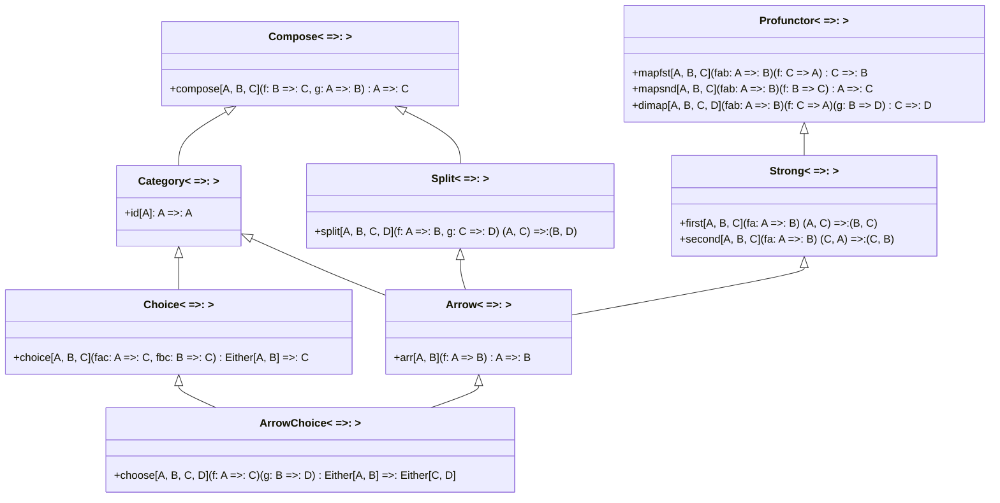

# Arrow Group

In functional programming, an **Arrow** is an abstraction that generalizes the notion of functions
and enables working with computations as first-class objects.
This concept was introduced by John Hughes for structuring programs
where computations can be combined and transformed into more complex constructs.
In Scala, this concept is implemented through type classes,
which provide the flexibility to build compositional programs,
modeling composable relationships between two types — for example, a function `A => B`,
`Kleisli` (wrapping `A => F[B]`) or `Cokleisli` (wrapping `F[A] => B`).
An arrow `F[A, B]` can be viewed as a representation of a computation from `A` to `B` with some context,
similar to how a functor/applicative/monad `F[A]` represents a value `A` with context.

The **Arrow Group** includes several related type classes.
These type classes enable:

- **Abstracting computations**: `Arrow` allows representing computations as objects that can be combined and transformed.
- **Creating complex pipelines**: With `Arrow` you can build chains of computations where the output of one operation becomes the input of another.

## Usage

The `Arrow` group finds application in various areas of functional programming.
These abstractions enable working with computations as first-class objects, providing flexibility and modularity.
Here are the main areas where the `Arrow` group is used:

- **Composing computations**
    - `Arrow` allows combining computations into chains (pipelines), where the output of one operation becomes the input of another.
    - Example: data processing where each operation (e.g., filtering, transforming, aggregating)
      is represented as an `Arrow` and combined into a common pipeline.
- **Domain-Specific Languages (DSL)**
    - `Arrow` is used to create embedded DSLs that describe complex processes in a declarative style.
    - Example: a DSL for describing business processes where each operation (e.g., condition checking, action execution)
      is represented as an `Arrow`.
- **Data stream processing**
    - `Arrow` allows building complex data stream processing chains where each operation
      (e.g., `map`, `filter`, `reduce`) can be represented as an `Arrow`.
    - Example: processing real-time events or streaming data processing in systems
      such as Apache Kafka or Apache Flink.
- **Computation graphs**
    - `Arrow` allows building computation graphs where nodes represent operations and edges represent dependencies.
    - Example: task scheduling systems where each task is represented as an `Arrow`,
      and dependencies between tasks are described using `Arrow` composition.

## Diagram

---

**References:**

- [Exercise repository link][sample]
- [Cats](https://typelevel.org/cats/typeclasses/arrow.html)
- [Learning Scalaz](http://eed3si9n.com/learning-scalaz/Arrow.html)

[sample]: https://gitverse.ru/scalabook/typeclasses
