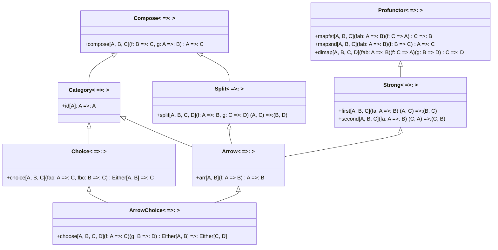

# Arrow Choice

`ArrowChoice` is an extension of [`Choice`](choice.md) that adds the `choose` method with infix syntax `+++`:

```dotty
trait ArrowChoice[=>:[_, _]] extends Arrow[=>:] with Choice[=>:]:
  def choose[A, B, C, D](f: A =>: C)(g: B =>: D): Either[A, B] =>: Either[C, D]

  infix def +++[A, B, C, D](f: A =>: C)(g: B =>: D)
      : Either[A, B] =>: Either[C, D] =
    choose(f)(g)

  override def choice[A, B, C](
      f: A =>: C,
      g: B =>: C
  ): Either[A, B] =>: C =
    mapsnd(choose(f)(g))(_.fold(identity, identity))
```

While `Choice` works with choosing between two alternatives (`Either`) within a single arrow,
`ArrowChoice` allows parallel transformation of both `Either` branches, applying different arrows to the left and right sides.
The result is also an `Either`, but with transformed values.

### Application: Logging in middleware

Let's return to the [authentication middleware example](choice.md).
Suppose we want to add logging to the `auth` middleware,
which will log both rejected requests and successfully processed ones:

```dotty
def logReject[F[_]]: Kleisli[[A] =>> OptionT[F, A], Response[F], Response[F]] = ???
// logs rejected requests

def logThrough[F[_]]: Kleisli[[A] =>> OptionT[F, A], Request[F], Request[F]] = ???
// logs successfully passed requests
```

Using `ArrowChoice` we can easily compose logging with our existing middleware:

```dotty
def authedRoute[F[_]: Monad] =
  auth[F] andThen
  (logReject[F] +++ logThrough[F]) andThen
  (reject[F] ||| routes[F])
```

Let's break down this composition step by step:

1. **`auth[F]`** — authentication middleware, transforms `Request[F]` into `Either[Response[F], Request[F]]`

2. **`logReject[F] +++ logThrough[F]`** — uses `ArrowChoice` (`+++`) for parallel transformation of both branches:
    - If `auth` result is `Left` (rejected), `logReject` is applied to `Response[F]`
    - If `auth` result is `Right` (successful), `logThrough` is applied to `Request[F]`
    - Result: `Either[Response[F], Request[F]]` (the type doesn't change, but each branch is enriched with logging)

3. **`reject[F] ||| routes[F]`** — uses `Choice` (`|||`) for final processing:
    - If the previous step result is `Left`, `reject` is applied (return the response)
    - If the result is `Right`, `routes` is applied (process the request)

## Exercises

### Exercise 4.8.1: Implement ArrowChoice for Function1 (regular functions)

> [Exercise repository with instructions][sample]

Implement the `ArrowChoice` instance for `Function1`.

```dotty
given ArrowChoice[Function1] with
  override def arr[A, B](f: A => B): A => B =
    ???

  override def id[A]: A => A =
    ???

  override def compose[A, B, C](f: B => C, g: A => B): A => C =
    ???

  override def first[A, B, C](fa: A => B): ((A, C)) => (B, C) =
    ???

  override def choose[A, B, C, D](
      f: A => C
  )(
      g: B => D
  ): Either[A, B] => Either[C, D] =
    ???
end given
```

@:note(🔍 Show solution)

This `ArrowChoice` instance for regular `Function1` functions implements all operations directly without additional effects:
`arr` simply returns the passed function, `id` returns `identity`,
`compose` uses standard `andThen` composition,
`first` applies the function to the first element of a pair, keeping the second unchanged,
and `choose` handles `Either`, applying `f` to `Left` and `g` to `Right`,
and returning the result on the corresponding side of `Either`.

```dotty
given ArrowChoice[Function1] with
  override def arr[A, B](f: A => B): A => B =
    f

  override def id[A]: A => A =
    identity

  override def compose[A, B, C](f: B => C, g: A => B): A => C =
    g andThen f

  override def first[A, B, C](fa: A => B): ((A, C)) => (B, C) =
    (a, c) => (fa(a), c)

  override def choose[A, B, C, D](
      f: A => C
  )(
      g: B => D
  ): Either[A, B] => Either[C, D] =
    case Left(a)  => Left(f(a))
    case Right(b) => Right(g(b))
end given
```

@:@

### Exercise 4.8.2: Implement ArrowChoice instance for Kleisli

In this exercise, you will implement a `ArrowChoice` type class instance for the `Kleisli[F, A, B]` type,
using the monadic capabilities of `Monad[F]`.

```dotty
given kleisliArrowChoice[F[_]: Monad]
    : ArrowChoice[[A, B] =>> Kleisli[F, A, B]] with
  override def arr[A, B](f: A => B): Kleisli[F, A, B] =
    ???

  override def id[A]: Kleisli[F, A, A] =
    ???

  override def compose[A, B, C](
      f: Kleisli[F, B, C],
      g: Kleisli[F, A, B]
  ): Kleisli[F, A, C] =
    ???

  override def first[A, B, C](fa: Kleisli[F, A, B])
      : Kleisli[F, (A, C), (B, C)] =
    ???

  override def choose[A, B, C, D](
      f: Kleisli[F, A, C]
  )(
      g: Kleisli[F, B, D]
  ): Kleisli[F, Either[A, B], Either[C, D]] =
    ???
```

@:note(🔍 Show solution)

This `ArrowChoice` instance for `Kleisli` implements all necessary operations,
using the `Monad` to work with the context:
`arr` lifts a function into an arrow, placing the result into the context via `unit`,
`id` returns the identity arrow, also using `unit`,
`compose` sequentially connects computations via `flatMap`, passing the result of the first computation to the second,
`first` applies the arrow to the first element of a pair, keeping the second element using `map`,
and `choose` handles `Either`, applying `f` to `Left` and `g` to `Right` via pattern matching,
transforming results into the corresponding sides of `Either` using `map` within the context.

```dotty
given kleisliArrowChoice[F[_]: Monad]
    : ArrowChoice[[A, B] =>> Kleisli[F, A, B]] with
  override def arr[A, B](f: A => B): Kleisli[F, A, B] =
    Kleisli[F, A, B](a => Monad[F].unit(f(a)))

  override def id[A]: Kleisli[F, A, A] =
    Kleisli[F, A, A](Monad[F].unit)

  override def compose[A, B, C](
      f: Kleisli[F, B, C],
      g: Kleisli[F, A, B]
  ): Kleisli[F, A, C] =
    Kleisli[F, A, C](a => g.run(a).flatMap(b => f.run(b)))

  override def first[A, B, C](fa: Kleisli[F, A, B])
      : Kleisli[F, (A, C), (B, C)] =
    Kleisli[F, (A, C), (B, C)]((a, c) =>
      fa.run(a).map(b => (b, c))
    )

  override def choose[A, B, C, D](
      f: Kleisli[F, A, C]
  )(
      g: Kleisli[F, B, D]
  ): Kleisli[F, Either[A, B], Either[C, D]] =
    Kleisli[F, Either[A, B], Either[C, D]] {
      case Left(a)  => f.run(a).map(c => Left(c))
      case Right(b) => g.run(b).map(d => Right(d))
    }
end kleisliArrowChoice
```

@:@

### Exercise 4.8.3: Implement ArrowChoice instance for Cokleisli

In this exercise, you will implement a `ArrowChoice` type class instance for the `Cokleisli[F, A, B]` type,
using the comonadic capabilities of `CoMonad[F]`.

```dotty
given cokleisliArrowChoice[F[_]: {CoMonad, Applicative}]
    : ArrowChoice[[A, B] =>> Cokleisli[F, A, B]] with
  override def arr[A, B](f: A => B): Cokleisli[F, A, B] =
    ???

  override def id[A]: Cokleisli[F, A, A] =
    ???

  override def compose[A, B, C](
      f: Cokleisli[F, B, C],
      g: Cokleisli[F, A, B]
  ): Cokleisli[F, A, C] =
    ???

  override def first[A, B, C](fa: Cokleisli[F, A, B])
      : Cokleisli[F, (A, C), (B, C)] =
    ???

  override def choose[A, B, C, D](
      f: Cokleisli[F, A, C]
  )(
      g: Cokleisli[F, B, D]
  ): Cokleisli[F, Either[A, B], Either[C, D]] =
    ???
```

@:note(🔍 Show solution)

This `ArrowChoice` instance for `Cokleisli` implements all necessary operations using the comonad
`CoMonad` to work with the context: `arr` lifts a function by extracting the value via `coUnit`,
`id` returns the identity arrow, `compose` sequentially connects computations via `cobind`,
`first` applies the arrow to the first element of a pair, extracting the second via `coPure`,
and `choose` parallel-transforms both branches of `Either`,
applying `map` to the context and using `Applicative` to place values into the context before applying arrows,
then the result is extracted via `coUnit`.

```dotty
given cokleisliArrowChoice[F[_]: {CoMonad, Applicative}]
    : ArrowChoice[[A, B] =>> Cokleisli[F, A, B]] with
  override def arr[A, B](f: A => B): Cokleisli[F, A, B] =
    Cokleisli[F, A, B](fa => f(CoMonad[F].coUnit(fa)))

  override def id[A]: Cokleisli[F, A, A] =
    Cokleisli[F, A, A](CoMonad[F].coUnit)

  override def compose[A, B, C](
      f: Cokleisli[F, B, C],
      g: Cokleisli[F, A, B]
  ): Cokleisli[F, A, C] =
    Cokleisli[F, A, C](fa => f.run(fa.cobind(g.run)))

  override def first[A, B, C](fa: Cokleisli[F, A, B])
      : Cokleisli[F, (A, C), (B, C)] =
    Cokleisli[F, (A, C), (B, C)](fac =>
      val b      = fa.run(CoMonad[F].map(fac)(_._1))
      val (_, c) = CoMonad[F].coPure(fac)
      (b, c)
    )

  override def choose[A, B, C, D](
      f: Cokleisli[F, A, C]
  )(
      g: Cokleisli[F, B, D]
  ): Cokleisli[F, Either[A, B], Either[C, D]] =
    Cokleisli[F, Either[A, B], Either[C, D]] { feither =>
      val fcd: F[Either[C, D]] = CoMonad[F].map(feither) {
        case Left(a)  => Left(f.run(Applicative[F].unit(a)))
        case Right(b) => Right(g.run(Applicative[F].unit(b)))
      }

      CoMonad[F].coUnit(fcd)
    }
end cokleisliArrowChoice
```

@:@

## Diagram



## Library Implementations

### Cats Implementation

```dotty
import cats.syntax.all.*

val toLong: Int => Long                           = _.toLong
val toDouble: Float => Double                     = _.toDouble
val f: Either[Int, Float] => Either[Long, Double] = toLong +++ toDouble

f(Left(3))
// Left(3)
f(Right(3))
// Right(3.0)
```

`Choice` and `ArrowChoice` in Cats are powerful abstractions for working with conditional logic at the type level. They enable:

- **Composing functions** that operate on different types into a unified processing pipeline
- **Avoiding explicit** pattern matching (`match` / `case`) constructs
- **Building flexible middleware** that handles various execution scenarios
- **Easily adding cross-cutting functionality** (logging, monitoring) without modifying existing code
- **Preserving purity and composability** of code even with complex business logic

These type classes are an important part of the Cats library and are widely used in libraries such as
Http4s, Doobie, and others where computation composition with context and conditional logic is required.

---

**References:**

- [Exercise repository link][sample]
- [Cats](https://typelevel.org/cats/typeclasses/arrowchoice.html)

[sample]: https://gitverse.ru/scalabook/typeclasses
