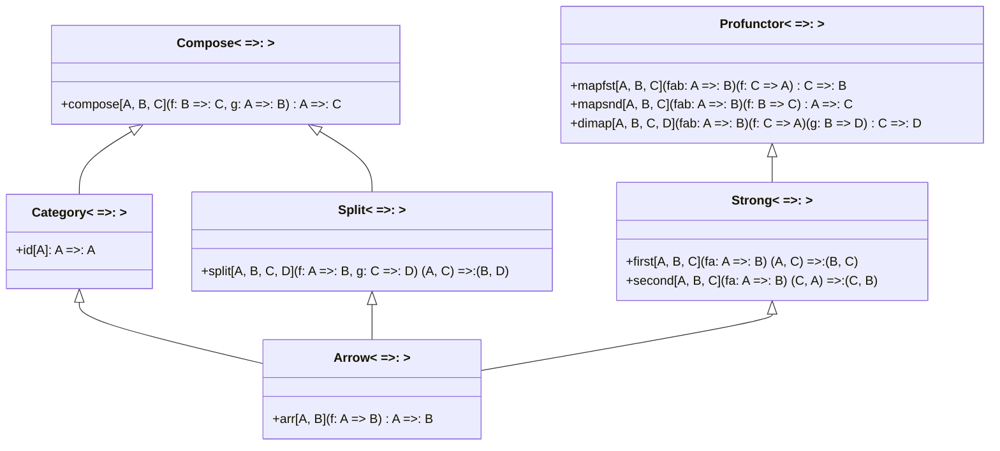

# Arrow

`Arrow` is a type class in functional programming
that generalizes the notion of a **function** and provides an abstraction for working with computations as first-class citizens.
`Arrow` extends the capabilities of [`Category`](category.md), [`Split`](split.md) and [`Strong`](strong.md),
adding support for parallel composition, branching, and other operations.
This enables building complex computation chains where each operation can be combined with others.

Main operations provided by `Arrow`:

- **Composition**: Combining two computations into one.
- **Parallel composition**: Executing two computations independently on different parts of input data.
- **Branching**: Choosing between two computations based on input data.
- **Dynamic application**: Applying computations that return other computations.

**Brief examples**

- **Functional pipelines**:
    - There are three functions: `parseData`, `validateData`, `transformData`.
    - With `Arrow` you can create a chain that first parses data, then validates it, and finally transforms it.
- **Business logic DSL**:
    - There are operations: `checkInventory`, `calculatePrice`, `applyDiscount`.
    - With `Arrow` you can create a pipeline that first checks product availability, then calculates price, and finally applies a discount.
- **Reactive systems**:
    - There is an event stream where each event goes through a chain of operations: `filterEvents`, `transformEvents`, `handleEvents`.
    - With `Arrow` you can create a handler that filters events, transforms them, and then processes them.
- **Parallel computations**:
    - There are two independent tasks: `fetchUser` and `fetchProduct`.
    - With `Arrow` you can create a parallel chain that executes both tasks simultaneously and combines results.
- **Testing**:
    - There are operations: `sendRequest`, `checkStatusCode`, `validateResponse`.
    - With `Arrow` you can create a test that sends a request, checks the status code, and validates the response.

## Formal definition

Let \\(C\\) be a category where:

- \\(\text{Obj}(C)\\) is a set of objects (e.g., types in Scala).
- \\(\text{Mor}(C)\\) is a set of morphisms (e.g., functions between types).

The `Arrow` type class is formally defined as follows:

- **Objects**: Types \\(A, B, C, D, \dots\\), which are objects of the category.
- **Morphisms**: Functions (or arrows) \\(f: A \to B\\), \\(g: B \to C\\), where:
    - \\(A, B, C\\) are types.
    - \\(f\\) and \\(g\\) are functions that can be composed.
- **`arr` operation**: For any function \\(f: A \to B\\) there exists a morphism \\(\text{arr}(f): A \to B\\) that "lifts" the function into an Arrow.
- **`>>>` operation (composition)**: For any two morphisms \\(f: A \to B\\) and \\(g: B \to C\\)
  there exists a morphism \\(f \, >>> \, g: A \to C\\) which is the composition of \\(f\\) and \\(g\\).
- **`first` operation**: For any morphism \\(f: A \to B\\) there exists a morphism \\(\text{first}(f): (A, C) \to (B, C)\\),
  which applies \\(f\\) to the first element of a pair, leaving the second element unchanged.
- **`second` operation**: For any morphism \\(f: A \to B\\) there exists a morphism \\(\text{second}(f): (C, A) \to (C, B)\\),
  which applies \\(f\\) to the second element of a pair, leaving the first element unchanged.
- **`***` operation (parallel composition)**: For any two morphisms \\(f: A \to B\\) and \\(g: C \to D\\)
  there exists a morphism \\(f \, \*\*\* \, g: (A, C) \to (B, D)\\) that applies \\(f\\) and \\(g\\) in parallel.
- **`&&&` operation (branching)**: For any two morphisms \\(f: A \to B\\) and \\(g: A \to C\\)
  there exists a morphism \\(f \, \&\&\& \, g: A \to (B, C)\\) that applies \\(f\\) and \\(g\\) to the same input.

### `Arrow` laws

The `Arrow` type class must satisfy the following laws:

- **Composition associativity**:
  \\((f \, >>> \, g) \, >>> \, h = f \, >>> \, (g \, >>> \, h)\\).
  This means the order of applying composition does not matter.
- **Identity morphism**:
  \\(\text{arr}(\text{id}) \, >>> \, f = f \quad \text{and} \quad f \, >>> \, \text{arr}(\text{id}) = f\\),
  where \\(\text{id}\\) is the identity morphism.
- **`first` naturality**:
  \\(\text{first}(f) \, >>> \, \text{arr}(\text{id} \times g) = \text{arr}(\text{id} \times g) \, >>> \, \text{first}(f)\\).
  This means the `first` operation must be natural with respect to composition.
- **`first` and `***` compatibility**:
  \\(\text{first}(f \, >>> \, g) = \text{first}(f) \, >>> \, \text{first}(g)\\).
  This means `first` preserves composition.

## Scala code definition

```dotty
trait Arrow[=>:[_, _]] extends Split[=>:], Strong[=>:], Category[=>:]:
  self =>

  /** 'Lifting' a regular function into an Arrow. */
  def arr[A, B](f: A => B): A =>: B

  /** Alias for `compose`. */
  final def <<<[A, B, C](fbc: B =>: C, fab: A =>: B): A =>: C =
    compose(fbc, fab)

  /** Reverse `<<<`. */
  final def >>>[A, B, C](fab: A =>: B, fbc: B =>: C): A =>: C =
    compose(fbc, fab)

  /** Swaps a pair */
  def swap[X, Y]: (X, Y) =>: (Y, X) = arr[(X, Y), (Y, X)] { case (x, y) => (y, x) }

  /** Pass `C` through untouched. */
  override def second[A, B, C](f: A =>: B): (C, A) =>: (C, B) =
    >>>(<<<(first[A, B, C](f), swap), swap)

  /** Run `fab` and `fcd` next to each other. Sometimes denoted as `***`. */
  override def split[A, B, C, D](fab: A =>: B, fcd: C =>: D): (A, C) =>: (B, D) =
    >>>(first[A, B, C](fab), second[C, D, B](fcd))

  /** Run `fab` and `fac` on the same `A`. Sometimes denoted as `&&&`. */
  def combine[A, B, C](fab: A =>: B, fac: A =>: C): A =>: (B, C) =
    >>>(arr((a: A) => (a, a)), split(fab, fac))

  /** Contramap on `A`. */
  override def mapfst[A, B, C](fab: A =>: B)(f: C => A): C =>: B =
    >>>[C, A, B](arr(f), fab)

  /** Functor map on `B`. */
  override def mapsnd[A, B, C](fab: A =>: B)(f: B => C): A =>: C =
    <<<[A, B, C](arr(f), fab)

  /** Run two `fab` next to each other */
  def product[A, B](fab: A =>: B): (A, A) =>: (B, B) =
    split(fab, fab)
```

### Single-argument function

```dotty
given Arrow[Function1] with
  override def arr[A, B](f: A => B): A => B = f
  override def id[A]: A => A = a => a
  override def compose[A, B, C](f: B => C, g: A => B): A => C = g andThen f
  override def first[A, B, C](fa: A => B): ((A, C)) => (B, C) = (a, c) => (fa(a), c)
```

### Relationship with other type classes

Each "arrow" forms a [`Contravariant`](../monad/contravariant-functor.md)
in one type parameter and an [`Applicative`](../monad/applicative.md)
in the other, as is the case with regular functions.

```dotty
trait Arrow[=>:[_, _]] extends Split[=>:], Strong[=>:], Category[=>:]:
  ...

  override def covariantInstance[C]: Applicative[[X] =>> =>:[C, X]] =
    new Applicative[[X] =>> =>:[C, X]]:
      override def unit[A](a: => A): C =>: A = arr(_ => a)

      override def apply[A, B](fab: C =>: (A => B))(fa: C =>: A): C =>: B =
        <<<(arr((y: (A => B, A)) => y._1(y._2)), combine(fab, fa))
```

## Exercises

### Exercise 4.6.1: Implement Arrow for Function1 (regular functions)

> [Exercise repository with instructions][sample]

Implement the `Arrow` instance for `Function1`.
Other methods (`split`, `second`, `combine`, `product`, `mapfst`, `mapsnd`) are already implemented in the `Arrow` trait
using the base operations, so they don't need to be implemented.

```dotty
given Arrow[Function1] with
  override def arr[A, B](f: A => B): A => B = ???
  override def id[A]: A => A = ???
  override def compose[A, B, C](f: B => C, g: A => B): A => C = ???
  override def first[A, B, C](fa: A => B): ((A, C)) => (B, C) = ???
```

**Examples:**

```dotty
import Arrow.given

// Basic functions
val inc: Int => Int = _ + 1
val mul2: Int => Int = _ * 2

// arr — lifting a regular function
val arrInc = arr(inc)
arrInc(5)  // 6

// id — identity arrow
id(42)     // 42

// compose — composition
val incThenMul2 = compose(mul2, inc)  // inc andThen mul2
incThenMul2(5)  // (5 + 1) * 2 = 12

// first — apply to the first element of a pair
val firstInc = first(inc)
firstInc(5, "hello")  // (6, "hello")
```

@:note(🔍 Show solution)

The `Arrow` implementation for `Function1` is trivial because regular functions already have all the necessary properties:

- `arr` simply returns the passed function (a function is already an arrow)
- `id` returns the identity function `a => a`
- `compose` uses built-in composition `g andThen f` (or `f compose g`)
- `first` applies the function `fa` to the first element of a pair, leaving the second unchanged

All other operations (`second`, `split`, `combine`, `product`, `mapfst`, `mapsnd`, `dimap`)
are already implemented in the `Split`, `Strong`, `Profunctor` and `Category` traits through these base primitives.
This demonstrates the power of the abstraction: having just a few base operations,
we get a rich set of combinators for working with arrows.

```dotty
given Arrow[Function1] with
  override def arr[A, B](f: A => B): A => B                   = f
  override def id[A]: A => A                                  = a => a
  override def compose[A, B, C](f: B => C, g: A => B): A => C = g andThen f
  override def first[A, B, C](fa: A => B): ((A, C)) => (B, C) = (a, c) =>
    (fa(a), c)
```

@:@

### Exercise 4.6.2: Implement Arrow instance for Kleisli based on Monad

In this exercise, you will implement a `Arrow` type class instance for the `Kleisli[F, A, B]` type,
using the monadic capabilities of `Monad[F]`.

```dotty
given kleisliArrow[F[_]: Monad]: Arrow[[A, B] =>> Kleisli[F, A, B]] with
  override def arr[A, B](f: A => B): Kleisli[F, A, B] =
    ???

  override def id[A]: Kleisli[F, A, A] =
    ???

  override def compose[A, B, C](
      f: Kleisli[F, B, C],
      g: Kleisli[F, A, B]
  ): Kleisli[F, A, C] =
    ???

  override def first[A, B, C](fa: Kleisli[F, A, B])
      : Kleisli[F, (A, C), (B, C)] =
    ???
```

@:note(🔍 Show solution)

The solution uses `Monad[F]` to get access to `unit` (also known as `pure`),
which places a value into the `F` context.
For `arr`, an arrow is created that applies function `f` to the input value `a`,
then places the result into the context using `unit`.
`id` creates an arrow that simply places the input value into the context.
`compose` uses `flatMap` for sequential execution of computations.
`first` applies the arrow to the first element of a pair, using `map` to preserve the second element in the context.

```dotty
given kleisliArrow[F[_]: Monad]: Arrow[[A, B] =>> Kleisli[F, A, B]] with
  override def arr[A, B](f: A => B): Kleisli[F, A, B] =
    Kleisli[F, A, B](a => Monad[F].unit(f(a)))

  override def id[A]: Kleisli[F, A, A] =
    Kleisli[F, A, A](Monad[F].unit)

  override def compose[A, B, C](
      f: Kleisli[F, B, C],
      g: Kleisli[F, A, B]
  ): Kleisli[F, A, C] =
    Kleisli[F, A, C](a => g.run(a).flatMap(b => f.run(b)))

  override def first[A, B, C](fa: Kleisli[F, A, B])
      : Kleisli[F, (A, C), (B, C)] =
    Kleisli[F, (A, C), (B, C)]((a, c) =>
      fa.run(a).map(b => (b, c))
    )
```

@:@

### Exercise 4.6.3: Implement Arrow instance for Cokleisli based on CoMonad

In this exercise, you will implement a `Arrow` type class instance for the `Cokleisli[F, A, B]` type,
using the comonadic capabilities of `CoMonad[F]`.

```dotty
given cokleisliArrow[F[_]: CoMonad]: Arrow[[A, B] =>> Cokleisli[F, A, B]] with
  override def arr[A, B](f: A => B): Cokleisli[F, A, B] =
    ???

  override def id[A]: Cokleisli[F, A, A] =
    ???

  override def compose[A, B, C](
      f: Cokleisli[F, B, C],
      g: Cokleisli[F, A, B]
  ): Cokleisli[F, A, C] =
    ???

  override def first[A, B, C](fa: Cokleisli[F, A, B])
      : Cokleisli[F, (A, C), (B, C)] =
    ???
```

@:note(🔍 Show solution)

The solution uses `CoMonad[F]` to get access to `coUnit` (also known as `extract`),
which extracts a value from the `F` context.
For `arr`, an arrow is created that extracts `A` from context `F[A]` via `coUnit`, applies function `f`, and returns the result.
`id` creates an arrow that simply extracts the value from the context using `coUnit`.
`compose` uses `cobind` to extend the context.
`first` applies the arrow to the first element of a pair, using `map` to extract `A` and `coPure` to obtain `C`.

```dotty
given cokleisliArrow[F[_]: CoMonad]: Arrow[[A, B] =>> Cokleisli[F, A, B]] with
  override def arr[A, B](f: A => B): Cokleisli[F, A, B] =
    Cokleisli[F, A, B](fa => f(CoMonad[F].coUnit(fa)))

  override def id[A]: Cokleisli[F, A, A] =
    Cokleisli[F, A, A](CoMonad[F].coUnit)

  override def compose[A, B, C](
      f: Cokleisli[F, B, C],
      g: Cokleisli[F, A, B]
  ): Cokleisli[F, A, C] =
    Cokleisli[F, A, C](fa => f.run(fa.cobind(g.run)))

  override def first[A, B, C](fa: Cokleisli[F, A, B])
      : Cokleisli[F, (A, C), (B, C)] =
    Cokleisli[F, (A, C), (B, C)](fac =>
      val b      = fa.run(fac.map(_._1))
      val (_, c) = CoMonad[F].coPure(fac)
      (b, c)
    )
```

@:@

## Diagram



## Library Implementations

### ScalaZ Implementation

```dotty
import scalaz.*
import Scalaz.*

val plus1 = (_: Int) + 1
val times2 = (_: Int) * 2
val rev = (_: String).reverse

plus1.first apply (7 -> "abc")     // (8,abc)
plus1.second apply ("def" -> 14)   // (def,15)
plus1 *** rev apply (7 -> "abc")   // (8,cba)
plus1 &&& times2 apply 7           // (8,14)
plus1.product apply (9 -> 99)      // (10,100)

val f1 = (_:Int) + 1
val f2 = (_:Int) * 100

(f1 >>> f2)(2)                     // 300
(f1 <<< f2)(2)                     // 201
```

---

**References:**

- [Exercise repository link][sample]
- [Cats](https://typelevel.org/cats/typeclasses/arrow.html)
- [Herding Cats](http://eed3si9n.com/herding-cats/Arrow.html)
- [Learning Scalaz](http://eed3si9n.com/learning-scalaz/Arrow.html)
- [Scalaz API](https://javadoc.io/doc/org.scalaz/scalaz-core_3/7.3.6/scalaz/Arrow.html)

[sample]: https://gitverse.ru/scalabook/typeclasses
