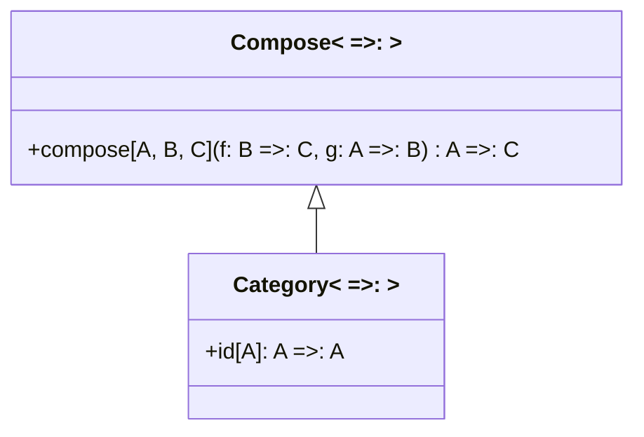

# Category

`Category` is a type class in Scala that represents a **category** in the mathematical sense.
In category theory, a category consists of objects and morphisms (arrows) between them,
which can be combined via the [composition operation](compose.md).
In Scala, `Category` provides an abstraction for working with function or morphism composition.

Main components of `Category`:

- **Objects**: Types (e.g., `A`, `B`, `C`).
- **Morphisms**: Functions between types (e.g., `A => B`).
- **Composition**: An operation that combines two morphisms \\(f: A \to B\\) and \\(g: B \to C\\)
  into a new morphism \\(g \circ f: A \to C\\).
- **Identity morphism**: For each object \\(A\\) there exists a morphism \\(\text{id}_A: A \to A\\),
  which acts as the neutral element for composition.

**Brief examples**

- **Data processing**:
    - There are three functions: `parseData`, `validateData`, `transformData`.
    - With `Category` you can create a single function that first parses data, then validates it, and finally transforms it.
- **Working with effects**:
    - There are two functions: `fetchUser` (returns `Option[User]`) and `getUserDetails` (takes `User` and returns `Option[UserDetails]`).
    - With `Category` you can create a function that first fetches the user, then their details.
- **Business logic DSL**:
    - There are operations: `checkInventory`, `calculatePrice`, `applyDiscount`.
    - With `Category` you can create a pipeline that first checks product availability, then calculates price, and finally applies a discount.
- **Testing**:
    - There are functions: `sendRequest`, `checkStatusCode`, `validateResponse`.
    - With `Category` you can create a test that sends a request, checks the status code, and validates the response.

## Formal definition

Let \\(C\\) be a category where:

- \\(\text{Obj}(C)\\) is a set of objects (e.g., types in Scala).
- \\(\text{Mor}(C)\\) is a set of morphisms (e.g., functions between types).

The `Category` type class is formally defined as follows:

- **Objects**: Types \\(A, B, C, \dots\\), which are objects of the category.
- **Morphisms**: Functions (or arrows) \\(f: A \to B\\), \\(g: B \to C\\), where:
    - \\(A, B, C\\) are types.
    - \\(f\\) and \\(g\\) are functions that can be composed.
- **Composition operation**: For any two morphisms \\(f: A \to B\\) and \\(g: B \to C\\) there exists
  a morphism \\(g \circ f: A \to C\\) which is the composition of \\(f\\) and \\(g\\).
- **Identity morphism**: For each object \\(A\\) there exists an identity morphism \\(\text{id}\_A: A \to A\\),
  such that: \\(f \circ \text{id}\_A = f \quad \text{and} \quad \text{id}\_B \circ f = f\\), where \\(f: A \to B\\).

> `Category` is [`Compose`](compose.md) with the `identity` operation.

### Category laws

The `Category` type class must satisfy the following category laws:

- **Composition associativity**:
  \\(h \circ (g \circ f) = (h \circ g) \circ f\\).
  This means the order of applying composition does not matter.
- **Existence of identity morphism**:
  For each object \\(A\\) there exists an identity morphism \\(\text{id}\_A: A \to A\\) such that:
  \\(f \circ \text{id}\_A = f \quad \text{and} \quad \text{id}\_B \circ f = f\\), where \\(f: A \to B\\).

#### What is composition?

Given an arrow **f** from **a** to **b** and an arrow **g** from **b** to **c**,
their _composition_ is an arrow going directly from **a** to **c**.
In other words, if one has two arrows where the target of one matches the source of the other,
one can always compose them to obtain a third arrow.
Denoted as: \\(h = g \circ f\\)

#### What is associativity?

Suppose \\(j = i \circ f\\).
Suppose we managed to decompose i into \\(h \circ g\\).
Then \\(j = (h \circ g) \circ f\\).
It would be desirable for this decomposition to be the same as \\(j = h \circ (g \circ f)\\).
At the same time, there should be a way to state
that j was decomposed into three simpler functions \\(j = h \circ g \circ f\\)
and there is no need to track which decomposition was first.
This property is called _associativity_ of composition.

#### What is identity?

Every object has a special arrow called _identity_ (or _identity morphism_),
which leaves the object unchanged.
This means that when you compose the identity arrow with any other arrow, incoming or outgoing,
you get the same arrow. The identity arrow does nothing to another arrow.

The identity arrow on object \\(a\\) is denoted as \\(id\_{a}\\).
So, if you have an arrow \\(f : a \to b\\),
you can compose it with identities on both sides: \\(id\_{b} \circ f = f = f \circ id\_{a}\\)

## Scala code definition

In Scala, the `Category` type class can be defined as follows:

```dotty
trait Compose[=>:[_, _]]:
  // Composition of morphisms
  def compose[A, B, C](f: B =>: C, g: A =>: B): A =>: C

trait Category[=>:[_, _]] extends Compose[=>:]:
  // Identity morphism
  def id[A]: A =>: A
```

Where:

- `=>:[_, _]` is a type representing a morphism (e.g., a function `A => B`).
- The `id` method returns the identity morphism for type `A`.
- The `compose` method takes two morphisms \\(f: B \to C\\) and \\(g: A \to B\\) and returns their composition \\(f \circ g: A \to C\\).

### Relationship with other type classes

`Category` can be transformed into a [Monoid](../monoid/monoid.md)
and [PlusEmpty](../monad/plus-empty.md).

```dotty
trait Category[=>:[_, _]] extends Compose[=>:]:
  def id[A]: A =>: A

  def empty: PlusEmpty[[A] =>> A =>: A] = new PlusEmpty[[A] =>> A =>: A] with ComposePlus:
    def empty[A]: A =>: A = id

  def monoid[A]: Monoid[A =>: A] = new Monoid[A =>: A] with ComposeSemigroup[A]:
    def empty: A =>: A = id
```

## Exercises

### Exercise 4.2.1: Implement Category for Function1 (regular functions)

> [Exercise repository with instructions][sample]

Implement the `Category` instance for `Function1`:

```dotty
given Category[Function1] with
  override def compose[A, B, C](f: B => C, g: A => B): A => C = ???
  override def id[A]: A => A = ???
```

**Examples:**

```dotty
import Category.given

// Basic functions
val add1: Int => Int = _ + 1
val mul2: Int => Int = _ * 2
val toString: Int => String = _.toString
val length: String => Int = _.length

// Composition
val composed1 = compose(mul2, add1)  // first add1, then mul2
composed1(5)  // (5 + 1) * 2 = 12

val composed2 = compose(length, toString)  // first toString, then length
composed2(42)  // length of string "42" = 2

// Identity function
id(42)      // 42
id("hello") // "hello"
```

@:note(🔍 Show solution)

The `compose` implementation uses the built-in composition `g andThen f`, which first applies `g`, then `f`.
This corresponds to the mathematical definition of composition: (f ∘ g)(x) = f(g(x)).
The `id` implementation returns the function `a => a` — the identity mapping.

```dotty
given Category[Function1] with
  override def compose[A, B, C](f: B => C, g: A => B): A => C = g andThen f

  override def id[A]: A => A = a => a
```

@:@

### Exercise 4.2.2: Implement Category instance for Kleisli based on Monad

In this exercise, you will implement a `Category` type class instance for the `Kleisli[F, A, B]` type,
using the monadic capabilities of `Monad[F]`.

```dotty
given kleisliCategory[F[_]: Monad]: Category[[A, B] =>> Kleisli[F, A, B]]
with
  def compose[A, B, C](
      f: Kleisli[F, B, C],
      g: Kleisli[F, A, B]
  ): Kleisli[F, A, C] =
    ???

  def id[A]: Kleisli[F, A, A] =
    ???
```

@:note(🔍 Show solution)

The solution uses `Monad[F]` to get access to `unit` (also known as `pure`),
which places a value into the `F` context.
For the identity arrow, we return a `Kleisli` that takes a value `A` and returns `F[A]` via `Monad[F].unit`.
The `compose` operation uses `flatMap` from the monad for sequential execution of computations, as in the `Compose` instance for `Kleisli`.

```dotty
given kleisliCategory[F[_]: Monad]: Category[[A, B] =>> Kleisli[F, A, B]]
with
  def compose[A, B, C](
      f: Kleisli[F, B, C],
      g: Kleisli[F, A, B]
  ): Kleisli[F, A, C] =
    Kleisli[F, A, C](a => g.run(a).flatMap(b => f.run(b)))

  def id[A]: Kleisli[F, A, A] =
    Kleisli[F, A, A](Monad[F].unit)
```

@:@

### Exercise 4.2.3: Implement Category instance for Cokleisli based on CoMonad

In this exercise, you will implement a `Category` type class instance for the `Cokleisli[F, A, B]` type,
using the comonadic capabilities of `CoMonad[F]`.

```dotty
given cokleisliCategory[F[_]: CoMonad]: Category[[A, B] =>> Cokleisli[F, A, B]]
with
  def compose[A, B, C](
      f: Cokleisli[F, B, C],
      g: Cokleisli[F, A, B]
  ): Cokleisli[F, A, C] =
    ???

  def id[A]: Cokleisli[F, A, A] =
    ???
```

@:note(🔍 Show solution)

The solution uses `CoMonad[F]` to get access to `coUnit` (also known as `extract`),
which extracts a value from the `F[A]` context.
For the identity arrow, we return a `Cokleisli` that takes `F[A]` and returns `A` via `CoMonad[F].coUnit`.
The `compose` operation uses `cobind` to extend the context, as in the `Compose` instance for `Cokleisli`.

```dotty
given cokleisliCategory[F[_]: CoMonad]: Category[[A, B] =>> Cokleisli[F, A, B]]
with
  def compose[A, B, C](
      f: Cokleisli[F, B, C],
      g: Cokleisli[F, A, B]
  ): Cokleisli[F, A, C] =
    Cokleisli[F, A, C](fa => f.run(fa.cobind(g.run)))

  def id[A]: Cokleisli[F, A, A] =
    Cokleisli[F, A, A](CoMonad[F].coUnit)
```

@:@

## Diagram



## Library Implementations

### ScalaZ Implementation

```dotty
import scalaz.*
import Scalaz.*

// ... All parent operations
```

---

**References:**

- [Exercise repository link][sample]
- [Cats](https://typelevel.org/cats/typeclasses/arrow.html)
- [Herding Cats](http://eed3si9n.com/herding-cats/Arrow.html)
- [Learning Scalaz](http://eed3si9n.com/learning-scalaz/Arrow.html)
- [On Monoids](https://apocalisp.wordpress.com/2010/06/14/on-monoids/)
- [Scalaz API](https://javadoc.io/doc/org.scalaz/scalaz-core_3/7.3.6/scalaz/Category.html)

[sample]: https://gitverse.ru/scalabook/typeclasses
