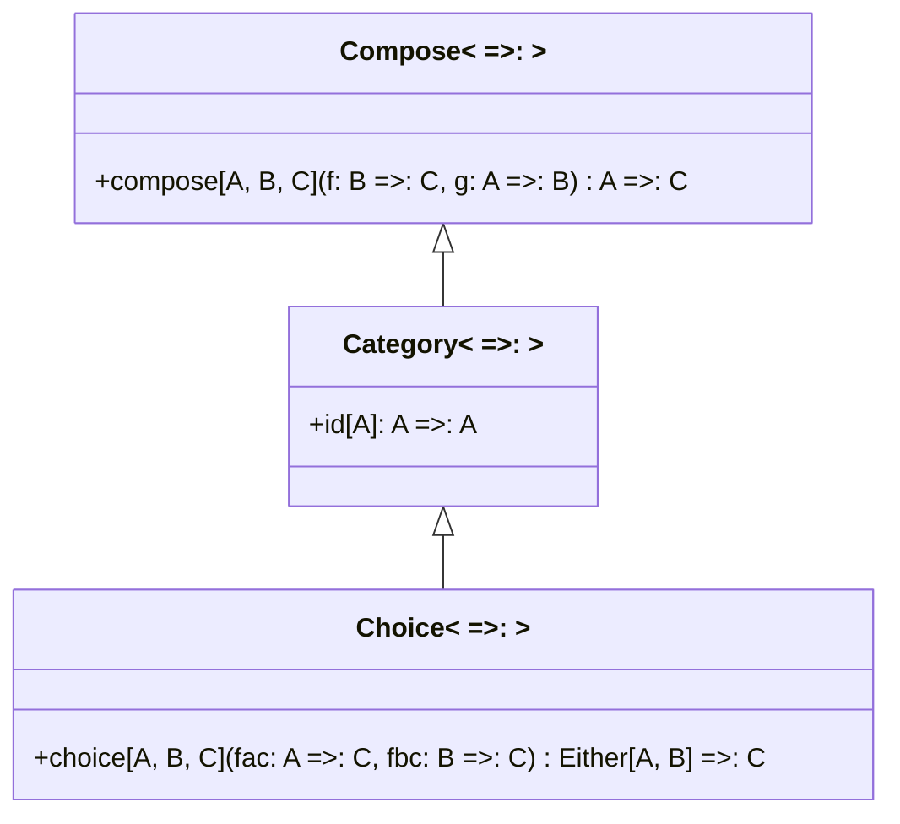

# Choice

In functional programming we are used to working with functions of the form `A => B`.
However, there are often situations where we need to compose several functions
working with different input types into a single composition.

Suppose we have two functions: `A => C` and `B => C`.
How do we combine them into a single function that could accept either a value of type `A` or a value of type `B`
and return `C` in both cases? Essentially, we are looking for a function of type:

`(A => C) => (B => C) => (Either[A, B] => C)`

This is exactly what the `Choice` type class provides.
If we generalize the regular function `=>` to a more abstract arrow `=>:[_, _]`, we get the definition of `Choice`.

```dotty
trait Choice[=>:[_, _]] extends Category[=>:]:
  def choice[A, B, C](fac: A =>: C, fbc: B =>: C): Either[A, B] =>: C

  infix def |||[A, B, C](fac: A =>: C, fbc: B =>: C): Either[A, B] =>: C =
    choice(fac, fbc)
```

This method takes two arrows: one from `A` to `C` and another from `B` to `C`,
and returns an arrow that takes `Either[A, B]` (i.e., either `A` or `B`) and returns `C`.
The infix syntax for `choice` is the operator `|||`.
This makes the code more readable and expressive.

## Practical application: Middleware in HTTP server

One of the most useful applications of `Choice` is building middleware
in HTTP servers. This is especially relevant for libraries such as [Http4s](https://http4s.org/).

### HttpRoutes as Kleisli

In Http4s, the type `HttpRoutes[F]` is defined as [`Kleisli`](../../data-structures/other/kleisli.md)
(an arrow representing a computation with an effect in context `F`):

```dotty
type HttpRoutes[F[_]] = Kleisli[[A] =>> OptionT[F, A], Request[F], Response[F]]
```

Where:

- `Request[F]` — incoming HTTP request
- `Response[F]` — outgoing HTTP response
- `[A] =>> OptionT[F, A]` — [monad transformer](../monad/monad-transformer.md) adding optionality to effect `F`
- `Kleisli` — a wrapper around the function `Request[F] => OptionT[F, Response[F]]`

### Creating authentication middleware

Suppose we want to add authentication to our routes.
We can define middleware as an arrow that takes a request and
returns either a rejected response (with an error code) or passes the request further.

```dotty
type Middleware[F[_]] = Kleisli[[A] =>> OptionT[F, A], Request[F], Either[Response[F], Request[F]]]
```

Where:

- `Left[Response[F]]` — means the request is rejected, and we immediately return the response (e.g., 401 Unauthorized)
- `Right[Request[F]]` — means authentication was successful, and the request can be passed further down the processing chain

Now let's define what to do in case of a rejected request:

```dotty
def reject[F[_]: Monad]: Kleisli[[A] =>> OptionT[F, A], Response[F], Response[F]] =
  Kleisli.ask[[A] =>> OptionT[F, A], Response[F]]
```

The `reject` function simply returns the received response unchanged. It serves as a "stub" for handling the `Left` case.

### Composing middleware with routes

Now we can compose our middleware with the main routes:

```dotty
def authedRoute[F[_]: Monad] = auth[F] andThen (reject[F] ||| routes[F])
```

Let's break down this composition:

1. `auth[F]` — authentication middleware, transforms `Request[F]` into `Either[Response[F], Request[F]]`
2. `reject[F] ||| routes[F]` — uses `Choice` to handle two cases:
    - If `auth` returned `Left` (rejected), `reject[F]` is applied (return error response)
    - If `auth` returned `Right` (successful), `routes[F]` is applied (main logic)
3. `andThen` — sequential composition: first apply `auth`, then pass the result to `reject ||| routes`

The result is a new route that automatically performs authentication,
correctly handles both rejected and successful requests — all without explicit conditional constructs in the code!

## Example: Handling HTTP responses

Another practical example is handling HTTP client responses.
Consider a situation where we make an HTTP request and get a result
that can be either an error or a successful response.

```dotty
val resp: IO[Either[Throwable, String]] =
  httpClient.expect[String](uri"https://google.com/").attempt
```

The `attempt` method (from [`MonadError`](../monad/monad-error.md)) transforms `IO[A]` into `IO[Either[Throwable, A]]`, where:

- `Left` contains the error
- `Right` contains the successful result

### Traditional approach without Choice

Without using `Choice`, we would have to write something like:

```dotty
resp.flatMap:
  case Left(error) => recover(error)    // handle the error
  case Right(data) => processResp(data) // process the successful data
```

This approach works, but it contains explicit pattern matching logic, making the code less composable.

### Composable solution with Choice

With `Choice` we can rewrite this more declaratively:

```dotty
def recover[A](error: Throwable): IO[A] = ???   // error handling
def processResp[A](resp: String): IO[A] = ???   // successful response processing

resp >>= (recover ||| processResp)
```

Here the operator `|||` (from `Choice`) combines two functions:

- `recover` — applied to the `Left` case (error)
- `processResp` — applied to the `Right` case (success)

The result is a single function that takes `Either[Throwable, String]` and returns `IO[A]`.
This is a more composable approach: we separate error-handling logic from branching logic.


## Exercises

### Exercise 4.7.1: Implement Choice for Function1 (regular functions)

> [Exercise repository with instructions][sample]

Implement the `Choice` instance for `Function1`.

```dotty
given Choice[Function1] with
  override def choice[A, B, C](fac: A => C, fbc: B => C): Either[A, B] => C =
    ???

  override def id[A]: A => A =
    ???

  override def compose[A, B, C](f: B => C, g: A => B): A => C =
    ???
```

@:note(🔍 Show solution)

This `Choice` instance for regular `Function1` functions implements choice between two functions directly
without additional effects: `choice` takes two functions `A => C` and `B => C`
and via pattern matching applies the first to `Left` or the second to `Right`, returning a result of type `C`;
`id` returns the identity function `identity`, and `compose` implements standard function composition via `andThen`.

```dotty
given Choice[Function1] with
  override def choice[A, B, C](fac: A => C, fbc: B => C): Either[A, B] => C =
    case Left(a)  => fac(a)
    case Right(b) => fbc(b)

  override def id[A]: A => A =
    identity

  override def compose[A, B, C](f: B => C, g: A => B): A => C =
    g andThen f
```

@:@

### Exercise 4.7.2: Implement Choice instance for Kleisli

In this exercise, you will implement a `Choice` type class instance for the `Kleisli[F, A, B]` type,
using the monadic capabilities of `Monad[F]`.

```dotty
given kleisliChoice[F[_]: Monad]: Choice[[A, B] =>> Kleisli[F, A, B]] with
  override def choice[A, B, C](
      fac: Kleisli[F, A, C],
      fbc: Kleisli[F, B, C]
  ): Kleisli[F, Either[A, B], C] =
    ???

  override def id[A]: Kleisli[F, A, A] =
    ???

  override def compose[A, B, C](
      f: Kleisli[F, B, C],
      g: Kleisli[F, A, B]
  ): Kleisli[F, A, C] =
    ???
```

@:note(🔍 Show solution)

This `Choice` instance for `Kleisli` implements choice between two arrows via the `Monad`:
`choice` takes `Either[A, B]` and via pattern matching applies `fac` to `Left` or `fbc` to `Right`,
returning the result in context `F[C]`; `id` creates the identity arrow,
placing the value into the context via `unit`, while `compose` sequentially connects computations via `flatMap`,
passing the result of the first computation to the second.

```dotty
given kleisliChoice[F[_]: Monad]: Choice[[A, B] =>> Kleisli[F, A, B]] with
  override def choice[A, B, C](
      fac: Kleisli[F, A, C],
      fbc: Kleisli[F, B, C]
  ): Kleisli[F, Either[A, B], C] =
    Kleisli[F, Either[A, B], C] {
      case Left(a)  => fac.run(a)
      case Right(b) => fbc.run(b)
    }

  override def id[A]: Kleisli[F, A, A] =
    Kleisli[F, A, A](Monad[F].unit)

  override def compose[A, B, C](
      f: Kleisli[F, B, C],
      g: Kleisli[F, A, B]
  ): Kleisli[F, A, C] =
    Kleisli[F, A, C](a => g.run(a).flatMap(b => f.run(b)))
```

@:@

### Exercise 4.7.3: Implement Choice instance for Cokleisli

In this exercise, you will implement a `Choice` type class instance for the `Cokleisli[F, A, B]` type,
using the comonadic capabilities of `CoMonad[F]`.

```dotty
given cokleisliChoice[F[_]: {CoMonad, Applicative}]
    : Choice[[A, B] =>> Cokleisli[F, A, B]]
with
  override def choice[A, B, C](
      fac: Cokleisli[F, A, C],
      fbc: Cokleisli[F, B, C]
  ): Cokleisli[F, Either[A, B], C] =
    ???

  override def id[A]: Cokleisli[F, A, A] =
    ???

  override def compose[A, B, C](
      f: Cokleisli[F, B, C],
      g: Cokleisli[F, A, B]
  ): Cokleisli[F, A, C] =
    ???
```

@:note(🔍 Show solution)

This `Choice` instance for `Cokleisli` implements choice between two arrows via the comonad `CoMonad`
and applicative `Applicative`: `choice` takes context `F[Either[A, B]]`,
applies `map` to traverse each element, where for `Left` it runs `fac` with `unit(a)`,
and for `Right` it runs `fbc` with `unit(b)`, forming `F[C]`, then extracts the result via `coUnit`,
returning a plain value `C`; `id` returns the identity arrow via `coUnit`,
and `compose` sequentially connects computations via `cobind`.

```dotty
given cokleisliChoice[F[_]: {CoMonad, Applicative}]
    : Choice[[A, B] =>> Cokleisli[F, A, B]]
with
  override def choice[A, B, C](
      fac: Cokleisli[F, A, C],
      fbc: Cokleisli[F, B, C]
  ): Cokleisli[F, Either[A, B], C] =
    Cokleisli[F, Either[A, B], C] { feither =>
      val fc: F[C] = CoMonad[F].map(feither) {
        case Left(a)  => fac.run(Applicative[F].unit(a))
        case Right(b) => fbc.run(Applicative[F].unit(b))
      }

      CoMonad[F].coUnit(fc)
    }

  override def id[A]: Cokleisli[F, A, A] =
    Cokleisli[F, A, A](CoMonad[F].coUnit)

  override def compose[A, B, C](
      f: Cokleisli[F, B, C],
      g: Cokleisli[F, A, B]
  ): Cokleisli[F, A, C] =
    Cokleisli[F, A, C](fa => f.run(fa.cobind(g.run)))
end cokleisliChoice
```

@:@

## Diagram



## Library Implementations

### Cats Implementation

```dotty
import cats.syntax.all.*

val b: Boolean => String                = _.toString + " is a boolean"
val i: Int => String                    = _.toString + " is an integer"
val f: (Either[Boolean, Int]) => String = b ||| i

f(Right(3))
// "3 is an integer"
f(Left(false))
// "false is a boolean"
```

---

**References:**

- [Exercise repository link][sample]
- [Cats](https://typelevel.org/cats/typeclasses/arrowchoice.html)

[sample]: https://gitverse.ru/scalabook/typeclasses
